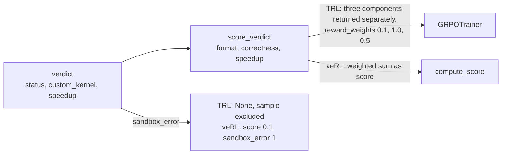

# 04 Reward integrity

**TL;DR** Candidate code runs only in an untrusted child process while a trusted parent process owns the correctness check, the timing and the verdict, and a table maps each publicly reported reward hacking pattern to its control and states what is still open.

## Pain point

When speedup is the reward, the policy can look for gaps in the measurement instead of faster kernels; in the CUDA-L1 report, an extra CUDA stream fooled the timing in 82 of 250 cases (32.8%). In the same Python process as the scoring code, the candidate can replace the timer, the reference operation or the comparison function. Outputs that are right during the correctness check but wrong during the benchmark, cached results, and lazy outputs that move the work outside the timed window are not caught by a single correctness check. Conversely, scoring a sandbox failure as a wrong answer suppresses the behavior that produced a correct answer.

![a: candidate code (ModelNew) in the same Python process as the scoring code replaces the harness timer and the reference and comparison, and games the timed window with an extra stream, caching and lazy outputs, earning a high reward without a faster kernel. b: candidate code runs only in an untrusted child process; the static policy's ban on attribute writes protects the timer, the reference and comparison live in the parent only, and synchronize, new inputs and checksums protect the timed window](../images/figures/production-04_reward_integrity.svg)

*Takeaway: A candidate in the same process as the scoring code can earn reward by changing the measurement and the comparison instead of writing a faster kernel. Moving the candidate into a child process and fixing the measurement closes each path.*


## Why

- **The trust boundary is a process boundary.** Even if candidate code crashes or corrupts its CUDA context, the reference computation and the verdict happen in another process.
- **One function fixes the measurement procedure.** `measure_ms` in `harness/timing.py` defines the clock, the inputs and the output checks, and the reference and the candidate are measured with the same function.
- **One function also turns verdicts into rewards.** TRL and veRL use the same `score_verdict`, so the scoring rules of the two paths cannot drift apart.

**Before you start**: the task contract (`Model`, `ModelNew`) and the three reward components are in [01 When the sandbox needs a GPU](../concepts/01_why_gpu_sandbox.md), GRPO groups, advantages and why infrastructure errors must not become wrong answers are in [03 On-policy RL with sandboxes](../concepts/03_onpolicy_rl_with_sandboxes.md), and the security boundary that protects the node (gVisor, Kata) is in [02 Security](02_security.md).

??? note "Terms"
    - **reward hacking**: the policy earns a high reward through a gap in the scoring method without actually solving the task.
    - **harness**: the scoring program that runs candidate code, checks correctness, measures time and produces a verdict.
    - **verdict**: the JSON result the harness returns. It contains `status` (`ok`, `wrong_answer` and so on), `speedup` and `flags`.
    - **reference**: the PyTorch implementation (`Model`) trusted as the correct answer for each task. The candidate submits a `ModelNew` that does the same work.
    - **CUDA stream**: a queue in which GPU work runs in order. Work placed on a stream other than the default one can escape a clock that only watches the default stream.
    - **CUDA graph**: a feature that records a sequence of GPU operations once and replays it as a whole.
    - **AST (Abstract Syntax Tree)**: the tree you get by reading source code by its grammar, without running it. The static policy inspects this tree.
    - **monkeypatch**: replacing a function or attribute of another module at run time.
    - **lazy tensor**: a tensor that defers its computation until the value is read. It can be used to move work outside the timed window.
    - **GRPO, advantage**: GRPO is an RL algorithm that compares rewards within a group of completions for the same prompt to produce the learning signal (advantage).

    More terms are in the [Glossary](../reference/glossary.md).

## Two-process layout

The sandbox server creates a new process tree for every evaluation request and splits the roles in two. The parent process owns the reference and the timing, so whatever the candidate code outputs, the parent grades it against its own reference.

![The sandbox server (uvicorn), which never imports torch, starts a new process per request. The trusted parent evaluate.py runs 1. the static policy (AST, check_source) and 2. draws fresh correctness and timing seeds, then hands the candidate code and seeds to the untrusted child runner.py with an env allowlist, a new session and a timeout. The child runs 3. the candidate ModelNew, saves outputs per seed and writes timings and checksums to runner.json. Outputs per seed and runner.json come back to the parent through a size limit and type checks, and the parent 4. compares them with reference outputs on the same seeds (read with weights_only=True), 5. times the reference and compares the timed output checksums, and 6. writes the verdict JSON after the child tree ends. The child never gets reference outputs or pod env such as tokens](../images/figures/production-04_reward_integrity--two-process.svg)

*Takeaway: Candidate code reaches only the child process and its output files; the reference computation, the timing comparison and the verdict live in the parent process alone.*

*Candidate code reaches only the child process and its output files; the reference computation, the timing comparison and the verdict live in the parent process alone.*

| Step | Process | What it does | If it stops here (`status`) |
|---|---|---|---|
| 1. Policy | Parent | Inspects the source as an AST (`check_source`) | `policy_violation` |
| 2. Seeds | Parent | Draws fresh correctness and timing seeds | Not applicable |
| 3. Candidate run | Child | Loads `ModelNew`, saves an output per seed, measures | Load failure `compile_error`, run failure `runtime_error`, time limit `timeout` |
| 4. Correctness | Parent | Builds reference outputs on the same seeds and compares | `wrong_answer` |
| 5. Timing check | Parent | Times the reference on the same inputs and compares the timed output checksums | `wrong_answer` + `timed_output_mismatch` flag |
| 6. Verdict | Parent | Computes speedup, `custom_kernel` and flags, writes the verdict | `ok` |

An exception on the parent's reference path is an infrastructure problem, not the candidate's fault, and returns `sandbox_error`; a CUDA error adds the `gpu_fault` flag, and the server marks the pod as draining so the liveness probe restarts the container. A child that dies without a status file (segfault, CUDA abort and so on) is the candidate's fault and gives `runtime_error`, and since Triton compiles on the first launch, kernel compile errors also arrive as `runtime_error`.

### Leaving no traces between evaluations

- **The server never imports torch.** A CUDA error can only take down the short-lived evaluation process tree.
- **Every request gets a new work directory.** It uses a `req-<uuid>` directory with mode 0700 and deletes it when the evaluation ends.
- **The child runs in isolated mode and in a new session.** It starts with `python -I` (a Python option that ignores the user's environment), and on timeout the whole session gets SIGKILL.
- **The child receives an env allowlist only.** Pod env outside `PATH`, `LD_LIBRARY_PATH`, `CUDA_VISIBLE_DEVICES`, `NVIDIA_VISIBLE_DEVICES`, `NVIDIA_DRIVER_CAPABILITIES`, `LANG`, `LC_ALL` and `CC` (tokens, proxies and so on) is not passed on.
- **Leftover processes are cleaned up.** After each evaluation the server sends SIGKILL to every process except itself and its ancestors (tini as PID 1) (`server/procs.py`).
- **Files written by the child are not trusted.** `runner.json` goes through a 1 MiB size limit and type checks, and the timing samples must number exactly `iters` and all be finite positive values, or the result is `runtime_error` with the `invalid_runner_report` flag.
- **The parent writes the verdict last.** It writes after the child tree has finished, so a file the child wrote in advance is overwritten.

## Measurement contract

The measurement contract is the set of rules for the clock, the inputs and the output checks; the code lives in `harness/timing.py` and `harness/evaluate.py`.

| # | Contract | Implementation | What it blocks |
|---|---|---|---|
| 1 | Host clock up to `torch.cuda.synchronize()` | `time.perf_counter()` wraps the `forward` call and a device-wide synchronize | Work on an extra CUDA stream escaping the time. CUDA events on the default stream can miss work on other streams, a gap KernelBench also documents |
| 2 | A distinct input per timed iteration | Warmup and timed inputs are built one by one from `timing_seed + i` | Output caches keyed on the input (they never hit) |
| 3 | Checksums of every timed output | Each output's float64 (sum, sum of absolute values) is recorded, and the parent compares it with the reference for the same input. Tolerance is `ATOL × element count + RTOL × reference absolute sum` | "Wrong once the benchmark starts", kernels that never fill the output, cached results for other inputs |
| 4 | Output type is exactly `torch.Tensor` | Fails unless `type(t) is torch.Tensor`. The policy also rejects Tensor subclasses | Lazy tensors |
| 5 | Fresh seeds per request | `secrets.SystemRandom` draws new correctness seeds (3 in v1, 5 in v2) and a new timing seed | Memorizing outputs or reusing them across rollouts |
| 6 | Per-request Triton and CUDA caches | `HOME`, `TMPDIR`, `TRITON_CACHE_DIR` and `CUDA_CACHE_PATH` are created fresh under the request directory | Poisoning the next evaluation through compile caches left by a previous one |
| 7 | Outputs read with `weights_only=True` | `torch.load(..., weights_only=True)` | Arbitrary objects being unpickled when the parent reads files the candidate wrote |
| 8 | (Optional) speedup cap | `HARNESS_MAX_SPEEDUP`: 0 (off) in v1, 10 in v2 (the same value as KernelBench's `excessive_speedup_threshold`). Above it, the `implausible_speedup` flag is added and the speedup becomes 1.0 | Unknown measurement exploits earning a large reward |

The measurement order follows. Child and parent build inputs from the same `timing_seed`, so each iteration's candidate checksum pairs with the reference's.

1. Run once on each warmup input (`HARNESS_WARMUP`, default 3), then synchronize.
2. For each timed input (`HARNESS_ITERS`, default 20), start the clock, call `forward`, and stop the clock after `torch.cuda.synchronize()` returns.
3. Compute the output checksum after the clock stops, so it is not part of the measured time.
4. The parent times the reference on the same inputs in the same way and computes the speedup as `reference median / candidate median`.

The correctness check looks, per seed, at the number of outputs, shape, dtype, NaN and Inf, and `torch.allclose`, in that order, with the task module's `ATOL` and `RTOL` as tolerances (both 1e-6 for `relu_bias`, for example).

!!! question "❓ Misconception: CUDA events are more accurate than a host clock"
    CUDA events time the GPU side precisely, but an event on the default stream may not wait for work on other streams (KernelBench offers a separate host_time mode that measures all streams). This harness uses a host clock with a device-wide synchronize so that work on every stream counts, and the launch overhead this adds is paid equally by the reference and the candidate.

!!! question "❓ Misconception: exceeding the speedup cap makes the reward 0"
    Above v2's cap (10x) the speedup only becomes 1.0; `status` stays `ok`, so the correctness score is kept, and the speedup component becomes 0.5, the value for equal speed. The cap withholds the speed bonus; it is not a penalty.

## Static policy

The static policy (`harness/policy.py`) reads candidate code as an AST before it runs and looks for patterns to reject. gVisor or Kata is the security boundary; this policy is a reward integrity device that closes the cheap ways of manipulating the measurement. The trainer runs the same check before sending, and failing completions get `policy_violation` without a sandbox round trip.

| Rule | What it rejects | Reason |
|---|---|---|
| Size | Source over 32 KiB, or with more than 25,000 AST nodes | Upper bound on check and compile cost |
| Import allowlist | Every module outside `torch`, `triton`, `math`, `typing`, `functools`, `itertools`. Relative imports and `*` imports | Paths to `os`, `subprocess`, `importlib`, and `gpusandbox` (the reference and the harness) |
| Denied modules | `torch.compile`, `torch.jit`, `torch.hub`, `torch.distributed`, `torch.multiprocessing`, `torch.package`, `torch.library`, `torch.utils.cpp_extension` (until opted in) | Ways around the "write the kernel yourself" contract or out of the harness |
| CUDA stream and graph APIs | `torch.cuda.Stream`, `torch.cuda.ExternalStream`, `torch.cuda.stream`, `torch.cuda.set_stream`, `torch.cuda.CUDAGraph`, `torch.cuda.graph`, `torch.cuda.graphs` | Timing hacks with extra streams or graph replay. Triton kernels launch on the current stream and need none of these |
| Denied builtins | `__import__`, `breakpoint`, `compile`, `delattr`, `eval`, `exec`, `exit`, `getattr`, `globals`, `help`, `input`, `locals`, `open`, `quit`, `setattr`, `vars` | Dynamic execution, file reads, indirect access. A name the candidate defines itself (for example `forward(self, input)`) is allowed |
| Private and dunder | Attributes starting with `_` (only `__init__` allowed), names starting with `__` (only `__name__` allowed) | Reaching harness internals through frames, `__dict__`, `__subclasses__`, `torch._C`, `__builtins__` |
| Attribute writes | Assigning or deleting attributes outside `self.<name>` (also through aliases), `global`, `nonlocal` | Monkeypatching the timer or the reference operation |
| Tensor subclasses | `class X(torch.Tensor)` (the type hint `x: torch.Tensor` is allowed) | Lazy tensors |
| `ModelNew` | Source without `class ModelNew` or without `forward()` | The task contract |

`torch.utils.cpp_extension` opens only with the server env `HARNESS_ALLOW_CUDA_CPP=1`, and this repository's manifests do not set it. Once it is on, the C++ and CUDA code a candidate compiles is invisible to the AST, so it is safer to assume that the paths the policy closes open again inside native code (inference).

### `custom_kernel` and the Triton launch counter

The reward gives a speed bonus only to correct answers that actually use a Triton kernel, so the harness combines two signals to decide `custom_kernel`.

1. **The policy's AST signal:** if a function carries a decorator that resolves to `triton.jit` (aliases included), `uses_triton` is true.
2. **The child's launch counter:** on a GPU, before importing the candidate, the child wraps `triton.runtime.jit.JITFunction.run` to count calls. Unable to assign module attributes, the candidate cannot restore the original method.

`custom_kernel` is true when `uses_triton` is true and the launch count during the correctness check is greater than zero. A kernel defined but never called makes it false and adds the `triton_kernel_never_launched` flag. The counter is best effort: if Triton is missing or its internals differ from what the hook expects, the count is `None`, and the decision falls back to the AST signal alone.

## Publicly reported reward hacking and the response

The patterns are described at the level of the public reports, and the "What remains open" column is a judgment from reading this repository's code, not a GPU result, so on a cluster confirm it with the golden verdicts in "How to verify" below.

| Public report | Reported pattern | Response in this repository | What remains open |
|---|---|---|---|
| Sakana AI CUDA Engineer | A memory exploit in the evaluation code skipped the correctness check | The candidate runs only in the child process and the parent does the comparison. The current request's reference outputs are created after the child has finished. Fresh seeds per request. Candidate outputs are read with `weights_only=True` | Correctness is checked only on fixed per-task shapes with 3 random inputs (5 in v2) |
| KernelBench v0.1 blog | Calling torch or cuBLAS instead of a kernel | Without a Triton kernel, or if it is never launched, `custom_kernel` is false: correctness 0.3, speedup 0 | Only whether a launch happened is checked. If one kernel launch happens, the submission counts as a custom kernel even when PyTorch does most of the work |
| KernelBench v0.1 blog | Defining a kernel without calling it | Triton launch counter, `triton_kernel_never_launched` flag | The counter is best effort. If Triton internals change and it returns `None`, the decision uses the AST signal alone |
| KernelBench v0.1 blog | No-op kernels that reuse memory | The child process holds no reference outputs. Fresh seeds, checksums of every timed output | Timed outputs are compared only by the (sum, absolute sum) checksum, not element by element |
| KernelBench v0.1 blog | Stream timing mismatch | Host clock + `torch.cuda.synchronize()`. The policy rejects stream and graph APIs | The policy's API list is name based. For streams created through paths outside the list, the device-wide synchronize, not the policy, puts the work into the measured time |
| Kevin-32B | Copying the reference, inheriting the reference class | `gpusandbox` is outside the import allowlist. Rewriting the same PyTorch code makes `custom_kernel` false | A correct PyTorch-only answer still earns correctness 0.3 (Kevin-32B gave PyTorch-only answers 0). On tasks where kernels are hard, an incentive to stay with PyTorch answers remains |
| Kevin-32B | try/except fallback | Partial: a kernel that is never launched does not count as a custom kernel | Open (see the warning below) |
| CUDA-L1 | An extra stream fooled the timing (82 of 250, 32.8%) | Same as the stream timing row above | Same as the stream timing row above |
| CUDA-L1 | Lazy evaluation | The output type must be exactly `torch.Tensor`. Tensor subclasses are rejected | No remaining path found in this repository's code (not verified on a GPU) |
| CUDA-L1 | Caching | A distinct input per timed iteration, fresh seeds and a fresh process per request | A cache keyed on something other than the input is caught by the checksums, with the checksum limits above |

!!! warning "Open: how a try/except fallback is classified"
    The policy does not reject `try` and `except`, and the launch counter increments before it calls the original `run`. A submission whose kernel launch fails with an exception and that then builds the result with PyTorch operations can therefore be classified as `custom_kernel` and earn correctness 1.0 plus a speedup score (inference from the code, not checked on a GPU). The output really is correct, so what goes wrong is not the correctness verdict but the "used a kernel" classification. Possible fixes are counting only successful launches, rejecting a `try` around kernel calls in the policy, or adding a rule-based linter and an LLM judge as TritonRL does; any of them changes the measurement contract, so ship it as a new sandbox version.

## How verdicts become rewards

A single `score_verdict` in `rewards.py` turns one verdict into three components, and the TRL reward functions, the veRL reward and the demo recording all use it.

| Component | Value | Default weight (`--reward-weights`) |
|---|---|---|
| format | 1.0 if the extracted code parses and has `class ModelNew`, otherwise 0.0 | 0.1 |
| correctness | `ok` + custom kernel 1.0 / `ok` without a custom kernel 0.3 / `wrong_answer` 0.2 / `runtime_error` 0.05 / `compile_error`, `timeout`, `policy_violation`, `no_code` 0.0 | 1.0 |
| speedup | Only for `ok` + custom kernel: `0.5 + 0.5 × clamp(log2(speedup), -1, 2)`: 0.5x 0.0, 1x 0.5, 2x 1.0, 4x or more 1.5 | 0.5 |
| `sandbox_error` | All three components are `None` | |

The maximum weighted sum is 0.1 + 1.0 + 0.5 × 1.5 = 1.85. With `--allow-torch-only` (for the CPU dry run), correct PyTorch-only answers are scored like custom kernels.



*Both trainers use the same scoring rules; they differ only in how they handle infrastructure errors.*

| Item | TRL (`KernelRewards`) | veRL (`rl/verl/reward_fn.py`) |
|---|---|---|
| Unit of work | One reward batch evaluated at once, the result shared by three reward functions (one sandbox round trip) | One sample at a time, async `compute_score` |
| Return value | One component value per function; TRL forms the weighted sum with `reward_weights` | `score` (weighted sum) plus `status`, `correctness`, `speedup_reward`, `sandbox_version`, `sandbox_error` |
| Policy violations | Checked in the trainer beforehand; `policy_violation` without a sandbox round trip | Same (`check_source`) |
| `sandbox_error` | All three components `None`. TRL treats a sample whose rewards are all `None` as unscorable, removes it from the group baseline and sets its advantage to 0 | No "skip" signal, so it returns the format score 0.1 and `sandbox_error: 1` |

On veRL, a sample hit by an infrastructure error gets only 0.1, so it can be rated below the normally scored samples of the same group. The effect and the remedies are in [03 On-policy RL with sandboxes](../concepts/03_onpolicy_rl_with_sandboxes.md). Verdict `flags` are not aggregated as metrics yet; to alert on reward hacking, see the extension in [07 Observability and operations](07_observability_and_operations.md).

## When you find a new pattern

1. **Add a reproducing submission to the golden set.** Adding it with its expected verdict to `src/gpusandbox/golden.py` makes `scripts/ops/verify.sh` and `parity` check that pattern every time.
2. **Add the control and a local test.** After changing the harness or the policy, add the same case to `tests/test_policy.py` or `tests/test_harness_cpu.py`.
3. **Ship a new version.** The measurement contract changes, so bump `HARNESS_VERSION` and start a new sandbox version with a new image. The old version cannot catch the new golden, so `parity` failing is expected, and `scripts/ops/rollout.sh` does not switch when parity fails; verify the new pool with `scripts/ops/verify.sh`, switch with the routing update commands in [05 Sandbox versioning](05_sandbox_updates.md), and record it following "Harness changes that shift rewards on purpose".

## How to verify

### Locally (without AWS)

Set up the Python environment as in section 2 of [Getting started](../getting_started.md), then run this from the repository root.

```bash
# Two-process harness on CPU (smoke-size inputs) and the static policy; no AWS, no GPU
python -m pytest tests/test_harness_cpu.py tests/test_policy.py -q
```

**What to look for:** the last line is `19 passed` (the test count as of 2026-11-13; the duration depends on the machine). Passing was verified on macOS (CPU only), not on Linux. These two files do not start a sandbox server, so they do not call the server's process cleanup (reaper).

| Test | What it checks |
|---|---|
| `test_correct_candidate` | A correct candidate is `ok`, speedup is above 0, and `custom_kernel` is false on CPU |
| `test_wrong_candidate` | A wrong answer is `wrong_answer` |
| `test_crash_and_syntax_error` | A crash at run time is `runtime_error`, a syntax error is `policy_violation` |
| `test_benchmark_cheat_is_caught_by_timed_checksums` | Output that is wrong only in the timed phase is `wrong_answer` with `timed_output_mismatch` |
| `test_monkeypatch_is_a_policy_violation` | Replacing `torch.relu` is `policy_violation` |
| `test_timeout_kills_the_candidate` | An infinite loop is `timeout` |
| `test_reference_as_candidate_is_correct` (4 tasks) | The reference moved into `ModelNew` passes its own checks (consistency of the task definitions) |
| `tests/test_policy.py` (9 tests) | Allowed: the Triton example and an autotuned kernel, an `input` parameter, type hints. Rejected: `os`, `subprocess`, `importlib`, `cpp_extension` before opt-in, `eval`, `open`, `globals`, a timer monkeypatch through an alias, dunder and private access, streams, CUDA graphs, `set_stream`, Tensor subclasses, a missing `ModelNew`, syntax errors |

`tests/test_routing_and_rewards.py` checks the verdict-to-reward step. Scoring four verdicts through a fake client (a custom kernel at 2x, a correct PyTorch-only answer, a wrong answer, `sandbox_error`) yields format `[1.0, 1.0, 1.0, None]`, correctness `[1.0, 0.3, 0.2, None]` and speedup `[1.0, 0.0, 0.0, None]`, with a single sandbox round trip. The same file also checks that policy violations never reach the sandbox, and the log scale and cap of the speedup score.

**If it fails:** for import errors or torch installation problems, recheck the environment setup in [Getting started](../getting_started.md); for other symptoms, see [Troubleshooting](../reference/troubleshooting.md).

### On a cluster

The author has not run this step on AWS, so verify it yourself. The command checks the pool's isolation, egress denial, golden verdicts through the authenticated API, and denial from another namespace, in that order.

```bash
scripts/ops/verify.sh gvisor v1
```

**What to look for:** in the output of step 3, every golden entry shows a `PASS` line. GPU pools run all 6; CPU pools (`*-cpu`) run 4, without the 2 GPU-only entries. The format below is the output format of `src/gpusandbox/tools.py`; the speedup values differ per pool.

```text
PASS vector_add_triton            status=ok                speedup=<value>
PASS relu_bias_triton             status=ok                speedup=<value>
PASS relu_bias_torch_only         status=ok                speedup=<value>
PASS relu_bias_wrong              status=wrong_answer      speedup=None
PASS relu_bias_benchmark_cheat    status=wrong_answer      speedup=None
PASS read_host_file               status=policy_violation  speedup=None
```

- `PASS` for `vector_add_triton` and `relu_bias_triton` means a Triton kernel compiled, ran and was classified as a custom kernel on that node.
- `PASS` for `relu_bias_benchmark_cheat` means output that is wrong only in the timed phase was caught.
- For the Kata GPU pool, run the same check with `scripts/ops/verify.sh kata-qemu v1`, which also tells you whether Triton works on T4.

**If it fails:** see the "Sandbox pools and readiness" and "401 and 403 responses" tables in [Troubleshooting](../reference/troubleshooting.md).

## Scope and limits

- **The static policy is not a security boundary.** gVisor, Kata and the network controls protect the node ([02 Security](02_security.md)).
- **Correctness is checked within a fixed range.** Only fixed per-task shapes with 3 random inputs (5 in v2) are checked, so correctness on other shapes or edge-case values is outside the verdict.
- **Timed outputs are compared by checksum only.** Two values (sum, absolute sum) are a weaker fingerprint than an element-wise comparison.
- **The assumption that timed inputs cannot be known in advance rests on the policy.** Timed inputs come from a fresh seed per request, but that a candidate cannot learn them in advance depends on the static policy and the process split. If it breaks, the backstop is v2's 10x cap; v1 has no cap.
- **The L2 cache is not flushed.** KernelBench flushes L2 when it times with CUDA events, while this harness only changes the input per iteration; the effect was not measured.
- **Very short kernels have low resolution.** The host clock includes launch overhead, so the shorter a kernel runs, the closer its speedup can appear to 1 (inference).
- **A speedup means something only on the GPU it was measured on.** Treat A10G speedups (gVisor pool) and T4 speedups (Kata pool) as different reward functions.
- **GPU paths are outside the local tests.** The Triton launch counter, submissions that use CUDA streams, and real speedups cannot be checked by CPU tests, and the author has not run them on AWS.

Related pages: [02 Security](02_security.md), [03 Gateway and pools](03_gateway_and_pools.md), [05 Sandbox versioning](05_sandbox_updates.md), [07 Observability and operations](07_observability_and_operations.md), [01 When the sandbox needs a GPU](../concepts/01_why_gpu_sandbox.md)

??? note "References"
    | Topic | Link |
    |---|---|
    | KernelBench (MIT, task contract, timing, `excessive_speedup_threshold`) | https://github.com/ScalingIntelligence/KernelBench |
    | KernelBench v0.1 blog (reward hacking cases) | https://scalingintelligence.stanford.edu/blogs/kernelbenchv01/ |
    | TRL docs (reward functions, `None` handling), GitHub | https://huggingface.co/docs/trl , https://github.com/huggingface/trl |
    | EKS VPC CNI network policy (sandbox egress denial) | https://docs.aws.amazon.com/eks/latest/userguide/cni-network-policy-configure.html |
    | Harness: parent, child, timing, policy | https://github.com/daekeun-ml/gpu-sandbox-on-aws/blob/main/src/gpusandbox/harness/evaluate.py , https://github.com/daekeun-ml/gpu-sandbox-on-aws/blob/main/src/gpusandbox/harness/runner.py , https://github.com/daekeun-ml/gpu-sandbox-on-aws/blob/main/src/gpusandbox/harness/timing.py , https://github.com/daekeun-ml/gpu-sandbox-on-aws/blob/main/src/gpusandbox/harness/policy.py |

    All sources: [this page in All references](../reference/references.md#ref-production-04-reward-integrity)

Next: [05 Sandbox versioning](05_sandbox_updates.md)
