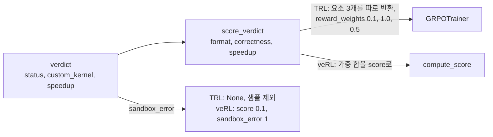

# 04 Reward 무결성

!!! info "TL;DR"
    후보 코드는 신뢰하지 않는 자식 프로세스에서만 실행합니다. 자식은 후보의 실행 시간과 출력 checksum을 기록하고, 신뢰하는 부모 프로세스는 같은 입력으로 reference의 실행 시간을 잽니다. 그런 다음 출력을 정답과 비교하고 speedup을 계산해 verdict를 내립니다.

## 측정값을 reward로 쓸 때

학습 로그에서 처음으로 speedup이 크게 올랐다면, 실제 계산이 빨라졌는지부터 확인합니다. 출력이 틀리거나 GPU 작업이 끝나기 전에 시간을 기록하면 speedup은 높게 나와도 그 결과로 매긴 점수를 학습에 반영하기 어렵습니다. reward를 계산하기 전에 출력과 측정 시간이 유효한지부터 확인하세요.


## 채점기가 결과를 검증하는 방법

제출 코드를 실행하는 프로세스와 출력을 기준 답과 대조해 verdict를 내리는 프로세스를 분리합니다. 그다음 입력을 바꾸어 정확성을 확인하고, GPU 작업을 끝까지 기다린 뒤 시간을 기록합니다. 운영 중 갑자기 높은 speedup이 보이면 평균 reward만 보지 말고 같은 평가의 verdict와 측정 관련 flag를 함께 확인하세요.

??? note "세부 조건과 예외"
    speedup을 reward로 주면 policy는 더 빠른 커널을 만드는 대신 측정 방식의 허점을 찾을 수 있습니다.

    - **추가 CUDA stream**: CUDA-L1 보고에서는 추가 CUDA stream이 250건 중 82건(32.8%)에서 timing을 속였습니다.
    - **채점 코드와 후보가 같은 Python 프로세스에 있으면**: 후보가 timer, reference 연산, 비교 함수를 바꿔치기할 수 있습니다.
    - **정답 비교를 한 번만 하면**: 정확성 검사 때만 맞고 벤치마크 때 틀리는 출력, 결과 캐싱, 계산을 측정 구간 밖으로 미루는 lazy 출력을 찾아낼 수 없습니다.
    - **반대로 샌드박스 장애를 오답으로 채점하면**: 정답을 낸 completion이 낮은 reward를 받아, policy가 그런 출력을 오히려 덜 만들게 됩니다.

    - **신뢰 경계를 프로세스 단위로 나눕니다.** 후보 코드가 크래시하거나 CUDA context를 망가뜨려도 별도 프로세스가 reference를 계산하고 verdict를 기록합니다.
    - **측정 절차를 함수 하나로 고정합니다.** `harness/timing.py`의 `measure_ms`는 시간을 재는 방법과 입력, 출력 검사 절차를 정합니다. reference와 후보 코드 모두 이 함수로 측정합니다.
    - **verdict를 reward로 바꾸는 규칙도 한 함수에 둡니다.** TRL과 veRL 모두 `score_verdict`로 점수를 계산하므로 같은 채점 규칙을 따릅니다.

**읽기 전에**　과제 계약(`Model`, `ModelNew`)과 reward 3요소는 [01 GPU 샌드박스가 필요한 경우](../concepts/01_why_gpu_sandbox.md)에, GRPO group, advantage, 인프라 오류를 오답으로 처리하지 않는 이유는 [03 On-policy RL과 샌드박스](../concepts/03_onpolicy_rl_with_sandboxes.md)에, 노드를 보호하는 보안 경계(gVisor, Kata)는 [02 보안](02_security.md)에 있습니다.

??? note "용어"
    - **reward hacking**: policy가 과제를 실제로 풀지 않고 채점 방식의 허점을 이용해 높은 reward를 받는 현상입니다.
    - **harness**: 후보 코드를 실행하고 정답 비교와 시간 측정을 거쳐 verdict를 내리는 채점 프로그램입니다.
    - **verdict**: harness가 반환하는 JSON 판정입니다. `status`(`ok`, `wrong_answer` 등), `speedup`, `flags`가 들어 있습니다.
    - **reference**: 과제마다 정답으로 신뢰하는 PyTorch 구현(`Model`)입니다. 후보는 같은 일을 하는 `ModelNew`를 제출합니다.
    - **CUDA stream**: GPU 작업이 순서대로 실행되는 대기열입니다. 기본 stream이 아닌 stream에 넣은 작업은 기본 stream만 기준으로 측정하는 타이머에서 빠질 수 있습니다.
    - **CUDA graph**: 여러 GPU 작업을 한 번 기록해 두고 그 전체를 다시 실행하는 기능입니다.
    - **AST (Abstract Syntax Tree)**: 소스 코드를 실행하지 않고 문법 구조로 파싱한 트리입니다. 정적 정책은 이 트리를 검사합니다.
    - **monkeypatch**: 실행 중에 다른 모듈의 함수나 속성을 바꿔치기하는 기법입니다.
    - **lazy tensor**: 값을 읽는 순간까지 계산을 미루는 텐서입니다. 계산을 측정 구간 밖으로 옮기는 데 쓰일 수 있습니다.
    - **GRPO, advantage**: GRPO는 같은 prompt에서 나온 completion 묶음(group) 안에서 reward를 비교해 학습 신호(advantage)를 만드는 RL 알고리즘입니다.

    더 많은 용어는 [용어 사전](../reference/glossary.md)에 있습니다.

## 두 프로세스 구조

샌드박스 서버는 평가 요청마다 새 프로세스 트리를 만들고 부모와 자식 프로세스에 역할을 나눕니다. 후보의 실행 시간과 출력 checksum은 자식이 측정해 보고하고, reference 계산과 측정, 결과 비교는 부모가 맡습니다. 후보 코드가 무엇을 출력하든 부모가 자신의 reference로 채점합니다.

![torch를 import하지 않는 샌드박스 서버(uvicorn)가 요청마다 새 프로세스를 시작합니다. 신뢰하는 부모 evaluate.py가 1. 정적 정책 검사(AST, check_source)와 2. 요청마다 새 seed 생성(정확성 seed, timing seed)을 한 뒤, 후보 코드와 seed를 신뢰하지 않는 자식 runner.py에 전달합니다(env allowlist, 새 session, timeout). 자식은 3. 후보 ModelNew를 실행해 seed별 출력을 저장하고, timing과 checksum을 runner.json에 씁니다. seed별 출력과 runner.json이 부모로 돌아옵니다. runner.json은 1 MiB 크기 제한과 타입 검사를 거칩니다. 부모는 4. seed별 출력을 크기 검사 없이 weights_only=True로 읽어 같은 seed로 만든 reference 출력과 비교하고, 5. reference timing과 timed 출력 checksum을 비교하고, 6. runner.py가 끝난 뒤 마지막에 verdict JSON을 작성합니다. 자식에게는 reference 출력과 토큰 같은 pod env가 없습니다.](../images/figures/production-04_reward_integrity--two-process.ko.svg)

*그림 요약: 후보 코드는 자식 프로세스에서 실행하고, reference 계산, 시간 비교, verdict 작성은 부모 프로세스에서만 합니다. 두 프로세스는 같은 pod와 UID를 쓰므로 파일 접근까지 나뉘지는 않습니다([02 보안](02_security.md)의 "다루지 않는 위험" 3).*

| 단계 | 프로세스 | 하는 일 | 여기서 끝나면 (`status`) |
|---|---|---|---|
| 1. 정책 | 부모 | 소스를 AST로 검사 (`check_source`) | `policy_violation` |
| 2. seed | 부모 | 정확성 seed와 timing seed를 새로 생성 | 해당 없음 |
| 3. 후보 실행 | 자식 | `ModelNew` 로드, seed마다 출력 저장, 측정 | 로드 실패 `compile_error`, 실행 실패 `runtime_error`, 시간 초과 `timeout` |
| 4. 정답 비교 | 부모 | 같은 seed로 reference 출력을 만들어 비교 | `wrong_answer` |
| 5. 측정 검증 | 부모 | 같은 입력으로 reference 시간을 측정하고 timed 출력 checksum 비교 | `wrong_answer` + `timed_output_mismatch` flag |
| 6. verdict | 부모 | speedup, `custom_kernel`, flags를 계산해 verdict 작성 | `ok` |

- **부모의 reference 경로에서 예외가 나면**: 후보 코드가 아니라 인프라의 문제로 판단해 `sandbox_error`를 반환합니다. CUDA 오류였다면 `gpu_fault` flag가 붙고, 이때 서버는 그 pod를 draining 상태로 바꿉니다. 그러면 liveness probe가 실패해 컨테이너가 재시작됩니다.
- **자식이 상태 파일을 쓰지 않고 종료되면(segfault, CUDA abort 등)**: 후보 코드의 문제로 보고 `runtime_error`로 처리합니다. Triton은 첫 launch 때 커널을 컴파일하므로 커널 컴파일 오류도 `runtime_error`입니다.

### 평가 사이에 상태를 남기지 않는 장치

- **서버는 torch를 import하지 않습니다.** CUDA 오류가 발생해도 수명이 짧은 평가 프로세스 트리만 종료됩니다.
- **요청마다 작업 디렉터리를 새로 만듭니다.** 권한 0700인 `req-<uuid>` 디렉터리를 쓰고, 평가가 끝나면 삭제합니다.
- **자식은 격리 모드와 새 session으로 실행합니다.** `python -I`(사용자 환경의 영향을 받지 않는 Python 실행 옵션)로 실행하고, timeout이 나면 session 전체를 SIGKILL합니다.
- **자식 프로세스에는 allowlist에 있는 env만 전달합니다.** `PATH`, `LD_LIBRARY_PATH`, `CUDA_VISIBLE_DEVICES`, `NVIDIA_VISIBLE_DEVICES`, `NVIDIA_DRIVER_CAPABILITIES`, `LANG`, `LC_ALL`, `CC` 외의 pod env(토큰, 프록시 등)는 전달하지 않습니다.
- **남은 프로세스를 정리합니다.** 평가가 끝나면 서버는 자신과 조상 프로세스(PID 1의 tini)를 제외한 모든 프로세스를 SIGKILL합니다(`server/procs.py`).
- **자식이 쓴 파일은 신뢰하지 않습니다.**
    - `runner.json`은 1 MiB 크기 제한과 타입 검사를 거칩니다.
    - seed별 출력 텐서 파일은 크기 검사 없이 `weights_only=True`로 읽은 뒤 shape, dtype, 값을 reference와 비교합니다.
    - timing 샘플은 개수가 `iters`와 같고 모두 유한한 양수여야 하며, 이 조건을 만족하지 않으면 `runtime_error`와 `invalid_runner_report` flag가 붙습니다.
- **최종 verdict는 부모 프로세스가 기록합니다.** runner가 종료되면 부모가 결과를 검증해 verdict 파일에 저장합니다. 자식이 미리 만든 파일이 있어도 이때 덮어씁니다. 평가가 끝나면 서버가 남은 프로세스를 정리합니다.

## 실행 시간 측정 기준

<span id="측정-계약"></span>

후보가 정답을 냈는지와 실행 시간을 제대로 쟀는지는 따로 확인합니다. 기준 답과 일치해야 성능 비교가 의미 있고, GPU 작업을 끝까지 기다려야 기록한 시간이 실제 실행 시간을 반영합니다. 그 결과를 어떤 reward로 바꾸는지는 학습 쪽 규칙에서 확인합니다.

아래 표에서 시간을 잴 때 사용하는 시계와 입력, 출력 검사 방법을 확인하세요. 구현은 `harness/timing.py`와 `harness/evaluate.py`에 있습니다.

| # | 측정 기준 | 구현 | 막는 것 |
|---|---|---|---|
| 1 | host clock으로 `torch.cuda.synchronize()`까지 측정 | `time.perf_counter()`로 `forward` 호출과 장치 전체 동기화를 감쌈 | 추가 CUDA stream의 작업이 시간에서 빠지는 것 |
| 2 | timed iteration마다 다른 입력 | warmup과 측정 입력을 `timing_seed + i`로 하나씩 따로 만듦 | 입력을 key로 한 출력 캐시 (적중하지 않음) |
| 3 | 모든 timed 출력의 checksum 비교 | 출력마다 float64 (합, 절댓값 합)을 기록하고, 부모가 같은 입력의 reference와 비교 | "벤치마크가 시작되면 틀리기", 출력을 채우지 않는 커널, 다른 입력의 캐시 결과 |
| 4 | 출력 타입이 정확히 `torch.Tensor` | 출력이 리스트나 튜플이면 원소마다 검사해, `type(t) is torch.Tensor`가 아닌 것이 있으면 실패. 정책이 Tensor 상속도 거부 | lazy tensor |
| 5 | 요청마다 새 seed | `secrets.SystemRandom`으로 정확성 seed(v1 3개, v2 5개)와 timing seed를 새로 생성 | 출력을 하드코딩하거나 rollout 사이에 재사용하는 것 |
| 6 | 요청별 Triton, CUDA 캐시 | `HOME`, `TMPDIR`, `TRITON_CACHE_DIR`, `CUDA_CACHE_PATH`를 요청 디렉터리 아래에 새로 만듦 | 이전 평가의 컴파일 캐시가 다음 평가에 영향을 주는 것 |
| 7 | 출력은 `weights_only=True`로 읽음 | `torch.load(..., weights_only=True)` | 후보가 쓴 파일을 읽는 순간 임의 객체가 unpickle되는 것 |
| 8 | (선택) speedup 상한 | `HARNESS_MAX_SPEEDUP`: v1은 0(끔), v2는 10 | 아직 발견되지 않은 측정 exploit이 큰 reward를 받는 것 |

- **계약 1이 필요한 이유**: 기본 stream의 CUDA event만 보면 다른 stream의 작업을 놓칠 수 있고, KernelBench도 이 문제를 문서화합니다.
- **계약 3의 허용 오차**: `ATOL × 원소 수 + RTOL × reference 절댓값 합`입니다.
- **계약 8의 상한**: v2의 10은 KernelBench `excessive_speedup_threshold`와 같은 값입니다. 넘으면 `implausible_speedup` flag를 붙이고 speedup을 1.0으로 바꿉니다.

자식과 부모는 같은 `timing_seed`로 입력을 만들므로, iteration마다 후보 출력과 reference 출력의 checksum을 하나씩 대응시켜 비교할 수 있습니다.

1. warmup 입력(`HARNESS_WARMUP`, 기본 3개)으로 한 번씩 실행한 뒤 동기화합니다.
2. 측정 입력(`HARNESS_ITERS`, 기본 20개)마다 타이머를 시작하고, `forward`를 호출하고, `torch.cuda.synchronize()`가 끝나면 타이머를 멈춥니다.
3. 타이머를 멈춘 뒤 출력의 checksum을 계산하므로, checksum 계산 시간은 측정 시간에 포함되지 않습니다.
4. 부모가 같은 입력으로 reference 시간을 같은 방식으로 측정하고, speedup을 `reference 중앙값 / 후보 중앙값`으로 구합니다.

정답 비교는 seed마다 출력 개수, shape, dtype, NaN과 Inf, `torch.allclose`를 차례로 확인하고, 허용 오차는 과제 모듈의 `ATOL`, `RTOL`(예: `relu_bias`는 둘 다 1e-6)입니다.

!!! question "❓ 오해: CUDA event로 측정하는 쪽이 host clock보다 정확하다"
    CUDA event는 GPU 쪽 시간을 정밀하게 측정하지만, 기본 stream의 event는 다른 stream에 넣은 작업을 기다리지 않을 수 있습니다(KernelBench는 모든 stream을 측정하는 host_time 모드를 별도로 제공합니다). 이 harness는 host clock과 장치 전체 동기화로 모든 stream의 작업을 측정 시간에 포함합니다. 이 방식에서 추가되는 launch overhead는 reference와 후보의 측정 시간에 똑같이 포함됩니다.

!!! question "❓ 오해: speedup 상한을 넘으면 reward가 0이 된다"
    v2 상한(10배)을 넘으면 speedup이 1.0으로 바뀔 뿐 `status`는 `ok` 그대로입니다. 따라서 correctness 점수는 유지됩니다. 커스텀 커널로 판정된 정답은 speedup 요소가 reference와 같은 속도에 해당하는 0.5가 되어 총점에 0.25(가중치 0.5 × 0.5)를 더하고, PyTorch만 쓴 정답의 speedup 요소는 상한과 관계없이 0입니다. 상한은 1x를 넘는 속도 보너스만 없앱니다.

## 정적 정책

정적 정책(`harness/policy.py`)은 후보 코드를 실행하기 전에 AST로 파싱해 거부할 패턴을 찾습니다. 보안 경계는 gVisor나 Kata가 담당하고, 이 정책은 측정을 조작하는 간단한 방법을 차단하는 reward 무결성 장치입니다. trainer도 요청을 보내기 전에 같은 검사를 실행하므로, 정책을 위반한 completion은 샌드박스 왕복 없이 `policy_violation`이 됩니다.

| 규칙 | 거부하는 것 | 이유 |
|---|---|---|
| 크기 | 32 KiB를 넘는 소스, AST 노드가 25,000개를 넘는 소스 | 검사와 컴파일 비용의 상한 |
| import 허용 목록 | `torch`, `triton`, `math`, `typing`, `functools`, `itertools` 밖의 모든 모듈. 상대 import와 `*` import | `os`, `subprocess`, `importlib`, `gpusandbox`(reference와 harness)에 접근하는 경로 |
| 금지 모듈 | `torch.compile`, `torch.jit`, `torch.hub`, `torch.distributed`, `torch.multiprocessing`, `torch.package`, `torch.library`, `torch.utils.cpp_extension`(옵트인 전) | "커널을 직접 쓴다"는 계약을 우회하거나 harness 밖에서 코드를 실행하는 경로 |
| CUDA stream, graph API | `torch.cuda.Stream`, `torch.cuda.ExternalStream`, `torch.cuda.stream`, `torch.cuda.set_stream`, `torch.cuda.CUDAGraph`, `torch.cuda.graph`, `torch.cuda.graphs` | 추가 stream이나 graph replay를 쓰는 timing hack. Triton 커널은 현재 stream에서 launch되므로 이 API가 필요 없음 |
| 금지 builtin | `__import__`, `breakpoint`, `compile`, `delattr`, `eval`, `exec`, `exit`, `getattr`, `globals`, `help`, `input`, `locals`, `open`, `quit`, `setattr`, `vars` | 동적 실행, 파일 읽기, 우회 접근. 후보가 같은 이름을 직접 정의한 경우(예: `forward(self, input)`)는 허용 |
| private, dunder | `_`로 시작하는 속성(`__init__`만 허용), `__`로 시작하는 이름(`__name__`만 허용) | frame, `__dict__`, `__subclasses__`, `torch._C`, `__builtins__`로 harness 내부에 접근하는 경로 |
| 속성 쓰기 | `self.<이름>` 밖의 속성 대입과 삭제(별칭을 거쳐도 거부), `global`, `nonlocal` | timer나 reference 연산의 monkeypatch |
| Tensor 상속 | `class X(torch.Tensor)` (타입 힌트 `x: torch.Tensor`는 허용) | lazy tensor |
| `ModelNew` | `class ModelNew`가 없거나 `forward()`가 없는 소스 | 과제 계약 |

`torch.utils.cpp_extension`은 서버 env `HARNESS_ALLOW_CUDA_CPP=1`을 설정할 때만 허용되고, 이 저장소의 매니페스트는 이 변수를 설정하지 않습니다. 이 변수를 켜면 후보가 컴파일한 C++와 CUDA 코드는 AST로 검사할 수 없습니다. 따라서 정책이 차단하던 우회 방법을 네이티브 코드에서 다시 쓸 수 있다고 가정하는 편이 안전합니다(추론).

### `custom_kernel` 판정과 Triton launch counter

reward는 Triton 커널을 실제로 쓴 정답에만 속도 보너스를 주므로, harness는 두 신호를 함께 사용해 `custom_kernel` 값을 결정합니다.

1. **정책의 AST 신호:** `triton.jit`로 해석되는 데코레이터(별칭 포함)가 붙은 함수가 있으면 `uses_triton`이 참입니다.
2. **자식의 launch counter:** GPU 환경에서 자식 프로세스는 후보를 import하기 전에 `triton.runtime.jit.JITFunction.run`을 감싸 호출 횟수를 집계합니다. 후보는 모듈 속성에 값을 대입할 수 없으므로 원래 메서드로 되돌릴 수 없습니다.

`custom_kernel`은 `uses_triton`이 참이고 정확성 검사 구간에서 집계한 launch 횟수가 0보다 클 때 참입니다.

- **정의만 하고 호출하지 않은 커널이면**: 거짓이 되고 `triton_kernel_never_launched` flag가 붙습니다.
- **Triton이 없거나 내부 구조가 예상과 다르면**: counter는 best effort 방식이라 `None`이 되며, 이때는 AST 신호만으로 판정합니다.

## 공개 보고된 reward hacking과 대응

아래 표는 공개 자료에 보고된 유형을 요약합니다. "대응의 한계" 열은 이 저장소의 코드를 검토해 작성했습니다. 이 내용은 GPU에서 검증하지 않았습니다. 클러스터에서는 아래 "확인 방법"의 golden verdict로 직접 확인하세요.

| 공개 보고 | 보고된 유형 | 이 저장소의 대응 | 대응의 한계 |
|---|---|---|---|
| Sakana AI CUDA Engineer | 평가 코드의 메모리 exploit으로 정확성 검사를 건너뜀 | 후보는 자식 프로세스에서만 실행되고 정답 비교는 부모가 함. 현재 요청의 reference 출력은 자식이 끝난 뒤에 만들어짐. 요청마다 새 seed. 후보 출력은 `weights_only=True`로 읽음 | 정확성은 과제별 고정 shape와 무작위 입력 3개(v2는 5개)로만 확인 |
| KernelBench v0.1 블로그 | 커널 대신 torch나 cuBLAS 호출 | Triton 커널이 없거나 launch되지 않으면 `custom_kernel`이 거짓: 정답이어도 correctness 0.3, speedup 0 | launch 여부만 봄. 계산 대부분을 PyTorch가 해도 커널이 한 번 launch되면 커스텀 커널로 분류 |
| KernelBench v0.1 블로그 | 커널을 정의만 하고 호출하지 않음 | Triton launch counter, `triton_kernel_never_launched` flag | counter는 best effort. Triton 내부 구조가 바뀌어 `None`이 되면 AST 신호만으로 판정 |
| KernelBench v0.1 블로그 | 메모리를 재사용하는 no-op 커널 | 자식 프로세스에는 reference 출력이 없음. 새 seed, 모든 timed 출력의 checksum 비교 | timed 출력은 원소별이 아니라 (합, 절댓값 합) checksum으로만 비교 |
| KernelBench v0.1 블로그 | stream timing 불일치 | host clock + `torch.cuda.synchronize()`. 정책이 stream과 graph API를 거부 | 정책의 API 목록은 이름 기반. 목록 밖 경로로 만든 stream의 작업은 정책이 아니라 장치 전체 동기화가 시간에 포함 |
| Kevin-32B | reference 복사, reference 클래스 상속 | `gpusandbox`는 import 허용 목록 밖. 같은 PyTorch 코드를 다시 쓰면 `custom_kernel`이 거짓 | PyTorch만 쓴 정답도 correctness 0.3을 받음(Kevin-32B는 PyTorch만 쓴 completion에 0점을 줌). 커널이 어려운 과제에서 PyTorch 정답에 머물 유인이 남음 |
| Kevin-32B | try/except fallback | 부분적: launch되지 않은 커널은 커스텀 커널로 치지 않음 | 미해결 (아래 경고) |
| CUDA-L1 | 추가 stream으로 timing을 속임 (250건 중 82건, 32.8%) | 위 stream timing 행과 같음 | 위 stream timing 행과 같음 |
| CUDA-L1 | lazy evaluation | 출력 타입이 정확히 `torch.Tensor`여야 함(리스트나 튜플이면 원소마다). Tensor 상속 금지 | 이 저장소 코드에서 확인한 잔여 경로는 없음 (GPU에서 미검증) |
| CUDA-L1 | caching | timed iteration마다 다른 입력, 요청마다 새 seed와 새 프로세스 | 입력이 아닌 다른 key의 캐시는 checksum 비교에서 발견되며, checksum의 한계는 위와 같음 |

!!! warning "해결하지 못한 부분: try/except fallback의 분류"
    정책은 `try`와 `except`를 허용하고, launch counter는 원래 `run`을 호출하기 전에 횟수를 올립니다. 그래서 커널 launch가 예외로 실패한 뒤 PyTorch 연산으로 결과를 만든 제출물도 `custom_kernel`로 분류되어, correctness 1.0과 speedup 점수를 받을 수 있습니다(코드 기준 추론, GPU에서 확인하지 않음). 이 경우 출력은 실제로 정답이므로 정답 판정은 맞고, "커널을 썼다"는 분류만 틀립니다.

    보완 방법으로는 다음이 있습니다.

    - 성공한 launch만 집계하기
    - 커널 호출을 감싼 `try`를 정책에서 거부하기
    - 규칙 기반 linter나 LLM judge를 추가하기

    어느 방법이든 측정 기준이 달라지므로 새 샌드박스 버전으로 배포하세요.

## verdict를 reward로 바꾸는 방식

`rewards.py`의 `score_verdict`는 각 verdict에서 점수 세 가지를 계산합니다. TRL reward 함수와 veRL reward, 데모 녹화 모두 같은 함수를 호출합니다.

| 요소 | 값 | 기본 가중치 (`--reward-weights`) |
|---|---|---|
| format | 추출한 코드가 파싱되고 `class ModelNew`가 있으면 1.0, 아니면 0.0 | 0.1 |
| correctness | `ok` + 커스텀 커널 1.0 / `ok`지만 커스텀 커널 아님 0.3 / `wrong_answer` 0.2 / `runtime_error` 0.05 / `compile_error`, `timeout`, `policy_violation`, `no_code` 0.0 | 1.0 |
| speedup | `ok` + 커스텀 커널일 때만 `0.5 + 0.5 × clamp(log2(speedup), -1, 2)`: 0.5x 0.0, 1x 0.5, 2x 1.0, 4x 이상 1.5 | 0.5 |
| `sandbox_error` | 세 요소 모두 `None` | |

가중 합의 최댓값은 0.1 + 1.0 + 0.5 × 1.5 = 1.85입니다. `--allow-torch-only`(CPU dry run용)를 지정하면 PyTorch만 쓴 정답도 커스텀 커널처럼 채점됩니다.



*두 trainer는 같은 점수 규칙을 쓰고, 인프라 오류를 다루는 방식만 다릅니다.*

| 항목 | TRL (`KernelRewards`) | veRL (`rl/verl/reward_fn.py`) |
|---|---|---|
| 호출 단위 | reward batch 하나를 한 번에 평가하고 세 reward 함수가 결과를 공유 (호출 횟수는 표 아래) | 샘플 하나씩 async `compute_score` |
| 반환 | 함수마다 요소 값 하나, TRL이 `reward_weights`로 가중 합 | `score`(가중 합)와 `status`, `correctness`, `speedup_reward`, `sandbox_version`, `sandbox_error` |
| 정책 위반 | trainer에서 미리 검사해 샌드박스 왕복 없이 `policy_violation` | 같음 (`check_source`) |
| `sandbox_error` | 세 요소 모두 `None`. TRL은 모두 `None`인 샘플을 채점 불가로 보고 group baseline에서 제외하며 advantage를 0으로 설정 | "skip" 신호가 없어서 format 점수 0.1과 `sandbox_error: 1`을 반환 |

- **TRL의 배치 호출 횟수**: 보통 1회입니다. 한 pool의 캐시로 끝나면 0회, 버전 전환으로 재채점하면 최대 3회입니다.

veRL에서 인프라 오류가 난 샘플은 0.1을 받습니다. 같은 group의 정상 채점 샘플보다 낮을 수 있고, 코드를 내지 않은 `no_code`(0점)보다는 높습니다. 이 차이의 영향과 대응 방법은 [03 On-policy RL과 샌드박스](../concepts/03_onpolicy_rl_with_sandboxes.md)에서 설명합니다.

verdict의 `flags`는 아직 지표로 집계되지 않으니, reward hacking 경보를 설정하려면 [07 Observability와 운영](07_observability_and_operations.md)의 확장 방법을 참고하세요.

## 새 유형을 발견했을 때

1. **재현 제출물을 golden 세트에 추가합니다.** 기대 verdict와 함께 `src/gpusandbox/golden.py`에 추가합니다.
    - **이미지 다시 빌드**: `scripts/ops/verify.sh`와 `parity`는 `CONTROL_IMAGE_URI` 이미지에 든 golden 세트를 실행하므로, `IMAGE_TAG`를 새 값으로 바꿔 `scripts/03_build_push_images.sh`로 이미지를 다시 빌드하고 `CONTROL_IMAGE_URI`를 갱신하세요.
    - **확인**: 그 뒤 검증 Job 출력에 새 사례 이름의 줄이 있는지 확인합니다.
2. **대응 코드를 넣고 로컬 테스트를 추가합니다.** harness나 정책을 고친 뒤 `tests/test_policy.py`나 `tests/test_harness_cpu.py`에 같은 사례를 추가합니다.
3. **새 버전으로 배포합니다.** 측정 기준이 달라지므로 `HARNESS_VERSION`을 올리고 새 이미지로 새 샌드박스 버전을 배포합니다.
    - **parity가 실패하는 경우**: 구버전이 새 사례의 기대 `status`나 `custom_kernel` 값을 내지 못하면 `parity`가 실패합니다.
    - **parity가 비교하는 값**: 기대 `status`, 지정한 `custom_kernel`, 두 pool의 speedup 차이뿐이라, 새 `flags`만 붙는 변경이면 parity는 통과하고 그 flag는 따로 확인해야 합니다.
    - **parity가 실패하면**: `scripts/ops/rollout.sh`는 전환하지 않습니다. 이때는 `scripts/ops/verify.sh`로 새 pool을 검증한 뒤 [05 샌드박스 버전 관리](05_sandbox_updates.md)의 routing 갱신 명령으로 전환하고, "reward가 의도적으로 바뀌는 harness 변경" 절차에 따라 기록하세요.

## 확인 방법

### 로컬 (AWS 없이)

[시작하기](../getting_started.md)의 2장대로 Python 환경을 만든 뒤 저장소 루트에서 실행합니다.

```bash
# Two-process harness on CPU (smoke-size inputs) and the static policy; no AWS, no GPU
python -m pytest tests/test_harness_cpu.py tests/test_policy.py -q
```

**확인할 것:**

- 마지막 줄이 `19 passed`입니다(2026-11-13 기준 테스트 수이며, 소요 시간은 환경마다 다릅니다).
- macOS(CPU 전용)에서 통과를 확인했고 Linux에서는 확인하지 않았습니다.
- 두 테스트 파일은 샌드박스 서버를 실행하지 않으므로 서버의 프로세스 정리 기능(reaper)도 호출하지 않습니다.

| 테스트 | 확인하는 것 |
|---|---|
| `test_correct_candidate` | 정답 후보가 `ok`, speedup이 0보다 큼, CPU에서는 `custom_kernel`이 거짓 |
| `test_wrong_candidate` | 오답이 `wrong_answer` |
| `test_crash_and_syntax_error` | 실행 중 크래시는 `runtime_error`, 문법 오류는 `policy_violation` |
| `test_benchmark_cheat_is_caught_by_timed_checksums` | 측정 구간에서만 틀리는 출력이 `wrong_answer`와 `timed_output_mismatch` |
| `test_monkeypatch_is_a_policy_violation` | `torch.relu` 바꿔치기가 `policy_violation` |
| `test_timeout_kills_the_candidate` | 무한 루프가 `timeout` |
| `test_reference_as_candidate_is_correct` (과제 4개) | reference를 `ModelNew`로 옮긴 코드가 자기 검사를 통과 (과제 정의의 일관성) |
| `tests/test_policy.py` (9개) | 허용: Triton 예시와 autotune 커널, `input` 매개변수, 타입 힌트. 거부: `os`, `subprocess`, `importlib`, 옵트인 전 `cpp_extension`, `eval`, `open`, `globals`, 별칭을 거친 timer monkeypatch, dunder와 private 접근, stream, CUDA graph, `set_stream`, Tensor 상속, `ModelNew` 누락, 문법 오류 |

verdict를 reward로 바꾸는 부분은 `tests/test_routing_and_rewards.py`가 확인합니다. 가짜 클라이언트로 verdict 네 개(커스텀 커널 2배, PyTorch만 쓴 정답, 오답, `sandbox_error`)를 채점하면 format `[1.0, 1.0, 1.0, None]`, correctness `[1.0, 0.3, 0.2, None]`, speedup `[1.0, 0.0, 0.0, None]`이 나오고, 샌드박스 왕복은 1번입니다. 같은 파일에서 정책을 위반한 completion이 샌드박스로 전송되지 않는지와 speedup 점수의 log 스케일, 상한도 확인합니다.

**문제가 생기면:**

- **import 오류나 torch 설치 문제**: [시작하기](../getting_started.md)의 환경 구성을 다시 보세요.
- **그 밖의 증상**: [문제 해결](../reference/troubleshooting.md)을 보세요.

### 클러스터에서

아래 명령은 pool의 격리, egress 차단, 인증된 API로 보낸 golden verdict, 다른 namespace의 접속 차단을 차례로 확인합니다. 2026년 11월 18일 us-west-2 EKS에서 gVisor v1 pool(A10G)과 Kata GPU v1 pool(T4)에 실행해 golden 6개가 모두 `PASS`였습니다.

```bash
scripts/ops/verify.sh gvisor v1
```

**확인할 것:**

- 3단계 출력에서 golden마다 `PASS` 줄이 출력되어야 합니다.
- GPU pool에서는 6개, CPU pool(`*-cpu`)에서는 GPU 전용 2개를 제외한 4개가 실행됩니다.

아래는 `src/gpusandbox/tools.py`의 출력 예시입니다. speedup 값은 pool마다 다릅니다.

```text
PASS vector_add_triton            status=ok                speedup=<value>
PASS relu_bias_triton             status=ok                speedup=<value>
PASS relu_bias_torch_only         status=ok                speedup=<value>
PASS relu_bias_wrong              status=wrong_answer      speedup=None
PASS relu_bias_benchmark_cheat    status=wrong_answer      speedup=None
PASS read_host_file               status=policy_violation  speedup=None
```

- `vector_add_triton`과 `relu_bias_triton`의 PASS는 그 노드에서 Triton 커널이 컴파일, 실행되고 커스텀 커널로 판정됐다는 뜻입니다.
- `relu_bias_benchmark_cheat`는 네 번째 `forward` 호출부터 오답을 냅니다. probe는 `status`만 비교합니다.
    - **정확성 seed가 3개인 v1**: 정확성 검사를 통과하고 측정 구간의 checksum 비교에서 `wrong_answer`가 됩니다.
    - **seed가 5개인 v2**: 정확성 검사에서 이미 `wrong_answer`가 되므로, v2 pool의 `PASS`만으로는 checksum 검사가 작동했다고 판정할 수 없습니다.
- Kata GPU pool은 `scripts/ops/verify.sh kata-qemu v1`로 같은 확인을 합니다.

**문제가 생기면:** [문제 해결](../reference/troubleshooting.md)의 "샌드박스 pool과 readiness", "401, 403 응답" 표를 보세요.

## 적용 범위와 한계

- **정적 정책은 보안 경계가 아닙니다.** 노드 보호는 gVisor, Kata와 네트워크 통제가 담당합니다([02 보안](02_security.md)).
- **정확성 확인 범위가 정해져 있습니다.** 과제별 고정 shape와 무작위 입력 3개(v2는 5개)로만 확인하므로, 다른 shape나 경계값에서의 정확성은 verdict가 보장하지 않습니다.
- **timed 출력은 checksum으로만 비교합니다.** (합, 절댓값 합) 두 값은 원소별 비교보다 약한 검사입니다.
- **측정 입력은 요청마다 새 seed로 만듭니다.** 후보가 그 입력을 미리 알아낼 수 없다는 가정은 정적 정책과 프로세스 분리에 의존합니다. 이 가정이 깨질 때의 마지막 안전장치는 v2의 10배 상한이고, v1에는 상한이 없습니다.
- **L2 cache를 비우지 않습니다.** KernelBench는 CUDA event로 측정할 때 L2를 flush하지만, 이 harness는 iteration마다 입력만 바꾸고 flush하지 않습니다. 그 영향은 측정하지 않았습니다.
- **실행 시간이 아주 짧은 커널은 측정 해상도가 낮습니다.** host clock은 launch overhead를 포함하므로, 실행 시간이 짧은 커널일수록 speedup이 1에 가깝게 보일 수 있습니다(추론).
- **speedup은 측정한 GPU에서만 의미가 있습니다.** A10G(gVisor pool)와 T4(Kata pool)의 speedup은 서로 다른 reward 함수로 다루세요.
- **GPU 경로는 로컬 테스트 범위 밖입니다.** Triton launch counter, CUDA stream을 쓰는 제출물, 실제 speedup은 CPU 테스트로 확인할 수 없습니다. 2026년 11월 18일 EKS의 v1 pool에서는 A10G와 T4 모두 Triton 커널이 커스텀 커널로 판정됐고, `relu_bias_triton`의 speedup은 A10G 1.7819, T4 1.7882였습니다. 추가 CUDA stream을 쓰는 제출물은 GPU에서 실행하지 않았습니다.

관련 페이지: [02 보안](02_security.md), [03 Gateway와 샌드박스 pool](03_gateway_and_pools.md), [05 샌드박스 버전 관리](05_sandbox_updates.md), [07 Observability와 운영](07_observability_and_operations.md), [01 GPU 샌드박스가 필요한 경우](../concepts/01_why_gpu_sandbox.md)

??? note "참고 자료"
    | 주제 | 링크 |
    |---|---|
    | KernelBench (MIT, 과제 계약, timing 방식, `excessive_speedup_threshold`) | https://github.com/ScalingIntelligence/KernelBench |
    | KernelBench v0.1 블로그 (reward hacking 사례) | https://scalingintelligence.stanford.edu/blogs/kernelbenchv01/ |
    | TRL 문서 (reward 함수, `None` 처리), GitHub | https://huggingface.co/docs/trl , https://github.com/huggingface/trl |
    | EKS VPC CNI network policy (샌드박스 egress 차단) | https://docs.aws.amazon.com/eks/latest/userguide/cni-network-policy-configure.html |
    | harness: 부모, 자식, 측정, 정책 | https://github.com/daekeun-ml/gpu-sandbox-on-aws/blob/main/src/gpusandbox/harness/evaluate.py , https://github.com/daekeun-ml/gpu-sandbox-on-aws/blob/main/src/gpusandbox/harness/runner.py , https://github.com/daekeun-ml/gpu-sandbox-on-aws/blob/main/src/gpusandbox/harness/timing.py , https://github.com/daekeun-ml/gpu-sandbox-on-aws/blob/main/src/gpusandbox/harness/policy.py |

    [관련 대표 자료](../reference/references.md#ref-production-04-reward-integrity)

다음: [05 샌드박스 버전 관리](05_sandbox_updates.md)
