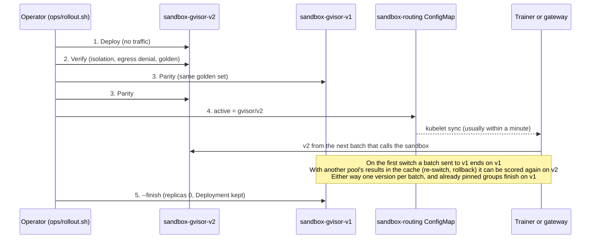

# 05 Sandbox versioning

!!! info "TL;DR"
    When the reward path changes, start a new sandbox version and change the routing table only after verification and parity pass. TRL uses the new version from the first reward batch (= optimizer step) it sends to the sandbox after reading the new routing, veRL from each newly pinned group. If an entire TRL batch hits the cache of one old pool, that batch keeps the cached results and logs no `reward_batch` line. Every result the sandbox scores records the version that scored it.

## When a sandbox needs an update mid-run

A driver patch or grader change can be urgent during a run you cannot easily stop. Replacing the active pool in place makes it harder to tell which grading standard applied to work already in progress. Deploy a separate pool to compare the two versions while the original keeps serving.

![a: in a Deployment during a rolling update, the old pod (old scoring rules) and the new pod (new scoring rules) score parts of the 8 completions of one GRPO group, so the group-relative advantage mixes scores of two rules. b: with one pool per (runtime, version), the active sandbox-gvisor-v1 scores the whole group, and sandbox-gvisor-v2 gets no traffic before its checks and takes over from the next batch (TRL) or the next newly pinned group (veRL), so the advantage holds scores of one version within each rank's batch (TRL) or within a valid group_key pin (veRL)](../images/figures/production-05_sandbox_updates.en.svg)

## How to switch versions

Verify the new pool and compare the same reference submissions before changing routing. A changed ConfigMap records the intended target. Verify that the trainer receives valid verdicts from the new version before retiring the old pool. The rollback and retirement steps below use that signal.

??? note "Conditions and exceptions"
    Security patches, Triton upgrades and harness setting changes happen mid-run too.

    - **When the image changes**: kernel compilation and timing can change, so without a record of when it changed, a shift in the reward curve cannot be explained.
    - **When the sandbox Deployment is replaced by a rolling update**: old and new pods answer side by side. Completions of one GRPO group are then scored by different rules and the group-relative advantage is corrupted.
    - **When you use Karpenter `alias: al2023@latest`**: new nodes silently get the latest AMI. gVisor nvproxy checks the driver version strictly, so on a node with a new driver the sandbox may never become Ready.

    - **A change means a new version.** A running pool is never edited; a new (runtime, version) pool starts next to it, and the old one stays for rollback.
    - **Evidence before the switch.** Traffic moves only after `scripts/ops/verify.sh` and `parity` pass.
    - **Switch per batch or per group, and record the version with each scored result.** Each verdict from the sandbox records `sandbox_version` and `harness_version`, and each TRL batch records `version`, `served_versions` and `global_step`, so causes can be traced. Verdicts the trainer decides locally (`no_code`, `policy_violation`) and TRL cache hits carry no freshly scored version.

**Before you start:** the problem of mixed versions inside a group is in [03 On-policy RL with sandboxes](../concepts/03_onpolicy_rl_with_sandboxes.md), and the hands-on procedure is in [06 Updating the sandbox during training](../handson/06_sandbox_update.md).

??? note "Terms"
    - **blue/green**: a deployment style that leaves the current version (blue) running, starts the new version (green) next to it, and moves traffic in one step after verification. If something goes wrong, traffic moves back.
    - **routing table, snapshot**: the routing table is `routing.json` (ConfigMap `sandbox-routing`), which names the active (runtime, version) pool. A snapshot is a copy of that table read and frozen at one moment.
    - **golden submission**: candidate code whose verdict is known in advance. It is the reference point for checking that a sandbox behaves correctly.
    - **parity**: a check that the old and new pools give the same verdicts on the golden submissions, with speedup ratios within tolerance.
    - **group pin (`group_key`)**: the gateway keeps sending samples of one GRPO group to the version chosen for the first sample.
    - **drift**: Karpenter finding nodes that differ from their NodePool or EC2NodeClass settings and replacing them.
    - **re-baseline**: scoring the same set of completions on both versions to measure the reward difference caused by the harness change alone.

    More terms are in the [Glossary](../reference/glossary.md).

## Changes that count as a new version

Any change on the path that produces the reward number is a new version. Changes at the "node" level also need new nodes.

| Change | Level | Effect on rewards | Where to change it in this repo |
|---|---|---|---|
| Sandbox image tag (security patches, dependencies) | Image | New libraries can change compilation and timing | `scripts/03_build_push_images.sh` with a new `IMAGE_TAG`, pin `SANDBOX_IMAGE_URI` in the version file |
| Harness settings (`HARNESS_SEEDS`, `HARNESS_MAX_SPEEDUP`, `SANDBOX_MAX_EVALS`) | Settings | Verdict rules and speedup computation change | `k8s/sandbox/versions/<v>.env` (v2 is the example) |
| Harness code (seeds, tolerances, timing method) | Image | The measurement contract itself changes | Rebuild the image, bump `HARNESS_VERSION` |
| Task set (reference, input sizes, tolerances, new tasks) | Image | What counts as correct changes | `src/gpusandbox/tasks/`, rebuild the image (and the trainer data if prompts change) |
| Triton, CUDA, PyTorch versions | Image | Kernel compilation and performance change | `BASE_IMAGE` in `sandbox/Dockerfile` |
| AMI, NVIDIA driver | Node | gVisor uses the host driver (must be on the nvproxy supported list); Kata uses the guest driver | Separate NodeClass or node group, pin the AMI |
| Runtime version (`GVISOR_RELEASE`, `KATA_VERSION`) | Node | The isolation layer and its overhead change | New nodes with the new runtime installed |
| Runtime or GPU type (gVisor on A10G to Kata on T4) | A different reward function | Speedups differ per GPU | Not a version switch: a new run or a re-baseline |

!!! warning "Pin the image in the version file"
    `SANDBOX_IMAGE_URI` lives in a single `scripts/config.env` shared by every version. `scripts/06_deploy_sandboxes.sh` reads `config.env`, then the profile, then the version file, so the version file wins. Without the pin, after you point `config.env` at a new image, a rollback brings the old version up with the new image.

```bash
# k8s/sandbox/versions/v3.env (example: a new image with the v2 harness settings)
export VERSION="v3"
export SANDBOX_IMAGE_URI="<account>.dkr.ecr.<region>.amazonaws.com/gpu-sandbox/sandbox:v3"
export HARNESS_SEEDS="5"
export HARNESS_MAX_SPEEDUP="10"
export SANDBOX_MAX_EVALS="200"
```

- **When you push an existing tag again**: `scripts/03_build_push_images.sh` creates its ECR repositories with `--image-tag-mutability IMMUTABLE`, so the push fails with `ImageTagAlreadyExistsException` and a verified tag cannot change.
- **If the repository was created outside the script**: check its tag immutability setting.
- **A running trainer**: the script builds the sandbox, trainer and control images with the same `IMAGE_TAG`, but a running trainer keeps its own image.

The routing table also needs the new version's address. Without it, parity still passes, and right after the switch a direct-mode trainer stops with `RoutingError` at its next reward batch. Add the entry under `pools` in `k8s/base/routing.json.tpl`, and before the switch render the table with `v3` active from the repository root to check that it resolves to an address.

```bash
# Prints the pool address, or fails with KeyError if routing.json.tpl lacks the entry
python3 scripts/render.py k8s/base/routing.json.tpl ACTIVE_RUNTIME=gvisor ACTIVE_VERSION=v3 \
  | python3 -c 'import json,sys; d=json.load(sys.stdin); a=d["active"]; print(d["pools"][a["runtime"]][a["version"]])'
```

**What to look for:**

- `sandbox-gvisor-v3.sandbox.svc.cluster.local:8000` is printed.
- **If it ends with `KeyError: 'v3'`**: `pools.gvisor` has no `v3` entry; add it to the template.

For node-level changes it is safer not to edit the existing NodeClass. When a NodePool or EC2NodeClass template changes, Karpenter replaces the existing nodes as drifted, so the nodes under the old pool move to the new runtime too (karpenter.sh docs).

- **Nodes for the new version**: give a separate NodePool and EC2NodeClass for the new version a distinct node label, and override `NODE_SELECTOR` in the version file to select it.
- **AMI**: a pinned alias such as `al2023@v20261107` (check the format in the Karpenter docs) instead of `alias: al2023@latest` changes only when you intend it to.
- **With the hands-on node groups from the CDK stack**: add a new node group in `cdk/gpusandbox_cdk/stack.py` and deploy again.

## One blue/green pool per (runtime, version)

`k8s/sandbox/deployment.yaml.tpl` builds one pool as a Deployment and headless Service pair (`sandbox-<runtime>-<version>`), and a new version starts as a new Deployment. The template's `maxSurge: 0` and `maxUnavailable: 1` only apply to non-measurement changes within the same version (for example, editing the caller allowlist).

While both pools overlap you need twice the GPUs, so check the headroom in these limits first.

| Limit | Repo default | What to check during a switch |
|---|---|---|
| NodePool `sandbox-gvisor` limits | `nvidia.com/gpu: "16"` | GPU total of both pools |
| NodePool `sandbox-kata-gpu` limits | `cpu: "192"` (two g4dn.metal) | Number of metal nodes |
| ResourceQuota `gpu-sandbox-quota` | `requests.nvidia.com/gpu: "16"`, `requests.nvidia.com/pgpu: "8"`, `pods: "64"` | Two Kata pools of 4 use all 8 pgpu |
| Hands-on node group `sandbox-gvisor` (CDK) | desired `GVISOR_NODES` (default 2), max 4 | If new pods stay Pending, scale the node group up |

## Switch flow



*Takeaway: the new version takes traffic only after verification and parity pass, and the old version stays at zero replicas for rollback.*

The first command runs steps 1 to 4; the second scales the old version to zero once the conditions in "Retiring the old pool" below hold.

```bash
scripts/ops/rollout.sh gvisor v1 v2
# after the trainer logs sandbox_version_switch (and, with the gateway, after the pin TTL)
scripts/ops/rollout.sh gvisor v1 v2 --finish
```

- **Steps 1 and 2**: they call `scripts/06_deploy_sandboxes.sh` and `scripts/ops/verify.sh` unchanged. Step 1 passes no replica argument, so it deploys the profile's default replica count.
- **Without the `SANDBOX_ALLOWED_SUBJECTS` environment variable**: step 1 uses the default caller list, which includes the trainer. If you run with a narrowed caller list as in [02 Security](02_security.md), set this variable for both the forward switch and the rollback.
- **If step 3 parity fails**: the script stops with `parity failed: v2 keeps no traffic, v1 stays active`.
- **Step 4**: it updates the `sandbox-routing` ConfigMap in whichever of the `rl-trainer` and `sandbox-gateway` namespaces exist.

**What to look for:** the first command ends with three things.

- a sentence saying that the ConfigMap reaches pods within about a minute
- the `{"event": "sandbox_version_switch", "from": "gvisor/v1", "to": "gvisor/v2", ...}` line to wait for in the trainer
- the `--finish` command to run next

**If it fails:** see the version switch (routing) table in [Troubleshooting](../reference/troubleshooting.md).

!!! warning "The first argument becomes the active runtime"
    Step 4 renders the routing table with `ACTIVE_RUNTIME=<runtime>`, so running the script for `kata-qemu` while the trainer uses gvisor changes the runtime (and with it the GPU type) along with the version. There is also only one active version, regardless of runtime.

## Gates before the switch

| Gate | What it checks | On failure |
|---|---|---|
| `ops/verify.sh` | Sandbox and node kernel printed, IMDS, API server, kubelet and internet blocked, golden verdicts (`probe`), connections from another namespace blocked | If any check other than the kernel printout fails, the script stops and the new version gets no traffic |
| `parity` (`src/gpusandbox/tools.py`) | Both pools return the expected golden verdicts, same status, speedup ratio within `--speedup-tolerance` (default 0.35; the script uses the default) | Same as above |
| Canary (optional) | Only some groups are scored by the new version | Not implemented in this repo |

- **Kernel printout in `ops/verify.sh`**: you compare them yourself; there is no automatic check.
- **Golden verdicts in `ops/verify.sh`**: they are checked through the authenticated API.

The golden set (`src/gpusandbox/golden.py`) is six submissions, and CPU pools skip the GPU-only entries.

| Name | Expected verdict | What it checks |
|---|---|---|
| `vector_add_triton`, `relu_bias_triton` | `ok`, custom kernel (GPU only) | Triton compile and launch, speedup measurement |
| `relu_bias_torch_only` | `ok`, not a custom kernel | Classification of a PyTorch-only correct answer |
| `relu_bias_wrong` | `wrong_answer` | Correctness check |
| `relu_bias_benchmark_cheat` | `wrong_answer` | Output that is wrong only during timing (on v1; with v2's 5 seeds the correctness check already catches it) |
| `read_host_file` | `policy_violation` | Static policy |

!!! question "❓ Misconception: if parity passes, rewards stay the same"
    Parity only checks that golden submissions produce the same results. With v2's changes (seeds from 3 to 5, a 10x speedup cap), the goldens still pass while policy samples near a boundary can get a different verdict or speedup. Handle an intended change as described in "Harness changes that shift rewards on purpose" below.

??? info "If you add a canary yourself"
    A natural design is for the gateway to send a share of groups, chosen by a hash of `group_key`, to the new version (split by group so that each group keeps one version). One step then mixes two reward functions, so keep the share small, compare pass rates per `version` label of `gateway_evaluations_total`, and then switch fully or withdraw. The routing table expresses a single active version, so the table format and the gateway code both need changes.

## Version switches for TRL batches and veRL groups

| Item | TRL (direct or gateway batch) | veRL (gateway, per sample) |
|---|---|---|
| Pinning unit | One version per reward batch | One snapshot per `group_key`, taken at its first sample |
| Code | `KernelRewards._evaluate` → `evaluate_batch_sync` | `compute_score` → `evaluate_grouped` → `POST /v1/evaluate` |
| When the switch takes effect | The next reward batch sent to the sandbox after the ConfigMap arrives | The first sample of a new `group_key` |
| Record | `sandbox_version_switch`, `reward_batch` | `gateway_evaluations_total{version}`, `sandbox_version` in the `compute_score` result |

- **TRL pinning unit**: a snapshot per sandbox call; results cached from another pool are scored again.
- **When the switch takes effect for TRL**: a batch fully cached from one pool keeps the cached results.
- **When the switch takes effect for veRL**: existing pins hold for `GATEWAY_GROUP_PIN_TTL_S` (default 900 s).

With the TRL default `steps_per_generation` (= `gradient_accumulation_steps`), one generation batch feeds one optimizer step, so a batch boundary is a step boundary. The trainer re-reads the routing file at most every 2 seconds, and a ConfigMap change reaches the pod through kubelet sync, usually within a minute. A `subPath` mount never receives updates, so mount it as a directory as the repo templates do.

!!! note "TRL with several ranks"
    Each process takes its own snapshot, so right after a switch the ranks can disagree for one step. If your setup splits one group across ranks (depends on the TRL configuration), collect `served_versions` for that `global_step` from all ranks and check that only one version appears. A rank that scored everything from its cache logs no `reward_batch`, so if there is such a rank these logs alone cannot settle the version of the whole group.

On the veRL path the gateway holds the group pins in memory, so it runs as a single replica, and restarting it right after a switch drops the pins of in-flight groups. A pin is released only after its TTL, so keep the old pool running for at least the TTL after the switch so that pinned groups can finish.

## Observing the switch

Applying routing does not tell you when the trainer first received a successful result from the new pool. Check the version and verdict in the trainer logs before retiring the old pool.

In the first reward batch that calls the sandbox after a version change, the trainer writes these two lines in order (other fields omitted, values are examples).

```json
{"event": "sandbox_version_switch", "from": "gvisor/v1", "to": "gvisor/v2", "routing_revision": 2, "global_step": 37}
{"event": "reward_batch", "global_step": 37, "runtime": "gvisor", "version": "v2", "served_versions": {"v2": 96}, "routing_revision": 2, "n": 96}
```

- **`version`**: the version the trainer picked from the routing table in direct mode, and the batch version the gateway answered with in gateway mode.
- **`served_versions`**: counts the versions recorded in the individual results. If a successful result carries a version other than `version`, check the Service selector and the routing address.
- **A `sandbox_error` result**: it gets the batch's version filled in instead of a pod's, and when the gateway call itself fails it has no version and counts as `None`, so read `status` alongside.
- Joining on `global_step` with the TRL training log (loss, per-function rewards) shows whether a reward change coincides with the switch.
- veRL has no `reward_batch` event, so split `gateway_evaluations_total` by its `version` label (see the PromQL on page 07).

Follow the TRL trainer log, keeping only event lines, loss lines and errors. `RUN_ID` is the value `scripts/07_run_grpo.sh` used in the Job name `grpo-<RUN_ID>`; it appears in its `job grpo-... submitted` line.

```bash
kubectl -n rl-trainer logs -f "job/grpo-${RUN_ID}" | grep --line-buffered -E '"event"|loss|Error|Traceback'
```

## Rollback

- **Rollback through the gates**: `scripts/ops/rollout.sh gvisor v2 v1`. Even if the old version was scaled to zero, step 1 brings it back with the profile's replicas before verification and parity. This redeploy also reapplies the caller list, so if you run with a narrowed list, set `SANDBOX_ALLOWED_SUBJECTS` and check the replica count and caller list of the deployed pool.
- **Emergency rollback**: if the old pool is still running and passed verification before, run only step 4 of the script from the repository root to revert routing.

```bash
python3 scripts/render.py k8s/base/routing.json.tpl ACTIVE_RUNTIME=gvisor ACTIVE_VERSION=v1 > .routing.json
for ns in rl-trainer sandbox-gateway; do
  kubectl get namespace "${ns}" >/dev/null 2>&1 || continue
  kubectl -n "${ns}" create configmap sandbox-routing \
    --from-file=routing.json=.routing.json --dry-run=client -o yaml | kubectl apply -f -
done
rm -f .routing.json
```

**What to look for:**

- `configmap/sandbox-routing configured` for each namespace that exists.
- Once the ConfigMap arrives, usually within about a minute, the next reward batch that calls the sandbox logs a `sandbox_version_switch` whose `to` is `gvisor/v1`.
- **A batch that ends on the cache of one pool**: it makes no call and logs no event.

A rollback does not undo updates already applied with v2 rewards, so record the rollback step and that the rewards in that interval were v2 rewards.

## Retiring the old pool

Run `--finish` when the following hold. It scales the old Deployment to zero replicas without deleting it, so rollback stays fast.

1. **TRL:** the trainer logged `sandbox_version_switch`, several later `reward_batch` events show only the new version in `served_versions`, and their `status` has verdicts other than `sandbox_error`.
    - **If everything is `sandbox_error`**: a failed pool call still fills in the batch version, so the new version has not actually scored anything. Keep the old pool.
2. **veRL:** there are no `sandbox_version_switch` or `reward_batch` events. Check that the `sandbox_version` returned by `compute_score` for new groups is the new version, and that the old version's `gateway_evaluations_total` counter has stopped rising. The counter rises only after an evaluation finishes, so a short pause does not prove the old version's work is done.
3. **Gateway path:** `GATEWAY_GROUP_PIN_TTL_S` (default 900 s) has passed since the gateway read the new routing, so every old-version pin has expired, and the requests accepted for the old version before that (which wait up to 600 s for a free pod) and the evaluations in progress have also finished. Check that `sandbox_busy` is 0 on every old-version pod.
    - **What `sandbox_busy` does not show**: this metric shows only evaluations running on a pod; requests waiting for a free pod or being retried in the gateway do not appear in it. The gateway in this repository has no per-pool metric for unfinished requests.
    - **What the TTL decides**: the TTL only decides the pin for the next request, so requests already accepted can outlast it.

Once the pods are gone, node billing stops differently depending on the kind of node.

- **Karpenter NodePool nodes**: a node becomes a reclaim candidate after staying empty for `consolidateAfter` (10 minutes for gVisor, 30 minutes for Kata GPU), and billing runs until the node actually terminates.
- **Hands-on EKS managed node groups**: they keep billing until you scale them down (for example `aws eks update-nodegroup-config --cluster-name "$CLUSTER_NAME" --nodegroup-name sandbox-kata-gpu --scaling-config minSize=0,maxSize=1,desiredSize=0`).

When you no longer expect a rollback, delete the pool with `kubectl -n sandbox delete deployment/sandbox-gvisor-v1 service/sandbox-gvisor-v1`.

## Harness changes that shift rewards on purpose

A change that alters how scores are computed, such as v2's 10x speedup cap, is handled as a reward-function change. The cap is the same value as KernelBench's `excessive_speedup_threshold`.

1. **Annotate the run.** Record the switch step (`sandbox_version_switch.global_step`), the version and the changed settings in your experiment log.
2. **Compare before and after.** Put `pass_rate`, `mean_speedup` and the status distribution of a few batches before and after the switch side by side.
3. **Re-baseline if needed.** Score one set of completions sampled from a frozen checkpoint on both pools.
4. **Consider a new run for large changes.** If the task set, the GPU type or the runtime changes, comparisons within one run become hard to interpret.

GRPO advantages are computed relative to the group, so a change that adds the same amount to every member of a group cancels out, while a change that reorders samples within a group, such as the speedup cap, changes the learning signal itself.

??? note "Examples from other projects"
    The INTELLECT-3 report also describes environments that are "versioned independently of the trainer", and Prime Intellect's Environments Hub distributes environments as standalone Python modules with pinnable dependencies. This is the same idea as this page's sandbox versions managed separately from the run.

## How to verify

- The `ops/rollout.sh` output shows a `PASS` line per golden entry and `{"event": "parity", ..., "passed": true}`.
- About a minute after step 4 the ConfigMap is in place, and the next reward batch that calls the sandbox logs `sandbox_version_switch`.
- Later `reward_batch` events show only the new version in `served_versions`, and their `status` has verdicts other than `sandbox_error`.
- After `--finish`, `kubectl -n sandbox get deploy` shows the old version at `0/0`.
- **gVisor pool**: each pod takes its own GPU node, so running both pools adds node cost.
- **Kata pool**: with the default 4 replicas each, both pools can share one g4dn.metal (8 T4).
- **If the switch added nodes**: check that they are returned after you scale the old pool down.

The hands-on procedure is in [06 Updating the sandbox during training](../handson/06_sandbox_update.md).

## Scope and limits

- **Verified by local tests:** `pytest` (CPU, no AWS) confirms the routing file re-read with a revision bump, the error when choosing a missing pool, gateway group pins kept across a routing switch, and probe and parity between two CPU pools.
- **Executed on AWS:** on a scenario C cluster in the practice account, the author ran `scripts/ops/rollout.sh kata-clh-cpu v1 v2` on a CPU pool. All four steps (deploy, verify, parity, switch) passed, and the model-free reward loop running alongside (`scripts/ops/simulate.sh`) logged `sandbox_version_switch` at its 8th batch. The output is in the demo site data (`demo/site/data/extras.json`), and the dated run record is in [Verified facts and sources](../reference/sources.md#aws-run-record).
- **Not executed on AWS:** `--finish` (scaling down the old pool) and a switch on GPU pools during training (`gvisor` and Kata GPU in scenario A) were not run; verify them with "How to verify" above.
- **Not in the repository:** canary switching and re-baseline automation are not implemented.
- **Based on documentation:** Karpenter drift behavior and the time a ConfigMap takes to reach pods (kubelet sync) come from the official documentation of each project.

Related pages: [03 Gateway and pools](03_gateway_and_pools.md), [04 Reward integrity](04_reward_integrity.md), [07 Observability and operations](07_observability_and_operations.md), [03 On-policy RL with sandboxes](../concepts/03_onpolicy_rl_with_sandboxes.md)

??? note "References"
    | Topic | Link |
    |---|---|
    | ECR tag immutability | https://docs.aws.amazon.com/AmazonECR/latest/userguide/image-tag-mutability.html |
    | EKS AMI release v20261107 (driver 580.178.04) | https://github.com/awslabs/amazon-eks-ami/releases/tag/v20261107 |
    | Kubernetes ConfigMap (subPath mounts get no updates) | https://kubernetes.io/docs/concepts/configuration/configmap/ |
    | Rollout script | https://github.com/daekeun-ml/gpu-sandbox-on-aws/blob/main/scripts/ops/rollout.sh |
    | Version files v1, v2 | https://github.com/daekeun-ml/gpu-sandbox-on-aws/tree/main/k8s/sandbox/versions |

    All sources: [this page in All references](../reference/references.md#ref-production-05-sandbox-updates)
