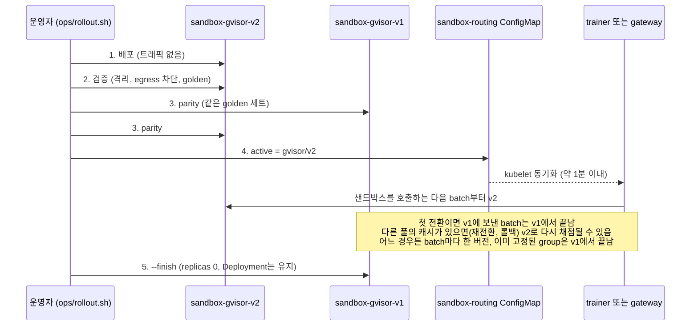

# 05 샌드박스 버전 관리

**TL;DR** reward를 계산하는 경로가 바뀌면 새 샌드박스 버전으로 배포하고, 검증과 parity를 통과한 뒤 routing 표를 바꿉니다. TRL은 새 routing을 읽은 뒤 샌드박스에 보내는 reward batch(= optimizer step)부터, veRL은 새로 고정되는 group부터 새 버전을 씁니다. TRL batch 전체가 한 구버전 풀의 캐시에 적중하면 그 batch는 기존 결과를 쓰고 `reward_batch` 줄도 남기지 않아요. 샌드박스가 채점한 결과에는 채점한 버전이 기록돼요.

## 기존 Pain Point

보안 패치, Triton 업그레이드, harness 설정 변경은 학습 도중에도 생깁니다. 이미지가 바뀌면 커널 컴파일과 timing이 달라질 수 있어서, 바뀐 시점의 기록이 없으면 reward 곡선의 변화를 설명할 수 없어요. 샌드박스 Deployment를 rolling update로 교체하면 구버전과 신버전 pod가 동시에 요청을 처리합니다. 그러면 같은 GRPO group의 completion이 서로 다른 채점 규칙으로 점수를 받아 group 기준 advantage가 잘못 계산됩니다. Karpenter `alias: al2023@latest`를 쓰면 새 노드에 별도 알림 없이 최신 AMI가 적용됩니다. gVisor nvproxy는 드라이버 버전을 엄격히 확인하므로, 드라이버가 바뀐 노드에서는 샌드박스가 Ready가 되지 않을 수 있습니다.


*그림 요약: rolling update 도중에는 한 group을 두 버전이 나눠 채점하므로, advantage에 서로 다른 규칙의 점수가 섞입니다. 새 버전을 별도 풀로 시작하고 검증과 parity를 통과한 뒤 전환하면, TRL은 rank별 batch 안에서, veRL은 유효한 `group_key` pin 안에서 한 버전을 씁니다.*


## Why

- **변경이 있으면 새 버전으로 배포합니다.** 실행 중인 풀은 수정하지 않고 새 (runtime, version) 풀을 따로 띄우며, 구버전 풀은 롤백용으로 유지합니다.
- **전환 전에 검증을 통과해야 합니다.** `scripts/ops/verify.sh`와 `parity`를 통과해야 트래픽이 신버전으로 전환돼요.
- **batch나 group 단위로 전환하고, 채점 결과에 버전을 기록합니다.** 샌드박스가 채점한 verdict마다 `sandbox_version`과 `harness_version`이, TRL batch마다 `version`, `served_versions`, `global_step`이 기록되므로 reward 변화의 원인을 추적할 수 있어요. trainer가 로컬에서 판정한 `no_code`, `policy_violation`과 TRL의 캐시 적중 결과에는 새로 채점한 버전 정보가 없습니다.

**사전 지식:** group 안에서 버전이 섞이는 문제는 [03 On-policy RL과 샌드박스](../concepts/03_onpolicy_rl_with_sandboxes.md)에, 핸즈온 절차는 [06 학습 중 샌드박스 업데이트](../handson/06_sandbox_update.md)에 있습니다.

??? note "용어"
    - **blue/green**: 기존 버전(blue)을 그대로 둔 채 새 버전(green)을 따로 띄우고, 검증이 끝나면 트래픽만 한 번에 전환하는 배포 방식입니다. 문제가 생기면 트래픽을 되돌립니다.
    - **routing 표, snapshot**: routing 표는 어느 (runtime, version) 풀이 active인지 적은 `routing.json`(ConfigMap `sandbox-routing`)입니다. snapshot은 그 표를 한 시점에 읽어 고정한 사본이에요.
    - **golden 제출물**: 기대 verdict가 미리 정해진 후보 코드입니다. 샌드박스가 정상인지 확인하는 기준으로 씁니다.
    - **parity**: 구버전 풀과 신버전 풀이 golden 제출물에 같은 verdict를 내는지, speedup 비율이 허용 범위 안인지 비교하는 검사입니다.
    - **group pin (`group_key`)**: gateway가 같은 GRPO group의 샘플을 첫 샘플을 처리할 때 정한 버전으로 계속 보내도록 고정하는 기능입니다.
    - **drift**: Karpenter가 NodePool이나 EC2NodeClass 설정과 달라진 노드를 찾아 교체하는 동작입니다.
    - **re-baseline**: 같은 completion 묶음을 두 버전에서 각각 채점해, harness 변경만으로 생긴 reward 차이를 측정하는 작업입니다.

    더 많은 용어는 [용어 사전](../reference/glossary.md)에 있습니다.

## 새 버전으로 취급하는 변경

reward 값을 계산하는 경로가 하나라도 바뀌면 새 버전으로 배포합니다. 아래 표에서 수준이 "노드"인 변경은 새 노드도 필요해요.

| 변경 | 수준 | reward에 미치는 영향 | 이 저장소에서 바꾸는 곳 |
|---|---|---|---|
| 샌드박스 이미지 태그 (보안 패치, 의존성) | 이미지 | 라이브러리가 바뀌면 컴파일과 timing이 달라질 수 있음 | 새 `IMAGE_TAG`로 `scripts/03_build_push_images.sh`, 버전 파일에 `SANDBOX_IMAGE_URI` 고정 |
| harness 설정 (`HARNESS_SEEDS`, `HARNESS_MAX_SPEEDUP`, `SANDBOX_MAX_EVALS`) | 설정 | verdict 기준과 speedup 계산이 바뀜 | `k8s/sandbox/versions/<v>.env` (v2가 예시) |
| harness 코드 (seeds, tolerance, timing 방식) | 이미지 | 측정 계약 자체가 바뀜 | 이미지 재빌드, `HARNESS_VERSION` 올리기 |
| task 세트 (reference, 입력 크기, tolerance, 새 task) | 이미지 | 정답 기준이 바뀜 | `src/gpusandbox/tasks/`, 이미지 재빌드 (prompt가 바뀌면 trainer 데이터도) |
| Triton, CUDA, PyTorch 버전 | 이미지 | 커널 컴파일과 성능이 바뀜 | `sandbox/Dockerfile`의 `BASE_IMAGE` |
| AMI, NVIDIA 드라이버 | 노드 | gVisor는 host 드라이버를 그대로 쓰고(nvproxy 지원 목록 필요), Kata는 guest 드라이버를 씀 | NodeClass 또는 노드 그룹 분리, AMI 고정 |
| 런타임 버전 (`GVISOR_RELEASE`, `KATA_VERSION`) | 노드 | 격리 계층과 오버헤드가 바뀜 | 새 런타임을 설치한 새 노드 |
| 런타임 또는 GPU 종류 (gVisor A10G에서 Kata T4로) | 다른 reward 함수 | speedup은 GPU마다 다름 | 버전 전환이 아니라 새 run 또는 re-baseline |

!!! warning "버전 파일에 이미지를 고정하세요"
    `SANDBOX_IMAGE_URI`는 `scripts/config.env` 하나에만 정의되어 있어 모든 버전이 같은 값을 씁니다. `scripts/06_deploy_sandboxes.sh`는 `config.env`, profile, 버전 파일 순서로 읽으므로 버전 파일의 값이 우선해요. 버전 파일에 이미지를 고정하지 않으면, `config.env`를 새 이미지로 바꾼 뒤 롤백할 때 구버전 풀이 새 이미지로 배포됩니다.

```bash
# k8s/sandbox/versions/v3.env (example: a new image with the v2 harness settings)
export VERSION="v3"
export SANDBOX_IMAGE_URI="<account>.dkr.ecr.<region>.amazonaws.com/gpu-sandbox/sandbox:v3"
export HARNESS_SEEDS="5"
export HARNESS_MAX_SPEEDUP="10"
export SANDBOX_MAX_EVALS="200"
```

`scripts/03_build_push_images.sh`는 ECR 저장소를 `--image-tag-mutability IMMUTABLE`로 만들므로, 같은 태그로 다시 push하면 `ImageTagAlreadyExistsException` 오류가 발생하고 검증한 태그의 이미지는 바뀌지 않아요. 저장소를 스크립트 밖에서 만들었다면 tag immutability 설정을 확인하세요. 스크립트가 sandbox, trainer, control 이미지를 같은 `IMAGE_TAG`로 빌드해도 실행 중인 trainer는 기존 이미지를 그대로 씁니다.

routing 표에도 새 버전의 주소가 있어야 합니다. 항목이 없으면 parity를 통과해도 전환 직후 direct 모드 trainer가 다음 reward batch에서 `RoutingError`로 중단됩니다. `k8s/base/routing.json.tpl`의 `pools`에 항목을 추가하고, 전환 전에 저장소 루트에서 `v3`를 active로 렌더링해 주소가 출력되는지 확인하세요.

```bash
# Prints the pool address, or fails with KeyError if routing.json.tpl lacks the entry
python3 scripts/render.py k8s/base/routing.json.tpl ACTIVE_RUNTIME=gvisor ACTIVE_VERSION=v3 \
  | python3 -c 'import json,sys; d=json.load(sys.stdin); a=d["active"]; print(d["pools"][a["runtime"]][a["version"]])'
```

**확인할 것:** `sandbox-gvisor-v3.sandbox.svc.cluster.local:8000`이 출력됩니다. `KeyError: 'v3'`로 끝나면 `pools.gvisor`에 `v3` 항목이 없으니 템플릿에 추가하세요.

노드 수준 변경은 기존 NodeClass를 수정하지 않는 편이 안전합니다. NodePool이나 EC2NodeClass template이 바뀌면 Karpenter가 기존 노드를 drift로 교체해, 구버전 풀의 노드까지 새 런타임으로 바뀝니다(karpenter.sh 문서). 새 버전용 NodePool과 EC2NodeClass에 고유한 노드 label을 붙이고, 버전 파일에서 `NODE_SELECTOR`를 덮어써 그 노드를 선택하세요. AMI는 `alias: al2023@latest` 대신 고정 alias(예: `al2023@v20261107`, 형식은 Karpenter 문서에서 재확인)를 쓰면 의도한 시점에만 바뀝니다. 핸즈온의 CDK 노드 그룹이라면 `cdk/gpusandbox_cdk/stack.py`에 새 노드 그룹을 추가해 다시 배포하세요.

## (runtime, version)마다 blue/green 풀 하나

`k8s/sandbox/deployment.yaml.tpl`은 풀 하나를 Deployment와 headless Service 한 쌍(`sandbox-<runtime>-<version>`)으로 만들고, 새 버전은 새 Deployment로 띄웁니다. 템플릿의 `maxSurge: 0`, `maxUnavailable: 1`은 같은 버전 안에서 측정에 영향을 주지 않는 변경(예: 호출자 allowlist 수정)에만 적용됩니다.

두 풀을 함께 실행하는 동안 GPU가 두 배로 필요하니, 아래 한도에 여유가 있는지 먼저 확인하세요.

| 한도 | 저장소 기본값 | 전환 중 확인할 점 |
|---|---|---|
| NodePool `sandbox-gvisor` limits | `nvidia.com/gpu: "16"` | 두 풀의 GPU 합계 |
| NodePool `sandbox-kata-gpu` limits | `cpu: "192"` (g4dn.metal 두 대) | metal 노드 수 |
| ResourceQuota `gpu-sandbox-quota` | `requests.nvidia.com/gpu: "16"`, `requests.nvidia.com/pgpu: "8"`, `pods: "64"` | Kata 풀은 구버전 4개와 신버전 4개를 합치면 pgpu 8을 모두 씀 |
| 핸즈온 노드 그룹 `sandbox-gvisor` (CDK) | desired `GVISOR_NODES`(기본 2), max 4 | 신버전 pod가 Pending이면 노드 그룹을 늘려야 함 |

## 전환 흐름



*그림 요약: 신버전은 검증과 parity를 통과한 뒤에만 트래픽을 받고, 구버전은 롤백을 위해 replicas 0으로 남습니다.*

첫 명령은 1단계부터 4단계까지 실행하고, 두 번째 명령은 아래 "구버전 풀 정리"의 조건을 확인한 뒤 구버전 풀을 0으로 줄입니다.

```bash
scripts/ops/rollout.sh gvisor v1 v2
# after the trainer logs sandbox_version_switch (and, with the gateway, after the pin TTL)
scripts/ops/rollout.sh gvisor v1 v2 --finish
```

1단계와 2단계는 `scripts/06_deploy_sandboxes.sh`와 `scripts/ops/verify.sh`를 그대로 호출합니다. 1단계는 replica 인자 없이 호출하므로 profile의 기본 replica 수로 배포하고, 환경 변수 `SANDBOX_ALLOWED_SUBJECTS`가 없으면 trainer를 포함한 기본 호출자 목록을 씁니다. [02 보안](02_security.md)처럼 호출자 목록을 좁혀 운영한다면 정방향 전환과 롤백 모두 이 변수를 지정해 실행하세요. 3단계 parity가 실패하면 스크립트는 `parity failed: v2 keeps no traffic, v1 stays active`를 출력하고 중단합니다. 4단계는 `rl-trainer`와 `sandbox-gateway` 중 존재하는 네임스페이스의 `sandbox-routing` ConfigMap을 갱신해요.

**확인할 것:** 첫 명령은 마지막에 세 가지를 출력합니다. ConfigMap이 1분 안팎에 pod에 반영된다는 안내, trainer 로그에서 확인할 `{"event": "sandbox_version_switch", "from": "gvisor/v1", "to": "gvisor/v2", ...}` 줄, 다음에 실행할 `--finish` 명령입니다.

**문제가 생기면:** [문제 해결](../reference/troubleshooting.md)의 "버전 전환 (routing)" 표를 보세요.

!!! warning "첫 번째 인자가 active runtime이 됩니다"
    4단계는 routing 표를 `ACTIVE_RUNTIME=<runtime>`으로 렌더링하므로, trainer가 gvisor를 쓰는 중에 `kata-qemu`를 인자로 실행하면 버전과 함께 런타임과 GPU 종류도 바뀌어요. active version도 런타임과 관계없이 하나만 지정됩니다.

## 전환 전 관문

| 관문 | 확인하는 것 | 실패하면 |
|---|---|---|
| `ops/verify.sh` | 샌드박스와 노드의 커널 출력(운영자가 직접 대조, 자동 판정 없음), IMDS, API 서버, kubelet, 인터넷 차단, 인증된 API로 golden verdict(`probe`), 다른 네임스페이스에서 접속 차단 | 커널 출력을 뺀 검사가 실패하면 스크립트가 중단되고 신버전은 트래픽을 받지 않음 |
| `parity` (`src/gpusandbox/tools.py`) | 두 풀 모두 golden 기대 verdict, status 동일, speedup 비율 차이가 `--speedup-tolerance` 이내(기본 0.35, 스크립트는 기본값 사용) | 위와 같음 |
| canary (선택) | 일부 group만 신버전으로 채점 | 이 저장소에는 구현되어 있지 않음 |

golden 세트(`src/gpusandbox/golden.py`)는 제출물 6개로 구성되며, CPU 풀에서는 GPU 전용 항목을 건너뜁니다.

| 이름 | 기대 verdict | 확인하는 것 |
|---|---|---|
| `vector_add_triton`, `relu_bias_triton` | `ok`, custom kernel (GPU 전용) | Triton 컴파일과 실행, speedup 측정 |
| `relu_bias_torch_only` | `ok`, custom kernel 아님 | PyTorch만 쓴 정답의 분류 |
| `relu_bias_wrong` | `wrong_answer` | 정확성 검사 |
| `relu_bias_benchmark_cheat` | `wrong_answer` | 측정 구간에서만 틀리는 출력 검출(v1 기준, seed가 5개인 v2에서는 정확성 검사에서 걸림) |
| `read_host_file` | `policy_violation` | 정적 정책 |

!!! question "❓ 오해: parity를 통과하면 reward도 그대로다"
    parity는 golden 제출물의 결과가 같은지만 확인합니다. v2처럼 seed를 3에서 5로 늘리고 speedup 상한 10배를 두면, golden은 통과해도 판정 경계에 가까웠던 policy 샘플의 verdict와 speedup은 달라질 수 있어요. 의도한 변화는 아래 "reward가 의도적으로 바뀌는 harness 변경" 절의 절차에 따라 처리합니다.

??? info "canary를 직접 구현한다면"
    gateway가 `group_key`의 hash로 일부 group만 신버전에 보내는 방식이 적합합니다. group 단위로 나눠야 group 안의 버전이 하나로 유지되기 때문이에요. 같은 step에서 두 reward 함수가 함께 쓰이므로 신버전 비율을 작게 두고, `gateway_evaluations_total`의 `version` label별 통과율을 비교해 전체 전환 또는 철회를 결정하세요. routing 표가 active version 하나만 표현하므로 표 형식과 gateway 코드를 함께 바꿔야 합니다.

## TRL 배치와 veRL group의 버전 전환

| 항목 | TRL (direct 또는 gateway batch) | veRL (gateway, 샘플 단위) |
|---|---|---|
| 고정 단위 | reward batch 하나에 버전 하나(샌드박스 호출마다 snapshot을 읽고, 다른 풀로 캐시된 결과는 다시 채점) | `group_key` 하나에 첫 샘플 시점의 snapshot |
| 코드 | `KernelRewards._evaluate` → `evaluate_batch_sync` | `compute_score` → `evaluate_grouped` → `POST /v1/evaluate` |
| 전환 시점 | ConfigMap이 반영된 뒤 샌드박스에 보내는 다음 reward batch (batch 전체가 한 풀의 캐시에 적중하면 기존 결과 사용) | 새 `group_key`의 첫 샘플 (`GATEWAY_GROUP_PIN_TTL_S`, 기본 900초 동안 기존 고정 유지) |
| 기록 | `sandbox_version_switch`, `reward_batch` | `gateway_evaluations_total{version}`, `compute_score` 반환값의 `sandbox_version` |

TRL은 `steps_per_generation` 기본값(= `gradient_accumulation_steps`)에서 generation batch 하나로 optimizer step 하나를 실행하므로, batch 경계와 step 경계가 같습니다. trainer는 routing 파일을 최대 2초에 한 번 다시 읽고, ConfigMap 변경은 kubelet 동기화로 보통 1분 안에 pod에 반영돼요. `subPath`로 마운트하면 갱신이 반영되지 않으니 저장소 템플릿처럼 디렉터리로 마운트하세요.

!!! note "여러 rank로 TRL을 실행할 때"
    snapshot은 프로세스마다 따로 만들어지므로 전환 직후 한 step 동안 rank마다 버전이 다를 수 있습니다. 한 group이 여러 rank에 나뉘는 설정이라면(TRL 설정에 따라 다름) 그 `global_step`의 `served_versions`를 모든 rank에서 모아 버전이 하나인지 확인하세요. 전부 캐시로 채점한 rank는 `reward_batch`를 남기지 않으므로, 그런 rank가 있으면 이 로그만으로 group 전체의 버전을 확정할 수 없어요.

veRL 경로의 gateway는 group 고정 정보를 메모리에 저장하므로 replica 하나로 실행됩니다. 전환 직후 gateway가 재시작하면 진행 중인 group의 고정 정보가 사라져요. 고정은 TTL이 지나야 해제되므로, 전환 후 최소 TTL 동안 구버전 풀을 유지해야 고정된 group이 끝까지 채점됩니다.

## 전환 확인

trainer는 버전이 바뀐 뒤 샌드박스를 호출하는 첫 reward batch에서 아래 두 줄을 차례로 로그에 남깁니다(다른 필드 생략, 값은 예시).

```json
{"event": "sandbox_version_switch", "from": "gvisor/v1", "to": "gvisor/v2", "routing_revision": 2, "global_step": 37}
{"event": "reward_batch", "global_step": 37, "runtime": "gvisor", "version": "v2", "served_versions": {"v2": 96}, "routing_revision": 2, "n": 96}
```

- `version`은 direct 모드에서는 trainer가 routing 표에서 고른 버전이고, gateway 모드에서는 gateway가 응답한 배치 버전입니다. `served_versions`는 개별 결과에 기록된 버전별 건수예요. 정상 응답의 버전이 `version`과 다르면 Service selector와 routing 주소를 확인하세요. `sandbox_error` 결과에는 pod 대신 그 배치의 버전이 채워지거나, gateway 호출이 실패하면 버전이 빠져 `None`으로 집계되니 `status`를 함께 보세요.
- `global_step`을 기준으로 TRL 학습 로그(loss, reward 함수별 값)와 맞춰 보면 reward 변화가 전환 시점과 겹치는지 확인할 수 있어요.
- veRL에는 `reward_batch` 이벤트가 없으니 `gateway_evaluations_total`을 `version` label로 나눠 확인합니다(07 페이지의 PromQL 참고).

아래 명령은 TRL trainer 로그에서 이벤트 줄, loss, 오류만 실시간으로 출력합니다. `RUN_ID`는 `scripts/07_run_grpo.sh`가 Job 이름 `grpo-<RUN_ID>`에 쓴 값으로, 출력의 `job grpo-... submitted` 줄에 있어요.

```bash
kubectl -n rl-trainer logs -f "job/grpo-${RUN_ID}" | grep --line-buffered -E '"event"|loss|Error|Traceback'
```

## 롤백

- **검증을 다시 거치는 롤백**: `scripts/ops/rollout.sh gvisor v2 v1`. 구버전 풀이 0으로 줄어 있어도 1단계에서 profile의 replicas 값으로 다시 배포한 뒤 검증과 parity를 실행합니다. 이 재배포는 호출자 목록도 다시 적용하므로, 호출자 목록을 좁혀 운영 중이라면 `SANDBOX_ALLOWED_SUBJECTS`를 지정해 실행하고 배포된 풀의 replica 수와 호출자 목록을 확인하세요.
- **급한 롤백**: 구버전 풀이 실행 중이고 이미 검증을 통과했다면, 저장소 루트에서 스크립트의 4단계만 실행해 routing을 되돌립니다.

```bash
python3 scripts/render.py k8s/base/routing.json.tpl ACTIVE_RUNTIME=gvisor ACTIVE_VERSION=v1 > .routing.json
for ns in rl-trainer sandbox-gateway; do
  kubectl get namespace "${ns}" >/dev/null 2>&1 || continue
  kubectl -n "${ns}" create configmap sandbox-routing \
    --from-file=routing.json=.routing.json --dry-run=client -o yaml | kubectl apply -f -
done
rm -f .routing.json
```

**확인할 것:** 존재하는 namespace마다 `configmap/sandbox-routing configured`가 출력됩니다. 1분 안팎에 ConfigMap이 반영되면, 샌드박스를 호출하는 다음 reward batch에서 trainer가 `to`가 `gvisor/v1`인 `sandbox_version_switch` 이벤트를 기록해요. batch가 한 풀의 캐시로 끝나면 호출이 없으므로 이벤트도 남지 않습니다.

롤백해도 v2 reward로 학습한 업데이트는 모델에 그대로 남습니다. 롤백한 step과, 그 구간의 reward가 v2 기준이었다는 사실을 기록하세요.

## 구버전 풀 정리

아래 조건을 만족할 때 `--finish`를 실행하세요. `--finish`는 구버전 Deployment를 삭제하지 않고 replicas를 0으로 줄이므로 롤백이 빠릅니다.

1. **TRL:** trainer가 `sandbox_version_switch`를 기록했고, 이후 여러 `reward_batch`의 `served_versions`에 신버전만 있으며, 그 batch의 `status`에 `sandbox_error` 말고 다른 판정도 있습니다. 풀 호출이 실패해도 `served_versions`에는 그 배치의 버전이 채워지므로, 모두 `sandbox_error`이면 신버전이 실제로 채점하지 못한 것이니 구버전 풀을 유지하세요.
2. **veRL:** `sandbox_version_switch`와 `reward_batch` 이벤트가 없습니다. 새 group의 `compute_score` 결과에 기록된 `sandbox_version`이 신버전인지, `gateway_evaluations_total`에서 구버전 카운터가 더 늘지 않는지 확인하세요. 이 카운터는 평가가 끝난 뒤에 늘어나므로 잠시 멈춘 것만으로는 구버전 작업이 끝났다고 볼 수 없습니다.
3. **gateway 경로:** gateway가 새 routing을 읽은 뒤 `GATEWAY_GROUP_PIN_TTL_S`(기본 900초)가 지나 구버전 pin이 모두 만료됐고, 그 전에 구버전으로 접수된 요청(빈 pod를 최대 600초 기다림)과 실행 중인 평가도 끝났습니다. 구버전 pod의 `sandbox_busy`가 모두 0인지 확인하세요. 다만 이 지표는 pod에서 실행 중인 평가만 보여 주고, gateway에서 빈 pod를 기다리거나 재시도 중인 요청은 보이지 않아요. 이 저장소의 gateway에는 풀별 미완료 요청 수 지표가 없습니다. TTL은 다음 요청이 쓸 pin만 정하므로, 이미 접수된 요청은 TTL이 지나도 남아 있을 수 있어요.

pod가 삭제된 뒤 Karpenter NodePool의 노드는 빈 상태로 `consolidateAfter`(gVisor 10분, Kata GPU 30분)가 지나면 회수 대상이 되고, 요금은 노드가 실제로 종료될 때까지 붙습니다. 반면 핸즈온의 EKS 관리형 노드 그룹은 직접 줄일 때까지 과금돼요(예: `aws eks update-nodegroup-config --cluster-name "$CLUSTER_NAME" --nodegroup-name sandbox-kata-gpu --scaling-config minSize=0,maxSize=1,desiredSize=0`). 더 이상 롤백할 필요가 없으면 `kubectl -n sandbox delete deployment/sandbox-gvisor-v1 service/sandbox-gvisor-v1`로 삭제합니다.

## reward가 의도적으로 바뀌는 harness 변경

v2의 10배 speedup 상한처럼 점수 계산이 달라지는 변경은 reward 함수 변경으로 처리합니다. 이 상한은 KernelBench의 `excessive_speedup_threshold`와 같은 값입니다.

1. **run 기록에 변경을 표시합니다.** 전환 step(`sandbox_version_switch.global_step`), 버전, 바뀐 설정을 실험 기록에 남깁니다.
2. **전후를 비교합니다.** 전환 전후 몇 batch의 `pass_rate`, `mean_speedup`, status 분포를 함께 확인합니다.
3. **필요하면 re-baseline합니다.** 고정한 checkpoint로 생성한 completion 묶음을 두 풀에서 각각 채점합니다.
4. **변경이 크면 새 run을 고려합니다.** task 세트나 GPU 종류, 런타임이 바뀌면 같은 run 안에서 비교하기 어렵습니다.

GRPO advantage는 group 안에서 상대적으로 계산되므로, group 전체 reward에 같은 값이 더해지는 변화는 상쇄됩니다. 하지만 speedup 상한처럼 group 안의 순위를 바꾸는 변화는 학습 신호 자체를 바꿔요.

INTELLECT-3 보고서는 environment를 "trainer와 독립적으로 버전 관리"한다고 설명합니다. Prime Intellect의 Environments Hub는 environment를 의존성을 고정할 수 있는 독립 Python 모듈로 배포합니다. 두 사례 모두 이 페이지처럼 채점 환경의 버전을 run과 따로 관리합니다.

## 확인 방법

- `ops/rollout.sh` 출력에 golden 항목별 `PASS` 줄과 `{"event": "parity", ..., "passed": true}`가 있습니다.
- 4단계 뒤 1분 안팎에 ConfigMap이 반영되고, 샌드박스를 호출하는 다음 reward batch에서 `sandbox_version_switch`가 기록됩니다.
- 이후 `reward_batch`의 `served_versions`에 신버전만 있고, `status`에 `sandbox_error` 말고 다른 판정도 있습니다.
- `--finish` 뒤 `kubectl -n sandbox get deploy`에서 구버전이 `0/0`으로 표시됩니다. gVisor 풀은 pod 하나가 GPU 노드 하나를 쓰므로 두 풀을 함께 실행하는 동안 노드 비용이 늘어요. Kata 풀은 기본 replica 4개씩이면 두 풀이 g4dn.metal 한 대(T4 8개)에 함께 들어갈 수 있습니다. 전환 때문에 노드를 추가했다면 구버전 풀을 줄인 뒤 그 노드가 반납됐는지 확인하세요. 핸즈온 절차는 [06 학습 중 샌드박스 업데이트](../handson/06_sandbox_update.md)에 있습니다.

## 적용 범위와 한계

- **로컬 테스트로 확인한 것:** `pytest`(CPU, AWS 없음)로 routing 파일 재읽기와 revision 증가, 없는 풀을 고를 때의 오류, routing 전환 뒤 gateway의 group pin 유지, CPU 풀 두 개 사이의 probe와 parity를 확인했습니다.
- **AWS에서 실행한 것:** 2026-11-17 실습 계정(us-west-2)의 시나리오 C 클러스터에서 CPU 풀로 `scripts/ops/rollout.sh kata-clh-cpu v1 v2`를 실행했습니다. 배포, 검증, parity, 전환 네 단계가 모두 통과했고, 함께 실행한 모델 없는 reward 루프(`scripts/ops/simulate.sh`)의 8번째 batch에서 `sandbox_version_switch`가 기록됐어요. 출력은 데모 사이트 데이터(`demo/site/data/extras.json`)에 있습니다.
- **AWS에서 실행하지 않은 것:** `--finish`(구버전 풀 축소)와, 학습 중인 GPU 풀(시나리오 A의 `gvisor`, Kata GPU)에서의 전환은 실행하지 않았으니 위 "확인 방법"으로 검증하세요.
- **저장소에 없는 것:** canary 전환과 re-baseline 자동화는 구현되어 있지 않습니다.
- **문서 기준인 것:** Karpenter drift 동작과 ConfigMap이 pod에 반영되는 시간(kubelet 동기화)은 각 공식 문서 기준입니다.

관련 페이지: [03 Gateway와 샌드박스 풀](03_gateway_and_pools.md), [04 Reward 무결성](04_reward_integrity.md), [07 Observability와 운영](07_observability_and_operations.md), [03 On-policy RL과 샌드박스](../concepts/03_onpolicy_rl_with_sandboxes.md)

??? note "참고 자료"
    | 주제 | 링크 |
    |---|---|
    | ECR tag immutability | https://docs.aws.amazon.com/AmazonECR/latest/userguide/image-tag-mutability.html |
    | EKS AMI 릴리스 v20261107 (드라이버 580.178.04) | https://github.com/awslabs/amazon-eks-ami/releases/tag/v20261107 |
    | Kubernetes ConfigMap (subPath 마운트는 갱신 안 됨) | https://kubernetes.io/docs/concepts/configuration/configmap/ |
    | 롤아웃 스크립트 | https://github.com/daekeun-ml/gpu-sandbox-on-aws/blob/main/scripts/ops/rollout.sh |
    | 버전 파일 v1, v2 | https://github.com/daekeun-ml/gpu-sandbox-on-aws/tree/main/k8s/sandbox/versions |

    전체 출처: [참고 자료 모음의 이 페이지 절](../reference/references.md#ref-production-05-sandbox-updates)
