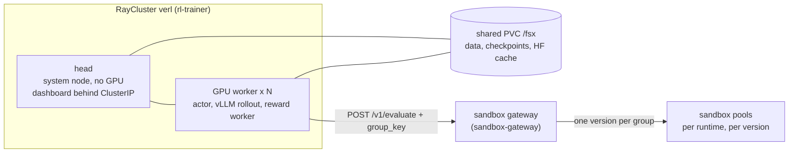

# 06 Scaling with veRL

!!! info "TL;DR"
    Spreading the single-GPU TRL loop over many GPUs with veRL 0.9.1 takes a separate image, parquet data, an async reward function that relies on the gateway's `group_key` pinning, a KubeRay `RayCluster`, and resumption from shared storage.

## From one GPU to multiple nodes

Moving a working single-GPU GRPO run to multiple GPUs changes how grading requests arrive. Multiple workers can send answers to one prompt as separate, concurrent requests, increasing waiting time at the sandbox pool.

![a: vLLM generation on one trainer A10G (24 GB), reward scoring on a separate sandbox GPU and the update on the trainer run in turn; each sandbox call takes one routing snapshot, so one batch is scored by one version, and the 7B bf16 weights alone take about 15 of the 24 GB. b: GPU workers (actor, vLLM rollout, reward worker) xN in RayCluster verl send each sample to the sandbox gateway with POST /v1/evaluate and a group_key, and the gateway pins a version per group_key, so one group is scored by one version of the sandbox pools (per runtime, per version)](../images/figures/production-06_scaling_with_verl.en.svg)

## Scaling with the same sandbox pools

Keep the EKS pools and route Ray worker evaluations through the gateway. Assign answers to the same prompt the same `group_key` to pin the grading version. In the first run, check evaluation wait time, `sandbox_error`, and version consistency alongside generation throughput. Save checkpoints on shared storage if a replacement pod must resume the run.

??? note "Conditions and exceptions"
    The hands-on trains a 1.5B model with LoRA on one A10G (24 GB).

    - **Long steps**: vLLM generates on that GPU, a separate sandbox GPU scores the candidate code, and the trainer then updates the LoRA adapter with the results. The three phases run one after another, so steps get long.
    - **Memory for a 7B model**: `Qwen/Qwen2.5-Coder-7B-Instruct` has about 7.6B parameters, so its bf16 weights alone are about 15 GB, which leaves little headroom when generation and training share one GPU (colocate mode).
    - **Reward calls on many GPUs**: moving to many GPUs also changes how rewards are called. veRL scores samples one at a time, so it cannot score a whole batch with one version as TRL does.

    - **Scale out in the same EKS cluster.** Running Ray through KubeRay reuses the sandbox pools, the gateway, the NetworkPolicies and token authentication.
    - **Keep on-policy consistency with per-sample scoring.** When the reward function attaches a `group_key` to every request, the gateway sends all samples of one group to the same sandbox version.
    - **Keep long runs going.** With checkpoints on a shared PVC and `trainer.resume_mode=auto`, resubmitting the job with the same `CKPT_DIR` after HyperPod replaces a node continues from the last checkpoint.

**Before you start:** the TRL loop in [On-policy GRPO training](../handson/scenarios/a/grpo.md) and the gateway API and group pins in [03 Gateway and pools](03_gateway_and_pools.md) help.

??? note "Terms"
    - **veRL**: an open source framework that runs RL post-training across many GPUs and nodes. This page is based on 0.9.1.
    - **Ray, KubeRay, RayCluster**: Ray is a distributed execution engine that spreads work over processes and nodes. KubeRay is the operator that runs Ray on Kubernetes, and a RayCluster is the KubeRay resource that declares a set of head and worker pods.
    - **reward worker, `compute_score`**: the unit of work veRL starts to compute rewards, and the user function that returns the score of one sample.
    - **parquet**: a columnar data file format. veRL reads its training data in this format.
    - **PVC, FSx for Lustre**: a PVC is a pod's request for a persistent volume; FSx for Lustre is an AWS managed shared file system that many nodes can mount at once.
    - **tensor parallel**: splitting the model weights over several GPUs to go beyond the memory of one GPU.
    - **`kubectl port-forward`**: a command that temporarily connects a Service port inside the cluster to a localhost port on your workstation.

    More terms are in the [Glossary](../reference/glossary.md).

## TRL path and veRL path

Multiple workers can score answers to one prompt in separate requests. veRL uses `group_key` so the gateway can keep their grading version consistent. Check throughput and version consistency independently.

| Item | TRL (hands-on) | veRL (production) |
|---|---|---|
| Trainer | `rl/trl/train_grpo.py`, 1 GPU, vLLM colocate, LoRA | `verl.trainer.main_ppo`, multiple GPUs, vLLM rollout |
| Image | `trainer/Dockerfile` (vllm 0.33.0, TRL 1.18.0) | `rl/verl/Dockerfile` (vllm 0.24.0, veRL 0.9.1) |
| Data | Built in memory with `build_rows` | Written as parquet by `rl/verl/prepare_data.py` |
| Reward call | Per batch, `evaluate_batch_sync` | Per sample, async `compute_score` → `evaluate_grouped` |
| Version pinning | One version per reward batch | Gateway pins per `group_key` (TTL 15 minutes) |
| `sandbox_error` | All three reward functions return `None`, sample excluded | Format score only, flagged with `sandbox_error: 1` |
| Launch | Kubernetes Job or HyperPodPyTorchJob | KubeRay `RayCluster` + `ray job submit` |
| Resume | `latest_checkpoint()` + `resume_from_checkpoint` | `trainer.resume_mode=auto` |
| Sandbox access | Direct (headless Service) or gateway | Gateway only |



*Takeaway: only the workers that compute rewards call the gateway, and the head and workers share data and checkpoints on one PVC.*

## Prerequisites

<span id="scope-and-limits"></span>

??? note "Which veRL components have been exercised"
    The data script produced 640 training rows and 10 validation rows locally. Tests cover the static policy, gateway pins and `compute_score` responses for passing code, missing code, policy violations and infrastructure failures using a fake gateway. The veRL image, RayCluster, live veRL training, authenticated Ray dashboard and resilient training were not exercised on AWS.

    The `reward.*` keys follow veRL 0.9.1. Check reward-worker placement, concurrency and `reward_extra_info` against your installed version. The sizing examples use script defaults; measure `t_eval` for the workload you deploy.

1. **KubeRay operator**: the latest release is v1.7.2 (API `ray.io/v1`). The commands below are the HyperPod documentation's install steps plus a pinned chart version.
2. **Gateway**: deploy it as in [03 Gateway and pools](03_gateway_and_pools.md) and include `system:serviceaccount:rl-trainer:grpo-trainer` in `GATEWAY_ALLOWED_SUBJECTS`. The gateway's `/readyz` succeeds only when it can read the routing table, so the `sandbox-routing` ConfigMap must also exist in the `sandbox-gateway` namespace.
3. **Shared PVC**: create a PVC in the `rl-trainer` namespace that the head and the workers mount together (the EKS documentation covers the FSx for Lustre CSI driver).
4. **A node for the head**: the head requests 4 CPUs and 16 GiB of memory on `gpusandbox/role: system` nodes. The hands-on default `m6i.large` is too small, so check the allocatable capacity of your system nodes.

Install the KubeRay operator and check the operator pod and the allocatable capacity of the system nodes.

```bash
helm repo add kuberay https://ray-project.github.io/kuberay-helm/
helm repo update
helm install kuberay-operator kuberay/kuberay-operator --version 1.7.2
kubectl get pods -l app.kubernetes.io/name=kuberay-operator
kubectl get nodes -l gpusandbox/role=system -o jsonpath='{range .items[*]}{.metadata.name}{" "}{.status.allocatable.cpu}{" "}{.status.allocatable.memory}{"\n"}{end}'
```

**What to look for:**

- The `kuberay-operator` pod is `Running`.
- One `<name> <cpu> <memory>` line per node. At least one system node must have 4 CPUs and 16 GiB of memory left after what other pods use, or the head cannot start.

**If it fails:**

- **If the operator pod does not start**: check the Events in `kubectl describe pod`.
- **If the head stays `Pending`**: move the system node group to a larger instance type.

## Why a separate image

The `[vllm]` extra of veRL 0.9.1 pins vllm 0.24.0, torch 2.11.0 and transformers 5.9.0, so it cannot share one image with the TRL stack (vllm 0.33.0, torch 2.14.0). `rl/verl/Dockerfile` builds the image in this order.

1. It starts from `vllm/vllm-openai:v0.24.0`.
2. It freezes the installed torch, vllm and triton versions into a constraints file so pip cannot move them.
3. It installs `verl[vllm]==0.9.1`.

The image also carries the `gpusandbox` client code and `rl/`, so the reward function `/opt/gpusandbox/rl/verl/reward_fn.py` exists on the head and on every worker.

According to the Dockerfile comment, CUDA 13 builds need an NVIDIA driver of the 580 branch or newer, and both the EKS AL2023 NVIDIA AMI (580.178.04) and the HyperPod EKS AMI (595.91.07) meet this. `scripts/03_build_push_images.sh` does not build this image.

The commands below log in to ECR, create the `verl` repository with IMMUTABLE tags if it does not exist, and build and push the image for linux/amd64. The Dockerfile does not pin `ray[default]`, so the Ray version can differ between builds; put the value printed by the last line into `RAY_VERSION`.

```bash
source scripts/config.env
registry="$(aws sts get-caller-identity --query Account --output text).dkr.ecr.${AWS_REGION}.amazonaws.com"
aws ecr get-login-password --region "${AWS_REGION}" | docker login --username AWS --password-stdin "${registry}"
aws ecr describe-repositories --region "${AWS_REGION}" --repository-names "${ECR_REPO_PREFIX}/verl" >/dev/null 2>&1 \
  || aws ecr create-repository --region "${AWS_REGION}" --repository-name "${ECR_REPO_PREFIX}/verl" \
       --image-scanning-configuration scanOnPush=true --image-tag-mutability IMMUTABLE >/dev/null
docker buildx build --platform linux/amd64 -f rl/verl/Dockerfile \
  -t "${registry}/${ECR_REPO_PREFIX}/verl:${IMAGE_TAG}" --push .
# RayCluster spec.rayVersion must match the Ray version inside the image
docker run --rm "${registry}/${ECR_REPO_PREFIX}/verl:${IMAGE_TAG}" python3 -c "import ray; print(ray.__version__)"
```

**What to look for:**

- `docker login` prints `Login Succeeded`.
- The build finishes with the push, and the last line prints one Ray version.
- **If you push the same tag again**: it fails because of the IMMUTABLE setting, so change `IMAGE_TAG`.
- **Other build problems**: see the configuration and scripts table of [Troubleshooting](../reference/troubleshooting.md).

## Data preparation

`rl/verl/prepare_data.py` turns the task list into the columns veRL expects and writes `train.parquet` and `val.parquet`. With the defaults (`--max-level 3`, `--repeats 64`) all 10 tasks are included, giving 640 train rows and 10 validation rows.

| Column | Value | Used by |
|---|---|---|
| `data_source` | `"gpusandbox/kernels"` | `compute_score` argument |
| `prompt` | Chat messages (`build_messages`) | Rollout input |
| `ability` | `"code"` | Metadata |
| `reward_model` | `{"style": "rule", "ground_truth": <task_id>}` | `ground_truth` is passed to `compute_score` |
| `extra_info` | `{"index", "task_id", "level", "repeat"}` | `index` goes into `group_key` |

`ground_truth` holds the task ID, and `prompt` holds the PyTorch reference code the model is asked to rewrite. The sandbox computes the reference outputs and timings from the reference in its own image.

Write the files to the shared PVC with a one-shot Job on the same image: fill in `<VERL_IMAGE_URI>` and `<SHARED_PVC>` in the example manifest below (not in the repository) and apply it with `kubectl apply -f <file>`.

```yaml
apiVersion: batch/v1
kind: Job
metadata: {name: verl-prepare-data, namespace: rl-trainer}
spec:
  backoffLimit: 0
  template:
    spec:
      restartPolicy: Never
      automountServiceAccountToken: false
      nodeSelector: {gpusandbox/role: system}
      containers:
        - name: prepare
          image: <VERL_IMAGE_URI>
          command: ["python3", "/opt/gpusandbox/rl/verl/prepare_data.py", "--out", "/fsx/verl/data/kernels", "--repeats", "64"]
          volumeMounts: [{name: shared, mountPath: /fsx}]
      volumes: [{name: shared, persistentVolumeClaim: {claimName: <SHARED_PVC>}}]
```

**What to look for:** `kubectl -n rl-trainer logs job/verl-prepare-data` prints `wrote 640 train / 10 val rows to /fsx/verl/data/kernels`.

## Async reward function

`compute_score(data_source, solution_str, ground_truth, extra_info, **kwargs)` in `rl/verl/reward_fn.py` returns one score with the same weights as the TRL path (format 0.1, correctness 1.0, speedup 0.5). veRL 0.9.x recommends async reward functions for sandboxed execution, and one reward worker runs many `compute_score` coroutines concurrently.

1. If there is no code block, nothing is sent to the sandbox and the result is `score` 0.0 with `status: no_code`.
2. If the static policy fails, nothing is sent either. The score is the format score 0.1 if the code parses and has a top-level `ModelNew` class, and 0 otherwise.
3. It builds `group_key = f"{task_id}:{index}"` and sends the sample to the gateway's `POST /v1/evaluate`.
4. It computes correctness and speedup from the verdict and returns them in a result dict with `sandbox_version`.

| `sandbox_error` handling | TRL | veRL |
|---|---|---|
| Behavior | All three reward functions return `None` and the sample is excluded (if all are `None`, the advantage is 0) | Format score 0.1 only, flagged with `sandbox_error: 1` |
| Reason | TRL expresses "unscorable" with `None` | veRL has no "skip this sample" signal (comment in `reward_fn.py`) |
| What to watch | `reward_batch.status.sandbox_error` | `sandbox_error` in the `reward_extra_info` part of the logs (logging format varies by release) |

!!! question "❓ Misconception: veRL also drops sandbox_error samples from training"
    It does not. An infrastructure failure still gets a low score (0.1) inside its group, which can inflate the advantages of the other samples in that group, so on the veRL path set the `sandbox_error` rate alarm tighter than for TRL ([07 Observability and operations](07_observability_and_operations.md)).

??? info "How group_key interacts with the pin TTL"
    `index` is the row number in the dataset, so the same row comes back in the next epoch (with the defaults, 640 rows at 64 per step repeat every 10 steps). A gateway pin is released only after `GATEWAY_GROUP_PIN_TTL_S` (default 900 s).

    - **If an epoch is shorter than the TTL**: the next epoch's group reuses the old pin.
    - **If the pin expires while a group is being scored**: the group can be split across versions.
    - **What to do**: tune the TTL so that "time to score one group < TTL < epoch length", or consider including a value that distinguishes steps or epochs in `group_key` (check what veRL passes in `kwargs` for your release).
    - **Validation groups**: `prepare_data.py` also numbers `val.parquet` from index 0, so validation groups use the same `task_id:index` as the first 10 training rows. The TTL cannot tell training and validation groups apart; to switch them separately or compare their versions, `group_key` also needs a value that distinguishes the data split.

## RayCluster

| Part | Setting | Why |
|---|---|---|
| Head | `num-gpus: "0"`, `dashboard-host: "0.0.0.0"`, `gpusandbox/role: system`, 4 CPUs, 16 GiB | Runs only the driver and the dashboard. The dashboard sits behind a ClusterIP Service only |
| Worker group `gpu` | `replicas = minReplicas = maxReplicas = VERL_NNODES` | Fixed size (no autoscaling) |
| Worker label | `gpusandbox/client: "true"` | Marks a sandbox client |
| Worker `serviceAccountName` | `grpo-trainer`, `automountServiceAccountToken: false` | Subject on the gateway allowlist, no Kubernetes API token |
| Worker projected token | Audience `gpu-sandbox-gateway`, 3600 s | Matches the gateway's TokenReview audience |
| Worker env | `SANDBOX_GATEWAY=gateway.sandbox-gateway.svc.cluster.local:8080`, `SANDBOX_TOKEN_FILE`, `HF_HOME=/fsx/hf` | The reward function calls the gateway; the model cache is shared |
| Volumes | Shared PVC on `/fsx` (head and workers), `/dev/shm` as 64 GiB of memory on workers | Data, checkpoints, model cache |

The ServiceAccount, projected token and gateway env exist only on the GPU workers. The head template sets neither a ServiceAccount nor whether the API token is mounted automatically, so the head follows the namespace's `default` ServiceAccount.

| Scenario | `VERL_NODE_SELECTOR` |
|---|---|
| A (EC2 trainer NodePool or node group) | `'{"gpusandbox/role": "trainer"}'` |
| B (HyperPod) | `'{"sagemaker.amazonaws.com/node-health-status": "Schedulable", "node.kubernetes.io/instance-type": "ml.g6e.48xlarge"}'` |

The health label in the HyperPod example places workers only on `Schedulable` nodes. From the repository root, fill the RayCluster template with `scripts/render.py`, apply it, and check its status.

```bash
python3 scripts/render.py k8s/production/raycluster-verl.yaml.tpl \
  RAY_VERSION="<ray version in the image>" \
  VERL_IMAGE_URI="<registry>/gpu-sandbox/verl:<tag>" \
  SHARED_PVC="<pvc name>" \
  VERL_NNODES=1 VERL_GPUS_PER_NODE=8 \
  VERL_NODE_SELECTOR='{"gpusandbox/role": "trainer"}' \
  VERL_CPU="<cpu>" VERL_MEMORY="<memory>" \
  | kubectl apply -f -
kubectl -n rl-trainer get raycluster verl
kubectl -n rl-trainer get pods -l app=verl-worker -o wide
```

**What to look for:**

- `VERL_NNODES` worker pods are `Running` and Ready on GPU nodes.
- The head pod shows up with `kubectl -n rl-trainer get pods -l app=verl-head`.

**If it fails:** if a worker stays `Pending`, look for missing GPUs or a node selector mismatch in the Events of `kubectl describe pod`.

!!! warning "The head has no gateway settings"
    Only the workers have `SANDBOX_GATEWAY` and the gateway token. If veRL places reward computation on the head, `SandboxClient.from_env()` raises `RoutingError` or every sample fails. Reward worker placement can depend on the veRL release and configuration, so consider the Ray convention of setting `num-cpus: "0"` in the head's `rayStartParams` so that no work is scheduled on the head.

!!! tip "Add do-not-disrupt on Karpenter"
    The trainer NodePool comment in `infra/karpenter/nodepools.yaml` says that RayCluster pods carry do-not-disrupt, but the current template does not set it. Adding `karpenter.sh/do-not-disrupt: "true"` to `metadata.annotations` of the worker template blocks voluntary disruption such as drift, but not forceful disruption such as expiration (`expireAfter: 720h`) or interruption (karpenter.sh docs).

## Submission

`rl/verl/run_grpo_kernels.sh` calls `ray job submit` from your workstation, so you need the `ray` CLI (the same Ray version as the image is safe). Terminal 1 connects the head Service's dashboard port (8265) to 127.0.0.1 on your workstation; terminal 2 submits the job and follows the log.

```bash
# terminal 1: binds 127.0.0.1 only
kubectl -n rl-trainer port-forward svc/verl-head-svc 8265:8265

# terminal 2
MODEL_PATH=Qwen/Qwen2.5-Coder-7B-Instruct NNODES=1 GPUS_PER_NODE=8 rl/verl/run_grpo_kernels.sh
ray job list --address http://127.0.0.1:8265
ray job logs <submission-id> --address http://127.0.0.1:8265 --follow
```

**What to look for:**

- Terminal 1 shows `Forwarding from 127.0.0.1:8265 -> 8265`. Keep it open.
- The script submits with `--no-wait` and returns right away, printing the submission ID. `ray job list` shows the same ID and its status.
- `ray job logs` keeps printing veRL step logs.

**If it fails:**

- **Connection errors**: they usually mean the port-forward has dropped.
- **If the job turns `FAILED` right away**: read the last Traceback in `ray job logs`.

| Variable | Default | Meaning |
|---|---|---|
| `RAY_ADDRESS` | `http://127.0.0.1:8265` | The port-forwarded dashboard |
| `MODEL_PATH` | `Qwen/Qwen2.5-Coder-7B-Instruct` | Apache-2.0, ungated |
| `DATA_DIR` | `/fsx/verl/data/kernels` | Output of `prepare_data.py` |
| `CKPT_DIR` | `/fsx/verl/ckpts/kernels-grpo` | `trainer.default_local_dir` |
| `NNODES`, `GPUS_PER_NODE` | 1, 8 | Keep equal to the RayCluster's `VERL_NNODES` and `VERL_GPUS_PER_NODE` |
| `TRAIN_BATCH_SIZE` | 64 | Prompts per step |
| `N_RESP_PER_PROMPT` | 8 | GRPO group size (`rollout.n`) |
| `TOTAL_STEPS` | 200 | `trainer.total_training_steps` |

Reward settings use the veRL 0.9.1 `reward.*` keys: `reward.custom_reward_function.path=/opt/gpusandbox/rl/verl/reward_fn.py`, `reward.custom_reward_function.name=compute_score`, `reward.num_workers=8`.

!!! warning "Config keys in older examples"
    The AWS veRL sample (`examples/training/verl/hyperpod-eks/rlvr` in `awslabs/awsome-distributed-ai`) was tested on veRL v0.6.1 and uses the top-level `custom_reward_function.path` and `.name` keys. The v0.9.1 default config places reward settings under `reward.*` (`verl/trainer/config/reward/reward.yaml`) and still carries the old top-level keys in a `legacy_reward_impl` block for backward compatibility. Do not mix the two forms, and check which one your installed release reads.

## Sizing (conditional guidance)

- **GPU memory**: the script defaults are rollout `tensor_model_parallel_size=1` and `gpu_memory_utilization=0.5`, so the 7B weights (about 15 GB) plus the KV cache must fit in vLLM's half of the GPU memory. On an A10G or L4 (24 GB) that is 12 GB, which is not enough: raise tensor parallelism or use GPUs with more memory. Check the GPU count and memory of the trainer NodePool candidates (`g6e.12xlarge`, `g6e.48xlarge`, `p5.48xlarge`) in the EC2 instance type documentation and set `GPUS_PER_NODE` to match.
- **Sandbox pods**: per step there are at most `N = TRAIN_BATCH_SIZE × N_RESP_PER_PROMPT` scoring requests (512 by default); samples without code or with policy violations are filtered locally. With `P` ready pods and one evaluation taking `t_eval`, the reward phase takes roughly `ceil(N / P) × t_eval`. Measure `t_eval` with `eval_p50_s` and `eval_p95_s` from `scripts/ops/bench.sh`.
- **Timeouts**: the veRL client waits 300 s for the gateway's answer (`request_timeout_s` of `SandboxClient`), and the gateway waits 600 s for a free pod (`acquire_timeout_s` of `SandboxPool`).
    - **If all N requests arrive at once**: any request that gets no answer within 300 s becomes `sandbox_error`. The last request then finishes in turn `ceil(N / P)`, so pick `P` such that `ceil(N / P) × t_eval(p95)` plus some network margin stays below 300 s, and check the actual timeout rate. For example, with N = 32 and `t_eval` = 28 s, `P` = 3 finishes the 11th turn at 308 s, so `P` must be at least 4.
    - **Concurrent requests**: how many requests veRL sends at once depends on `reward.num_workers` and the release's async handling.
- **Upper bounds**: the `sandbox-gvisor` NodePool and the ResourceQuota cap GPUs at 16, so with blue/green headroom one pool can have at most 8 under the default limits. For larger pools, raise both limits together.
- **GPU type**: speedups are measured on the sandbox GPU, so choose the GPU you want the kernels to be fast on and keep every pod of a pool on the same GPU type (mixing means the speedups of one group are measured on different hardware). The `sandbox-gvisor` NodePool allows only `g5.xlarge` and `g5.2xlarge` (both A10G).

## Resuming

With `trainer.resume_mode=auto`, veRL continues from the latest checkpoint in `trainer.default_local_dir`, and since the script sets `trainer.save_freq=20`, up to 20 steps may run again.

When a node on HyperPod has a fault, the following happens in order.

1. HyperPod's `NodeRecovery: Automatic` reboots or replaces the faulty node.
2. KubeRay recreates the worker pod.
3. You resubmit the job with the same command. Training continues from the checkpoint in `CKPT_DIR`.

To automate the resubmission as well, look at RayJob or the resilient training features of Ray on HyperPod.

The TRL path follows the same principle, but `k8s/trainer/hyperpod-job-grpo.yaml.tpl` keeps `/outputs` on an `emptyDir` to keep the hands-on simple, so checkpoints are lost when the pod is recreated or the node is replaced. To resume, change the `outputs` volume to a shared PVC in the `rl-trainer` namespace.

```yaml
        - name: outputs
          persistentVolumeClaim: {claimName: <SHARED_PVC>}
```

## Dashboard access

The dashboard is reached only through `kubectl port-forward` (binds 127.0.0.1 by default). Port 8265 also serves the Ray Jobs API, so anyone who reaches it can run code on the cluster.

- **Do not expose it**: do not expose it through a LoadBalancer or a NodePort, and do not pass `--address 0.0.0.0` to port-forward.
- **Other pods in the cluster**: they can still reach a ClusterIP, so the NetworkPolicy `verl-raycluster-members-only` at the end of the template admits only pods of this RayCluster (`ray.io/cluster: verl`).
- **Port-forward**: it goes through the kubelet, so it keeps working under this policy.

The Ray on HyperPod documentation also describes access through an authenticated browser link without port-forward.

## How to verify

- `ray job list` shows the job as `RUNNING`, and `ray job logs` keeps printing veRL step logs.
- The gateway's `gateway_evaluations_total` grows per `version` label.
    - **During a switch**: groups pinned earlier and new groups increment the old and new version counters, and because the counter is cumulative the old label stays.
- **Consistency within a group**: the value `compute_score` returns has no `group_key`, and samples decided locally (`no_code`, `policy_violation`) have an empty `sandbox_version`. Check consistency within a group in a record that lets you group samples by data row (`task_id`, `index`), comparing `sandbox_version` only across responses the sandbox actually scored. Validation data uses the same `task_id` and `index`, so group training and validation records separately.
- `sandbox_error` in the reward extra info of the logs stays close to 0.
- Every `save_freq` steps a checkpoint directory appears under `CKPT_DIR` (veRL's default name is `global_step_<N>`).

## Cost and cleanup

The 8-GPU trainer node is most of the cost (prices and arithmetic in [08 Cost](08_cost.md)). When training ends, free the GPU allocations by removing the workers with `kubectl -n rl-trainer delete raycluster verl`.

- **A node created by the Karpenter trainer NodePool**: it becomes a reclaim candidate after 15 minutes empty (`consolidateAfter: 15m`) and bills until it actually terminates.
- **The CDK-managed trainer node group of scenario A**: it keeps its instance running after the pods are gone, so scale it down yourself (`aws eks update-nodegroup-config --cluster-name "$CLUSTER_NAME" --nodegroup-name trainer --scaling-config minSize=0,maxSize=1,desiredSize=0`).
- **HyperPod instance groups**: they bill until you scale them down or delete the cluster (delete the hands-on cluster with `scripts/hyperpod/delete.sh`).
- **The old sandbox pool**: `--finish` from [05 Sandbox versioning](05_sandbox_updates.md) scales it to zero.
- **If the active pool is no longer used after training**: scale it to zero replicas too.

Related pages: [On-policy GRPO training](../handson/scenarios/a/grpo.md), [HyperPod training paths](../handson/scenarios/b/index.md), [01 Capacity and nodes](01_capacity_and_nodes.md), [02 Security](02_security.md).

??? note "References"
    | Topic | Link |
    |---|---|
    | Ray on SageMaker HyperPod | https://docs.aws.amazon.com/sagemaker/latest/dg/sagemaker-hyperpod-ray.html |
    | Installing KubeRay on HyperPod EKS | https://docs.aws.amazon.com/sagemaker/latest/dg/sagemaker-hyperpod-ray-install-kuberay.html |
    | veRL | https://github.com/verl-project/verl |
    | veRL 0.9.1 reward config | https://github.com/verl-project/verl/blob/v0.9.1/verl/trainer/config/reward/reward.yaml |
    | RayCluster template | https://github.com/daekeun-ml/gpu-sandbox-on-aws/blob/main/k8s/production/raycluster-verl.yaml.tpl |

    [Selected references on this topic](../reference/references.md#ref-production-06-scaling-with-verl)
