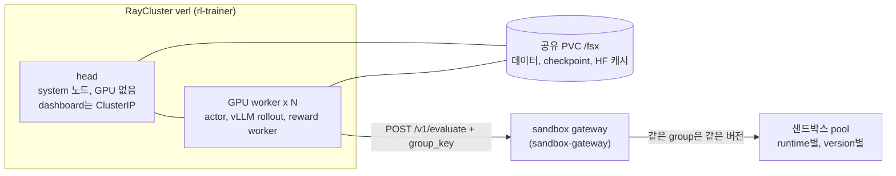

# 06 veRL로 확장

!!! info "TL;DR"
    GPU 한 장에서 실행하던 TRL 학습을 veRL 0.9.1로 여러 GPU에서 실행하려면 전용 이미지와 parquet 데이터를 준비하고 KubeRay `RayCluster`를 구성합니다. async reward 함수는 gateway에 `group_key`를 보내 채점 버전을 고정합니다. 중단한 학습을 이어 가려면 checkpoint를 공유 스토리지에 저장합니다.

## 한 장의 GPU에서 여러 노드로

GPU 한 장에서 실행한 GRPO를 여러 GPU로 옮길 때는 필요한 메모리와 step당 소요 시간뿐 아니라 채점 요청을 받는 방식도 달라집니다. worker 여러 개가 동시에 답을 보내면 같은 문제의 답들이 각기 다른 요청으로 들어오고, 샌드박스 pool에서 채점을 기다리는 시간도 늘어날 수 있습니다.


## 같은 샌드박스 pool로 확장하기

<span id="같은-샌드박스-풀로-확장하기"></span>

기존 EKS pool을 유지하고 Ray worker가 gateway를 호출하도록 연결합니다. 같은 문제의 답에는 같은 `group_key`를 붙여 버전을 고정합니다. 운영 환경에서 처음 학습할 때는 답안 생성 처리량과 채점 대기 시간을 살피고 `sandbox_error`가 얼마나 자주 발생하는지 확인하세요. 같은 문제의 답안을 같은 버전에서 채점했는지도 살펴보세요. 중단 후 재개가 필요하면 새 pod에서도 읽을 수 있는 공유 스토리지에 checkpoint를 저장합니다.

??? note "세부 조건과 예외"
    핸즈온은 1.5B 모델을 LoRA로 A10G 한 장(24 GB)에서 학습합니다.

    - **긴 step**: 이 GPU에서 vLLM이 응답을 생성하면 별도 샌드박스 GPU가 후보 코드를 채점하고, 결과를 받은 trainer가 LoRA를 업데이트합니다. 세 단계가 차례로 이어지므로 step이 길어집니다.
    - **7B 모델의 메모리**: `Qwen/Qwen2.5-Coder-7B-Instruct`는 파라미터가 약 7.6B라 bf16 가중치만 약 15 GB입니다. 생성과 학습을 한 GPU에서 실행하는 colocate 방식으로는 메모리 여유가 거의 없습니다.
    - **샘플별 채점 요청**: veRL은 샘플을 하나씩 채점해서 TRL처럼 batch 전체를 한 버전으로 채점할 수 없습니다.

    - **같은 EKS 클러스터에서 확장합니다.** KubeRay로 Ray를 배포하면 기존 샌드박스 pool, gateway, NetworkPolicy, 토큰 인증을 그대로 쓸 수 있습니다.
    - **샘플을 따로 보내더라도 group의 채점 버전은 고정합니다.** reward 함수가 요청마다 `group_key`를 붙이면 gateway는 이 키를 기준으로 샘플을 같은 샌드박스 버전으로 보냅니다.
    - **긴 run을 중단 지점부터 재개합니다.** checkpoint를 공유 PVC에 두고 `trainer.resume_mode=auto`를 쓰면, HyperPod가 노드를 교체한 뒤 같은 `CKPT_DIR`로 job을 다시 제출할 때 마지막 checkpoint부터 이어서 학습합니다.

**읽기 전에**　[05 On-policy GRPO 학습](../handson/05_grpo_training.md)의 TRL 루프와 [03 Gateway와 샌드박스 pool](03_gateway_and_pools.md)의 gateway API, group pin을 먼저 보세요.

??? note "용어"
    - **veRL**: 여러 GPU와 노드에 걸쳐 RL post-training을 실행하는 오픈소스 프레임워크입니다. 이 페이지는 0.9.1을 기준으로 합니다.
    - **Ray, KubeRay, RayCluster**: Ray는 여러 프로세스와 노드에 작업을 나눠 주는 분산 실행 엔진입니다. KubeRay는 Kubernetes에서 Ray를 운영하는 operator이고, RayCluster는 head와 worker pod 묶음을 선언하는 KubeRay 리소스입니다.
    - **reward worker, `compute_score`**: veRL이 reward를 계산하려고 실행하는 작업 단위와, 샘플 하나의 점수를 반환하는 사용자 함수입니다.
    - **parquet**: 열 단위로 저장하는 데이터 파일 형식입니다. veRL은 학습 데이터를 이 형식으로 읽습니다.
    - **PVC, FSx for Lustre**: PVC는 pod가 쓰는 영구 볼륨 요청이고, FSx for Lustre는 여러 노드가 함께 마운트할 수 있는 AWS 관리형 공유 파일 시스템입니다.
    - **tensor parallel**: 모델 가중치를 여러 GPU에 나눠 저장해, GPU 하나의 메모리보다 큰 모델을 실행하는 방법입니다.
    - **`kubectl port-forward`**: 클러스터 안의 Service 포트를 작업 PC의 localhost 포트로 잠시 연결하는 명령입니다.

    더 많은 용어는 [용어 사전](../reference/glossary.md)에 있습니다.

## TRL 경로와 veRL 경로

여러 worker로 확장하면 같은 문제의 답들이 서로 다른 요청으로 들어올 수 있습니다. veRL 경로에서는 `group_key`로 묶음을 구분하고, gateway가 같은 묶음의 답안을 한 버전에서 채점하도록 합니다. 처리량과 채점 버전 일관성을 각각 확인하세요.

| 항목 | TRL (핸즈온) | veRL (Production) |
|---|---|---|
| trainer | `rl/trl/train_grpo.py`, GPU 1개, vLLM colocate, LoRA | `verl.trainer.main_ppo`, 여러 GPU, vLLM rollout |
| 이미지 | `trainer/Dockerfile` (vllm 0.33.0, TRL 1.18.0) | `rl/verl/Dockerfile` (vllm 0.24.0, veRL 0.9.1) |
| 데이터 | `build_rows`로 메모리에서 생성 | `rl/verl/prepare_data.py`가 parquet로 기록 |
| reward 호출 | batch 단위 `evaluate_batch_sync` | 샘플 단위 async `compute_score` → `evaluate_grouped` |
| 버전 고정 | reward batch 하나에 버전 하나 | gateway가 `group_key`마다 고정 (TTL 15분) |
| `sandbox_error` | 세 reward 함수 모두 `None`, 샘플 제외 | format 점수만 주고 `sandbox_error: 1` 표시 |
| 실행 | Kubernetes Job 또는 HyperPodPyTorchJob | KubeRay `RayCluster` + `ray job submit` |
| 재개 | `latest_checkpoint()` + `resume_from_checkpoint` | `trainer.resume_mode=auto` |
| 샌드박스 접근 | direct(headless Service) 또는 gateway | gateway만 |



*그림 요약: reward를 계산하는 worker만 gateway를 부르고, head와 worker는 데이터와 checkpoint를 공유 PVC 하나에서 읽고 씁니다.*

## 사전 준비

1. **KubeRay operator**: 최신 릴리스는 v1.7.2(API `ray.io/v1`)입니다. 아래 명령은 HyperPod 문서의 설치 절차에 차트 버전 고정만 추가했습니다.
2. **gateway**: [03 Gateway와 샌드박스 pool](03_gateway_and_pools.md)대로 배포하고 `GATEWAY_ALLOWED_SUBJECTS`에 `system:serviceaccount:rl-trainer:grpo-trainer`를 넣습니다. gateway의 `/readyz`는 routing 표를 읽어야 성공하므로 `sandbox-gateway` 네임스페이스에도 `sandbox-routing` ConfigMap이 있어야 합니다.
3. **공유 PVC**: `rl-trainer` 네임스페이스에 head와 worker가 함께 마운트할 PVC를 만듭니다(FSx for Lustre CSI driver 사용법은 EKS 문서 참고).
4. **head를 배치할 노드**: head는 `gpusandbox/role: system` 노드에 CPU 4, 메모리 16 GiB를 요청합니다. 핸즈온 기본값 `m6i.large`로는 부족하므로 system 노드의 allocatable을 확인하세요.

KubeRay operator를 설치하고 operator pod와 system 노드의 allocatable을 확인합니다.

```bash
helm repo add kuberay https://ray-project.github.io/kuberay-helm/
helm repo update
helm install kuberay-operator kuberay/kuberay-operator --version 1.7.2
kubectl get pods -l app.kubernetes.io/name=kuberay-operator
kubectl get nodes -l gpusandbox/role=system -o jsonpath='{range .items[*]}{.metadata.name}{" "}{.status.allocatable.cpu}{" "}{.status.allocatable.memory}{"\n"}{end}'
```

**확인할 것:**

- `kuberay-operator` pod가 `Running`입니다.
- 노드마다 `<이름> <CPU> <메모리>` 한 줄이 출력됩니다. 다른 pod가 사용하는 리소스를 빼고도 CPU 4와 메모리 16 GiB가 남는 system 노드가 하나 이상 있어야 head pod가 실행됩니다.

**문제가 생기면:**

- **operator pod가 시작되지 않으면**: `kubectl describe pod`의 Events를 확인하세요.
- **head가 `Pending`이면**: system 노드 그룹을 더 큰 인스턴스로 바꾸세요.

## 이미지를 따로 두는 이유

veRL 0.9.1의 `[vllm]` extra는 vllm 0.24.0, torch 2.11.0, transformers 5.9.0을 고정하므로 TRL 이미지(vllm 0.33.0, torch 2.14.0)와 한 이미지에 함께 설치할 수 없습니다. `rl/verl/Dockerfile`은 다음 순서로 이미지를 만듭니다.

1. 기본 이미지는 `vllm/vllm-openai:v0.24.0`입니다.
2. 이미 설치된 torch, vllm, triton 버전을 constraints 파일로 고정해 pip가 바꾸지 못하게 합니다.
3. `verl[vllm]==0.9.1`을 설치합니다.

이미지에는 `gpusandbox` 클라이언트 코드와 `rl/`도 포함되므로, reward 함수 `/opt/gpusandbox/rl/verl/reward_fn.py`가 head와 모든 worker에 있습니다.

Dockerfile 주석에 따르면 CUDA 13 빌드는 580 계열 이상의 NVIDIA 드라이버가 필요하고, EKS AL2023 NVIDIA AMI(580.178.04)와 HyperPod EKS AMI(595.91.07)는 모두 이를 만족합니다. `scripts/03_build_push_images.sh`는 이 이미지를 빌드하지 않습니다.

아래 명령은 ECR에 로그인하고, `verl` 저장소가 없으면 tag immutability를 IMMUTABLE로 설정해 만든 뒤 linux/amd64 이미지를 빌드해 push합니다. Dockerfile이 `ray[default]` 버전을 고정하지 않아 빌드마다 Ray 버전이 달라질 수 있으니, 마지막 줄이 출력한 값을 `RAY_VERSION`에 넣으세요.

```bash
source scripts/config.env
registry="$(aws sts get-caller-identity --query Account --output text).dkr.ecr.${AWS_REGION}.amazonaws.com"
aws ecr get-login-password --region "${AWS_REGION}" | docker login --username AWS --password-stdin "${registry}"
aws ecr describe-repositories --region "${AWS_REGION}" --repository-names "${ECR_REPO_PREFIX}/verl" >/dev/null 2>&1 \
  || aws ecr create-repository --region "${AWS_REGION}" --repository-name "${ECR_REPO_PREFIX}/verl" \
       --image-scanning-configuration scanOnPush=true --image-tag-mutability IMMUTABLE >/dev/null
docker buildx build --platform linux/amd64 -f rl/verl/Dockerfile \
  -t "${registry}/${ECR_REPO_PREFIX}/verl:${IMAGE_TAG}" --push .
# RayCluster spec.rayVersion must match the Ray version inside the image
docker run --rm "${registry}/${ECR_REPO_PREFIX}/verl:${IMAGE_TAG}" python3 -c "import ray; print(ray.__version__)"
```

**확인할 것:**

- `docker login`이 `Login Succeeded`를 출력합니다.
- 빌드가 push까지 끝난 뒤 마지막 줄에 Ray 버전 하나가 출력됩니다.
- **같은 태그로 다시 push하면**: IMMUTABLE 설정 때문에 실패하니 `IMAGE_TAG`를 바꾸세요.
- **그 밖의 빌드 문제**: [문제 해결](../reference/troubleshooting.md)의 "설정과 스크립트" 표를 보세요.

## 데이터 준비

`rl/verl/prepare_data.py`는 task 목록을 veRL이 요구하는 열 형식으로 변환해 `train.parquet`과 `val.parquet`을 생성합니다. 기본값(`--max-level 3`, `--repeats 64`)을 쓰면 task 10개가 모두 포함되어 train 640행, val 10행이 만들어집니다.

| 열 | 값 | 쓰이는 곳 |
|---|---|---|
| `data_source` | `"gpusandbox/kernels"` | `compute_score` 인자 |
| `prompt` | chat 메시지 (`build_messages`) | rollout 입력 |
| `ability` | `"code"` | 메타데이터 |
| `reward_model` | `{"style": "rule", "ground_truth": <task_id>}` | `ground_truth`가 `compute_score`로 전달 |
| `extra_info` | `{"index", "task_id", "level", "repeat"}` | `index`가 `group_key`에 쓰임 |

`ground_truth`에는 task ID가, `prompt`에는 모델이 다시 작성할 PyTorch reference 코드가 들어갑니다. 기준 출력과 실행 시간은 샌드박스가 자체 이미지의 reference로 계산합니다.

veRL 이미지로 일회성 Job을 실행해 데이터를 공유 PVC에 저장합니다. 아래 예시 매니페스트(저장소에 없음)의 `<VERL_IMAGE_URI>`와 `<SHARED_PVC>`를 채워 `kubectl apply -f <파일>`로 적용하세요.

```yaml
apiVersion: batch/v1
kind: Job
metadata: {name: verl-prepare-data, namespace: rl-trainer}
spec:
  backoffLimit: 0
  template:
    spec:
      restartPolicy: Never
      automountServiceAccountToken: false
      nodeSelector: {gpusandbox/role: system}
      containers:
        - name: prepare
          image: <VERL_IMAGE_URI>
          command: ["python3", "/opt/gpusandbox/rl/verl/prepare_data.py", "--out", "/fsx/verl/data/kernels", "--repeats", "64"]
          volumeMounts: [{name: shared, mountPath: /fsx}]
      volumes: [{name: shared, persistentVolumeClaim: {claimName: <SHARED_PVC>}}]
```

**확인할 것:** `kubectl -n rl-trainer logs job/verl-prepare-data`가 `wrote 640 train / 10 val rows to /fsx/verl/data/kernels`를 출력합니다.

## async reward 함수

`rl/verl/reward_fn.py`의 `compute_score(data_source, solution_str, ground_truth, extra_info, **kwargs)`는 TRL 경로와 같은 가중치(format 0.1, correctness 1.0, speedup 0.5)로 점수 하나를 반환합니다. veRL 0.9.x는 샌드박스 실행에 async reward 함수를 권장하며, reward worker 하나가 여러 `compute_score` 코루틴을 동시에 실행합니다.

1. 코드 블록이 없으면 샌드박스에 보내지 않고 `score` 0.0, `status: no_code`를 반환합니다.
2. 정적 정책을 통과하지 못하면 샌드박스에 보내지 않습니다. 코드를 파싱할 수 있고 최상위에 `ModelNew` 클래스가 있으면 format 점수 0.1, 아니면 0점입니다.
3. `group_key = f"{task_id}:{index}"`를 만들어 gateway의 `POST /v1/evaluate`로 보냅니다.
4. 응답으로 correctness와 speedup 점수를 계산해 `sandbox_version`과 함께 결과 dict로 반환합니다.

| `sandbox_error` 처리 | TRL | veRL |
|---|---|---|
| 동작 | 세 reward 함수가 모두 `None`을 반환해 샘플을 제외 (전부 `None`이면 advantage 0) | format 점수 0.1만 주고 `sandbox_error: 1` 표시 |
| 이유 | TRL은 `None`으로 "채점 불가"를 표현 | veRL에는 샘플을 건너뛰는 신호가 없음 (`reward_fn.py` 주석) |
| 감시 | `reward_batch.status.sandbox_error` | 로그의 `reward_extra_info`에서 `sandbox_error` (로깅 형식은 릴리스에 따라 다름) |

!!! question "❓ 오해: veRL에서도 sandbox_error 샘플은 학습에서 제외된다"
    제외되지 않습니다. 인프라 오류가 난 샘플도 group 안에서 낮은 점수(0.1)를 받으므로 같은 group의 다른 샘플 advantage가 실제보다 커질 수 있습니다. veRL 경로에서는 `sandbox_error` 비율 경보 기준을 TRL보다 엄격하게 설정하세요([07 Observability와 운영](07_observability_and_operations.md)).

??? info "group_key와 pin TTL의 관계"
    `index`는 데이터셋의 행 번호이므로 다음 epoch에 같은 값이 다시 나옵니다(기본값이면 640행을 step당 64개씩 사용해 10 step마다 반복). gateway 고정은 `GATEWAY_GROUP_PIN_TTL_S`(기본 900초)가 지나야 해제됩니다.

    - **epoch가 TTL보다 짧으면**: 다음 epoch에서도 같은 group은 이전에 고정한 버전으로 채점합니다.
    - **채점 도중에 고정이 만료되면**: group 안에서 버전이 달라질 수 있습니다.
    - **대응**: "한 group을 채점하는 시간 < TTL < epoch 길이"가 되도록 TTL을 조정하거나, `group_key`에 step이나 epoch를 구분하는 값을 넣는 것을 고려하세요(veRL이 `kwargs`로 무엇을 전달하는지는 릴리스마다 재확인).
    - **검증 group**: `prepare_data.py`는 `val.parquet`의 `index`도 0부터 매기므로, 검증 group의 `task_id:index` 값은 학습 데이터 앞 10행과 겹칩니다. TTL만으로는 학습 group과 검증 group을 구분할 수 없으니, 둘을 따로 전환하거나 버전을 대조하려면 데이터 분할을 구분하는 값도 `group_key`에 넣어야 합니다.

## RayCluster

| 부분 | 설정 | 이유 |
|---|---|---|
| head | `num-gpus: "0"`, `dashboard-host: "0.0.0.0"`, `gpusandbox/role: system`, CPU 4, 메모리 16 GiB | driver와 dashboard만 담당. dashboard는 ClusterIP Service로만 노출 |
| worker group `gpu` | `replicas = minReplicas = maxReplicas = VERL_NNODES` | 크기 고정 (autoscaling 없음) |
| worker label | `gpusandbox/client: "true"` | 샌드박스 클라이언트 표시 |
| worker `serviceAccountName` | `grpo-trainer`, `automountServiceAccountToken: false` | gateway allowlist의 주체, Kubernetes API 토큰 없음 |
| worker projected token | audience `gpu-sandbox-gateway`, 3600초 | gateway의 TokenReview audience와 일치 |
| worker env | `SANDBOX_GATEWAY=gateway.sandbox-gateway.svc.cluster.local:8080`, `SANDBOX_TOKEN_FILE`, `HF_HOME=/fsx/hf` | reward 함수가 gateway를 호출하고, 모델 캐시를 공유 |
| volumes | 공유 PVC를 `/fsx`에(head, worker), worker의 `/dev/shm`은 메모리 64 GiB | 데이터, checkpoint, 모델 캐시 |

ServiceAccount, projected token, gateway env는 GPU worker에만 있습니다. head 템플릿은 ServiceAccount나 API 토큰 자동 마운트 여부를 지정하지 않으므로 namespace의 `default` ServiceAccount 설정을 따릅니다.

| 시나리오 | `VERL_NODE_SELECTOR` |
|---|---|
| A (EC2 trainer NodePool 또는 노드 그룹) | `'{"gpusandbox/role": "trainer"}'` |
| B (HyperPod) | `'{"sagemaker.amazonaws.com/node-health-status": "Schedulable", "node.kubernetes.io/instance-type": "ml.g6e.48xlarge"}'` |

HyperPod 예시의 health label 조건은 worker를 `Schedulable` 노드에만 배치합니다. 저장소 루트에서 RayCluster 템플릿을 `scripts/render.py`로 렌더링해 적용하고 상태를 확인합니다.

```bash
python3 scripts/render.py k8s/production/raycluster-verl.yaml.tpl \
  RAY_VERSION="<ray version in the image>" \
  VERL_IMAGE_URI="<registry>/gpu-sandbox/verl:<tag>" \
  SHARED_PVC="<pvc name>" \
  VERL_NNODES=1 VERL_GPUS_PER_NODE=8 \
  VERL_NODE_SELECTOR='{"gpusandbox/role": "trainer"}' \
  VERL_CPU="<cpu>" VERL_MEMORY="<memory>" \
  | kubectl apply -f -
kubectl -n rl-trainer get raycluster verl
kubectl -n rl-trainer get pods -l app=verl-worker -o wide
```

**확인할 것:**

- worker pod `VERL_NNODES`개가 GPU 노드에서 `Running`이고 READY입니다.
- head pod는 `kubectl -n rl-trainer get pods -l app=verl-head`로 확인합니다.

**문제가 생기면:** worker가 `Pending`이면 `kubectl describe pod`의 Events에서 GPU 부족이나 노드 selector 불일치를 찾으세요.

!!! warning "head에는 gateway 설정이 없습니다"
    `SANDBOX_GATEWAY`와 gateway 토큰은 worker에만 있습니다. veRL이 reward 계산을 head에 배치하면 `SandboxClient.from_env()`가 `RoutingError`를 내거나 모든 샘플이 실패합니다. reward worker 배치는 veRL 릴리스와 설정에 따라 다를 수 있으니, head의 `rayStartParams`에 `num-cpus: "0"`을 두어 head에 작업이 배치되지 않게 하는 Ray 관례를 고려하세요.

!!! tip "Karpenter에서는 do-not-disrupt를 붙이세요"
    `infra/karpenter/nodepools.yaml`의 trainer NodePool 주석은 RayCluster pod에 do-not-disrupt가 붙는다고 설명하지만 현재 템플릿에는 없습니다. worker template의 `metadata.annotations`에 `karpenter.sh/do-not-disrupt: "true"`를 추가하면 drift 같은 자발적 disruption은 막을 수 있지만, expiration(`expireAfter: 720h`)과 interruption 같은 강제 disruption은 막지 못합니다(karpenter.sh 문서).

## 제출

`rl/verl/run_grpo_kernels.sh`는 작업 PC에서 `ray job submit`을 호출하므로 `ray` CLI가 필요합니다(이미지와 같은 Ray 버전을 권장합니다). 터미널 1에서는 head Service의 dashboard 포트(8265)를 작업 PC의 127.0.0.1로 연결하고, 터미널 2에서는 job을 제출하고 로그를 확인합니다.

```bash
# terminal 1: binds 127.0.0.1 only
kubectl -n rl-trainer port-forward svc/verl-head-svc 8265:8265

# terminal 2
MODEL_PATH=Qwen/Qwen2.5-Coder-7B-Instruct NNODES=1 GPUS_PER_NODE=8 rl/verl/run_grpo_kernels.sh
ray job list --address http://127.0.0.1:8265
ray job logs <submission-id> --address http://127.0.0.1:8265 --follow
```

**확인할 것:**

- 터미널 1에 `Forwarding from 127.0.0.1:8265 -> 8265`가 출력됩니다. 이 터미널은 계속 열어 둡니다.
- 스크립트는 `--no-wait`로 job을 제출하고 submission ID를 출력한 뒤 바로 종료됩니다. `ray job list`에서도 같은 ID와 상태를 확인할 수 있습니다.
- `ray job logs`에 veRL step 로그가 계속 출력됩니다.

**문제가 생기면:**

- **연결 오류**: 대개 port-forward가 끊긴 경우입니다.
- **job이 바로 `FAILED`가 되면**: `ray job logs`의 마지막 Traceback을 보세요.

| 변수 | 기본값 | 의미 |
|---|---|---|
| `RAY_ADDRESS` | `http://127.0.0.1:8265` | port-forward한 dashboard |
| `MODEL_PATH` | `Qwen/Qwen2.5-Coder-7B-Instruct` | Apache-2.0, ungated |
| `DATA_DIR` | `/fsx/verl/data/kernels` | `prepare_data.py` 출력 |
| `CKPT_DIR` | `/fsx/verl/ckpts/kernels-grpo` | `trainer.default_local_dir` |
| `NNODES`, `GPUS_PER_NODE` | 1, 8 | RayCluster의 `VERL_NNODES`, `VERL_GPUS_PER_NODE`와 같은 값 |
| `TRAIN_BATCH_SIZE` | 64 | step당 prompt 수 |
| `N_RESP_PER_PROMPT` | 8 | GRPO group 크기 (`rollout.n`) |
| `TOTAL_STEPS` | 200 | `trainer.total_training_steps` |

veRL 0.9.1에서는 `reward.*` 아래에 reward 함수와 worker 수를 지정합니다. 이 스크립트의 설정은 `reward.custom_reward_function.path=/opt/gpusandbox/rl/verl/reward_fn.py`, `reward.custom_reward_function.name=compute_score`, `reward.num_workers=8`입니다.

!!! warning "예전 예제의 설정 키"
    AWS veRL 샘플(`awslabs/awsome-distributed-ai`의 `examples/training/verl/hyperpod-eks/rlvr`)은 veRL v0.6.1에서 테스트한 예제로, `custom_reward_function.path`와 `.name`을 최상위에 지정합니다. v0.9.1의 기본 config는 reward 설정을 `reward.*`(`verl/trainer/config/reward/reward.yaml`) 아래에 두고, 하위 호환용 `legacy_reward_impl`에 예전 top-level 키도 남겨 두었습니다. 두 형식을 섞지 말고, 설치한 릴리스가 어느 쪽을 읽는지 확인하세요.

## 사이징 (조건부 안내)

- **GPU 메모리**: 스크립트 기본값은 rollout `tensor_model_parallel_size=1`, `gpu_memory_utilization=0.5`이므로, vLLM에 할당되는 GPU 메모리 절반에 7B 가중치(약 15 GB)와 KV cache가 모두 들어가야 합니다. A10G나 L4(24 GB)에서는 이 절반이 12 GB라 부족하니 tensor parallel을 늘리거나 메모리가 더 큰 GPU를 쓰세요. trainer NodePool 후보(`g6e.12xlarge`, `g6e.48xlarge`, `p5.48xlarge`)의 GPU 수와 메모리는 EC2 인스턴스 문서에서 확인해 `GPUS_PER_NODE`에 맞춥니다.
- **샌드박스 pod 수**: step당 채점 요청은 최대 `N = TRAIN_BATCH_SIZE × N_RESP_PER_PROMPT`(기본 512)개이고, 코드가 없거나 정책을 위반한 샘플은 샌드박스에 보내기 전에 로컬에서 제외됩니다. Ready pod가 `P`개이고 평가 한 번에 `t_eval`이 걸리면, reward 계산 구간은 대략 `ceil(N / P) × t_eval`입니다. `t_eval`은 `scripts/ops/bench.sh`의 `eval_p50_s`, `eval_p95_s`로 측정합니다.
- **timeout**: veRL 클라이언트는 gateway 응답을 300초(`SandboxClient`의 `request_timeout_s`) 기다리고, gateway는 빈 pod를 600초(`SandboxPool`의 `acquire_timeout_s`) 기다립니다.
    - **요청 N개가 한꺼번에 들어오면**: 300초 안에 응답을 받지 못한 요청은 `sandbox_error`가 됩니다. 이때 마지막 차례의 요청은 `ceil(N / P)`번째로 평가를 마치므로, `ceil(N / P) × t_eval(p95)`에 통신 여유를 더한 값이 300초보다 작도록 `P`를 고르고, 실제 timeout 비율도 확인하세요. 예를 들어 N = 32, `t_eval` = 28초이면 `P` = 3에서는 11번째 차례가 308초에 끝나므로 `P`는 4 이상이어야 합니다.
    - **동시 요청 수**: veRL이 동시에 보내는 요청 수는 `reward.num_workers`와 릴리스의 async 처리 방식에 따라 다릅니다.
- **상한**: NodePool `sandbox-gvisor`와 ResourceQuota가 GPU를 16개로 제한하므로, blue/green 전환에 필요한 여유까지 고려하면 기본 한도에서 pool 하나는 GPU 8개까지 쓸 수 있습니다. 더 큰 pool이 필요하면 두 한도를 함께 올리세요.
- **GPU 종류**: speedup은 샌드박스 GPU에서 측정하므로, 커널을 최적화할 대상 GPU를 샌드박스 GPU로 고르세요. 한 pool의 pod는 모두 같은 GPU 종류로 구성하세요. GPU 종류가 섞이면 한 group의 speedup이 서로 다른 하드웨어에서 측정됩니다. `sandbox-gvisor` NodePool은 `g5.xlarge`, `g5.2xlarge`(둘 다 A10G)만 허용합니다.

## 재개

veRL은 `trainer.resume_mode=auto`이면 `trainer.default_local_dir`의 최신 checkpoint부터 학습을 재개합니다. 스크립트가 `trainer.save_freq=20`을 쓰므로 최대 20 step을 다시 실행할 수 있습니다.

HyperPod에서 문제 노드가 생기면 다음 순서를 거칩니다.

1. HyperPod의 `NodeRecovery: Automatic`이 문제 노드를 재부팅하거나 교체합니다.
2. KubeRay가 worker pod를 다시 만듭니다.
3. 같은 명령으로 job을 다시 제출합니다. 학습은 `CKPT_DIR`의 checkpoint부터 재개됩니다.

재제출까지 자동화하려면 RayJob이나 Ray on HyperPod의 resilient training 기능을 검토하세요.

TRL 경로도 원리는 같습니다. 다만 `k8s/trainer/hyperpod-job-grpo.yaml.tpl`은 핸즈온을 단순하게 하려고 `/outputs`를 `emptyDir`로 두므로, pod가 다시 만들어지거나 노드가 교체되면 checkpoint가 사라집니다. 학습을 재개하려면 `outputs` 볼륨을 `rl-trainer` 네임스페이스의 공유 PVC로 바꾸세요.

```yaml
        - name: outputs
          persistentVolumeClaim: {claimName: <SHARED_PVC>}
```

## 대시보드 접근

dashboard에는 `kubectl port-forward`(기본 127.0.0.1 바인딩)로만 접근합니다. 포트 8265는 Ray Jobs API 요청도 받으므로, 이 포트에 접근할 수 있는 사람은 클러스터에서 코드를 실행할 수 있습니다.

- **노출 금지**: LoadBalancer나 NodePort로 노출하지 말고, port-forward에 `--address 0.0.0.0`도 쓰지 마세요.
- **클러스터 안의 다른 pod**: ClusterIP에도 접근할 수 있으므로, 템플릿 끝의 NetworkPolicy `verl-raycluster-members-only`가 같은 RayCluster(`ray.io/cluster: verl`)의 pod에서 오는 트래픽만 허용합니다.
- **port-forward**: kubelet을 거치므로 이 정책과 무관하게 동작합니다.

Ray on HyperPod 문서는 port-forward 없이 인증된 브라우저 링크로 접근하는 기능도 설명합니다.

## 확인 방법

- `ray job list`에서 job이 `RUNNING`이고, `ray job logs`에 veRL step 로그가 계속 출력됩니다.
- gateway의 `gateway_evaluations_total`이 `version` label별로 늘어납니다.
    - **전환 중에는**: 이미 고정된 group과 새 group이 각각 구버전과 신버전 카운터를 올리고, 누적 카운터라 이전 버전 label도 남습니다.
- **group 안의 일관성**: `compute_score`의 반환값에는 `group_key`가 없고, 로컬에서 판정한 샘플(`no_code`, `policy_violation`)의 `sandbox_version`은 빈 문자열입니다. group 안의 일관성은 같은 데이터 행(`task_id`, `index`)의 샘플을 묶을 수 있는 기록에서, 샌드박스가 실제로 채점한 응답끼리 `sandbox_version`을 비교해 확인하세요. 검증 데이터도 같은 `task_id`, `index`를 쓰므로 학습 기록과 검증 기록은 나눠서 묶습니다.
- 로그의 reward 부가 정보에서 `sandbox_error`가 0에 가깝습니다.
- `save_freq` step마다 `CKPT_DIR` 아래에 checkpoint 디렉터리가 생깁니다(veRL 기본 이름은 `global_step_<N>`).

## 적용 범위와 한계

- **로컬에서 확인한 것:** `prepare_data.py`의 기본 출력(train 640행, val 10행)은 로컬 실행으로, reward 함수가 쓰는 정적 정책(`harness/policy.py`)과 gateway의 group pin은 `pytest`로 확인했습니다. `rl/verl/reward_fn.py`의 `compute_score`는 가짜 gateway 클라이언트로 정상, 코드 없음, 정책 위반, 인프라 오류일 때의 반환값과 키 구성을 `pytest`로 확인했습니다. 실제 veRL job과의 통합은 확인하지 않았습니다.
- **실행하지 않은 것:** 저자는 veRL 이미지 빌드, RayCluster, veRL job을 AWS에서 실행하지 않았으니 위 "확인 방법"으로 검증하세요.
- **문서 기준인 것:** `reward.*` 설정 키는 veRL 0.9.1 기본 config 기준이고, reward worker 배치, 동시 요청 수, 로그의 `reward_extra_info` 형식은 릴리스마다 다를 수 있으니 재확인하세요.
- **확인하지 않은 기능:** Ray on HyperPod의 인증된 dashboard 링크와 resilient training 기능은 이 저장소의 검증 범위에 포함되지 않았습니다.
- **필요한 자원 수는 계산으로 추정했습니다.** "사이징" 절의 식과 숫자는 스크립트 기본값으로 계산한 값이고 측정값이 아니니, `t_eval`은 직접 측정하세요.

## 비용과 정리

GPU 8장을 장착한 trainer 노드가 비용의 대부분을 차지합니다(단가와 계산은 [08 비용](08_cost.md)). 학습이 끝나면 `kubectl -n rl-trainer delete raycluster verl`로 RayCluster를 삭제해 worker pod를 종료하고 GPU 할당을 풀어 주세요.

- **Karpenter trainer NodePool이 만든 노드**: 빈 상태로 15분이 지나면 회수 대상이 되고(`consolidateAfter: 15m`), 실제로 노드가 종료될 때까지는 요금이 부과됩니다.
- **시나리오 A의 CDK 관리형 trainer 노드 그룹**: pod를 지워도 인스턴스가 계속 실행되므로 직접 줄이세요(`aws eks update-nodegroup-config --cluster-name "$CLUSTER_NAME" --nodegroup-name trainer --scaling-config minSize=0,maxSize=1,desiredSize=0`).
- **HyperPod 인스턴스 그룹**: 인스턴스 수를 줄이거나 클러스터를 삭제할 때까지 과금됩니다(핸즈온 클러스터는 `scripts/hyperpod/delete.sh`로 삭제).
- **구버전 샌드박스 pool**: [05 샌드박스 버전 관리](05_sandbox_updates.md)의 `--finish`로 0으로 줄입니다.
- **학습이 끝나 활성 pool도 쓰지 않으면**: 그 pool의 replica 수도 0으로 줄이세요.

관련 페이지: [05 On-policy GRPO 학습](../handson/05_grpo_training.md), [07 HyperPod 시나리오](../handson/07_hyperpod.md), [01 용량과 노드 관리](01_capacity_and_nodes.md), [02 보안](02_security.md).

??? note "참고 자료"
    | 주제 | 링크 |
    |---|---|
    | Ray on SageMaker HyperPod | https://docs.aws.amazon.com/sagemaker/latest/dg/sagemaker-hyperpod-ray.html |
    | HyperPod EKS에 KubeRay 설치 | https://docs.aws.amazon.com/sagemaker/latest/dg/sagemaker-hyperpod-ray-install-kuberay.html |
    | veRL | https://github.com/verl-project/verl |
    | veRL 0.9.1 reward config | https://github.com/verl-project/verl/blob/v0.9.1/verl/trainer/config/reward/reward.yaml |
    | RayCluster 템플릿 | https://github.com/daekeun-ml/gpu-sandbox-on-aws/blob/main/k8s/production/raycluster-verl.yaml.tpl |

    [관련 대표 자료](../reference/references.md#ref-production-06-scaling-with-verl)
