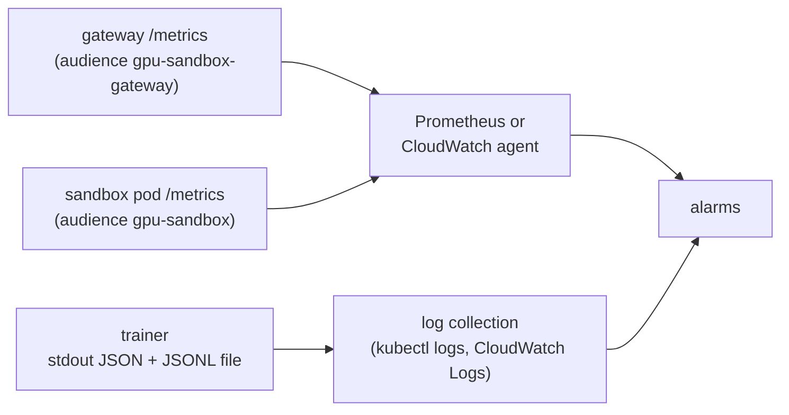

# 07 Observability and operations

**TL;DR** Watch the Prometheus metrics of the sandboxes and the gateway together with the trainer's JSON events, alarm on reward quality signals, and respond with a symptom-based runbook.

## Pain point

Sandbox-side failures usually do not stop training. Even under a flood of authentication failures (401), TRL drops `sandbox_error` samples by returning `None`, and when every sample is dropped the advantages are 0, so steps go by without learning. When the pool shrinks, a pod that is not Ready only disappears from the headless Service DNS, so requests pile onto the remaining pods and steps just get slower. Reward hacking even looks like improving rewards, because flags (`implausible_speedup`, `timed_output_mismatch` and others) live only in the verdicts and are not aggregated into metrics.

![a: authentication failures (a flood of 401s) drop sandbox_error samples with None, so the advantage is 0 and steps go by; a shrinking pool takes pods that are not Ready out of DNS and loads the remaining pods, so steps just get slower; reward hacking flags live only in verdicts and are not aggregated into metrics, so rewards seem to improve. Training stops in none of the three. b: the same failures map to alarms: status.sandbox_error / n to the sandbox_error rate (TRL over 5%, 3 batches in a row), sum(sandbox_ready) to Ready pods short (below expected replicas for 10 minutes), and flag counts (an extension not in the repository, dashed) to a reward hacking signal (flag rate trending up)](../images/figures/production-07_observability_and_operations.svg)

*Takeaway: Sandbox-side failures do not stop training: steps go by without learning, slow down, or rewards look better. Alarms on the reward quality signal each failure moves first are what catch them in time.*


## Why

- **Watch three layers together.** The sandbox pod (one evaluation), the gateway (scheduling and version pinning) and the trainer (reward batches and steps) each answer a different question.
- **Metrics endpoints are authenticated too.** `/metrics` goes through the same token verification as `/v1/evaluate`; the only unauthenticated routes are the kubelet probe routes `/healthz` and `/readyz`.
- **Alarm on training signals.** Reward quality signals such as `sandbox_error` rate, pass rate and flags show the moment training breaks earlier than CPU or memory do.

**Before you start:** the `reward_batch` log in [05 On-policy GRPO training](../handson/05_grpo_training.md), the authentication design in [02 Security](02_security.md) and the gateway behavior in [03 Gateway and pools](03_gateway_and_pools.md) help.

??? note "Terms"
    - **Counter, Gauge, Histogram**: Prometheus metric types. A counter only goes up, a gauge is a current value that goes up and down, and a histogram counts values per range (bucket) so that quantiles such as p95 can be computed.
    - **scrape, PromQL**: a scrape is the collector reading `/metrics` periodically; PromQL is the Prometheus query language that computes ratios and quantiles from the collected metrics.
    - **`reward_batch` event**: the one JSON line the trainer writes to stdout per reward batch, with the version, the verdict distribution and latencies.
    - **flag**: a warning marker on a verdict (`implausible_speedup`, `timed_output_mismatch` and others) that carries reward hacking signals.
    - **`RewardStalled`**: the log-based stall rule in the HyperPod job template. It restarts the job when no `reward_batch` line appears for 30 minutes.
    - **kube-state-metrics, Container Insights**: kube-state-metrics exports the state of Kubernetes objects such as Deployment replicas as metrics; Container Insights is the container monitoring feature of CloudWatch.

    More terms are in the [Glossary](../reference/glossary.md).



*Takeaway: alarms come from two sources, metrics (gateway, sandboxes) and logs (trainer), and the metrics collector needs a token with the right audience to read them.*

## Metrics

The sandbox server (`src/gpusandbox/server/app.py`) sees the evaluations of one pod; the gateway (`src/gpusandbox/gateway/app.py`) sees the requests of all trainer processes.

| Metric | Where | Type | Labels | Meaning |
|---|---|---|---|---|
| `sandbox_evaluations_total` | Sandbox | Counter | `status` | Evaluations per verdict (`ok`, `wrong_answer`, `compile_error`, `runtime_error`, `timeout`, `policy_violation`, `sandbox_error`) |
| `sandbox_evaluation_seconds` | Sandbox | Histogram | none | End-to-end time of one evaluation (buckets from 0.5 s to 120 s) |
| `sandbox_busy` | Sandbox | Gauge | none | 1 while an evaluation runs |
| `sandbox_ready` | Sandbox | Gauge | none | 1 when the GPU probe passed, egress denial is verified and the pod is not draining |
| `sandbox_reaped_processes_total` | Sandbox | Counter | none | Leftover processes killed after evaluations |
| `gateway_evaluations_total` | Gateway | Counter | `runtime`, `version`, `status` | Evaluations per version and verdict |
| `gateway_evaluation_seconds` | Gateway | Histogram | none | Gateway end-to-end time including waiting (buckets from 1 s to 300 s) |
| `gateway_recycled_pods_total` | Gateway | Counter | none | Pods deleted after reporting draining |

### Scraper authentication and NetworkPolicy

The sandbox pod's `/metrics` verifies an audience `gpu-sandbox` token offline against the cluster issuer's JWKS, and the subject must be in `SANDBOX_ALLOWED_SUBJECTS`. The gateway's `/metrics` checks an audience `gpu-sandbox-gateway` token with TokenReview and looks at `GATEWAY_ALLOWED_SUBJECTS`. The network is closed as well, so you also need a NetworkPolicy that admits the scraper's namespace.

| Approach | What it needs | Benefit | Caution |
|---|---|---|---|
| Scrape the gateway only | Add the scraper SA to `GATEWAY_ALLOWED_SUBJECTS`, an audience `gpu-sandbox-gateway` token, a NetworkPolicy admitting port 8080 | Sandbox ingress stays limited to the gateway | Per-pod `busy`, `ready` and `reaped` are not visible |
| Also scrape sandbox pods | The above, plus adding the SA to `SANDBOX_ALLOWED_SUBJECTS` and re-running `scripts/06_deploy_sandboxes.sh`, an audience `gpu-sandbox` token, a NetworkPolicy admitting port 8000 | Per-pod metrics | The allowlist does not distinguish routes, so that subject can also call `/v1/evaluate`. Use a dedicated scraper SA |

When `SANDBOX_ALLOWED_SUBJECTS` is set, `06_deploy_sandboxes.sh` uses it instead of the default list (`grpo-trainer`, `sandbox-probe`, `gateway`), so include the three defaults. Applying it to a running pool changes the pod template, so pods restart one at a time (new VMs under Kata); do it between runs. Adapt the labels and paths of the Prometheus example below to your installation.

```yaml
# Prometheus pod: one projected token per audience (example)
volumes:
  - name: gpusandbox-tokens
    projected:
      sources:
        - serviceAccountToken: {audience: gpu-sandbox-gateway, expirationSeconds: 3600, path: gateway-token}
        - serviceAccountToken: {audience: gpu-sandbox, expirationSeconds: 3600, path: sandbox-token}
---
# prometheus.yml scrape jobs (example)
scrape_configs:
  - job_name: gpu-sandbox-gateway
    kubernetes_sd_configs: [{role: pod, namespaces: {names: [sandbox-gateway]}}]
    authorization: {credentials_file: /var/run/secrets/gpusandbox/gateway-token}
    relabel_configs:
      - {source_labels: [__meta_kubernetes_pod_label_app_kubernetes_io_name], regex: gpu-sandbox-gateway, action: keep}
  - job_name: gpu-sandbox-pods
    kubernetes_sd_configs: [{role: pod, namespaces: {names: [sandbox]}}]
    authorization: {credentials_file: /var/run/secrets/gpusandbox/sandbox-token}
    relabel_configs:
      - {source_labels: [__meta_kubernetes_pod_label_app_kubernetes_io_name], regex: gpu-sandbox, action: keep}
---
# Admit the scraper to the sandbox API port (repeat for sandbox-gateway on 8080)
apiVersion: networking.k8s.io/v1
kind: NetworkPolicy
metadata: {name: allow-prometheus-scrape, namespace: sandbox}
spec:
  podSelector: {matchLabels: {app.kubernetes.io/name: gpu-sandbox}}
  policyTypes: ["Ingress"]
  ingress:
    - from:
        - namespaceSelector: {matchLabels: {kubernetes.io/metadata.name: monitoring}}
          podSelector: {matchLabels: {app.kubernetes.io/name: prometheus}}
      ports: [{protocol: TCP, port: 8000}]
```

## Trainer-side JSON events

`KernelRewards` (`src/gpusandbox/rewards.py`) and `train_grpo.py` write one JSON object per line to stdout and to `--metrics-file` (`/outputs/grpo/sandbox_metrics.jsonl` in the job templates). TRL also logs a value per reward function (`format_reward`, `correctness_reward`, `speedup_reward`).

| Event | When | Key fields |
|---|---|---|
| `routing` | Once at start | `mode` (direct or gateway), `runtime`, `version`, `address` or `gateway` |
| `reward_batch` | Every reward batch sent to the sandbox | `batch`, `global_step`, `runtime`, `version`, `served_versions`, `routing_revision`, `n`, `status`, `pass_rate`, `custom_kernel_rate`, `mean_speedup`, `eval_p50_s`, `eval_p95_s`, `batch_wall_s`, `ts` |
| `sandbox_version_switch` | First batch after a version change | `from`, `to`, `routing_revision`, `global_step` |
| `done` | End of training | `output`, `reward_batches` |
| `parity` (tool) | Rollout step 3 | `baseline`, `candidate`, `passed` |
| `jwks_synced` (tool) | JWKS sync | `keys` (list of kids) |

!!! note "What `n` and `pass_rate` count"
    `reward_batch` counts only completions sent to the sandbox. Completions without a code block, completions rejected by the static policy and duplicates within the batch are handled locally and left out, so `pass_rate` is "the share of completions that reached the sandbox and passed", and `n` shrinking relative to the batch size is itself a format collapse signal. If no completion reaches the sandbox, no `reward_batch` line is written for that batch.

Keep only the `reward_batch` lines of the trainer log and summarize the fields the alarms use. Your workstation needs `jq`, and `RUN_ID` is the value `scripts/07_run_grpo.sh` used in the Job name.

```bash
kubectl -n rl-trainer logs "job/grpo-${RUN_ID}" | grep '"event": "reward_batch"' \
  | jq -c '{step: .global_step, version, served_versions, n, pass_rate, sandbox_error: (.status.sandbox_error // 0), p95: .eval_p95_s}'
```

**What to look for:** one line per batch in the form `{"step":...,"version":"v1","served_versions":{"v1":...},"n":...,"pass_rate":...,"sandbox_error":0,"p95":...}`. If `sandbox_error` stays above 0, start with the 401 and 403 rows of the runbook below.

### Flags are not metrics yet

The `flags` list of a verdict (`implausible_speedup`, `timed_output_mismatch`, `triton_kernel_never_launched`, `gpu_fault`, `invalid_runner_report`) is aggregated neither in the server metrics nor in `reward_batch`. To alarm on reward hacking you need a small extension that adds flag counts to the `reward_batch` record built in `KernelRewards._log_batch`.

```python
# Suggested extension (not in the repo): add to the reward_batch record in KernelRewards._log_batch
"flags": dict(Counter(f for r in results for f in r.get("flags") or [])),
```

Indirect signals exist even before the extension: `timed_output_mismatch` becomes `wrong_answer`, and `implausible_speedup` lowers the speedup to 1.0, so `custom_kernel_rate` is high while `mean_speedup` sticks near 1.0 (threats in [04 Reward integrity](04_reward_integrity.md)).

## Suggested alarms

The conditions are starting-point examples, not values derived from a real run, so collect a few hours of baseline and then tune them.

| Alarm | Signal | Starting condition (example) | Look first at |
|---|---|---|---|
| Pass rate collapse | `reward_batch.pass_rate`, `ok` share per version | Below half of the trailing 20-batch mean for 3 batches in a row | Whether `sandbox_version_switch` happened, pool health |
| `sandbox_error` rate | `status.sandbox_error / n`, share of gateway `status="sandbox_error"` | Above 5% for 3 batches in a row on TRL, lower on veRL | Runbook entries for 401 and 403, pool size |
| p95 latency | `sandbox_evaluation_seconds`, `gateway_evaluation_seconds`, `eval_p95_s` | Twice the baseline | GPU health, recycling, nodes |
| Reward hacking signals | Flag counts (extension), a jump in `wrong_answer`, `mean_speedup` stuck at 1.0 | Rising flag share | Review samples directly, page 04 |
| Too few Ready pods | `sum(sandbox_ready)`, available replicas from kube-state-metrics | Below expected replicas for 10 minutes | Runbook entry "never Ready" |
| Rising killed processes | `sandbox_reaped_processes_total` | Stays above 0 over 30 minutes | Review candidates that leave daemons behind |
| Too many recycles | `gateway_recycled_pods_total` | Twice the evaluations ÷ `SANDBOX_MAX_EVALS` | `gpu_fault`, node GPU health |

Example PromQL for the alarms above. Enter one query at a time in Prometheus or Amazon Managed Service for Prometheus and compare with the baseline.

```text
# sandbox_error share through the gateway
sum(rate(gateway_evaluations_total{status="sandbox_error"}[10m])) / sum(rate(gateway_evaluations_total[10m]))
# pass rate per sandbox version
sum by (version) (rate(gateway_evaluations_total{status="ok"}[10m])) / sum by (version) (rate(gateway_evaluations_total[10m]))
# p95 evaluation latency inside the sandbox
histogram_quantile(0.95, sum by (le) (rate(sandbox_evaluation_seconds_bucket[10m])))
# ready sandbox pods and stray processes
sum(sandbox_ready)
sum(increase(sandbox_reaped_processes_total[30m]))
# actual recycles relative to the expected rate with SANDBOX_MAX_EVALS=200 (v2)
sum(increase(gateway_recycled_pods_total[1h])) / (sum(increase(gateway_evaluations_total[1h])) / 200)
```

A rising `sandbox_reaped_processes_total` means candidate code left processes behind after its evaluation. The server cleans up every time, so the next evaluation is protected, but it may be an attempt to tamper with it, so inspect those samples.

## Using CloudWatch (optional)

- **Container Insights (EKS)**: the CloudWatch agent collects cluster, node and pod level metrics and logs, and alarms on those metrics.
- **Prometheus metrics**: Container Insights Prometheus monitoring collects with the CloudWatch agent, and the documentation states that counter, gauge and summary types are collected, so check first whether you can build p95 alarms from this repo's latency metrics (histograms). OTel Container Insights, which the documentation recommends, supports PromQL.
- **Amazon Managed Service for Prometheus**: a managed Prometheus-compatible service that works with EKS, where the PromQL above applies as is.
- **Logs**: sending the trainer's JSON lines to CloudWatch Logs lets you filter `reward_batch` with Logs Insights.

```text
fields @timestamp, @message
| filter @message like /"event": "reward_batch"/
| sort @timestamp desc
| limit 50
```

Whichever collector you use, the authentication and NetworkPolicy requirements above stay the same, so the CloudWatch agent also needs a token of an allowlisted subject to read `/metrics`.

## Operations runbook

| Symptom | Likely cause | Action |
|---|---|---|
| Sandbox pods never become Ready (egress) | Readiness passes only when IMDS, the API server and the node kubelet are blocked. VPC CNI network policy is off, or the node guard is missing (the VPC CNI allows traffic to the pod's own node IP regardless of policy) | Check the pod log for `egress is open, refusing work: ...`, check step 2 of `scripts/ops/verify.sh`, check `enableNetworkPolicy` and the `gpusandbox-node-guard` service |
| Never Ready (GPU probe) | Log shows `device probe ok=False`. For gVisor, an nvproxy driver mismatch (an unknown driver cannot pass even with the allow flag), or a device plugin or CDI problem | On the node, compare `/usr/local/bin/runsc nvproxy list-supported-drivers` with `/proc/driver/nvidia/version`, look for `WARNING: NVIDIA driver ... is not supported` in the boot log, pin the AMI. For HyperPod nodes, `scripts/hyperpod/check_gvisor.sh` |
| Kata pod Pending with `Insufficient nvidia.com/pgpu` | pgpu is not advertised: missing `nvidia.com/gpu.workload.config=vm-passthrough` label, `ccManager.defaultMode` not off (T4), no `intel_iommu=on` in the AMI, the host loaded the NVIDIA driver | Check `kubectl get node <node> -o jsonpath='{.status.allocatable.nvidia\.com/pgpu}'` and the `nvidia.com/cc.ready.state` label, re-check the output of `scripts/kata/gpu_nodes.sh` |
| Kata pod stuck in `ContainerCreating` | VFIO pins all VM memory (default 8 GiB + limits) before boot, and CUDA initializes inside the guest | Check the node kubelet's `runtimeRequestTimeout: 20m` and the `kubectl describe pod` events. The startupProbe allows 10 minutes (5 s × 120) after the container starts |
| Every call returns 401 (sandbox) | Stale JWKS (`unknown signing key` after a signing key rotation), missing JWKS ConfigMap (`token verification keys unavailable`), issuer or audience mismatch, auth not configured (fail closed) | Run `scripts/ops/sync_jwks.sh` or check the `jwks-sync` CronJob, compare `identity.oidc.issuer` from `aws eks describe-cluster` with `SANDBOX_AUTH_ISSUER`, reproduce with the probe to see the error body |
| Every call returns 401 (gateway) | The caller token's audience is not `gpu-sandbox-gateway`, or `GATEWAY_AUTH_AUDIENCE` or `GATEWAY_ALLOWED_SUBJECTS` is empty | Check the projected token audience of the caller pod and the gateway env |
| 403 | The subject is not on the allowlist (the error body names the subject) | Add it to `SANDBOX_ALLOWED_SUBJECTS` or `GATEWAY_ALLOWED_SUBJECTS` and redeploy |
| A version switch is not seen | ConfigMap mounted with `subPath`, kubelet sync delay, only one namespace updated, the trainer runs with `--runtime`, no reward batch yet | Check `sandbox-routing` in both namespaces, check that the pod's `volumeMounts` have no `subPath`, check again a few minutes later |
| HyperPod job restarts repeatedly (`RewardStalled`) | No `reward_batch` line for 30 minutes: a generation hang, a very slow reward batch, or no completion reaching the sandbox (format collapse) | Check the logs right before the restart, pool readiness and latency, and `format_reward`. If `/outputs` is an `emptyDir`, checkpoints vanish on restart ([06 Scaling with veRL](06_scaling_with_verl.md)) |
| `sandbox_error` with `no free sandbox in ...` | No Ready endpoints, or the pool is too small for the batch to get a free pod within 600 s | Check the number of Ready pods, resize the pool |
| The gateway never becomes Ready | No `sandbox-routing` ConfigMap in the `sandbox-gateway` namespace, or a malformed one | Create the ConfigMap (`ops/rollout.sh` only updates namespaces that already exist) |
| More recycles than expected | Many pods drained because of `gpu_fault` | Check the GPU health of those nodes, replace a node if needed |

The 401 error body is not written to the server log; it appears only in the client-side result (the `error` of a `sandbox_error`), so see the cause with the probe step of `scripts/ops/verify.sh <runtime> <version>`. Each golden entry then prints `expected ok, got sandbox_error: HTTP 401: ...`, but the probe calls as the `sandbox-probe` subject, so a 403 caused by only the trainer subject missing does not reproduce this way.

To follow JWKS changes automatically, use the CronJob in `k8s/production/jwks-sync.yaml.tpl` (minute 17 of every hour), and create the `sandbox-gateway` namespace first. The commands below apply the CronJob, run one Job right away and check it, then print the routing tables of both namespaces for comparison.

```bash
source scripts/config.env
python3 scripts/render.py k8s/production/jwks-sync.yaml.tpl | kubectl apply -f -
kubectl -n sandbox-gateway create job --from=cronjob/jwks-sync jwks-sync-manual
kubectl -n sandbox-gateway wait --for=condition=complete job/jwks-sync-manual --timeout=300s
kubectl -n sandbox-gateway logs job/jwks-sync-manual    # {"event": "jwks_synced", "keys": [...]}
kubectl -n rl-trainer get configmap sandbox-routing -o jsonpath='{.data.routing\.json}'
kubectl -n sandbox-gateway get configmap sandbox-routing -o jsonpath='{.data.routing\.json}'
```

**What to look for:** `wait` ends with `job.batch/jwks-sync-manual condition met`, and the Job log shows one line, `{"event": "jwks_synced", "keys": [...]}`. Both routing tables should have the same `active`.

**If it fails:** if the Job fails, check `kubectl -n sandbox-gateway describe job jwks-sync-manual` and the 401 and 403 table in [Troubleshooting](../reference/troubleshooting.md).

!!! question "❓ Misconception: a RewardStalled restart means an infrastructure problem"
    Not necessarily. The `reward_batch` line is also missing when the policy produces no code blocks or every completion fails the static policy, so nothing is sent to the sandbox. A restart does not fix that; check the trend of TRL's `format_reward` as well. The pattern matches the default `json.dumps` output (`"event": "reward_batch"`, a space after the colon), so if you change the log format, change the pattern too.

## Scope and limits

- **Checked in the code:** metric names, labels, buckets and event fields are copied from `server/app.py`, `gateway/app.py` and `rewards.py`. In the code, `/metrics` on the server and the gateway uses the same authentication dependency as `/info` and `/v1/evaluate`, and the local tests check the authentication behavior itself through `/info`.
- **Not executed:** the author did not run the Prometheus scrape example, the NetworkPolicy example or the CloudWatch integration on a cluster.
- **Not there yet:** flags are not aggregated into metrics, so reward hacking alarms need the extension in "Flags are not metrics yet" above.
- **Based on documentation:** how Container Insights handles histogram metrics comes from the CloudWatch documentation and was not checked directly.

??? note "References"
    | Topic | Link |
    |---|---|
    | CloudWatch Container Insights | https://docs.aws.amazon.com/AmazonCloudWatch/latest/monitoring/ContainerInsights.html |
    | Amazon Managed Service for Prometheus | https://docs.aws.amazon.com/prometheus/latest/userguide/what-is-Amazon-Managed-Service-Prometheus.html |
    | EKS NetworkPolicy configuration (VPC CNI) | https://docs.aws.amazon.com/eks/latest/userguide/cni-network-policy-configure.html |
    | Prometheus Python client | https://github.com/prometheus/client_python |
    | Sandbox server metrics | https://github.com/daekeun-ml/gpu-sandbox-on-aws/blob/main/src/gpusandbox/server/app.py |

    All sources: [this page in All references](../reference/references.md#ref-production-07-observability-and-operations)

Related pages: [02 Security](02_security.md), [03 Gateway and pools](03_gateway_and_pools.md), [04 Deploy and verify sandbox pools](../handson/04_sandbox_pools.md), [Troubleshooting](../reference/troubleshooting.md)
