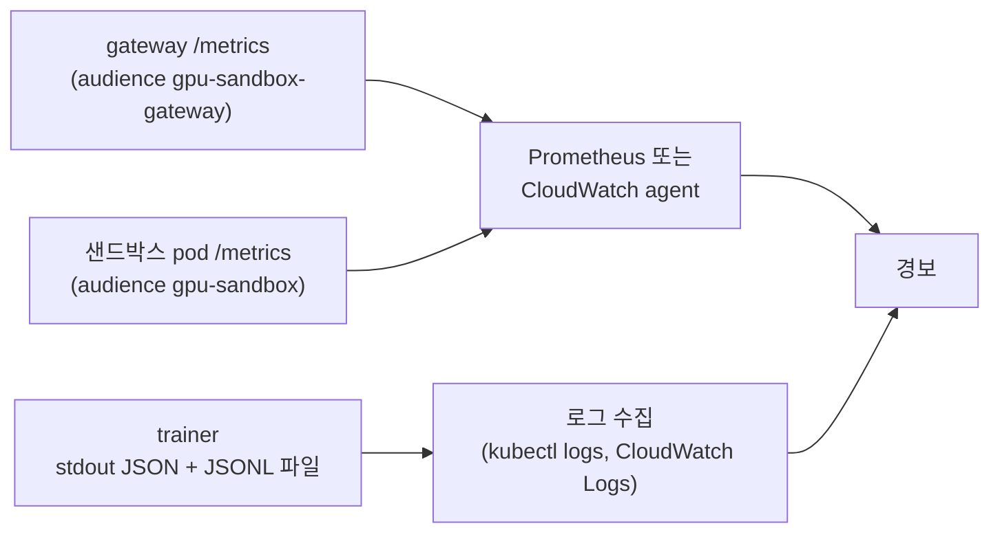
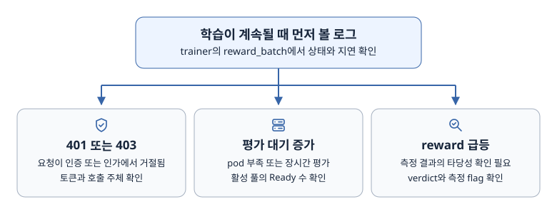

# 07 Observability와 운영

!!! info "TL;DR"
    샌드박스와 gateway에서 수집한 Prometheus 지표를 trainer의 JSON 이벤트와 함께 확인합니다. 채점 오류 비율이나 정답률이 달라지면 알아차릴 수 있도록 경보를 설정하고, 경보가 울리면 아래 런북에서 해당 증상을 찾으세요.

## 학습이 계속돼도 채점은 실패할 수 있습니다

step 번호는 계속 올라가는데 모델 성능은 그대로이거나 배치 처리 시간이 길어질 수 있습니다. `reward_batch`를 먼저 열어 제출한 답이 틀렸는지, 샌드박스가 채점을 마치지 못했는지 구분하세요. 채점을 완료하지 못한 요청이 늘면 샌드박스로 요청을 보내고 응답을 받는 과정을 먼저 점검하세요.

![a: 인증 실패(401 응답이 대량으로 발생)가 나면 sandbox_error 샘플이 None으로 제외되고 그 샘플의 advantage는 0이 됩니다. 모든 샘플이 제외되면 학습 신호 없이 step만 진행됩니다. pool이 줄면 Ready가 아닌 pod가 DNS에서 빠지고 남은 pod로 요청이 몰려 step만 느려집니다. reward hacking은 flag가 verdict에만 기록되고 지표로 집계되지 않아 reward가 오르는 것처럼 보입니다. 세 경우 모두 학습은 멈추지 않습니다. b: 같은 세 고장을 각각 경보에 연결합니다. status.sandbox_error / n으로 sandbox_error 비율 경보(TRL 5% 초과, 3 batch 연속)를, 활성 pool Deployment별 available과 desired replicas 비교로 Ready pod 부족 경보(available이 desired 미만인 상태 10분)를, flag 개수(집계 기능을 추가해야 함, 점선)로 reward hacking 신호 경보(flag 비율 상승 추세)를 만듭니다.](../images/figures/production-07_observability_and_operations.ko.svg)

## 계층별 로그와 지표

`sandbox_error`가 늘면 trainer에 기록된 오류를 gateway 상태와 대조하고, pool에서 Ready 상태인 pod가 줄었는지 확인하세요. reward가 갑자기 높아졌다면 verdict의 측정 flag도 살펴보세요. 이 flag는 기본 지표로 집계되지 않습니다. 증상별 런북에는 어느 로그를 열고 어떤 설정을 점검할지 정리해 두었습니다.

??? note "세부 조건과 예외"
    샌드박스 쪽에 장애가 생겨도 대개 학습은 중단되지 않습니다.

    - **인증 실패(401)가 대량으로 발생해도**: TRL은 `sandbox_error` 샘플을 `None`으로 처리해 제외합니다. 모든 샘플이 제외되면 advantage가 0이 되어 학습 신호 없이 step만 진행됩니다.
    - **pool의 Ready pod가 줄어도**: Ready가 아닌 pod는 headless Service DNS에서 제외될 뿐이므로, 남은 pod로 요청이 몰려 step만 느려집니다.
    - **reward hacking이 일어날 때**: reward 값은 오히려 올라갑니다. 이를 알려 주는 flag(`implausible_speedup`, `timed_output_mismatch` 등)는 verdict에만 기록되고 지표로 집계되지 않습니다.

    - **세 계층을 함께 모니터링합니다.** 샌드박스 pod(평가 하나), gateway(스케줄과 버전 고정), trainer(reward batch와 step)가 각각 다른 범위의 상태를 보고합니다.
    - **지표 엔드포인트도 인증합니다.** `/metrics`도 `/v1/evaluate`와 같은 토큰 검증을 거치며, 인증 없이 호출할 수 있는 경로는 kubelet probe용 `/healthz`, `/readyz`뿐입니다.
    - **채점 결과의 변화에도 경보를 설정합니다.** 학습에 문제가 생기면 CPU나 메모리 사용량보다 `sandbox_error` 비율이나 pass rate, verdict의 flag가 먼저 달라집니다. flag 발생 빈도까지 감시하려면 집계 기능을 추가해야 합니다.

**읽기 전에**　[05 On-policy GRPO 학습](../handson/05_grpo_training.md)의 `reward_batch` 로그, [02 보안](02_security.md)의 인증 설계, [03 Gateway와 샌드박스 pool](03_gateway_and_pools.md)의 gateway 동작을 먼저 보세요.

??? note "용어"
    - **Counter, Gauge, Histogram**: Prometheus 지표 종류입니다. Counter는 계속 늘기만 하는 누적 값, Gauge는 오르내리는 현재 값, Histogram은 값을 구간(bucket)별로 집계해 분위수(p95 등)를 계산할 수 있게 하는 지표입니다.
    - **scrape, PromQL**: scrape는 수집기가 `/metrics`를 주기적으로 읽어 가는 동작이고, PromQL은 수집한 지표로 비율이나 분위수를 계산하는 Prometheus 쿼리 언어입니다.
    - **`reward_batch` 이벤트**: trainer가 샌드박스를 부른 reward batch마다 stdout에 출력하는 JSON 한 줄입니다. 버전, verdict 분포, 지연이 들어 있습니다.
    - **flag**: verdict에 붙는 경고 표시입니다(`implausible_speedup`, `timed_output_mismatch` 등). reward hacking 가능성을 나타냅니다.
    - **`RewardStalled`**: HyperPod job 템플릿의 로그 기반 정지 감지 규칙입니다. 30분 동안 `reward_batch` 줄이 없으면 job을 재시작합니다.
    - **kube-state-metrics, Container Insights**: kube-state-metrics는 Deployment replica 같은 Kubernetes 객체 상태를 지표로 제공하는 도구이고, Container Insights는 CloudWatch의 컨테이너 모니터링 기능입니다.

    더 많은 용어는 [용어 사전](../reference/glossary.md)에 있습니다.



*그림 요약: 경보는 지표(gateway, 샌드박스)와 로그(trainer) 두 경로에서 오고, 수집기가 지표를 읽으려면 audience가 맞는 토큰이 필요합니다.*

## 증상별 첫 점검



먼저 trainer 로그에서 실제 HTTP 오류와 평가 지연을 확인하고, [운영 런북](#운영-런북)에서 원인을 좁히세요. reward 급등만 보이면 해당 평가의 verdict를 확인합니다.

## 지표

샌드박스 서버(`src/gpusandbox/server/app.py`)는 pod 하나의 평가 지표를, gateway(`src/gpusandbox/gateway/app.py`)는 모든 trainer 프로세스의 요청 지표를 제공합니다.

| 지표 | 위치 | 종류 | label | 의미 |
|---|---|---|---|---|
| `sandbox_evaluations_total` | 샌드박스 | Counter | `status` | verdict별 평가 수 (`ok`, `wrong_answer`, `compile_error`, `runtime_error`, `timeout`, `policy_violation`, `sandbox_error`) |
| `sandbox_evaluation_seconds` | 샌드박스 | Histogram | 없음 | 평가 하나의 end-to-end 시간 (bucket 0.5초부터 120초까지) |
| `sandbox_busy` | 샌드박스 | Gauge | 없음 | 평가 중이면 1 |
| `sandbox_ready` | 샌드박스 | Gauge | 없음 | GPU probe 통과, egress 차단 확인, draining 아님이면 1 |
| `sandbox_reaped_processes_total` | 샌드박스 | Counter | 없음 | 평가가 끝난 뒤 강제 종료한 남은 프로세스 수 |
| `gateway_evaluations_total` | gateway | Counter | `runtime`, `version`, `status` | 버전별, verdict별 평가 수 |
| `gateway_evaluation_seconds` | gateway | Histogram | 없음 | 대기를 포함한 gateway end-to-end 시간 (bucket 1초부터 300초까지) |
| `gateway_recycled_pods_total` | gateway | Counter | 없음 | draining 상태를 알린 pod를 삭제한 횟수 |

### 수집기 인증과 NetworkPolicy

- **샌드박스 pod의 `/metrics`**: audience `gpu-sandbox` 토큰을 cluster issuer의 JWKS로 오프라인 검증하고, 주체가 `SANDBOX_ALLOWED_SUBJECTS`에 있어야 합니다.
- **gateway의 `/metrics`**: audience `gpu-sandbox-gateway` 토큰을 TokenReview로 확인하고, `GATEWAY_ALLOWED_SUBJECTS`에 주체가 있는지 확인합니다.
- **NetworkPolicy**: 기본적으로 ingress를 차단하므로, 수집기 네임스페이스의 접근을 허용하는 NetworkPolicy도 필요합니다.

| 방식 | 필요한 것 | 장점 | 주의 |
|---|---|---|---|
| gateway만 수집 | 수집기 SA를 `GATEWAY_ALLOWED_SUBJECTS`에 추가, audience `gpu-sandbox-gateway` 토큰, 8080 허용 NetworkPolicy | 샌드박스 ingress를 gateway 하나로 유지 | pod별 `busy`, `ready`, `reaped`는 수집되지 않음 |
| 샌드박스 pod도 수집 | 위 항목과 함께 `SANDBOX_ALLOWED_SUBJECTS`에 추가하고 `scripts/06_deploy_sandboxes.sh` 재실행, audience `gpu-sandbox` 토큰, 8000 허용 NetworkPolicy | pod별 지표 | allowlist는 경로를 구분하지 않아 그 주체가 `/v1/evaluate`도 호출할 수 있음. 수집 전용 SA를 쓰세요 |

`SANDBOX_ALLOWED_SUBJECTS`를 설정하면 `06_deploy_sandboxes.sh`가 기본 목록(`grpo-trainer`, `sandbox-probe`, `gateway`) 대신 그 값만 쓰므로, 현재 pool에 설정된 주체 목록에 수집기 주체를 더해 넣으세요.

- **기본 배포라면**: 세 기본 주체를 유지합니다.
- **[02 보안](02_security.md)의 운영 구성이라면**: `gateway`와 `sandbox-probe`를 유지합니다.
- **replica 수**: 세 번째 인자로 현재 replica 수를 넘기지 않으면 프로필의 기본 replica 수로 돌아갑니다.
- **실행 중인 pool에 다시 적용하면**: pod template이 바뀌어 pod가 하나씩 다시 생성되므로(Kata는 새 VM), 학습 run 사이에 적용하세요.

아래 Prometheus 예시의 label과 경로는 설치 방식에 맞게 바꾸세요.

```yaml
# Prometheus pod: one projected token per audience (example)
volumes:
  - name: gpusandbox-tokens
    projected:
      sources:
        - serviceAccountToken: {audience: gpu-sandbox-gateway, expirationSeconds: 3600, path: gateway-token}
        - serviceAccountToken: {audience: gpu-sandbox, expirationSeconds: 3600, path: sandbox-token}
# mount the tokens in the Prometheus container
containers:
  - name: prometheus
    volumeMounts:
      - {name: gpusandbox-tokens, mountPath: /var/run/secrets/gpusandbox, readOnly: true}
---
# prometheus.yml scrape jobs (example)
scrape_configs:
  - job_name: gpu-sandbox-gateway
    kubernetes_sd_configs: [{role: pod, namespaces: {names: [sandbox-gateway]}}]
    authorization: {credentials_file: /var/run/secrets/gpusandbox/gateway-token}
    relabel_configs:
      - {source_labels: [__meta_kubernetes_pod_label_app_kubernetes_io_name], regex: gpu-sandbox-gateway, action: keep}
  - job_name: gpu-sandbox-pods
    kubernetes_sd_configs: [{role: pod, namespaces: {names: [sandbox]}}]
    authorization: {credentials_file: /var/run/secrets/gpusandbox/sandbox-token}
    relabel_configs:
      - {source_labels: [__meta_kubernetes_pod_label_app_kubernetes_io_name], regex: gpu-sandbox, action: keep}
---
# Admit the scraper to the sandbox API port (repeat for sandbox-gateway on 8080)
apiVersion: networking.k8s.io/v1
kind: NetworkPolicy
metadata: {name: allow-prometheus-scrape, namespace: sandbox}
spec:
  podSelector: {matchLabels: {app.kubernetes.io/name: gpu-sandbox}}
  policyTypes: ["Ingress"]
  ingress:
    - from:
        - namespaceSelector: {matchLabels: {kubernetes.io/metadata.name: monitoring}}
          podSelector: {matchLabels: {app.kubernetes.io/name: prometheus}}
      ports: [{protocol: TCP, port: 8000}]
```

## trainer가 기록하는 JSON 이벤트

<span id="trainer-쪽-json-이벤트"></span>

`KernelRewards`(`src/gpusandbox/rewards.py`)와 `train_grpo.py`는 JSON 이벤트를 한 줄에 하나씩 표준 출력(stdout)으로 내보냅니다. `KernelRewards`의 `reward_batch`와 `sandbox_version_switch`는 `--metrics-file`(job 템플릿에서는 `/outputs/grpo/sandbox_metrics.jsonl`)에도 기록되고, `train_grpo.py`의 `routing`과 `done`은 stdout에만 나옵니다. TRL은 reward 함수별 값(`format_reward`, `correctness_reward`, `speedup_reward`)을 따로 기록합니다.

| event | 언제 | 주요 필드 |
|---|---|---|
| `routing` | 시작할 때 한 번 | `mode`(direct 또는 gateway), `runtime`, `version`, `address` 또는 `gateway` |
| `reward_batch` | 샌드박스로 보낸 reward batch마다 | `batch`, `global_step`, `runtime`, `version`, `served_versions`, `routing_revision`, `n`, `status`, `pass_rate`, `custom_kernel_rate`, `mean_speedup`, `eval_p50_s`, `eval_p95_s`, `batch_wall_s`, `ts` |
| `sandbox_version_switch` | 버전이 바뀐 첫 batch | `from`, `to`, `routing_revision`, `global_step` |
| `done` | 학습 종료 | `output`, `reward_batches` |
| `parity` (도구) | 롤아웃 3단계 | `baseline`, `candidate`, `passed` |
| `jwks_synced` (도구) | JWKS 동기화 | `keys` (kid 목록) |

!!! note "`n`과 `pass_rate`의 집계 대상"
    `reward_batch`는 이번 호출에서 샌드박스로 보낸 completion만 집계합니다.

    - **빠지는 것**: 코드 블록이 없거나 정적 정책을 위반한 completion, 이미 같은 pool의 캐시에 결과가 있는 completion은 보내지 않으므로 빠집니다.
    - **들어가는 것**: 다른 pool로 캐시돼 이 batch의 pool에서 다시 채점한 completion은 들어갑니다.
    - **같은 completion**: 동일한 유효 completion은 한 요청에 한 번만 담깁니다. pool이 바뀌어 같은 completion을 다시 보내도 `n`과 `status`에는 그 completion의 마지막 결과 한 건만 들어갑니다.
    - **`pass_rate`의 뜻**: 그래서 `pass_rate`는 "샌드박스로 보낸 completion 가운데 통과한 비율"입니다.
    - **format 붕괴 판단**: `n`은 캐시 적중으로도 줄어드니, format 붕괴는 `n`과 TRL의 `format_reward`를 함께 보고 판단하세요.
    - **샌드박스로 보낸 completion이 없으면**: 그 batch의 `reward_batch`는 기록되지 않습니다.

아래 명령은 trainer 로그에서 `reward_batch` 줄만 골라 경보에 쓸 필드를 요약합니다. 작업 PC에 `jq`가 필요하고, `RUN_ID`는 `scripts/07_run_grpo.sh`가 Job 이름에 쓴 값입니다.

```bash
kubectl -n rl-trainer logs "job/grpo-${RUN_ID}" | grep '"event": "reward_batch"' \
  | jq -c '{step: .global_step, version, served_versions, n, pass_rate, sandbox_error: (.status.sandbox_error // 0), p95: .eval_p95_s}'
```

**확인할 것:**

- batch마다 `{"step":...,"version":"v1","served_versions":{"v1":...},"n":...,"pass_rate":...,"sandbox_error":0,"p95":...}` 형태의 줄이 출력됩니다.
- **`sandbox_error`가 계속 0보다 크면**: 아래 런북의 401, 403 행부터 확인하세요.

### flag는 아직 지표가 아닙니다

verdict의 `flags` 목록(`implausible_speedup`, `timed_output_mismatch`, `triton_kernel_never_launched`, `gpu_fault`, `invalid_runner_report`)은 서버 지표에도 `reward_batch`에도 집계되지 않습니다. reward hacking 경보를 설정하려면 `KernelRewards._log_batch`가 만드는 `reward_batch` 기록에 flag 개수를 추가하도록 코드를 조금 확장해야 합니다.

```python
# Suggested extension (not in the repo): add to the reward_batch record in KernelRewards._log_batch
"flags": dict(Counter(f for r in results for f in r.get("flags") or [])),
```

두 flag는 기존 지표에 각각 다음과 같이 간접적으로 나타납니다.

- **`timed_output_mismatch`**: 이 flag가 붙은 결과는 `wrong_answer`로 집계됩니다.
- **`implausible_speedup`**: 이 flag가 붙으면 speedup이 1.0으로 바뀌므로, `custom_kernel_rate`는 높은데 `mean_speedup`이 1.0 근처에 머뭅니다(위협 유형은 [04 Reward 무결성](04_reward_integrity.md) 참고).

## 권장 경보

아래 임계값은 경보를 처음 설정할 때 참고하는 예시입니다. 실제 학습에서 몇 시간 동안 평소 값을 수집한 뒤 환경에 맞게 조정하세요.

| 경보 | 신호 | 시작 조건 (예시) | 먼저 볼 곳 |
|---|---|---|---|
| pass rate 붕괴 | `reward_batch.pass_rate`, 버전별 `ok` 비율 | 직전 20 batch 평균의 절반 미만이 3 batch 연속 | `sandbox_version_switch` 여부, pool 상태 |
| `sandbox_error` 비율 | TRL은 `reward_batch`의 `status.sandbox_error / n`, veRL은 `compute_score`가 반환한 `sandbox_error`의 샘플별 집계 | TRL 5% 초과가 3 batch 연속, veRL은 더 낮게 | 런북의 401, 403, pool 크기 |
| p95 지연 | `sandbox_evaluation_seconds`, `gateway_evaluation_seconds`, `eval_p95_s` | 기준선의 2배 | GPU 상태, recycle, 노드 |
| reward hacking 신호 | flag 개수(확장), `wrong_answer` 급증, `mean_speedup`이 1.0 근처에 머묾 | flag 비율이 상승 추세 | 샘플 직접 검토, 04 페이지 |
| Ready pod 부족 | 활성 pool Deployment별 kube-state-metrics의 desired와 available replicas | 활성 pool의 available이 desired 미만인 상태가 10분 | 런북의 "Ready가 되지 않음" |
| 강제 종료 프로세스 증가 | `sandbox_reaped_processes_total` | 최근 30분 증가량(`increase`)이 0보다 큼 | 데몬을 남기는 후보 코드 검토 |
| recycle 과다 | `gateway_recycled_pods_total` | 횟수 기반 재활용을 켠 버전(v2)의 평가 수 ÷ `SANDBOX_MAX_EVALS`의 2배 | `gpu_fault`, 노드 GPU 상태 |

- **`sandbox_error` 비율의 집계 범위**: TRL 값에는 gateway가 거부한 응답(401, 403)이 포함되고, veRL 값에는 호출자 인증 실패가 포함됩니다. gateway `status="sandbox_error"` 비율은 인증을 통과해 pool로 전달된 요청만 집계합니다.
- **Ready pod 부족에 `sandbox_ready`를 쓰지 않는 이유**: `sandbox_ready`에는 runtime과 version label이 없어 합계에 다른 pool의 pod도 들어갑니다.
- **Ready pod가 하나도 없을 때**: routing이 replica 0인 pool을 가리키면 available과 desired가 모두 0이라 두 값을 비교하는 경보가 울리지 않습니다. 트래픽을 받을 활성 pool에는 available이 0일 때 울리는 경보도 설정하세요. 수집 대상이 모두 사라질 때는 시계열도 없어지므로 지표 누락을 감지하는 경보가 필요합니다.
- **recycle 카운터의 범위**: 재활용 카운터에는 runtime과 version label이 없어, 여러 버전을 함께 운영하면 v1의 `gpu_fault` 재활용도 함께 셉니다.
- **recycle 기준의 분모**: gateway 평가 수에는 빈 pod를 얻지 못해 pod에 닿지 않은 요청이 들어가고, probe Job이 pool에 직접 보낸 평가는 빠지므로 이 분모는 근사값입니다.

위 경보의 PromQL 예시입니다. Prometheus나 Amazon Managed Service for Prometheus의 쿼리 화면에 한 줄씩 넣어 기준선과 비교하세요.

```text
# sandbox_error share through the gateway
sum(rate(gateway_evaluations_total{status="sandbox_error"}[10m])) / sum(rate(gateway_evaluations_total[10m]))
# pass rate per sandbox version
sum by (version) (rate(gateway_evaluations_total{status="ok"}[10m])) / sum by (version) (rate(gateway_evaluations_total[10m]))
# p95 evaluation latency inside the sandbox
histogram_quantile(0.95, sum by (le) (rate(sandbox_evaluation_seconds_bucket[10m])))
# available vs desired replicas of the active pool (kube-state-metrics), and stray processes
kube_deployment_status_replicas_available{namespace="sandbox",deployment="sandbox-gvisor-v2"} < kube_deployment_spec_replicas{namespace="sandbox",deployment="sandbox-gvisor-v2"}
kube_deployment_status_replicas_available{namespace="sandbox",deployment="sandbox-gvisor-v2"} == 0
sum(increase(sandbox_reaped_processes_total[30m]))
# actual recycles relative to the expected rate with SANDBOX_MAX_EVALS=200 (v2 evaluations only)
sum(increase(gateway_recycled_pods_total[1h])) / (sum(increase(gateway_evaluations_total{version="v2"}[1h])) / 200)
```

`sandbox_reaped_processes_total`이 늘면 후보 코드가 평가 뒤에도 남는 프로세스를 만든 것입니다. 서버가 매번 이 프로세스를 정리하므로 다음 평가는 영향을 받지 않지만, 다음 평가에 영향을 주려는 시도일 수 있으니 해당 샘플을 확인하세요.

## CloudWatch를 쓰는 경우 (선택)

<span id="적용-범위와-한계"></span>

Prometheus 수집, NetworkPolicy, CloudWatch 연동은 클러스터에 맞게 적용할 예시입니다. 경보를 설정하기 전에 수집기가 인증을 통과하고 필요한 시계열이 생성되는지 확인하세요.

- **Container Insights (EKS)**: CloudWatch agent는 클러스터, 노드, pod 수준의 지표와 로그를 수집합니다. 이 지표에서 알림이 필요하면 CloudWatch alarm을 설정하세요.
- **Prometheus 지표**: Container Insights의 Prometheus 모니터링은 CloudWatch agent로 지표를 수집합니다. 문서에는 counter, gauge, summary 유형을 수집한다고 적혀 있으므로, 샌드박스와 gateway의 지연 지표(histogram)로 p95 경보를 만들 수 있는지 먼저 확인하세요. 문서가 권장하는 OTel Container Insights는 PromQL을 지원합니다.
- **Amazon Managed Service for Prometheus**: EKS와 함께 쓰는 관리형 Prometheus 호환 서비스로 위 PromQL을 그대로 지원합니다.
- **로그**: trainer의 JSON 로그를 CloudWatch Logs로 보낸다면 Logs Insights에서 `reward_batch` 줄만 필터링하세요.

```text
fields @timestamp, @message
| filter @message like /"event": "reward_batch"/
| sort @timestamp desc
| limit 50
```

어떤 수집기를 쓰든 위의 인증과 NetworkPolicy 조건은 같습니다. CloudWatch agent도 allowlist에 등록된 주체의 토큰이 있어야 `/metrics`를 읽을 수 있습니다.

## 운영 런북

학습 step이 계속되면 먼저 trainer 로그에서 `sandbox_error` 비율을 봅니다. 비율이 늘었다면 gateway의 대기와 샌드박스의 Ready 상태를 대조해, 답이 틀린 경우와 답을 채점하지 못한 경우를 구분하세요.

| 증상 | 가능한 원인 | 조치 |
|---|---|---|
| 샌드박스 pod가 Ready가 되지 않음 (egress) | readiness는 IMDS, API 서버, 노드 kubelet 연결이 모두 차단돼야 통과. VPC CNI network policy가 꺼져 있거나, node guard가 없음(VPC CNI는 pod가 실행 중인 노드 IP와의 트래픽을 정책과 무관하게 허용) | pod 로그의 `egress is open, refusing work: ...` 확인, `scripts/ops/verify.sh` 2단계 결과 확인, `enableNetworkPolicy`와 `gpusandbox-node-guard` 서비스 확인 |
| Ready가 되지 않음 (GPU probe) | 로그에 `device probe ok=False`. gVisor는 nvproxy 드라이버 불일치(unknown 드라이버는 허용 플래그로도 통과하지 못함), device plugin이나 CDI 설정 문제 | 노드에서 `/usr/local/bin/runsc nvproxy list-supported-drivers`와 `/proc/driver/nvidia/version` 비교, 부팅 로그의 `WARNING: NVIDIA driver ... is not supported` 확인, AMI 고정. HyperPod 노드는 `scripts/hyperpod/check_gvisor.sh` |
| Kata pod가 `Insufficient nvidia.com/pgpu`로 Pending | 노드가 pgpu를 보고하지 않음: `nvidia.com/gpu.workload.config=vm-passthrough` label 없음, `ccManager.defaultMode`가 off가 아님(T4), AMI에 `intel_iommu=on` 없음, host가 NVIDIA 드라이버를 로드함 | `kubectl get node <node> -o jsonpath='{.status.allocatable.nvidia\.com/pgpu}'`와 `nvidia.com/cc.ready.state` label 확인, `scripts/kata/gpu_nodes.sh` 출력 재확인 |
| Kata pod가 `ContainerCreating` 상태로 오래 남음 | VFIO가 VM 메모리 전체(기본 8 GiB + limits)를 부팅 전에 고정하고 guest에서 CUDA가 초기화됨 | 노드 kubelet의 `runtimeRequestTimeout: 20m` 확인, `kubectl describe pod` 이벤트 확인. startupProbe는 컨테이너 시작 뒤 10분(5초 × 120)을 허용 |
| 샌드박스 pod가 ContainerCreating에 머묾 (`FailedMount`) | JWKS ConfigMap `sandbox-auth-jwks`가 없음. Deployment가 이 ConfigMap을 필수 볼륨으로 마운트하므로 서버가 시작되지 않음 | `scripts/ops/sync_jwks.sh`로 ConfigMap 생성(`jwks-sync` CronJob은 기존 ConfigMap을 patch할 권한만 있음) |
| 모든 호출이 401 (샌드박스) | JWKS가 오래됨(서명 키 교체 뒤 `unknown signing key`), 마운트된 `jwks.json`을 읽지 못하거나 형식이 틀림(`token verification keys unavailable`), issuer나 audience 불일치, 인증 미설정(fail closed) | `scripts/ops/sync_jwks.sh` 실행 또는 `jwks-sync` CronJob 상태 확인, `aws eks describe-cluster`의 `identity.oidc.issuer`와 `SANDBOX_AUTH_ISSUER` 비교, probe로 재현해 오류 본문 확인 |
| 모든 호출이 401 (gateway) | 호출자 토큰의 audience가 `gpu-sandbox-gateway`가 아님, `GATEWAY_AUTH_AUDIENCE`나 `GATEWAY_ALLOWED_SUBJECTS`가 비어 있음 | 호출자 pod의 projected token audience와 gateway env 확인 |
| 403 | 주체가 allowlist에 없음 (오류 본문에 주체 이름 포함) | `SANDBOX_ALLOWED_SUBJECTS` 또는 `GATEWAY_ALLOWED_SUBJECTS`에 추가 후 다시 배포 |
| 버전 전환이 기록되지 않음 | ConfigMap을 `subPath`로 마운트, kubelet 동기화 지연, 한쪽 네임스페이스만 갱신, runtime만 바꾸는 전환인데 trainer가 `--runtime`으로 runtime을 고정함(버전은 계속 active를 따름), batch 전체가 캐시에 적중해 샌드박스를 호출하지 않음, 아직 reward batch가 없음 | 두 네임스페이스의 `sandbox-routing` 내용 확인, pod의 `volumeMounts`에 `subPath`가 없는지 확인, 몇 분 뒤 다시 확인 |
| HyperPod job이 반복 재시작 (`RewardStalled`) | 30분 동안 `reward_batch` 줄이 없음: 생성 hang, reward batch가 매우 느림, completion이 하나도 샌드박스로 전송되지 않음(format 붕괴) | 재시작 직전 로그, pool의 Ready와 지연, `format_reward` 확인. `/outputs`가 `emptyDir`이면 재시작 때 checkpoint가 사라짐([06 veRL로 확장](06_scaling_with_verl.md)) |
| `sandbox_error`에 `no free sandbox in ...` | Ready endpoint가 없거나 pool이 batch에 비해 작아 600초 안에 빈 pod를 할당받지 못함 | Ready pod 수 확인, pool 크기 조정 |
| gateway가 Ready가 되지 않음 | `sandbox-gateway` 네임스페이스에 `sandbox-routing` ConfigMap이 없거나 형식이 틀림 | ConfigMap 생성 (`ops/rollout.sh`는 이미 있는 네임스페이스만 갱신) |
| recycle이 기대보다 많음 | `gpu_fault`로 draining된 pod가 많음 | 해당 노드의 GPU 상태 확인, 필요하면 노드 교체 |

샌드박스가 보낸 401의 오류 본문은 서버 로그에 남지 않고 클라이언트 결과(`sandbox_error`의 `error`)에 일부만 포함됩니다.

- **원인 확인**: `scripts/ops/verify.sh <runtime> <version>`의 probe 단계로 원인을 확인하세요. golden 항목마다 `expected ok, got sandbox_error: HTTP 401: ...` 형태로 출력됩니다.
- **probe로 재현되지 않는 것**: probe는 `sandbox-probe` 주체로 샌드박스를 직접 호출하므로, allowlist에서 trainer 주체만 빠져서 생긴 403이나 gateway가 거부한 401, 403은 재현되지 않습니다.
- **gateway가 거부하면**: trainer 쪽 `error`에는 HTTP 상태만 남으니, 실제 호출 주체의 토큰으로 gateway를 호출해 응답 본문을 확인하세요.

JWKS 변경을 자동으로 반영하려면 `sandbox-gateway` 네임스페이스를 먼저 만든 뒤 `k8s/production/jwks-sync.yaml.tpl`의 CronJob(매시 17분)을 배포하세요. 아래 명령은 CronJob을 적용하고 Job 하나를 바로 실행해 결과를 확인한 뒤, 비교를 위해 두 namespace의 routing 표를 출력합니다.

```bash
source scripts/config.env
python3 scripts/render.py k8s/production/jwks-sync.yaml.tpl | kubectl apply -f -
kubectl -n sandbox-gateway create job --from=cronjob/jwks-sync jwks-sync-manual
kubectl -n sandbox-gateway wait --for=condition=complete job/jwks-sync-manual --timeout=300s
kubectl -n sandbox-gateway logs job/jwks-sync-manual    # {"event": "jwks_synced", "keys": [...]}
kubectl -n rl-trainer get configmap sandbox-routing -o jsonpath='{.data.routing\.json}'
kubectl -n sandbox-gateway get configmap sandbox-routing -o jsonpath='{.data.routing\.json}'
```

**확인할 것:**

- `wait`가 `job.batch/jwks-sync-manual condition met`으로 끝납니다.
- Job 로그에 `{"event": "jwks_synced", "keys": [...]}` 한 줄이 출력됩니다.
- 두 routing 표의 `active`가 같아야 합니다.

**문제가 생기면:** Job이 실패하면 `kubectl -n sandbox-gateway describe job jwks-sync-manual`과 [문제 해결](../reference/troubleshooting.md)의 "401, 403 응답" 표를 보세요.

!!! question "❓ 오해: RewardStalled로 재시작되면 인프라 문제다"
    항상 그렇지는 않습니다. policy가 코드 블록을 생성하지 않거나 모든 completion이 정적 정책을 위반해 샌드박스로 보내는 요청이 없을 때도 `reward_batch` 줄은 기록되지 않습니다. 이 경우 재시작으로는 해결되지 않으니 TRL의 `format_reward` 추이를 함께 확인하세요. 감지 패턴은 `json.dumps` 기본 출력(`"event": "reward_batch"`, 콜론 뒤 공백)에 맞춰져 있으므로, 로그 형식을 바꾸면 패턴도 수정해야 합니다.

??? note "참고 자료"
    | 주제 | 링크 |
    |---|---|
    | CloudWatch Container Insights | https://docs.aws.amazon.com/AmazonCloudWatch/latest/monitoring/ContainerInsights.html |
    | Amazon Managed Service for Prometheus | https://docs.aws.amazon.com/prometheus/latest/userguide/what-is-Amazon-Managed-Service-Prometheus.html |
    | EKS NetworkPolicy 설정 (VPC CNI) | https://docs.aws.amazon.com/eks/latest/userguide/cni-network-policy-configure.html |
    | Prometheus Python client | https://github.com/prometheus/client_python |
    | 샌드박스 서버 지표 | https://github.com/daekeun-ml/gpu-sandbox-on-aws/blob/main/src/gpusandbox/server/app.py |

    [관련 대표 자료](../reference/references.md#ref-production-07-observability-and-operations)

관련 페이지: [02 보안](02_security.md), [03 Gateway와 샌드박스 pool](03_gateway_and_pools.md), [04 샌드박스 pool 배포와 검증](../handson/04_sandbox_pools.md), [문제 해결](../reference/troubleshooting.md)
