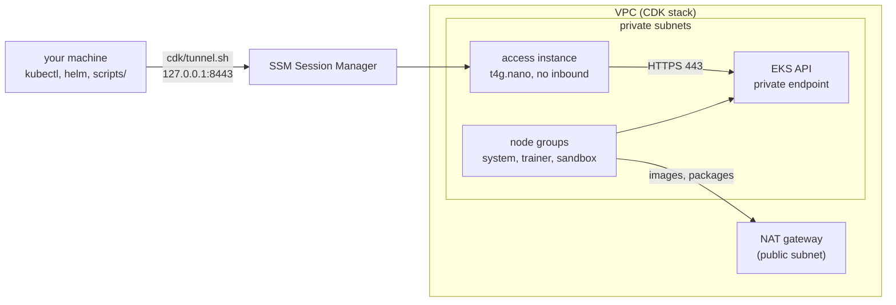
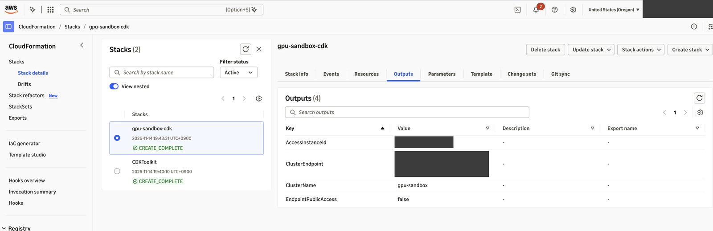
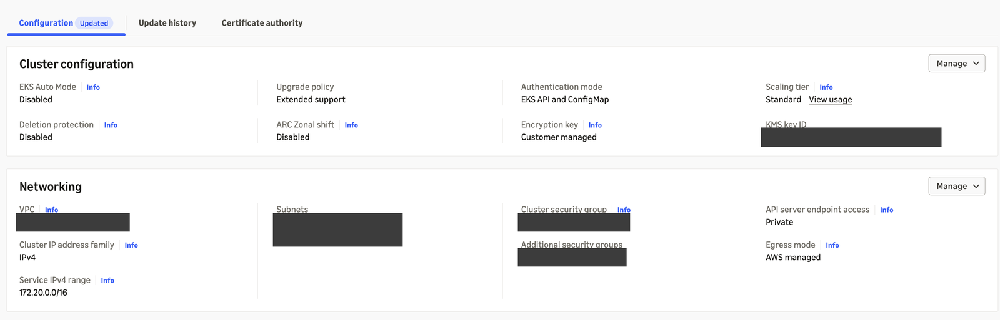
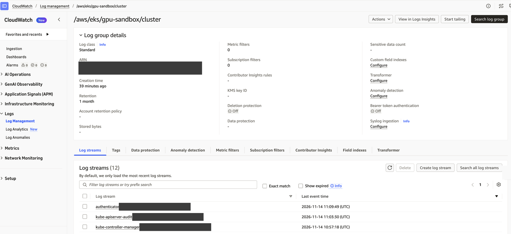

# 09 Provisioning and tearing down with CDK

!!! info "TL;DR"
    This CDK app, called by the hands-on cluster creation script (`02_create_cluster.sh`), creates the VPC, EKS (private API endpoint only), the node groups of the scenario and an SSM access instance as one stack and deletes it with one command. cdk-nag checks the security rules on every synth; the template tests (`cdk/tests`) run separately.

## Why infrastructure is hard to recreate

When recreating an exercise in another account or cleaning it up, it is easy to lose track of which command owns each resource. A deleted cluster can leave a separately created image repository or AMI behind. Identify resource ownership before repeating the deployment or cleanup.


## What the CDK stack owns

The CDK stack creates and removes the VPC, EKS cluster, managed node groups, and SSM access instance together. Other scripts create HyperPod, AMIs, and ECR repositories. After deploying, check the private API through the tunnel. After deleting, check both stack status and separately created resources.

??? note "Conditions and exceptions"
    - **Creating in several scripts**: creating the cluster, node groups and launch templates in several scripts helps understanding, but when you recreate the environment or hand it to a team, steps get missed.
    - **Deleting a setup created in several scripts**: it means removing each step's resources (launch templates, log groups and so on) one by one, and one leftover costs money or breaks the next creation.
    - **Account security checks**: they flag a public API endpoint, IMDSv1, unencrypted volumes or a wide-open security group right away (for example Security Hub control EKS.1).
    - **eksctl**: it cannot create a cluster with a private-only endpoint (eksctl documentation), so a public endpoint stays, which is why this asset removed the eksctl path.

    - **One stack is one unit of deletion.** The VPC, the EKS cluster, the managed node groups and the SSM access instance live in one CloudFormation stack and go with it. The HyperPod cluster, the AMIs and the ECR repositories are outside the stack and must be deleted separately ("Kept outside the stack" in the table below).
    - **Private by default, and security checks block the deploy.** The EKS API endpoint is not opened to the internet (operators connect through SSM Session Manager port forwarding), and cdk-nag (AwsSolutions rules) runs on every synth and fails the deploy on any unacknowledged finding.
    - **The hands-on uses the same stack.** `scripts/02_create_cluster.sh` calls `cdk/deploy.sh`, and both read `scripts/config.env`, so instance types and pinned versions cannot drift.

**Before you start:** read the architecture in [00 Hands-on overview](../handson/00_overview.md) and [00 Architecture](00_architecture.md). For the cheapest trial, create scenario C ([10 CPU-only path on c8i](../handson/10_cpu_only.md)).

??? note "Terms (expand if a word is new)"
    - **AWS CDK**: a tool that defines AWS infrastructure in code (Python here) and deploys it with CloudFormation.
    - **Stack, synth**: a stack is a set of resources created and deleted together. Synth turns the code into a CloudFormation template.
    - **Bootstrap**: a one-time setup per account and Region that creates the S3 bucket and IAM roles CDK deploys with.
    - **cdk-nag**: an open-source tool that checks CDK code against AWS best-practice rules. When you deliberately do not follow a rule, you acknowledge it with a reason.
    - **Private endpoint**: an EKS API address reachable only from inside the VPC, not from the internet.
    - **SSM Session Manager port forwarding**: connects a local port on your machine to an address inside the VPC through an instance with the SSM agent. The instance needs no inbound port and no public IP.
    - **Access entry**: an EKS resource that decides which permissions an IAM role has in the cluster.

!!! warning "Verification status"
    - **Run in a practice account**: deploying, checking and deleting scenario C, the gVisor path of scenario A and the Kata GPU node group (`scripts/kata/gpu_nodes.sh`).
    - **Checked for scenario C**: cluster and node status, the private endpoint, nested virtualization and `/dev/kvm` on the c8i node, gVisor and the node guard on the node, kubectl through the SSM tunnel (the tunnel listened on `127.0.0.1` only), the Kata CPU node script `scripts/kata/cpu_nodes.sh` (kata-deploy, the `gvisor-cpu` RuntimeClass, the smoke pods of the three runtimes), and the resources left after deletion.
    - **Deployed only as intermediate steps**: the B2 stack, while creating the scenario A cluster.
    - **Not run on AWS**: the B2 custom AMI path and `ops/rollout.sh` during scenario A training.
    - **Checked locally**: synth checks the security defaults (`cdk/tests`, 19 tests) and cdk-nag.

    The dated run record is in [Verified facts and sources](../reference/sources.md#aws-run-record).

## Layout



*Takeaway: there is no path from the internet into the cluster; operators reach the API only through one SSM session.*

This CDK stack owns the infrastructure, and the scripts in `scripts/` own what runs inside the cluster, through the tunnel.

| Item | CDK stack (`02_create_cluster.sh`) | Scripts in `scripts/` (in-cluster) |
|---|---|---|
| What it owns | one stack: VPC, cluster, add-ons, the node groups of the scenario, access instance | device plugin, RuntimeClasses, kata-deploy, GPU Operator, namespaces, sandbox pools, training Jobs |
| Start command | `scripts/02_create_cluster.sh` (options `--hyperpod`, `--hyperpod-b2`, `--cpu-only`) calls `cdk/deploy.sh A`, `B1`, `B2` or `C` | Main path: `04_install_gpu_stack.sh`, `05_setup_namespaces_auth.sh`, `06_deploy_sandboxes.sh`, `07_run_grpo.sh`. Optional and operations: `kata/cpu_nodes.sh`, `kata/gpu_nodes.sh`, `ops/verify.sh`, `ops/rollout.sh` |
| EKS API endpoint | private only (public is an opt-in for a single /32 in `EKS_PUBLIC_ACCESS_CIDR`) | use the stack's private endpoint |
| Access | not needed (CloudFormation deploys) | `cdk/tunnel.sh` (SSM port forwarding) running in a second terminal |
| Adding node groups | set `WITH_KATA_CPU=1` or `WITH_KATA_GPU=1` (needs `KATA_IOMMU_AMI_ID`) and run `02_create_cluster.sh` again; CDK changes only what differs | `kata/cpu_nodes.sh` and `kata/gpu_nodes.sh` check that their node group exists, then only install |
| Deletion | `cdk/destroy.sh` | `scripts/08_cleanup.sh` (after the cluster name check, `cdk/destroy.sh --yes`, then the AMIs and ECR) |
| Security checks | 19 tests in `cdk/tests` + cdk-nag (blocks the deploy) | user data and manifest rendering tests in `tests/` |
| Kept outside the stack | the HyperPod cluster, the IOMMU AMI and the B2 AMI, Karpenter, ECR repositories | `scripts/hyperpod/`, `kata/gpu_nodes.sh` (bakes the IOMMU AMI), `03_build_push_images.sh` (ECR) |

## Security defaults

`cdk/tests/test_stack.py` checks each item in the synthesized template.

| Item | Value | Why |
|---|---|---|
| EKS API endpoint | private only. Public only when `EKS_PUBLIC_ACCESS_CIDR` is a single /32 | The cluster API is not open to the internet. Ranges such as `0.0.0.0/0` or a /24 are rejected at configuration time |
| Security groups | the extra control plane security group that CDK adds allows only TCP 443 from the access instance. Nodes and the control plane talk through the cluster security group that EKS creates | No rule admits the internet (`0.0.0.0/0`). The access instance has HTTPS egress only |
| Operator permissions | an access entry (`AmazonEKSClusterAdminPolicy`) for the IAM role in `ADMIN_PRINCIPAL_ARN` | The CloudFormation execution role gets no cluster admin (`BootstrapClusterCreatorAdminPermissions: false`) |
| Instance metadata | IMDSv2 only on every node and the access instance; hop limit 1 on nodes | Pods cannot read node credentials |
| Encryption at rest | every EBS volume encrypted; Kubernetes secrets encrypted with a KMS key (automatic rotation) | Disks and secrets are not left in plain text |
| Logs | five control plane log types (api, audit, authenticator, controllerManager, scheduler), VPC flow logs (rejected traffic) | Auditing and incident investigation. Log groups keep 30 days |
| Network | nodes and the access instance in private subnets. Public subnets hold only the NAT and do not auto-assign public IPs. The default security group blocks all traffic | Nodes never get a public IP |
| Managed policies | only the AWS managed policies that the EKS and SSM docs prescribe, acknowledged in cdk-nag with the reason | No broad hand-written policies |

## Preparation (once)

1. **Tools:** you need Node.js 22 or 24 LTS (versions jsii supports), the AWS CDK CLI 2.1148.1 or later (`npm install -g aws-cdk`), the Session Manager plugin for the AWS CLI, and Python 3.14.
2. **Python environment:** install into the repository's virtual environment; `cdk/cdk.json` calls `python3 app.py`, so run `cdk/deploy.sh` from a shell where this environment is active.

    ```bash
    uv pip install -r cdk/requirements.txt
    ```

3. **Bootstrap:** run once per account and Region. The command uses `AWS_REGION` from your shell, so create `scripts/config.env` from step 4 first and load it before running.

    ```bash
    source scripts/config.env   # AWS_REGION
    cdk bootstrap "aws://$(aws sts get-caller-identity --query Account --output text)/$AWS_REGION"
    ```

    By CDK default the CloudFormation execution role gets `AdministratorAccess`. To narrow it, create a managed policy with EC2, EKS, IAM (role creation), KMS, CloudWatch Logs, Lambda and SSM permissions and pass it with `--cloudformation-execution-policies <policy ARN>`.

4. **Settings:** `scripts/config.env` is the same as for the hands-on, and `SCENARIO`, `WITH_KATA_CPU` and `WITH_KATA_GPU` decide the stack's node groups.
    - **Role ARN**: access entries do not accept STS session ARNs, so if your role has a path (an SSO role, for example), put the ARN from `aws iam get-role --role-name <role> --query Role.Arn --output text` into `ADMIN_PRINCIPAL_ARN`.
    - **Several roles or users**: join the ARNs with commas.
    - **If you leave it empty**: `deploy.sh` derives the role ARN from the current session.

## Step 1: Deploy (cdk/deploy.sh)

This command deploys scenario C (system nodes and the c8i node), the same as `scripts/02_create_cluster.sh --cpu-only` in the hands-on.

- **Other scenarios**: `cdk/deploy.sh A`, `cdk/deploy.sh B1` and `cdk/deploy.sh B2`.
- **A with the c8i node**: `cdk/deploy.sh A --with-kata-cpu`.
- **With `WITH_KATA_GPU=1`**: `deploy.sh` asks you to type `metal` before it adds `g4dn.metal` (about 7.8 USD per hour).

```bash
cdk/deploy.sh C
```

**What to look for:**

1. cdk-nag runs during synth and, with no unacknowledged findings, the deploy continues.
2. A list of IAM role and security group changes appears, followed by `Do you wish to deploy these changes (y/n)?`. Check that there is no `0.0.0.0/0` inbound rule in the list, then press `y`.
3. After 20 to 30 minutes, `Outputs` lists `ClusterName`, `ClusterEndpoint`, `AccessInstanceId` and `EndpointPublicAccess = false` (about 20 minutes in the practice account).

The stack's Outputs tab in the CloudFormation console and the Networking tab in the EKS console show the same; API server endpoint access must be `Private`.





The control plane logs go to `/aws/eks/<CLUSTER_NAME>/cluster` in CloudWatch Logs with 30-day retention.



**If it fails:**

- A bootstrap error such as `Has the environment been bootstrapped?`: run preparation step 3.
- `ValidationFailed`: a new cdk-nag finding; fix it from the rule ID and the resource in the output, and do not acknowledge it without a reason.
- `ADMIN_PRINCIPAL_ARN must list IAM role or user ARNs, not sts assumed-role ARNs`: set it yourself in the form `arn:aws:iam::<account>:role/<role>`.
- `Cloud assembly schema version mismatch`: the CDK CLI is older than the library in `cdk/requirements.txt`; upgrade it with `npm install -g aws-cdk`.

## Step 2: Open the tunnel (cdk/tunnel.sh)

Keep it running in a second terminal. It connects `127.0.0.1:8443` on your machine to the private API endpoint and creates the kubectl context `<CLUSTER_NAME>-tunnel`.

```bash
cdk/tunnel.sh
```

**What to look for:** after the `kubectl context ... -> 127.0.0.1:8443 -> ...` log line, `Waiting for connections...` appears. In the first terminal, list the nodes:

```bash
kubectl get nodes -L gpusandbox/role,node.kubernetes.io/instance-type
```

For scenario C you see two `system` nodes and one `sandbox-kata` node. In the practice deployment the EKS console showed 3 nodes, 2 node groups, 4 add-ons and 4 access entries (2 operators and 2 created by EKS). There is one operator entry per role or user listed in `ADMIN_PRINCIPAL_ARN`, so check that count on your own cluster.


Managed node groups passing this option through is undocumented behavior, so also check that nested virtualization is on for the c8i node (see "Scope and limits" below).

```bash
aws ec2 describe-instances --region "$AWS_REGION" \
  --filters "Name=tag:eks:cluster-name,Values=$CLUSTER_NAME" "Name=tag:eks:nodegroup-name,Values=sandbox-kata-cpu" \
            "Name=instance-state-name,Values=running" \
  --query 'Reservations[].Instances[].CpuOptions'
```

The result must contain `"NestedVirtualization": "enabled"`. Without it, the Kata smoke pods of the Kata CPU node script (`scripts/kata/cpu_nodes.sh`) fail to open KVM.

**If it fails:**

- **`TargetNotConnected`**: the access instance's SSM agent has not registered yet; right after a deploy, wait a few minutes and run it again.
- **If `session-manager-plugin` is missing**: install the plugin from preparation step 1.
- **If kubectl says `Unable to connect`**: check that the tunnel terminal is still running.

## Step 3: In-cluster setup (existing scripts)

CDK created the node groups, so run only the in-cluster steps, with the tunnel from step 2 open.

| Scenario | Steps to run next |
|---|---|
| C | set `KATA_CPU_REPLICAS`, then run `scripts/kata/cpu_nodes.sh` and `scripts/05_setup_namespaces_auth.sh` (the "Scenario C" list below the table) |
| A | `scripts/04_install_gpu_stack.sh`, `scripts/05_setup_namespaces_auth.sh`, `scripts/06_deploy_sandboxes.sh gvisor v1`, `scripts/ops/verify.sh gvisor v1`, then [05 On-policy GRPO training](../handson/05_grpo_training.md) |
| B1, B2 | create the HyperPod cluster with `scripts/hyperpod/create.sh`; B2 prepares the custom AMI first (the "B1, B2" list below the table) |

- **Scenario C**:
    1. Add `export KATA_CPU_REPLICAS="1"` to `scripts/config.env` as in preparation step 2 of [10 CPU-only path on c8i](../handson/10_cpu_only.md) (with the CPU profiles' default of 2 replicas, four pools do not fit on one `c8i.2xlarge`).
    2. Run `scripts/kata/cpu_nodes.sh` (kata-deploy, the `gvisor-cpu` RuntimeClass, the smoke pods; about 14 minutes in the practice account).
    3. Run `ACTIVE_RUNTIME=kata-clh-cpu scripts/05_setup_namespaces_auth.sh`.
    4. Then continue with [10 CPU-only path on c8i](../handson/10_cpu_only.md) from step 6.
- **B1, B2**:
    - **B1**: run `scripts/hyperpod/create.sh`.
    - **B2**: put the `export HYPERPOD_B2_AMI_ID=...` line printed by `scripts/hyperpod/build_b2_ami.sh` into `scripts/config.env`, then run `scripts/hyperpod/create.sh --b2` (it stops if the value is empty).
    - **Subnet choice**: the HyperPod script picks a private subnet that CDK tagged with `kubernetes.io/role/internal-elb`.
    - **The rest of the order**: it is in [07 HyperPod scenario](../handson/07_hyperpod.md).

Build the images as in the hands-on with `scripts/03_build_push_images.sh`.

- **Scenario C**: add `--no-trainer`.
- **For B1 and B2 with `HyperPodPyTorchJob`**: build with `HYPERPOD=1 scripts/03_build_push_images.sh` so the trainer image includes `hyperpodrun`.

## Step 4: Delete (cdk/destroy.sh)

Check stack ownership before cleanup. CloudFormation can finish deleting the stack while separately created resources such as HyperPod or ECR still remain.

Before you start deleting anything, check that `kubectl config current-context` is `<CLUSTER_NAME>-tunnel`; both scripts below use the current context as is.

For B1 and B2, delete the HyperPod cluster with `scripts/hyperpod/delete.sh` before this step. If the HyperPod CRD exists, that script deletes every `HyperPodPyTorchJob` in `rl-trainer` of the current context, then deletes the HyperPod cluster.

`cdk/destroy.sh` works as follows.

- **What it deletes**: if the current kubectl context shows a `sandbox` namespace, this command first deletes every Job in `rl-trainer` and every Deployment and Service in `sandbox` in that context, regardless of app labels, then deletes the whole stack `<CLUSTER_NAME>-cdk` of `CLUSTER_NAME`.
- **No context check**: the script does not check that the current context belongs to `CLUSTER_NAME`.
- **Name confirmation**: it continues only after you type the cluster name.

To delete the CDK stack, run the following command.

```bash
cdk/destroy.sh
```

**What to look for:**

- The final instance table is empty, and a command to delete the ECR repositories is printed.
- **What the script also cleans up**: it deletes the Lambda log group created outside the stack (`/aws/lambda/<CLUSTER_NAME>-cdk-...`, from the default security group cleanup), and the secrets KMS key is scheduled for deletion after 7 days.
- **What stays**: the bootstrap stack `CDKToolkit` (CDK's S3 bucket, ECR repository and deployment roles) stays for the next deploy.
- **For an account you will not use again**: empty that S3 bucket and delete the `CDKToolkit` stack in CloudFormation.

The hands-on `scripts/08_cleanup.sh` asks for the cluster name, calls `cdk/destroy.sh` with `--yes`, asks whether to delete the IOMMU AMI and the B2 AMI, and with `--images` also deletes the ECR repositories.

## Scope and limits

- **HyperPod B1**. The EKS 1.36 stack hosted a one-step GRPO run with two gVisor sandboxes on November 22. [Run and screenshots](../handson/07_hyperpod.md#how-to-verify)
- **Outside the CDK stack:** the HyperPod cluster (`scripts/hyperpod/create.sh`), baking the IOMMU AMI (`scripts/kata/gpu_nodes.sh`) and the B2 AMI (`scripts/hyperpod/build_b2_ami.sh`), Karpenter, Production components such as the gateway, and the ECR repositories are created by the scripts.
- **CPU topology of c8i:** the `CoreCount` and `ThreadsPerCore` that go with nested virtualization come from the table in `cdk/gpusandbox_cdk/config.py` (`c8i.2xlarge`: 4, 2). A type missing from the table is rejected when the CDK settings load, so to use another Kata CPU instance type, look up its core count and threads per core with the `describe-instance-types` command in that file's comment, add it to `CPU_TOPOLOGY`, then deploy.
- **EKS encryption setting:** EKS 1.28 and later envelope-encrypt all Kubernetes API data by default, so CloudFormation marks `EncryptionConfig.Resources` as deprecated (W9009). The stack sets only the KMS key (`Provider`), without `Resources`. The CloudFormation documentation lists a change to this property as Replacement, so deploying onto a stack that was created with `Resources: [secrets]` can plan a cluster replacement. Check with `cdk diff` first, and if it shows a replacement, delete the stack and create it again.
- **VPC CNI permissions:** `AmazonEKS_CNI_Policy` is attached to the node role, while the EKS documentation recommends the `aws-node` service account through Pod Identity or IRSA, so consider moving it in production.
- **Passing nested virtualization through:** the documentation does not say that EKS managed node groups pass the launch template's `CpuOptions.NestedVirtualization` to the nodes. In the practice-account deployment (2026-11-14) it arrived as `enabled` (the node had `/dev/kvm`), but the behavior can change, so do not skip the `describe-instances` check in step 2.
- **Upgrade policy:** the EKS default is Extended support. If you keep the cluster past 2027-08-02, when standard support for 1.36 ends, extended support charges apply, so upgrade before then for long-lived clusters.
- **Cost:** besides the nodes and the control plane, the access instance (`t4g.nano`), the KMS key and log storage cost a little more (check the pricing pages).

## Next steps

After one deploy and delete with scenario C, deploy scenario A the same way. For the production layout, see [00 Architecture](00_architecture.md).

??? note "References"
    | Topic | Link |
    |---|---|
    | AWS CDK v2 Developer Guide | https://docs.aws.amazon.com/cdk/v2/guide/home.html |
    | CDK bootstrapping | https://docs.aws.amazon.com/cdk/v2/guide/bootstrapping.html |
    | EKS cluster endpoint access | https://docs.aws.amazon.com/eks/latest/userguide/cluster-endpoint.html |
    | Start a Session Manager session (port forwarding) | https://docs.aws.amazon.com/systems-manager/latest/userguide/session-manager-working-with-sessions-start.html |
    | This repository's CDK app | https://github.com/daekeun-ml/gpu-sandbox-on-aws/tree/main/cdk |

    [Selected references on this topic](../reference/references.md#ref-production-09-cdk)
