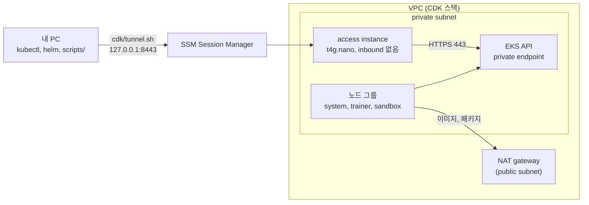
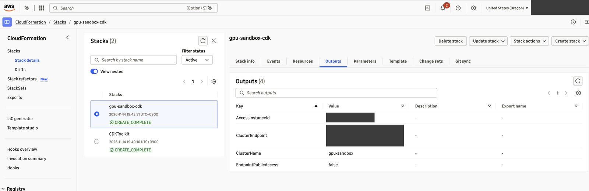
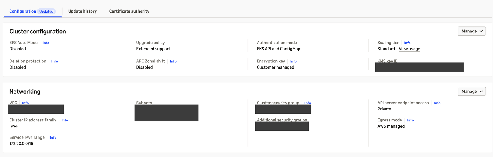
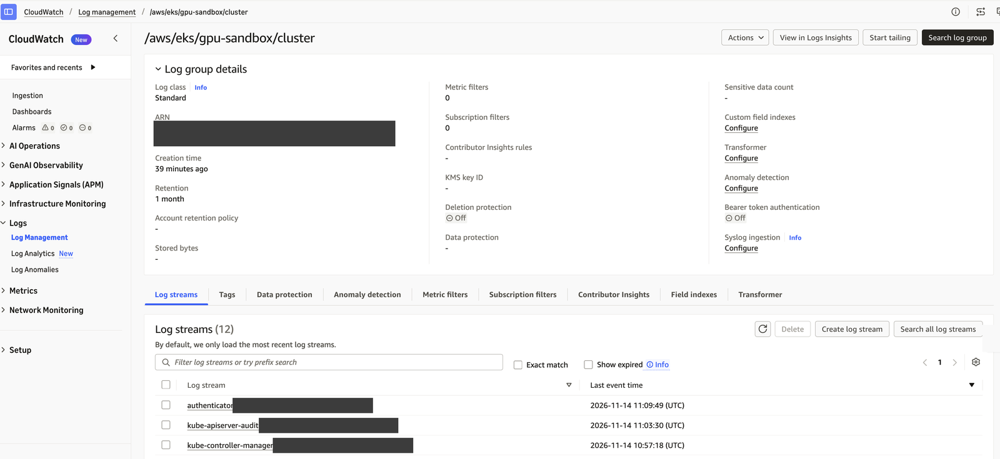

# 09 CDK로 프로비저닝하고 삭제하기

이 장에서 B2 CDK 명령은 EC2 시스템 노드를 두는 이전 구성을 가리킵니다. CPU와 GPU 워커를 모두 HyperPod에 두는 실습은 [관리형 B2](../handson/07_hyperpod_b2.md)를 따르세요.

!!! info "TL;DR"
    핸즈온의 클러스터 생성 단계(`02_create_cluster.sh`)에서 실행하는 이 CDK 앱은 VPC, EKS(API endpoint는 private 전용), 시나리오별 노드 그룹, SSM 접속 인스턴스를 스택 하나로 만들고 명령 한 번으로 삭제합니다. synth할 때마다 cdk-nag가 보안 규칙을 검사하고, 템플릿 테스트(`cdk/tests`)는 따로 실행합니다.

## 인프라를 다시 만들기 어려운 이유

실습용 클러스터를 다른 계정에 다시 만들거나 삭제할 때, 어느 명령이 어떤 리소스를 만들었는지 놓치기 쉽습니다. 예를 들어 클러스터가 지워져도 별도로 만든 이미지 저장소나 AMI는 남을 수 있습니다. 반복 배포와 정리를 하려면 먼저 리소스의 관리 주체를 확인합니다.


## CDK 스택으로 관리하는 범위

CDK 스택은 VPC, EKS, 관리형 노드 그룹, SSM 접속 인스턴스를 함께 배포하고 삭제합니다. HyperPod와 AMI, ECR은 생성 주체가 다른 리소스입니다. 배포 뒤에는 private API를 터널로 열어 확인하고, 정리 뒤에는 스택 상태와 별도 리소스 목록을 모두 확인합니다.

??? note "세부 조건과 예외"
    - **여러 스크립트로 나눠 만들 때**: 클러스터, 노드 그룹, launch template을 여러 스크립트로 나눠 만들면 이해하기는 쉽지만, 환경을 다시 만들거나 팀에 공유할 때 순서를 놓치기 쉽습니다.
    - **여러 스크립트로 나눠 만든 구성을 삭제할 때**: 단계별 리소스(launch template, 로그 그룹 등)를 따로 삭제해야 하고, 하나라도 남으면 비용이 계속 발생하거나 다음 생성이 실패합니다.
    - **계정 보안 점검**: 공개된 API endpoint, IMDSv1, 암호화하지 않은 볼륨, 넓게 열린 security group은 계정 보안 점검에서 바로 지적됩니다(예: Security Hub 컨트롤 EKS.1).
    - **eksctl**: private endpoint만 활성화한 클러스터를 처음부터 만들 수 없어(eksctl 문서) public endpoint가 활성화된 상태로 남습니다. 그래서 이 저장소는 eksctl을 쓰는 방법을 제거했습니다.

    - **스택 하나를 삭제 단위로 씁니다.** VPC, EKS 클러스터, 관리형 노드 그룹, SSM 접속 인스턴스가 CloudFormation 스택 하나에 있어 스택과 함께 삭제됩니다. HyperPod 클러스터, AMI, ECR 저장소는 스택 밖에 있으니 따로 지워야 합니다(아래 표의 "스택 밖에서 만드는 것").
    - **기본값이 private이고, 보안 검사를 통과해야 배포됩니다.** EKS API endpoint는 인터넷에 노출하지 않습니다(접속은 SSM Session Manager 포트 포워딩). synth할 때마다 실행되는 cdk-nag(AwsSolutions 규칙)가 예외 처리하지 않은 지적을 발견하면 배포가 중단됩니다.
    - **핸즈온도 같은 스택을 씁니다.** `scripts/02_create_cluster.sh`가 `cdk/deploy.sh`를 호출하고 둘 다 `scripts/config.env`를 읽으므로, 인스턴스 유형과 고정 버전이 서로 달라지지 않습니다.

**읽기 전에**　[00 핸즈온 전체 흐름](../handson/00_overview.md)의 아키텍처와 [00 아키텍처](00_architecture.md)를 먼저 보세요. 가장 적은 비용으로 시험하려면 시나리오 C([10 c8i 단독 저비용 경로](../handson/10_cpu_only.md))로 배포하세요.

??? note "용어 (처음 보는 단어가 있으면 펼치세요)"
    - **AWS CDK**: 코드(여기서는 Python)로 AWS 인프라를 정의하고 CloudFormation으로 배포하는 도구입니다.
    - **스택, synth**: 스택은 함께 만들고 함께 삭제하는 리소스 묶음입니다. synth는 코드를 CloudFormation 템플릿으로 변환하는 단계입니다.
    - **bootstrap**: CDK가 배포에 쓰는 S3 버킷과 IAM 역할을 계정과 리전마다 한 번 만드는 작업입니다.
    - **cdk-nag**: CDK 코드를 AWS 모범 사례 규칙으로 검사하는 오픈소스 도구입니다. 규칙을 의도적으로 따르지 않을 때는 이유를 적어 예외로 처리합니다.
    - **private endpoint**: VPC 안에서만 접근할 수 있는 EKS API 주소입니다. 인터넷에서는 접근할 수 없습니다.
    - **SSM Session Manager 포트 포워딩**: SSM agent가 있는 인스턴스를 거쳐 내 PC의 로컬 포트를 VPC 안의 주소로 연결해 주는 기능입니다. 인스턴스에 inbound 포트나 공인 IP가 없어도 됩니다.
    - **access entry**: 어떤 IAM 역할이 EKS 클러스터에서 어떤 권한을 갖는지 정하는 EKS 리소스입니다.

!!! warning "검증 상태"
    - **실습 계정에서 실행한 것**: 시나리오 C의 배포, 확인, 삭제와 시나리오 A(gVisor 경로), Kata GPU 노드 그룹(`scripts/kata/gpu_nodes.sh`)입니다.
    - **시나리오 C에서 확인한 것**: 클러스터와 노드 상태, private endpoint, c8i 노드의 nested virtualization과 `/dev/kvm`, 노드의 gVisor와 node guard, SSM 터널을 통한 kubectl 접속(터널은 `127.0.0.1`에서만 열림), Kata CPU 노드 추가(`scripts/kata/cpu_nodes.sh`)의 kata-deploy, `gvisor-cpu` RuntimeClass, 세 런타임의 smoke pod, 삭제 후 남은 리소스입니다.
    - **중간 단계로만 배포한 것**: B2 스택은 시나리오 A 클러스터를 만드는 중간 단계로만 배포했습니다.
    - **AWS에서 실행하지 않은 것**. HyperPod B2 custom AMI 경로입니다.
    - **로컬에서 확인하는 것**: synth로 보안 기본값(`cdk/tests`, 19개)과 cdk-nag를 확인합니다.

    날짜별 실행 기록은 [검증된 사실과 출처](../reference/sources.md#aws-실행-기록)에 있습니다.

## 구성



*그림 요약: 인터넷에서 클러스터로 들어오는 경로는 없고, 운영자는 SSM 세션 하나로만 API에 접근합니다.*

인프라는 이 CDK 스택이 만들고, 클러스터 안쪽 구성은 `scripts/`의 스크립트가 터널을 거쳐 설치합니다.

| 항목 | CDK 스택 (`02_create_cluster.sh`) | `scripts/`의 스크립트 (클러스터 안쪽) |
|---|---|---|
| 담당 범위 | 스택 하나: VPC, 클러스터, add-on, 시나리오별 노드 그룹, access instance | device plugin, RuntimeClass, kata-deploy, GPU Operator, namespace, 샌드박스 pool, 학습 Job |
    - **AWS에서 실행하지 않은 것**. HyperPod B2 custom AMI 경로입니다.
| EKS API endpoint | private 전용 (public은 `EKS_PUBLIC_ACCESS_CIDR`에 /32 하나로만 opt-in) | 스택의 private endpoint를 그대로 씀 |
| 접속 | 필요 없음 (CloudFormation이 배포) | `cdk/tunnel.sh` (SSM 포트 포워딩)를 두 번째 터미널에서 실행해 둠 |
| 노드 그룹 추가 | `WITH_KATA_CPU=1`, `WITH_KATA_GPU=1`(`KATA_IOMMU_AMI_ID` 필요)을 설정하고 `02_create_cluster.sh`를 다시 실행하면 CDK가 변경된 부분만 반영 | `kata/cpu_nodes.sh`, `kata/gpu_nodes.sh`는 노드 그룹이 있는지 확인한 뒤 설치만 함 |
| 삭제 | `cdk/destroy.sh` | `scripts/08_cleanup.sh` (클러스터 이름 확인 뒤 `cdk/destroy.sh --yes`, 그다음 AMI와 ECR) |
| 보안 검사 | `cdk/tests` 19개 + cdk-nag (지적이 있으면 배포 중단) | `tests/`의 user data, 매니페스트 렌더링 테스트 |
| 스택 밖에서 만드는 것 | HyperPod 클러스터, IOMMU AMI와 B2 AMI, Karpenter, ECR 저장소 | `scripts/hyperpod/`, `kata/gpu_nodes.sh`(IOMMU AMI 빌드), `03_build_push_images.sh`(ECR) |

## 보안 기본값

각 항목은 `cdk/tests/test_stack.py`가 synth한 템플릿에서 확인합니다.

| 항목 | 값 | 이유 |
|---|---|---|
| EKS API endpoint | private 전용. public은 `EKS_PUBLIC_ACCESS_CIDR`에 /32 하나를 지정할 때만 활성화 | 클러스터 API를 인터넷에 노출하지 않음. `0.0.0.0/0`이나 /24 같은 범위는 설정 단계에서 거부 |
| security group | CDK가 추가한 control plane security group의 inbound는 access instance에서 오는 TCP 443 하나. 노드와 control plane 사이의 통신은 EKS가 만든 cluster security group을 사용 | 인터넷(`0.0.0.0/0`)에서 들어오는 규칙이 없음. access instance는 HTTPS egress만 |
| 운영자 권한 | `ADMIN_PRINCIPAL_ARN`의 IAM 역할에 access entry(`AmazonEKSClusterAdminPolicy`) | CloudFormation 실행 역할에는 클러스터 관리자 권한을 주지 않음(`BootstrapClusterCreatorAdminPermissions: false`) |
| 인스턴스 메타데이터 | 모든 노드와 access instance에 IMDSv2만, 노드는 hop limit 1 | pod가 노드의 자격 증명을 읽지 못하게 함 |
| 저장소 암호화 | 모든 EBS 볼륨 암호화, Kubernetes secrets는 KMS 키(자동 교체)로 암호화 | 디스크와 secrets가 평문으로 남지 않음 |
| 로그 | control plane 로그 5종(api, audit, authenticator, controllerManager, scheduler), VPC flow log(거부된 트래픽) | 감사와 사고 조사. 로그 그룹 보존 기간 30일 |
| 네트워크 | 노드와 access instance는 private subnet. public subnet은 NAT만 두고 공인 IP를 자동으로 할당하지 않음. 기본 security group은 모든 트래픽을 차단 | 노드에 공인 IP가 생기지 않음 |
| 관리형 정책 | EKS와 SSM 문서가 정한 AWS 관리형 정책만, cdk-nag에 근거를 적어 예외 처리 | 권한이 넓은 정책을 직접 만들지 않음 |

## 준비 (한 번만)

1. **도구:** Node.js 22 또는 24 LTS(jsii가 지원하는 버전), AWS CDK CLI 2.1148.1 이상(`npm install -g aws-cdk`), Session Manager plugin for the AWS CLI, Python 3.14가 필요합니다.
2. **Python 환경:** 아래 패키지를 저장소의 가상 환경에 설치합니다. `cdk/cdk.json`이 `python3 app.py`를 호출하므로, 이 가상 환경을 활성화한 셸에서 `cdk/deploy.sh`를 실행하세요.

    ```bash
    uv pip install -r cdk/requirements.txt
    ```

3. **bootstrap:** 계정과 리전마다 한 번 실행합니다. 명령은 셸의 `AWS_REGION`을 쓰므로, 4단계의 `scripts/config.env`를 먼저 만들고 불러온 뒤 실행하세요.

    ```bash
    source scripts/config.env   # AWS_REGION
    cdk bootstrap "aws://$(aws sts get-caller-identity --query Account --output text)/$AWS_REGION"
    ```

    CDK 기본값으로 CloudFormation 실행 역할에 `AdministratorAccess`가 붙습니다. 권한을 좁히려면 EC2, EKS, IAM(역할 생성), KMS, CloudWatch Logs, Lambda, SSM 권한을 담은 관리형 정책을 미리 만들어 `--cloudformation-execution-policies <정책 ARN>`으로 지정하세요.

4. **설정:** `scripts/config.env`는 핸즈온과 같은 파일을 쓰며, `SCENARIO`, `WITH_KATA_CPU`, `WITH_KATA_GPU` 값에 따라 스택의 노드 그룹이 정해집니다.
    - **역할 ARN**: access entry는 STS 세션 ARN을 받지 않으므로, 역할에 path가 있다면(예: SSO 역할) `aws iam get-role --role-name <역할> --query Role.Arn --output text`로 얻은 ARN을 `ADMIN_PRINCIPAL_ARN`에 적으세요.
    - **여러 역할이나 사용자**: 쉼표로 구분해 적습니다.
    - **비워 두면**: `deploy.sh`가 현재 세션 정보로 역할 ARN을 만듭니다.

## 1단계: 배포 (cdk/deploy.sh)

다음 명령은 시나리오 C(system 노드와 c8i 노드)를 배포하며, 핸즈온의 `scripts/02_create_cluster.sh --cpu-only`와 같은 동작입니다.

- **다른 시나리오**: `cdk/deploy.sh A`, `cdk/deploy.sh B1`, `cdk/deploy.sh B2`로 배포합니다.
- **A에 c8i 노드를 추가하려면**: `cdk/deploy.sh A --with-kata-cpu`를 실행합니다.
- **`WITH_KATA_GPU=1`이면**: `deploy.sh`는 `g4dn.metal`(시간당 약 7.8 USD)을 추가하기 전에 확인을 위해 `metal`을 입력하도록 요구합니다.

```bash
cdk/deploy.sh C
```

**확인할 것:**

1. synth 중에 cdk-nag가 실행되고, 예외 처리하지 않은 지적이 없으면 다음 단계로 넘어갑니다.
2. IAM 역할과 security group 변경 목록이 출력되고 `Do you wish to deploy these changes (y/n)?`를 묻습니다. 목록에 `0.0.0.0/0` inbound가 없는지 확인하고 `y`를 누르세요.
3. 20~30분 뒤 `Outputs` 아래에 `ClusterName`, `ClusterEndpoint`, `AccessInstanceId`, `EndpointPublicAccess = false`가 출력됩니다(실습 계정에서 약 20분).

같은 값은 CloudFormation 콘솔의 스택 Outputs 탭과 EKS 콘솔의 Networking 탭에서도 확인할 수 있으며, API server endpoint access가 `Private`이어야 합니다.





control plane 로그는 CloudWatch Logs의 `/aws/eks/<CLUSTER_NAME>/cluster`에 30일 보존 설정으로 저장됩니다.



**문제가 생기면:**

- `Has the environment been bootstrapped?` 같은 bootstrap 오류는 준비 3번으로 해결합니다.
- `ValidationFailed`는 cdk-nag의 새 지적이니 출력의 규칙 ID와 리소스를 확인해 수정하고, 이유 없이 예외 처리하지 마세요.
- `ADMIN_PRINCIPAL_ARN must list IAM role or user ARNs, not sts assumed-role ARNs`이면 `arn:aws:iam::<계정>:role/<역할>` 형식으로 직접 적으세요.
- `Cloud assembly schema version mismatch`는 CDK CLI 버전이 `cdk/requirements.txt`의 라이브러리보다 낮다는 뜻이니, `npm install -g aws-cdk`로 CLI를 업그레이드하세요.

## 2단계: 터널 열기 (cdk/tunnel.sh)

두 번째 터미널에서 실행해 둡니다. 이 스크립트는 내 PC의 `127.0.0.1:8443`을 private API endpoint로 연결하고 kubectl 컨텍스트 `<CLUSTER_NAME>-tunnel`을 만듭니다.

```bash
cdk/tunnel.sh
```

**확인할 것:** `kubectl context ... -> 127.0.0.1:8443 -> ...` 로그 뒤에 `Waiting for connections...`가 출력됩니다. 첫 번째 터미널에서 노드 목록을 확인합니다.

```bash
kubectl get nodes -L gpusandbox/role,node.kubernetes.io/instance-type
```

시나리오 C라면 `system` 두 대와 `sandbox-kata` 한 대가 출력됩니다. 실습 화면의 EKS 콘솔에는 노드 3, 노드 그룹 2, add-on 4, access entry 4(운영자 2개와 EKS가 만든 2개)가 표시됐습니다. 운영자 entry는 `ADMIN_PRINCIPAL_ARN`에 적은 역할이나 사용자마다 하나씩 생깁니다. 자신의 클러스터에서 그 수와 맞는지 확인하세요.


관리형 노드 그룹이 nested virtualization 옵션을 노드에 전달하는 것은 문서에 없는 동작이니, c8i 노드에서 nested virtualization이 활성화됐는지도 확인하세요(아래 "적용 범위와 한계").

```bash
aws ec2 describe-instances --region "$AWS_REGION" \
  --filters "Name=tag:eks:cluster-name,Values=$CLUSTER_NAME" "Name=tag:eks:nodegroup-name,Values=sandbox-kata-cpu" \
            "Name=instance-state-name,Values=running" \
  --query 'Reservations[].Instances[].CpuOptions'
```

결과에 `"NestedVirtualization": "enabled"`가 있어야 합니다. 없으면 Kata CPU 노드 추가(`scripts/kata/cpu_nodes.sh`)의 Kata smoke pod가 KVM을 사용하지 못해 실패합니다.

**문제가 생기면:**

- **`TargetNotConnected`**: access instance의 SSM agent가 아직 등록되지 않았다는 뜻이니, 배포 직후라면 몇 분 뒤 다시 실행하세요.
- **`session-manager-plugin`이 없다는 오류가 나오면**: 준비 1번의 plugin을 설치하세요.
- **kubectl이 `Unable to connect`를 출력하면**: 터널 터미널에서 스크립트가 실행 중인지 확인하세요.

## 3단계: 클러스터 안쪽 설치 (기존 스크립트)

노드 그룹은 CDK가 만들었으므로, 2단계의 터널을 유지한 상태에서 클러스터 안쪽 단계만 실행합니다.

| 시나리오 | 이어서 실행할 단계 |
|---|---|
| C | `KATA_CPU_REPLICAS` 설정, `scripts/kata/cpu_nodes.sh`, `scripts/05_setup_namespaces_auth.sh` 순서로 실행(표 아래 "시나리오 C" 목록) |
| A | `scripts/04_install_gpu_stack.sh`, `scripts/05_setup_namespaces_auth.sh`, `scripts/06_deploy_sandboxes.sh gvisor v1`, `scripts/ops/verify.sh gvisor v1`, 그다음 [05 On-policy GRPO 학습](../handson/05_grpo_training.md) |
| B1, B2 | `scripts/hyperpod/create.sh`로 HyperPod 클러스터 생성. B2는 custom AMI를 먼저 준비(표 아래 "B1, B2" 목록) |

- **시나리오 C**:
    1. [10 c8i 단독](../handson/10_cpu_only.md)의 준비 2대로 `scripts/config.env`에 `export KATA_CPU_REPLICAS="1"`을 추가합니다(CPU 프로필의 기본 replica 2로는 pool 4개가 `c8i.2xlarge` 한 대에 들어가지 않음).
    2. `scripts/kata/cpu_nodes.sh`를 실행합니다(kata-deploy, `gvisor-cpu` RuntimeClass, smoke pod. 실습 계정에서 약 14분).
    3. `ACTIVE_RUNTIME=kata-clh-cpu scripts/05_setup_namespaces_auth.sh`를 실행합니다.
    4. 그다음 [10 c8i 단독](../handson/10_cpu_only.md)의 6단계부터 이어 갑니다.
- **B1, B2**:
    - **B1**: `scripts/hyperpod/create.sh`를 실행합니다.
    - **B2**: `scripts/hyperpod/build_b2_ami.sh`가 출력한 `export HYPERPOD_B2_AMI_ID=...` 줄을 `scripts/config.env`에 넣은 뒤 `scripts/hyperpod/create.sh --b2`를 실행합니다(값이 비어 있으면 생성이 중단됨).
    - **subnet 선택**: HyperPod 스크립트는 CDK가 `kubernetes.io/role/internal-elb` 태그를 붙인 private subnet을 고릅니다.
    - **이어지는 순서**: [07 HyperPod 시나리오](../handson/07_hyperpod.md)에 있습니다.

이미지는 핸즈온과 같이 `scripts/03_build_push_images.sh`로 만듭니다.

- **시나리오 C**: `--no-trainer`를 붙입니다.
- **B1과 B2에서 `HyperPodPyTorchJob`으로 학습하려면**: trainer 이미지에 `hyperpodrun`이 들어가도록 `HYPERPOD=1 scripts/03_build_push_images.sh`로 빌드하세요.

## 4단계: 지우기 (cdk/destroy.sh)

정리 전에 스택이 소유한 리소스와 스크립트가 별도로 만든 리소스를 확인하세요. CloudFormation이 삭제를 마쳐도 HyperPod 클러스터나 ECR 저장소 등 스택 밖 리소스는 별도 확인이 필요합니다.

삭제를 시작하기 전에 `kubectl config current-context`가 `<CLUSTER_NAME>-tunnel`인지 확인하세요. 아래 두 스크립트 모두 현재 컨텍스트를 그대로 씁니다.

B1과 B2에서는 이 단계 전에 `scripts/hyperpod/delete.sh`로 HyperPod 클러스터를 먼저 삭제합니다. 이 스크립트는 HyperPod CRD가 있으면 현재 컨텍스트의 `rl-trainer`에 있는 `HyperPodPyTorchJob`을 모두 지운 뒤 HyperPod 클러스터를 삭제합니다.

`cdk/destroy.sh`는 다음과 같이 동작합니다.

- **삭제 범위**: 현재 kubectl 컨텍스트에서 `sandbox` namespace가 보이면 그 컨텍스트의 `rl-trainer` Job 전체와 `sandbox`의 Deployment, Service 전체를 앱 label과 관계없이 먼저 삭제한 뒤, `CLUSTER_NAME`의 스택 `<CLUSTER_NAME>-cdk` 전체를 삭제합니다.
- **컨텍스트 검사 없음**: 스크립트는 현재 컨텍스트가 `CLUSTER_NAME`의 클러스터인지 검사하지 않습니다.
- **이름 확인**: 클러스터 이름을 직접 입력해야 삭제가 진행됩니다.

CDK 스택을 삭제하려면 다음 명령을 실행하세요.

```bash
cdk/destroy.sh
```

**확인할 것:**

- 마지막에 출력되는 인스턴스 표가 비어 있고, ECR 저장소를 삭제하는 명령이 안내됩니다.
- **스크립트가 함께 정리하는 것**: 스택 밖에 생기는 Lambda 로그 그룹(`/aws/lambda/<CLUSTER_NAME>-cdk-...`, 기본 security group 정리용)도 삭제하며, secrets용 KMS 키는 7일 뒤 삭제되도록 예약됩니다.
- **남는 것**: bootstrap 스택 `CDKToolkit`(CDK용 S3 버킷, ECR 저장소, 배포 역할)은 다음 배포에 다시 쓰므로 삭제하지 않습니다.
- **더는 쓰지 않을 계정이라면**: 그 S3 버킷을 비우고 CloudFormation에서 `CDKToolkit` 스택을 삭제하세요.

핸즈온의 `scripts/08_cleanup.sh`는 클러스터 이름을 확인한 뒤 `cdk/destroy.sh`를 `--yes`로 호출합니다. 이어서 IOMMU AMI와 B2 AMI의 삭제 여부를 묻고, `--images`를 지정하면 ECR 저장소까지 삭제합니다.

## 적용 범위와 한계

- **HyperPod B1**. 11월 22일 EKS 1.36 스택에서 gVisor 샌드박스 2개를 연결해 GRPO 한 스텝을 실행했습니다. [실행 기록과 화면](../handson/07_hyperpod.md#확인-방법)
- **CDK 스택 밖에 있는 것:** HyperPod 클러스터(`scripts/hyperpod/create.sh`), IOMMU AMI(`scripts/kata/gpu_nodes.sh`)와 B2 AMI(`scripts/hyperpod/build_b2_ami.sh`) 빌드, Karpenter, gateway 같은 Production 구성 요소, ECR 저장소는 스크립트로 만듭니다.
- **c8i의 CPU 토폴로지:** nested virtualization을 활성화할 때 함께 지정하는 `CoreCount`, `ThreadsPerCore`는 `cdk/gpusandbox_cdk/config.py`의 표(`c8i.2xlarge`: 4, 2)에서 읽습니다. 표에 없는 유형은 CDK 설정 단계에서 거부되므로, 다른 Kata CPU 인스턴스 유형을 쓰려면 그 파일 주석의 `describe-instance-types` 명령으로 코어 수와 코어당 스레드 수를 확인해 `CPU_TOPOLOGY`에 추가한 뒤 배포하세요.
- **EKS 암호화 설정:** EKS 1.28 이상은 모든 Kubernetes API 데이터를 기본으로 envelope 암호화하므로, CloudFormation은 `EncryptionConfig.Resources`를 deprecated로 표시합니다(W9009). 스택은 `Resources` 없이 KMS 키(`Provider`)만 지정합니다. CloudFormation 문서상 이 속성의 변경은 Replacement이므로, `Resources: [secrets]`로 이미 배포한 스택에 그대로 배포하면 클러스터 교체가 계획될 수 있습니다. 먼저 `cdk diff`로 확인하고, 교체가 보이면 스택을 지운 뒤 새로 만드세요.
- **VPC CNI 권한:** 이 스택은 `AmazonEKS_CNI_Policy`를 노드 역할에 붙입니다. EKS 문서는 이 정책을 `aws-node` service account에 Pod Identity나 IRSA로 연결하도록 권장하므로, 운영 환경에서는 이 방식으로 옮기는 것을 검토하세요.
- **nested virtualization 전달:** EKS 관리형 노드 그룹이 launch template의 `CpuOptions.NestedVirtualization`을 노드에 전달한다는 내용은 문서에 없습니다. 실습 계정 배포(2026-11-14)에서는 `enabled`로 전달됐지만(노드에 `/dev/kvm` 있음) 바뀔 수 있으니 2단계의 `describe-instances` 확인을 생략하지 마세요.
- **upgrade policy:** EKS 기본값은 Extended support입니다. 1.36의 standard support가 끝나는 2027-08-02 뒤에도 클러스터를 유지하면 extended support 요금이 부과되니, 오래 쓸 클러스터라면 그 전에 Kubernetes 버전을 업그레이드하세요.
- **비용:** 노드와 control plane 외에 access instance(`t4g.nano`), KMS 키, 로그 저장 비용이 조금 더 듭니다(요금 페이지에서 확인).

## 다음 단계

시나리오 C로 배포와 삭제를 한 번 해 본 뒤, 같은 방법으로 시나리오 A를 배포하세요. 운영 구성은 [00 아키텍처](00_architecture.md)부터 보세요.

??? note "참고 자료"
    | 주제 | 링크 |
    |---|---|
    | AWS CDK v2 개발자 가이드 | https://docs.aws.amazon.com/cdk/v2/guide/home.html |
    | CDK bootstrapping | https://docs.aws.amazon.com/cdk/v2/guide/bootstrapping.html |
    | EKS cluster endpoint access | https://docs.aws.amazon.com/eks/latest/userguide/cluster-endpoint.html |
    | Session Manager 세션 시작 (포트 포워딩) | https://docs.aws.amazon.com/systems-manager/latest/userguide/session-manager-working-with-sessions-start.html |
    | 이 저장소의 CDK 앱 | https://github.com/daekeun-ml/gpu-sandbox-on-aws/tree/main/cdk |

    [관련 대표 자료](../reference/references.md#ref-production-09-cdk)
