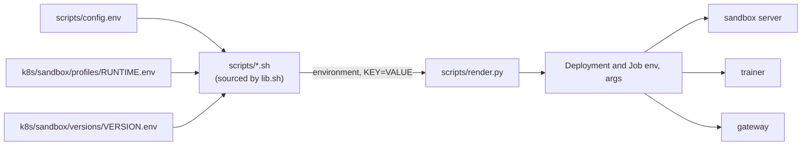

# Configuration

!!! info "TL;DR"
    A reference of this repository's settings, with the code default next to the value the manifests actually set in the cluster.

## Pain point

The code defaults (`127.0.0.1` bind, egress self-test off, auth unconfigured) are for local tests, and in the cluster the manifests set different values. A value passes from `config.env` through a script, `render.py` and the manifest `env` or command-line arguments to the process, so if you miss one stage the cause is hard to find. Some names, such as `SANDBOX_RUNTIME` and `SANDBOX_VERSION`, have a different meaning and default on the server and on the client. Parsing rules are subtle too: `SANDBOX_AUTH_TEST_BYPASS` turns on only when it is exactly `1`, while `HARNESS_ALLOW_CUDA_CPP` accepts `1`, `true` and `yes`.

## Why

- **If the docs and the code disagree, the code wins.** The defaults come from `Settings.from_env`, `AuthConfig.from_env`, the argparse definitions and the gateway's `create_app`.
- **The cluster uses the manifest values.** A value that no manifest sets falls back to the code default in the cluster too. For example, no manifest sets `HARNESS_WARMUP`, so the server uses the default `3`.
- **Each value is changed in a different file.** Pool CPU and memory live in the runtime profile, the number of correctness seeds in the version file, and the model to train in `scripts/config.env`.

**Before you start:** "How values and templates come together" in the [Repository map](repository_map.md) shows where the tables on this page are used. To follow the local commands, finish the installation in [Getting started](../getting_started.md).

??? note "Terms"
    - **environment variable (env)**: a name and value pair a process receives when it starts. The server, the gateway and the trainer in this repository take most of their settings this way.
    - **code default, manifest value**: the code default is what the code uses when the variable is absent; the manifest value is what a Kubernetes Deployment or Job actually sets. In the cluster the manifest value applies.
    - **downward API**: the Kubernetes feature that passes a pod's own information, such as its name, node name and node IP, as environment variables.
    - **projected ServiceAccount token**: a token kubelet writes into a pod file. It has a chosen audience and lifetime, and kubelet replaces it periodically at the same path.
    - **fail closed**: rejecting instead of allowing when a setting is missing or cannot be checked.
    - **Guaranteed QoS**: the highest resource guarantee class Kubernetes gives to pods whose requests equal their limits.

    More terms are in the [Glossary](glossary.md).

## How values flow



*Figure: in the cluster a process reads its values through the manifest's `env` or its command arguments (`args`). The trainer gets its model and step count as arguments, so when a value looks wrong, check both the pod's env and its arguments.*

The scripts run in a shell that has sourced `scripts/config.env`, so every value you `export` there is available to the templates' `${VAR}`. A variable that config.env does not set can be changed for one run by prefixing the command, for example `ACTIVE_RUNTIME=kata-qemu scripts/05_setup_namespaces_auth.sh`. If config.env `export`s the variable, the script reads that file later and overwrites the prefixed value, so change it in the file.

## 1. scripts/config.env

Create it only when it does not exist, with `test -f scripts/config.env || cp scripts/config.env.example scripts/config.env`, and edit it. Copying over an existing file loses the values you filled in. If a value a script requires is empty or contains `__SET_ME__`, that script stops with `set <NAME> in scripts/config.env`. Variables with a defined behaviour when empty, such as `ADMIN_PRINCIPAL_ARN` and `EKS_PUBLIC_ACCESS_CIDR`, are described in the table below.

| Variable | Example file value | Meaning | Used by |
|---|---|---|---|
| `AWS_REGION` | `us-west-2` | AWS Region for the cluster, image and HyperPod steps. The demo site (`demo/deploy.sh`) deploys to `us-east-1` regardless of this value | all |
| `CLUSTER_NAME` | `gpu-sandbox` | EKS cluster name. Also used in the CDK stack name `<CLUSTER_NAME>-cdk` and the kubectl context `<CLUSTER_NAME>-tunnel` | all |
| `K8S_VERSION` | `1.36` | EKS Kubernetes version, inside EKS standard support (until 2027-08-02) and the versions in the HyperPod EKS AMI release notes (the HyperPod prerequisites page still says up to 1.35) | `cdk/`, `build-iommu-ami.sh` |
| `SCENARIO` | `A` | Node groups the CDK stack creates. `A` (system, trainer, gVisor), `B1` (system, gVisor), `B2` (system only), `C` (system, Kata CPU). The options of `02_create_cluster.sh` (`--hyperpod`, `--hyperpod-b2`, `--cpu-only`) override it | `02_create_cluster.sh`, `cdk/` |
| `CHANGE_SCENARIO` | not set (script default `0`) | `1` allows deploying a scenario other than the one recorded in the stack (the `Scenario` output). Not needed for a first deployment or a redeployment of the same scenario; when the scenario differs and this is not `1`, `cdk/deploy.sh` stops | `cdk/deploy.sh` |
| `ADMIN_PRINCIPAL_ARN` | derived from the current session by `cdk/deploy.sh` when empty | IAM role or user ARNs that get the cluster admin access entry, comma-separated (not STS session ARNs). Set it yourself if the role has a path | `cdk/` |
| `EKS_PUBLIC_ACCESS_CIDR` | none (commented out, private only) | Only to turn on the public endpoint; a single IPv4 /32. Other ranges are rejected at configuration time | `cdk/` |
| `WITH_KATA_CPU` | `0` | `1` adds the `sandbox-kata-cpu` (c8i) node group to any scenario (the same as `cdk/deploy.sh <scenario> --with-kata-cpu`). Scenario C always has it. Set it before adding Kata CPU nodes (`kata/cpu_nodes.sh`) and run `02_create_cluster.sh` again | `02_create_cluster.sh`, `cdk/` |
| `WITH_KATA_GPU` | `0` | `1` together with `KATA_IOMMU_AMI_ID` adds the `sandbox-kata-gpu` (`g4dn.metal`) node group. `cdk/deploy.sh` asks you to type `metal` to confirm | `02_create_cluster.sh`, `cdk/` |
| `ECR_REPO_PREFIX` | `gpu-sandbox` | ECR repository prefix (`<prefix>/sandbox`, `/trainer`, `/control`) | `03_build_push_images.sh`, `08_cleanup.sh` |
| `IMAGE_TAG` | `v1` | Tag shared by the three images. Repositories are IMMUTABLE, so the same tag cannot be pushed twice | `03_build_push_images.sh` |
| `SYSTEM_INSTANCE_TYPE` | `m6i.large` | System node group (2 nodes) | `cdk/` |
| `TRAINER_INSTANCE_TYPE` | `g5.2xlarge` | Scenario A trainer node (1x A10G 24 GB, 8 vCPU, 32 GiB). You can set `g6.2xlarge` (L4) instead | `cdk/`, `01_check_prereqs.sh` |
| `GVISOR_INSTANCE_TYPE` | `g5.xlarge` | gVisor node. One A10G and one sandbox pod per node. You can set `g6.xlarge` (L4) instead ([04 Platforms and instances](../concepts/04_platforms_and_instances.md)) | `cdk/`, `01_check_prereqs.sh` |
| `GVISOR_NODES` | `2` | Number of gVisor nodes. Also the default replica count of the gVisor pool | `cdk/`, `profiles/gvisor.env` |
| `KATA_CPU_INSTANCE_TYPE` | `c8i.2xlarge` | Kata CPU node (nested virtualization, no GPU). Another type needs its core count and threads per core in `CPU_TOPOLOGY` of `cdk/gpusandbox_cdk/config.py` | `01_check_prereqs.sh`, `cdk/` |
| `KATA_GPU_INSTANCE_TYPE` | `g4dn.metal` | Kata GPU node (8x T4) | `01_check_prereqs.sh`, `cdk/`, `kata/gpu_nodes.sh` |
| `GVISOR_RELEASE` | `20261109.0` | gVisor release to install | `install-gvisor.sh` (put into the node user data by `infra/eks/userdata.py`), `hyperpod/check_gvisor.sh` |
| `KATA_VERSION` | `4.3.1` | kata-deploy Helm chart version | `kata/cpu_nodes.sh`, `kata/gpu_nodes.sh` |
| `NVIDIA_DEVICE_PLUGIN_VERSION` | `0.20.1` | NVIDIA device plugin chart version | `04_install_gpu_stack.sh` |
| `GPU_OPERATOR_VERSION` | `v26.7.2` | NVIDIA GPU Operator chart version | `kata/gpu_nodes.sh` |
| `SANDBOX_AUDIENCE` | `gpu-sandbox` | Audience of sandbox API tokens | `05_setup_namespaces_auth.sh`, `06_deploy_sandboxes.sh`, Job templates |
| `HYPERPOD_CLUSTER_NAME` | `gpu-sandbox-hp` | HyperPod cluster name. Also used for the execution role name `<name>-execution` | `hyperpod/*` |
| `HYPERPOD_TRAINER_INSTANCE_TYPE` | `ml.g5.2xlarge` | HyperPod trainer instance group. You can set `ml.g6.2xlarge` instead | `cluster.json.tpl`, `hyperpod-job-grpo.yaml.tpl` |
| `HYPERPOD_LCS_BUCKET` | `sagemaker-gpu-sandbox-lcs-__SET_ME__` | Lifecycle script bucket. Keep the `sagemaker-` prefix, which the HyperPod managed policy expects | `hyperpod/create.sh`, `hyperpod/delete.sh` |
| `B2_NVIDIA_DRIVER_VERSION` | `580.178.04` | Driver baked into the B2 custom AMI. Must be on the pinned gVisor's nvproxy supported list | `hyperpod/build_b2_ami.sh` |
| `B2_NVIDIA_RUNFILE_SHA256` | `5975a86e...` (64 chars) | sha256 of that driver's `.run` installer, used only if the base AMI installed the driver that way. Matches NVIDIA's `.sha256sum` and gVisor's nvproxy table | `hyperpod/build_b2_ami.sh` |
| `HYPERPOD_SANDBOX_INSTANCE_TYPE`, `HYPERPOD_SANDBOX_COUNT` | `ml.g5.xlarge`, `2` | The B2 `sandbox` instance group. You can set `ml.g6.xlarge` instead | `instance-group-sandbox.json.tpl` |

!!! warning "EKS_PUBLIC_ACCESS_CIDR"
    Leave it empty by default. Then the EKS API endpoint is private only, and you connect through `cdk/tunnel.sh` (SSM port forwarding). If you set it, the public endpoint opens for that single /32 (IAM authentication still applies), and ranges such as `0.0.0.0/0` or a /24 are rejected at configuration time. Account security checks (for example Security Hub control EKS.1) can flag a public endpoint by itself.

### Values printed by scripts (add them to config.env)

| Variable | Printed by | Meaning |
|---|---|---|
| `SANDBOX_IMAGE_URI`, `TRAINER_IMAGE_URI`, `CONTROL_IMAGE_URI` | `scripts/03_build_push_images.sh` | ECR URIs of the three images |
| `KATA_IOMMU_AMI_ID` | first run of `scripts/kata/gpu_nodes.sh` (`infra/kata/build-iommu-ami.sh`) | AMI ID with `intel_iommu=on iommu=pt` baked in. Add it with `WITH_KATA_GPU=1` and run `02_create_cluster.sh` again to get the `g4dn.metal` node group |
| `HYPERPOD_B2_AMI_ID` | `scripts/hyperpod/build_b2_ami.sh` | The B2 custom AMI ID. `08_cleanup.sh` asks whether to delete it |

### Optional values (set in the shell or in config.env)

| Variable | Default | Meaning | Used by |
|---|---|---|---|
| `HYPERPOD` | `0` | `1` installs `hyperpod-elastic-agent` (hyperpodrun) in the trainer image | `03_build_push_images.sh` |
| `ENABLE_EXPERIMENTAL_CLH_GPU` | `0` | `1` adds the experimental `kata-clh-nvidia-gpu` RuntimeClass | `kata/gpu_nodes.sh` |
| `ACTIVE_RUNTIME`, `ACTIVE_VERSION` | `gvisor`, `v1` | Active values of the first routing table | `05_setup_namespaces_auth.sh` |
| `SANDBOX_ALLOWED_SUBJECTS` | `system:serviceaccount:rl-trainer:grpo-trainer`, `system:serviceaccount:rl-trainer:sandbox-probe`, `system:serviceaccount:sandbox-gateway:gateway` (comma-joined) | ServiceAccounts allowed to call the sandbox API. `extensions/agent_sandbox.sh pool` uses a different default (`grpo-trainer`, `sandbox-probe`, `sandbox-episode`) | `06_deploy_sandboxes.sh`, `extensions/agent_sandbox.sh pool` |
| `KATA_QEMU_REPLICAS`, `KATA_CLH_REPLICAS`, `KATA_CPU_REPLICAS` | `4`, `2`, `2` | Default pool replicas. The third argument of `06_deploy_sandboxes.sh` overrides them. For scenario C, add `export KATA_CPU_REPLICAS="1"` to `scripts/config.env` (four pools on one c8i) | `profiles/*.env` |
| `RUN_ID` | current time (`%Y%m%d-%H%M%S`) | Job name `grpo-<RUN_ID>` | `07_run_grpo.sh`, `hyperpod/run_grpo.sh` |
| `MODEL_ID` | `Qwen/Qwen2.5-Coder-1.5B-Instruct` | Model to train | `07_run_grpo.sh`, `hyperpod/run_grpo.sh` |

Some values are computed by the scripts. `06_deploy_sandboxes.sh` reads `OIDC_ISSUER` from `aws eks describe-cluster`, and `hyperpod/create.sh` derives `EKS_CLUSTER_ARN`, `HYPERPOD_SECURITY_GROUP_ID`, `HYPERPOD_SUBNET_ID` and `HYPERPOD_EXECUTION_ROLE_ARN`. `cdk/tunnel.sh` reads the stack outputs (`ClusterEndpoint`, `AccessInstanceId`) from CloudFormation. You do not need to put these in config.env.

??? info "Values used by the production templates and the veRL script"
    | Variable | Used by | Meaning |
    |---|---|---|
    | `KARPENTER_NODE_ROLE` | `infra/karpenter/nodeclasses.yaml.tpl` | Karpenter node IAM role name |
    | `GATEWAY_ALLOWED_SUBJECTS` | `k8s/production/gateway.yaml.tpl` | ServiceAccounts allowed to call the gateway (for example `system:serviceaccount:rl-trainer:grpo-trainer`) |
    | `RAY_VERSION`, `VERL_IMAGE_URI`, `SHARED_PVC`, `VERL_NNODES`, `VERL_GPUS_PER_NODE`, `VERL_NODE_SELECTOR`, `VERL_CPU`, `VERL_MEMORY` | `k8s/production/raycluster-verl.yaml.tpl` | RayCluster layout |
    | `RAY_ADDRESS` (`http://127.0.0.1:8265`), `MODEL_PATH` (`Qwen/Qwen2.5-Coder-7B-Instruct`), `DATA_DIR` (`/fsx/verl/data/kernels`), `CKPT_DIR` (`/fsx/verl/ckpts/kernels-grpo`), `NNODES` (`1`), `GPUS_PER_NODE` (`8`), `TRAIN_BATCH_SIZE` (`64`), `N_RESP_PER_PROMPT` (`8`), `TOTAL_STEPS` (`200`) | `rl/verl/run_grpo_kernels.sh` | veRL job submission (defaults in parentheses) |
    | `HYPERPOD_CONTAINERD_CONFIG` (the running containerd's `--config`, else `/etc/containerd/config.toml`) | `infra/hyperpod/lifecycle/on_create_sandbox.sh` | containerd config file on the B2 sandbox nodes. Lifecycle scripts get no environment variables, so edit the script before uploading to change it |
    | `HYPERPOD_BASE_AMI_ID` (when empty, EC2 `describe-images` picks the newest available AMI owned by `amazon` and named `HyperPod EKS <K8S_VERSION> x86_64 AMI Amazon Linux 2023 *`) | `infra/hyperpod/ami/build-b2-ami.sh` | base AMI of the B2 builder. Set it when the search finds none |
    | `GVISOR_HYPERPOD_REPLICAS` (`1`) | `k8s/sandbox/profiles/gvisor-hyperpod.env` | replicas per version of the B2 pool |

## 2. Sandbox server

Values read by `gpusandbox-server` (`gpusandbox.server.app:main`). Manifest values are the ones `k8s/sandbox/deployment.yaml.tpl` sets.

| Variable | Code default | Manifest value | Meaning |
|---|---|---|---|
| `SANDBOX_HOST` | `127.0.0.1` | `0.0.0.0` | Bind address. In the cluster it is reachable only inside the pod network, and the Service is headless ClusterIP only |
| `SANDBOX_PORT` | `8000` | default | Port |
| `LOG_LEVEL` | `INFO` | default | Python log level |
| `SANDBOX_VERSION` | `dev` | `${VERSION}` | Sandbox version this pod reports in responses |
| `SANDBOX_RUNTIME` | `unknown` | `${RUNTIME}` | Runtime name this pod reports in responses |
| `SANDBOX_DEVICE` | `cuda` | profile | `cuda` or `cpu`. With `cuda` and no visible GPU, the pod never becomes Ready |
| `SANDBOX_SIZE` | `full` | profile | Input shapes. `full` for GPU timing, `smoke` for small CPU checks |
| `SANDBOX_WORK_ROOT` | `/work` | image ENV `/work` | Where each request gets a `req-<uuid>` work directory (emptyDir 8Gi) |
| `SANDBOX_EVAL_TIMEOUT_S` | `90` | default | Time limit of the candidate child process (seconds). The whole harness is bounded by `2 x value + 30` seconds |
| `HARNESS_SEEDS` | `3` | version file | Number of correctness seeds, drawn fresh per request |
| `HARNESS_WARMUP` | `3` | default | Warmup iterations before timing |
| `HARNESS_ITERS` | `20` | default | Timed iterations, each with a different input |
| `HARNESS_MAX_SPEEDUP` | `0` | version file | Speedup cap. `0` means no cap. Above it, the verdict gets the `implausible_speedup` flag and the speedup is recorded as 1.0 |
| `HARNESS_ALLOW_CUDA_CPP` | off | not set | `1`, `true` or `yes` allows `torch.utils.cpp_extension` |
| `SANDBOX_MAX_EVALS` | `0` | version file | Drain (NotReady) after N evaluations. `0` means unlimited |
| `POD_NAME` | host name | downward API `metadata.name` | Pod name used in responses and for recycling |
| `NODE_NAME` | empty | downward API `spec.nodeName` | Node name reported in responses |
| `NODE_IP` | not read by the server | downward API `status.hostIP` | Used by `$(NODE_IP)` in the egress targets below and by the denial check of the sandbox verification (`ops/verify.sh`) |
| `SANDBOX_EGRESS_PROBE_TARGETS` | empty (self-test off) | `169.254.169.254:80,apiserver,$(NODE_IP):10250` | Comma-separated `host:port`. All must be unreachable for Ready. `apiserver` becomes `KUBERNETES_SERVICE_HOST:KUBERNETES_SERVICE_PORT` (port default 443) |

Under the readiness rule in the code, `/readyz` returns 200 only when the GPU probe succeeded, egress is verified blocked, the pod is not draining, and no fatal error occurred. The GPU probe runs in a fresh process and must finish within 120 seconds. A CUDA pool (`SANDBOX_DEVICE=cuda`) passes only if `torch.ones(1, device='cuda').add_(1)` and `torch.cuda.synchronize()` succeed on the GPU; a CPU pool passes without a GPU. When `SANDBOX_EGRESS_PROBE_TARGETS` is empty, the egress check is skipped and egress counts as blocked. The egress check tries each target with a 2-second timeout and counts both a completed connection and connection refused as "reachable". It re-checks every 30 seconds while blocked and every 5 seconds while something is open.

| Route | Auth | Response |
|---|---|---|
| `POST /v1/evaluate` | required | Verdict JSON plus `sandbox_version`, `runtime`, `harness_version`, `pod`, `node`, `request_id`, `duration_s`, `draining`. 503 `not ready` before readiness, 503 `busy` while evaluating |
| `GET /info` | required | The metadata above plus `kernel_release`, `kernel_version`, `device` (GPU probe result), `evals_done`, `draining`, `egress_blocked`, `egress_open_targets` |
| `GET /metrics` | required | Prometheus format |
| `GET /healthz` | none | 500 in a fatal state (GPU fault on the reference path), otherwise 200 |
| `GET /readyz` | none | 200 when Ready, otherwise 503 |

Request body limits: `task_id` 1 to 64 characters, `code` 1 to 32,768 characters, `request_id` up to 128 characters. Separately, the static policy returns `policy_violation` for sources above 32 KiB (UTF-8 bytes) or 25,000 AST nodes.

| Metric | Type | Meaning |
|---|---|---|
| `sandbox_evaluations_total{status}` | counter | Evaluations per verdict |
| `sandbox_evaluation_seconds` | histogram | End-to-end evaluation latency (buckets 0.5 to 120 seconds) |
| `sandbox_busy` | gauge | 1 while evaluating |
| `sandbox_ready` | gauge | 1 when the sandbox accepts work |
| `sandbox_reaped_processes_total` | counter | Stray processes killed after evaluations |

The command below starts the server in the foreground from your installed virtual environment, with CPU values and the auth bypass. The default bind is `127.0.0.1`, so only the same machine can reach it, and the server creates the `SANDBOX_WORK_ROOT` directory at startup.

!!! warning "Do not send evaluation requests on a Linux host"
    After every evaluation the server sends SIGKILL to every process visible in `/proc` except itself and its ancestors. If you send an evaluation request to a server started directly on a Linux host, it also kills your editor and other servers running as the same user. A virtual environment and a loopback bind do not isolate processes. The `/readyz` check below is safe. To send evaluation requests, run the server in a container with its own PID namespace. The default bind is `127.0.0.1`, so to send requests from the host, start it in a container that shares the host network (for example `docker run --network host`; see the warning in [Getting started](../getting_started.md)). macOS has no `/proc`, so this does not happen there.

```bash
# Local smoke test only: loopback bind, CPU shapes, authentication bypassed
SANDBOX_DEVICE=cpu SANDBOX_SIZE=smoke SANDBOX_WORK_ROOT=/tmp/gpusandbox-work \
SANDBOX_AUTH_TEST_BYPASS=1 gpusandbox-server
```

The startup log observed on macOS (CPU) looks like this (abridged; versions and PIDs differ per machine).

```text
WARNING:gpusandbox.auth:authentication TEST BYPASS is enabled; use only on loopback
WARNING:gpusandbox.server:egress self-test disabled (SANDBOX_EGRESS_PROBE_TARGETS is empty)
INFO:gpusandbox.server:device probe ok=True info={'torch': '<version>', 'cuda_runtime': None}
INFO:     Uvicorn running on http://127.0.0.1:8000 (Press CTRL+C to quit)
```

From another terminal, `curl -s http://127.0.0.1:8000/readyz` returns `{"status":"ready"}`. Stop the server with Ctrl-C. If you get `command not found: gpusandbox-server`, the virtual environment is not active; repeat the installation steps in [Getting started](../getting_started.md).

## 3. Authentication (SANDBOX_AUTH_*)

| Variable | Code default | Manifest value | Meaning |
|---|---|---|---|
| `SANDBOX_AUTH_AUDIENCE` | empty | `${SANDBOX_AUDIENCE}` (`gpu-sandbox`) | Value that must be in the token's `aud` |
| `SANDBOX_AUTH_ISSUER` | empty | `${OIDC_ISSUER}` (cluster OIDC issuer URL) | Token `iss` |
| `SANDBOX_AUTH_ALLOWED_SUBJECTS` | empty | `${SANDBOX_ALLOWED_SUBJECTS}` | Allowed `sub` values (comma-separated) |
| `SANDBOX_AUTH_JWKS_FILE` | empty | `/etc/gpusandbox/auth/jwks.json` | Public key JWKS file (ConfigMap `sandbox-auth-jwks`) |
| `SANDBOX_AUTH_TEST_BYPASS` | empty | not set | Disables verification only when exactly `1` |

Verification rules:

- If any of the first four values is empty, the server logs `authentication not configured (missing ...)` at startup and rejects every protected route with 401 (`authentication is not configured on this service`). It fails closed.
- Only RS256 is accepted, and the `exp`, `iat`, `iss`, `aud` and `sub` claims are required. Clock skew of up to 30 seconds is tolerated.
- The signing key is chosen by the token header's `kid`. If the `kid` is not in the JWKS and the JWKS holds exactly one key, that key is tried; otherwise the token is rejected with `unknown signing key`.
- The JWKS file is re-read when its modification time changes, so a ConfigMap update takes effect without restarting the pod.
- There are two response codes: 401 (authentication failed, with `WWW-Authenticate: Bearer`) and 403 (subject not in the allowlist). Causes per message are in [Troubleshooting](troubleshooting.md).

`SANDBOX_AUTH_TEST_BYPASS` turns on only when the value is exactly `1`. It then accepts every request as subject `test-bypass` without looking at a token, and logs `authentication TEST BYPASS is enabled; use only on loopback` at startup. The manifests never set it; it exists for local smoke tests on loopback.

| Caller | ServiceAccount | Token audience | Token file |
|---|---|---|---|
| trainer Job, HyperPodPyTorchJob | `rl-trainer/grpo-trainer` | `gpu-sandbox` | `/var/run/secrets/gpusandbox/token` |
| probe, parity, bench Jobs | `rl-trainer/sandbox-probe` | `gpu-sandbox` | `/var/run/secrets/gpusandbox/token` |
| gateway calling sandboxes | `sandbox-gateway/gateway` | `gpu-sandbox` | `/var/run/secrets/gpusandbox/token` |
| veRL workers calling the gateway | `rl-trainer/grpo-trainer` | `gpu-sandbox-gateway` | `/var/run/secrets/gpusandbox/token` |

All tokens are projected ServiceAccount tokens (`expirationSeconds: 3600`), and callers re-read the file on every request with `read_token`, because kubelet replaces the token at the same path.

## 4. Harness CLI

The server runs `python -I -m gpusandbox.harness.evaluate` fresh for every evaluation. For debugging you can run the same command yourself.

| Flag | Default | Server env | Meaning |
|---|---|---|---|
| `--task` | required | request `task_id` | Task ID |
| `--code` | required | request `code` | Candidate file path |
| `--workdir` | required | `SANDBOX_WORK_ROOT/req-<uuid>` | Existing work directory |
| `--out` | required | `result.json` in the work directory | Verdict JSON path |
| `--device` | `cuda` | `SANDBOX_DEVICE` | `cuda`, `cpu` |
| `--size` | `full` | `SANDBOX_SIZE` | `full`, `smoke` |
| `--seeds` | `3` | `HARNESS_SEEDS` | Correctness seeds |
| `--warmup` | `3` | `HARNESS_WARMUP` | Warmup iterations |
| `--iters` | `20` | `HARNESS_ITERS` | Timed iterations |
| `--timeout` | `90.0` | `SANDBOX_EVAL_TIMEOUT_S` | Candidate child time limit (seconds) |
| `--allow-cuda-cpp` | off | `HARNESS_ALLOW_CUDA_CPP` | Allow `cpp_extension` |
| `--max-speedup` | `0.0` | `HARNESS_MAX_SPEEDUP` | Speedup cap, `0` disables it |

The example below creates one candidate file, evaluates it with the harness on CPU and prints the verdict JSON. The candidate is a correct answer that uses torch only, without Triton. It was run and checked in a local environment with CPU torch and this package installed ([Getting started](../getting_started.md)).

```bash
mkdir -p /tmp/gs-eval
cat > /tmp/gs-eval/candidate.py <<'EOF'
import torch
from torch import nn


class ModelNew(nn.Module):
    def forward(self, x, b):
        return torch.clamp_min(x + b, 0.0)
EOF
python -I -m gpusandbox.harness.evaluate --task relu_bias \
  --code /tmp/gs-eval/candidate.py --workdir /tmp/gs-eval --out /tmp/gs-eval/result.json \
  --device cpu --size smoke --seeds 2 --warmup 1 --iters 3
python -m json.tool /tmp/gs-eval/result.json
```

Look for `"status": "ok"`, `"correct": true` and `"custom_kernel": false` (there is no Triton kernel). The `speedup` value on CPU is meaningless. A `ModuleNotFoundError` usually means the virtual environment is not active. The `-I` option ignores the current directory and `PYTHONPATH`, so the package must be installed in the virtual environment.

The candidate child process receives only `PATH`, `LD_LIBRARY_PATH`, `CUDA_VISIBLE_DEVICES`, `NVIDIA_VISIBLE_DEVICES`, `NVIDIA_DRIVER_CAPABILITIES`, `LANG`, `LC_ALL` and `CC`, plus a fresh per-request `HOME`, `TMPDIR`, `TRITON_CACHE_DIR` and `CUDA_CACHE_PATH`, and `PYTHONDONTWRITEBYTECODE=1`, `PYTHONHASHSEED=0`.

| Verdict `status` | Meaning | TRL correctness reward |
|---|---|---|
| `ok` | Correct | 1.0 (`custom_kernel` is true: the static check found a `@triton.jit` function, and the Triton launch count up to the correctness check is not zero or could not be counted), 0.3 (correct without Triton and no `--allow-torch-only`) |
| `wrong_answer` | Output mismatch, including a checksum mismatch on the timed iterations | 0.2 |
| `runtime_error` | Error while running, Triton compile error, exit without a status file | 0.05 |
| `compile_error` | The candidate module failed to load | 0.0 |
| `timeout` | Time limit exceeded | 0.0 |
| `policy_violation` | Static policy violation | 0.0 |
| `sandbox_error` | Infrastructure problem (reference failure, transport failure, auth failure and so on) | `None` (excluded from training) |

| Flag | Meaning |
|---|---|
| `gpu_fault` | CUDA error on the reference path. The server marks the pod fatal and liveness restarts it |
| `implausible_speedup` | Above `HARNESS_MAX_SPEEDUP`. The speedup is recorded as 1.0 |
| `timed_output_mismatch` | Correct on the correctness inputs, wrong on the timed inputs |
| `invalid_runner_report` | The timing report written by the child is malformed |
| `triton_kernel_never_launched` | A `@triton.jit` function exists, but the Triton launch function was never called up to the end of the correctness check |

## 5. Client

Values read by `SandboxClient.from_env()` (trainer, veRL reward).

| Variable | Default | Meaning |
|---|---|---|
| `SANDBOX_GATEWAY` | none | Gateway mode when set. `host:port` (for example `gateway.sandbox-gateway.svc.cluster.local:8080`) |
| `SANDBOX_ROUTING_FILE` | none | routing.json path in direct mode (Job templates: `/etc/gpusandbox/routing/routing.json`) |
| `SANDBOX_ADDRESS` | none | A single pool given directly, without a routing file |
| `SANDBOX_RUNTIME` | `gvisor` | Runtime name used only together with `SANDBOX_ADDRESS` |
| `SANDBOX_VERSION` | `v1` | Version name used only together with `SANDBOX_ADDRESS` |
| `SANDBOX_TOKEN_FILE` | none | Projected token file. Re-read per request; if the file is missing, requests go out without a token |

Precedence is `SANDBOX_GATEWAY`, then `SANDBOX_ROUTING_FILE`, then `SANDBOX_ADDRESS`. With none of them set, the client fails to start with `set SANDBOX_ROUTING_FILE or SANDBOX_ADDRESS`.

There are three address forms. `host:port` is treated as headless Service DNS, re-resolved every 10 seconds, and the last result is kept if a lookup fails. A comma-separated list or a value with the `static:` prefix is used as is (local tests).

The table below describes the pool client that calls sandbox pods; the trainer in direct mode and the gateway both use it. In gateway mode the trainer sends a batch as a single `POST /v1/evaluate_batch` with no retry. That request times out after 1,200 seconds (four times 300), and on failure every item in the batch becomes `sandbox_error`.

| Behaviour | Value in the code |
|---|---|
| Concurrent requests per pod | 1 |
| Timeout of one sandbox pod request | 300 seconds |
| Maximum wait for a free pod | 600 seconds, then `no free sandbox in <address>` |
| Maximum attempts for one sandbox pod request | 4 |
| Cooldown of a failed pod | 5 seconds |
| 503 | Cooldown, then retry on another pod |
| Other 4xx (401, 403, 422 and so on) | No retry, `sandbox_error` with `HTTP <code>: <start of body>` |
| Connection errors, 5xx | Cooldown, then retry |

## 6. Gateway

Values read by `gpusandbox-gateway` (`gpusandbox.gateway.app:main`). Manifest values come from `k8s/production/gateway.yaml.tpl`.

| Variable | Code default | Manifest value | Meaning |
|---|---|---|---|
| `GATEWAY_HOST` | `127.0.0.1` | `0.0.0.0` | Bind address |
| `GATEWAY_PORT` | `8080` | default | Port |
| `LOG_LEVEL` | `INFO` | default | Log level |
| `GATEWAY_ROUTING_FILE` | `/etc/gpusandbox/routing/routing.json` | same | Routing table |
| `GATEWAY_SANDBOX_TOKEN_FILE` | `/var/run/secrets/gpusandbox/token` | same | Token sent to sandboxes (audience `gpu-sandbox`) |
| `GATEWAY_GROUP_PIN_TTL_S` | `900` | default | How long a `group_key` stays pinned (seconds), counted from the group's first request |
| `GATEWAY_AUTH_AUDIENCE` | empty | `gpu-sandbox-gateway` | Audience of caller tokens (verified with TokenReview) |
| `GATEWAY_ALLOWED_SUBJECTS` | empty | `${GATEWAY_ALLOWED_SUBJECTS}` | Allowed TokenReview usernames (comma-separated) |
| `GATEWAY_SANDBOX_NAMESPACE` | `sandbox` | default | Namespace in which draining pods are deleted |
| `GATEWAY_RECYCLE_PODS` | `1` | `1` | Deletes draining pods (grace period 10 seconds) only when exactly `1` |

With an empty audience or allowlist, every protected route returns 401. Successful TokenReviews are cached for 60 seconds, keyed by a hash of the token.

| Route | Auth | Content |
|---|---|---|
| `POST /v1/evaluate_batch` | required | `{runtime?, items}` (1 to 4096 items). One routing snapshot for the whole batch. Response `{runtime, version, revision, results}` |
| `POST /v1/evaluate` | required | `{task_id, code, request_id?, group_key, runtime?}`. The same `group_key` is scored by the version of its first request for the TTL |
| `GET /v1/routing` | required | Current `{runtime, version, revision}` |
| `GET /metrics` | required | `gateway_evaluations_total{runtime,version,status}`, `gateway_evaluation_seconds`, `gateway_recycled_pods_total` |
| `GET /healthz` | none | 200 |
| `GET /readyz` | none | 503 when no usable routing table exists (the first read failed, or the active runtime and version have no pool address). If a later re-read fails but a last good table exists, 200 |

Pins live in memory only, and expired entries are purged when there are more than 100,000. That is why the manifest runs a single replica.

## 7. Trainer (rl/trl/train_grpo.py)

| Flag | Default | GRPOConfig field or meaning |
|---|---|---|
| `--model` | `Qwen/Qwen2.5-Coder-1.5B-Instruct` | Model to train |
| `--output-dir` | `/outputs/grpo` | `output_dir`. Resumes from the latest `checkpoint-*` at startup |
| `--max-steps` | `60` | `max_steps` |
| `--max-level` | `2` | Hardest task level to include (0 to 3) |
| `--repeats` | `64` | Dataset rows per task |
| `--num-generations` | `8` | `num_generations` (GRPO group size) |
| `--per-device-batch` | `4` | `per_device_train_batch_size` (in completions) |
| `--grad-accum` | `4` | `gradient_accumulation_steps`. Becomes the default of `steps_per_generation` |
| `--max-completion-length` | `768` | `max_completion_length` |
| `--learning-rate` | `1e-5` | `learning_rate` |
| `--lora-r` | `32` | LoRA `r` |
| `--lora-alpha` | `64` | LoRA `lora_alpha` |
| `--vllm-gpu-memory-utilization` | `0.35` | `vllm_gpu_memory_utilization` |
| `--vllm-max-model-length` | `2048` | `vllm_max_model_length` |
| `--runtime` | none | Runtime to use instead of the routing table's active runtime. The version is still the active version |
| `--allow-torch-only` | off | Give correctness 1.0 and the speedup score to correct answers without a Triton kernel |
| `--reward-weights` | `0.1,1.0,0.5` | `reward_weights` (format, correctness, speedup) |
| `--metrics-file` | none (`<output-dir>/sandbox_metrics.jsonl`) | Per-batch sandbox metrics as JSONL |
| `--save-steps` | `20` | `save_steps` |
| `--seed` | `42` | `seed`, dataset shuffle |
| `--dry-run` | off | CPU plumbing check: no vLLM, 2 steps, short completions |

Fixed in the code: `use_vllm=True`, `vllm_mode="colocate"`, `vllm_enable_sleep_mode=True`, `logging_steps=1`, `save_total_limit=2`, `report_to="none"`, LoRA `target_modules="all-linear"`. `--dry-run` changes these to `max_completion_length=32`, `save_steps=1000`, `max_steps=2`, `use_vllm=False`, `bf16=False`, `gradient_checkpointing=False`, `use_cpu=True`.

With the defaults, one generation batch is `--per-device-batch` x `--grad-accum` = 16 completions (2 prompts x 8 generations), and each generation batch is used for exactly one optimizer step (strictly on-policy). When you change `--per-device-batch` to save memory, adjust `--grad-accum` as well so that the product stays a multiple of `--num-generations`. Otherwise TRL rejects the configuration (TRL behaviour).

The Job templates (`k8s/trainer/job-grpo.yaml.tpl`, `hyperpod-job-grpo.yaml.tpl`) pass only `--output-dir`, `--max-steps`, `--model` and `--metrics-file`. To change other flags, add them to the template's `args` (`command` for HyperPod). The templates set `SANDBOX_ROUTING_FILE`, `SANDBOX_TOKEN_FILE`, `HF_HOME=/cache/hf` and `PYTORCH_CUDA_ALLOC_CONF=expandable_segments:True`, and request 7 CPUs, 28Gi memory and 1 GPU.

## 8. Runtime profiles (k8s/sandbox/profiles)

| Profile | `RUNTIME_CLASS` | Node selection | Accelerator | CPU, memory | Device, size | Default replicas |
|---|---|---|---|---|---|---|
| `gvisor` | `gvisor` | `gpusandbox/role=sandbox-gvisor` | `nvidia.com/gpu: 1` | 3, 12Gi | cuda, full | `${GVISOR_NODES:-2}` |
| `kata-qemu` | `kata-qemu-nvidia-gpu` | `sandbox-kata`, `kata-gpu=true` | `nvidia.com/pgpu: 1` | 8, 16Gi | cuda, full | `${KATA_QEMU_REPLICAS:-4}` |
| `kata-clh` (experimental) | `kata-clh-nvidia-gpu` | `sandbox-kata`, `kata-gpu=true` | `nvidia.com/pgpu: 1` | 8, 16Gi | cuda, full | `${KATA_CLH_REPLICAS:-2}` |
| `gvisor-hyperpod` | `gvisor-hyperpod` (handler `runsc`) | `gpusandbox/role=sandbox-hyperpod` | `nvidia.com/gpu: 1` | 3, 12Gi | cuda, full | `${GVISOR_HYPERPOD_REPLICAS:-1}` |
| `gvisor-cpu` | `gvisor-cpu` (handler `runsc`) | `sandbox-kata`, `kata-gpu=false` | none | 1, 2Gi | cpu, smoke | `${KATA_CPU_REPLICAS:-2}` |
| `kata-clh-cpu` | `kata-clh` | `sandbox-kata`, `kata-gpu=false` | none | 1, 2Gi | cpu, smoke | `${KATA_CPU_REPLICAS:-2}` |
| `kata-qemu-cpu` | `kata-qemu` | `sandbox-kata`, `kata-gpu=false` | none | 1, 2Gi | cpu, smoke | `${KATA_CPU_REPLICAS:-2}` |

Requests equal limits in every profile (Guaranteed QoS). With the Go shim, a Kata GPU VM is sized `default_memory` 8 GiB plus the limits, and the RuntimeClass overhead adds 10 GiB and 1 CPU per pod. Eight pods on one `g4dn.metal` therefore take 8 x (16 + 10) = 208 GiB of its 384 GiB. VFIO pins all guest memory, so it cannot be overcommitted.

The Deployment template also fixes these values for every pool:

| Item | Value |
|---|---|
| ephemeral-storage | 12Gi for both requests and limits |
| Volumes | `/work` emptyDir 8Gi, `/tmp` emptyDir 2Gi, `/etc/gpusandbox/auth` ConfigMap (read-only) |
| Security context | `runAsNonRoot`, UID and GID 10001, seccomp `RuntimeDefault`, `readOnlyRootFilesystem`, all capabilities dropped, `allowPrivilegeEscalation: false`, `automountServiceAccountToken: false`, `enableServiceLinks: false` |
| Probes | startup `/readyz` 5 seconds x 120, readiness `/readyz` 5 seconds x 2, liveness `/healthz` 10 seconds x 3 |
| Other | `terminationGracePeriodSeconds: 15`, spread across nodes (`topologySpreadConstraints`), template changes within one version use RollingUpdate (`maxSurge: 0`, `maxUnavailable: 1`) |

## 9. Version files (k8s/sandbox/versions)

| Value | `v1` | `v2` |
|---|---|---|
| `VERSION` | `v1` | `v2` |
| `HARNESS_SEEDS` | `3` | `5` |
| `HARNESS_MAX_SPEEDUP` | `0` (no cap) | `10` |
| `SANDBOX_MAX_EVALS` | `0` (never recycle) | `200` |

!!! warning "SANDBOX_MAX_EVALS=200 in v2"
    A v2 pod drains after 200 evaluations and stays NotReady. Only the production gateway's recycling (`GATEWAY_RECYCLE_PODS=1`) deletes such pods so that the Deployment creates new ones. In direct mode, where the trainer calls the pools itself as in the hands-on track, delete those pods yourself or keep this value at `0` in a hands-on version file. The symptoms are described in [Troubleshooting](troubleshooting.md).

A new version (for example `v3`) needs two changes. Export the four values in `k8s/sandbox/versions/v3.env`, and add the `v3` addresses to `pools` in `k8s/base/routing.json.tpl`. The version switch script (`ops/rollout.sh`) re-renders this template when it switches, so switching to a version that is not in the template makes the trainer fail with `no pool for runtime=... version=...`.

## 10. routing.json

```json
{
  "active": {"runtime": "gvisor", "version": "v1"},
  "pools": {
    "gvisor":    {"v1": "sandbox-gvisor-v1.sandbox.svc.cluster.local:8000",
                  "v2": "sandbox-gvisor-v2.sandbox.svc.cluster.local:8000"},
    "kata-qemu": {"v1": "sandbox-kata-qemu-v1.sandbox.svc.cluster.local:8000"}
  }
}
```

| Key | Meaning |
|---|---|
| `active.runtime` | Default runtime. The trainer's `--runtime` or the `runtime` of a gateway request overrides it |
| `active.version` | Version. Even when the runtime is overridden, this version is used |
| `pools.<runtime>.<version>` | Address of that pool (`host:port`, headless Service DNS). Locally a comma-separated list or a `static:` value also works |

`k8s/base/routing.json.tpl` is the source. `05_setup_namespaces_auth.sh` uploads it to `rl-trainer`, and the version switch script (`ops/rollout.sh`) to `rl-trainer` and (if it exists) `sandbox-gateway`, as the ConfigMap `sandbox-routing` (key `routing.json`). The template holds `v1` and `v2` addresses for all four GPU runtimes (`gvisor`, `kata-qemu`, `kata-clh`, `gvisor-hyperpod`) and all three CPU runtimes (`gvisor-cpu`, `kata-clh-cpu`, `kata-qemu-cpu`). An address in the table receives requests only after that version's pool is deployed.

On the reader side, `revision` goes up by one whenever the content changes (compared as JSON with normalized key order), and the file is re-read at most every 2 seconds. If a read or JSON parse fails, the last good table stays in use; if the very first read fails, a `RoutingError` is raised (the trainer cannot start, the gateway does not become Ready). Mount the ConfigMap as a directory. A `subPath` mount never receives ConfigMap updates.

To use two local servers as two versions, write:

```json
{
  "active": {"runtime": "local", "version": "v1"},
  "pools": {"local": {"v1": "127.0.0.1:8001", "v2": "127.0.0.1:8002"}}
}
```

> ❓ **Misconception: `SANDBOX_RUNTIME` must match between the server and the trainer.**
> Only the name is shared. On the server it is the name the pod reports about itself (default `unknown`); on the client it is used only when a single pool is given with `SANDBOX_ADDRESS` (default `gvisor`). A trainer that uses a routing file does not read it at all. To see which pod actually answered, check the `runtime`, `sandbox_version` and `pod` fields of the verdict.

> ❓ **Misconception: `HARNESS_MAX_SPEEDUP=0` clamps the speedup to 0.**
> `0` disables the cap. With `10`, as in v2, a speedup above 10x gets the `implausible_speedup` flag and is recorded as 1.0. The verdict itself stays `ok`, so the correctness reward is unchanged.

> ❓ **Misconception: `SANDBOX_AUTH_TEST_BYPASS=true` turns authentication off.**
> It turns on only with exactly `1`. `true` and `yes` are ignored, so check the value if you get 401 locally. `HARNESS_ALLOW_CUDA_CPP`, on the other hand, accepts `1`, `true` and `yes`.

??? note "References"
    | Topic | Link |
    |---|---|
    | SageMaker HyperPod EKS prerequisites | [SageMaker HyperPod EKS prerequisites](https://docs.aws.amazon.com/sagemaker/latest/dg/sagemaker-hyperpod-eks-prerequisites.html) |
    | TRL documentation | [TRL documentation](https://huggingface.co/docs/trl), [huggingface/trl](https://github.com/huggingface/trl) |
    | gVisor GPU support | [gVisor GPU support](https://gvisor.dev/docs/user_guide/gpu/), [google/gvisor](https://github.com/google/gvisor) |
    | scripts/config.env.example | [scripts/config.env.example](https://github.com/daekeun-ml/gpu-sandbox-on-aws/blob/main/scripts/config.env.example) |
    | src/gpusandbox/auth.py | [src/gpusandbox/auth.py](https://github.com/daekeun-ml/gpu-sandbox-on-aws/blob/main/src/gpusandbox/auth.py) |

    All sources: [this page in All references](references.md#ref-reference-configuration)
