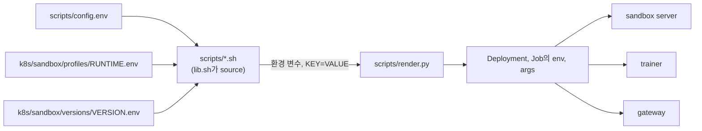

# 설정 값

!!! info "TL;DR"
    값을 바꿀 파일을 먼저 찾으세요. 배포된 pod는 매니페스트가 넘긴 값을 쓰고, 지정하지 않은 값은 코드 기본값을 씁니다.

| 바꾸려는 것 | 수정할 곳 |
|---|---|
| AWS 리전, 클러스터 이름, 이미지 URI, 모델 | [`scripts/config.env`](#1-scriptsconfigenv) |
| RuntimeClass, GPU 종류, pod의 CPU와 메모리 | [런타임 프로필](#8-런타임-profile-k8ssandboxprofiles) |
| 정확성 검사 횟수, 측정 옵션 | [버전 파일](#9-버전-파일-k8ssandboxversions) |
| trainer가 평가를 보낼 풀 | [라우팅 설정](#10-routingjson) |

수정한 값이 적용되지 않으면 [값이 전달되는 경로](#값이-전달되는-경로)에서 설정 파일과 실행 중인 프로세스 사이를 확인하세요.

## 값이 전달되는 경로



*그림: 클러스터에서 프로세스가 읽는 값은 매니페스트의 `env`나 실행 인자(`args`)를 거쳐 옵니다. trainer의 모델과 학습 step 수는 실행 인자로 전달되므로, 값이 이상하면 pod의 env와 실행 인자를 함께 확인합니다.*

`scripts/config.env`를 source 한 셸에서 스크립트를 실행하므로 config.env에 `export`로 적은 값은 템플릿의 `${VAR}`에 그대로 쓰입니다.

- **config.env에 없는 변수**: `ACTIVE_RUNTIME=kata-qemu scripts/05_setup_namespaces_auth.sh`처럼 명령 앞에 붙여 한 번만 바꿀 수 있습니다.
- **config.env에 `export`로 적은 변수**: 스크립트가 그 파일을 나중에 읽어 명령 앞의 값을 덮어쓰므로, 파일의 값을 고칩니다.

## 1. scripts/config.env

파일이 없을 때만 `test -f scripts/config.env || cp scripts/config.env.example scripts/config.env`로 만든 뒤 편집합니다. 이미 있는 파일을 덮어쓰면 채워 둔 값이 사라집니다.

- **필수값이 비었거나 `__SET_ME__`를 포함할 때**: 그 스크립트는 `set <NAME> in scripts/config.env` 오류를 내고 멈춥니다.
- **빈 값일 때의 동작이 정해진 변수**: `ADMIN_PRINCIPAL_ARN`, `EKS_PUBLIC_ACCESS_CIDR`처럼 정해진 동작은 아래 표에 적었습니다.

| 변수 | 예시 파일 값 | 뜻 | 쓰는 곳 |
|---|---|---|---|
| `AWS_REGION` | `us-west-2` | 클러스터, 이미지, HyperPod 작업의 AWS 리전 | 전체 |
| `CLUSTER_NAME` | `gpu-sandbox` | EKS 클러스터 이름. CDK 스택 이름 `<CLUSTER_NAME>-cdk`와 kubectl 컨텍스트 `<CLUSTER_NAME>-tunnel`에도 쓰임 | 전체 |
| `K8S_VERSION` | `1.36` | EKS Kubernetes 버전 | `cdk/`, `build-iommu-ami.sh` |
| `SCENARIO` | `A` | CDK 스택이 만들 노드 그룹 구성 | `02_create_cluster.sh`, `cdk/` |
| `CHANGE_SCENARIO` | 없음 (스크립트 기본 `0`) | `1`이면 이미 배포된 스택의 시나리오(Outputs의 `Scenario`)와 다른 시나리오로 배포하는 것을 허용 | `cdk/deploy.sh` |
| `ADMIN_PRINCIPAL_ARN` | 비우면 `cdk/deploy.sh`가 현재 세션에서 만듦 | 클러스터 관리자 access entry를 받을 IAM 역할이나 사용자 ARN | `cdk/` |
| `EKS_PUBLIC_ACCESS_CIDR` | 없음 (주석 처리, private만) | public endpoint를 켤 때만, IPv4 /32 하나. 다른 범위는 설정 단계에서 거부 | `cdk/` |
| `WITH_KATA_CPU` | `0` | `1`이면 어느 시나리오에든 `sandbox-kata-cpu`(c8i) 노드 그룹을 추가. 시나리오 C에는 항상 있음 | `02_create_cluster.sh`, `cdk/` |
| `WITH_KATA_GPU` | `0` | `1`이고 `KATA_IOMMU_AMI_ID`가 있으면 `sandbox-kata-gpu`(`g4dn.metal`) 노드 그룹을 추가. `cdk/deploy.sh`가 `metal` 입력으로 한 번 더 확인 | `02_create_cluster.sh`, `cdk/` |
| `ECR_REPO_PREFIX` | `gpu-sandbox` | ECR 저장소 접두사(`<prefix>/sandbox`, `/trainer`, `/control`) | `03_build_push_images.sh`, `08_cleanup.sh` |
| `IMAGE_TAG` | `v1` | 세 이미지 공통 태그. 저장소가 IMMUTABLE이라 같은 태그로 다시 push 할 수 없음 | `03_build_push_images.sh` |
| `SYSTEM_INSTANCE_TYPE` | `m6i.large` | system 노드 그룹(2대) | `cdk/` |
| `TRAINER_INSTANCE_TYPE` | `g5.2xlarge` | 시나리오 A trainer 노드(A10G 24 GB 1개, 8 vCPU, 32 GiB). `g6.2xlarge`(L4)도 지정할 수 있음 | `cdk/`, `01_check_prereqs.sh` |
| `GVISOR_INSTANCE_TYPE` | `g5.xlarge` | gVisor 노드. 노드당 A10G 1개, 샌드박스 pod 1개. `g6.xlarge`(L4)도 지정할 수 있음([04 플랫폼과 인스턴스 선택](../concepts/04_platforms_and_instances.md)) | `cdk/`, `01_check_prereqs.sh` |
| `GVISOR_NODES` | `2` | gVisor 노드 수. gVisor 풀 replica의 기본값이기도 함 | `cdk/`, `profiles/gvisor.env` |
| `KATA_CPU_INSTANCE_TYPE` | `c8i.2xlarge` | Kata CPU 노드(nested virtualization, GPU 없음) | `01_check_prereqs.sh`, `cdk/` |
| `KATA_GPU_INSTANCE_TYPE` | `g4dn.metal` | Kata GPU 노드(T4 8개) | `01_check_prereqs.sh`, `cdk/`, `kata/gpu_nodes.sh` |
| `GVISOR_RELEASE` | `20261109.0` | 설치할 gVisor 릴리스 | `install-gvisor.sh`(`infra/eks/userdata.py`가 노드 user data에 넣음), `hyperpod/check_gvisor.sh` |
| `KATA_VERSION` | `4.3.1` | kata-deploy Helm chart 버전 | `kata/cpu_nodes.sh`, `kata/gpu_nodes.sh` |
| `NVIDIA_DEVICE_PLUGIN_VERSION` | `0.20.1` | NVIDIA device plugin chart 버전 | `04_install_gpu_stack.sh` |
| `GPU_OPERATOR_VERSION` | `v26.7.2` | NVIDIA GPU Operator chart 버전 | `kata/gpu_nodes.sh` |
| `SANDBOX_AUDIENCE` | `gpu-sandbox` | 샌드박스 API 토큰의 audience | `05_setup_namespaces_auth.sh`, `06_deploy_sandboxes.sh`, Job 템플릿 |
| `HYPERPOD_CLUSTER_NAME` | `gpu-sandbox-hp` | HyperPod 클러스터 이름. 실행 역할 이름 `<이름>-execution`에도 쓰임 | `hyperpod/*` |
| `HYPERPOD_TRAINER_INSTANCE_TYPE` | `ml.g5.2xlarge` | HyperPod trainer instance group. `ml.g6.2xlarge`도 지정할 수 있음 | `cluster.json.tpl`, `hyperpod-job-grpo.yaml.tpl` |
| `HYPERPOD_LCS_BUCKET` | `sagemaker-gpu-sandbox-lcs-__SET_ME__` | lifecycle 스크립트 버킷. HyperPod 관리형 정책이 `sagemaker-` 접두사를 전제로 하므로 유지 | `hyperpod/create.sh`, `hyperpod/delete.sh` |
| `HYPERPOD_SYSTEM_INSTANCE_TYPE` | `ml.m5.xlarge` | 관리형 B2의 HyperPod CPU 시스템 워커 | `hyperpod/create_managed.sh` |
| `HYPERPOD_AZ_IDS` | 예: `use1-az1,use1-az2` | 대상 리전에서 사용할 가용 영역 ID | `hyperpod/create_managed.sh` |
| `B2_NVIDIA_DRIVER_VERSION` | `580.178.04` | 관리형 B2 채점 노드에 설치할 드라이버. 고정한 gVisor의 지원 목록에서 선택 | `hyperpod/create_managed.sh`, `hyperpod/reboot_sandboxes.sh`, 기존 `hyperpod/build_b2_ami.sh` |
| `B2_NVIDIA_RUNFILE_SHA256` | `5975a86e...` (64자) | 위 드라이버의 `.run` 설치 파일 sha256 | `hyperpod/create_managed.sh`, `hyperpod/build_b2_ami.sh` |
| `HYPERPOD_SANDBOX_INSTANCE_TYPE`, `HYPERPOD_SANDBOX_COUNT` | `ml.g5.xlarge`, `2` | B2 `sandbox` 인스턴스 그룹. `ml.g6.xlarge`도 지정할 수 있음 | `hyperpod/create_managed.sh`, `instance-group-sandbox.json.tpl` |

- **`AWS_REGION`**: 데모 사이트(`demo/deploy.sh`)는 이 값과 관계없이 `us-east-1`에 배포합니다.
- **`K8S_VERSION`**: 예시 값 `1.36`은 EKS standard support(2027-08-02까지)와 HyperPod EKS AMI 릴리스 노트의 지원 범위에 포함됩니다.
- **`SCENARIO`**: `A`(system, trainer, gVisor), `B1`(system, gVisor), 기존 CDK `B2`(EC2 system만), `C`(system, Kata CPU). `02_create_cluster.sh`의 옵션(`--hyperpod`, `--hyperpod-b2`, `--cpu-only`)이 이 값을 덮어씁니다.
- **관리형 B2**는 `SCENARIO=B2`로 [`create_managed.sh`를 실행](../handson/07_hyperpod_b2.md)해 EKS와 HyperPod의 `system`, `trainer`, `sandbox`를 함께 만듭니다.
- **`CHANGE_SCENARIO`**: 첫 배포와 같은 시나리오의 재배포에는 필요 없습니다. 시나리오가 다를 때 이 값이 없으면 `cdk/deploy.sh`가 멈춥니다.
- **`ADMIN_PRINCIPAL_ARN`**: 여러 개는 쉼표로 구분합니다(STS 세션 ARN 불가). 역할에 path가 있으면 직접 적습니다.
- **`WITH_KATA_CPU`**: `1`로 설정하면 `cdk/deploy.sh <시나리오> --with-kata-cpu`와 같습니다. Kata CPU 노드 추가(`kata/cpu_nodes.sh`) 전에 넣고 `02_create_cluster.sh`를 다시 실행합니다.
- **`KATA_CPU_INSTANCE_TYPE`**: 다른 유형은 `cdk/gpusandbox_cdk/config.py`의 `CPU_TOPOLOGY`에 코어 수와 코어당 스레드 수를 추가해야 합니다.
- **`B2_NVIDIA_RUNFILE_SHA256`**는 관리형 B2 채점 노드에서 내려받은 드라이버 설치 파일을 실행하기 전에 검증하는 값입니다.

!!! warning "EKS_PUBLIC_ACCESS_CIDR"
    기본으로는 비워 두세요.

    - **비워 둘 때**: EKS API 엔드포인트는 private만 열리고, `cdk/tunnel.sh`(SSM 포트 포워딩)로 접속합니다.
    - **값을 넣을 때**: 그 /32 주소 하나에서만 public 엔드포인트에 접근할 수 있습니다(IAM 인증은 그대로 적용). `0.0.0.0/0`이나 /24 같은 범위는 설정 단계에서 거부됩니다.
    - **계정 보안 점검**: 점검 도구(예: Security Hub 컨트롤 EKS.1)는 public 엔드포인트 자체를 지적할 수 있습니다.

### 스크립트가 출력하는 값 (config.env에 추가)

| 변수 | 출력하는 곳 | 뜻 |
|---|---|---|
| `SANDBOX_IMAGE_URI`, `TRAINER_IMAGE_URI`, `CONTROL_IMAGE_URI` | `scripts/03_build_push_images.sh` | 세 이미지의 ECR URI |
| `KATA_IOMMU_AMI_ID` | `scripts/kata/gpu_nodes.sh` 첫 실행(`infra/kata/build-iommu-ami.sh`) | `intel_iommu=on iommu=pt`를 포함한 AMI ID. `WITH_KATA_GPU=1`과 함께 넣고 `02_create_cluster.sh`를 다시 실행하면 `g4dn.metal` 노드 그룹이 생깁니다 |
| `HYPERPOD_B2_AMI_ID` | `scripts/hyperpod/build_b2_ami.sh` | B2 custom AMI ID. `08_cleanup.sh`가 지울지 묻습니다 |

### 선택 값 (셸이나 config.env에서 지정)

| 변수 | 기본값 | 뜻 | 쓰는 곳 |
|---|---|---|---|
| `HYPERPOD` | `0` | `1`이면 trainer 이미지에 `hyperpod-elastic-agent`(hyperpodrun)를 설치 | `03_build_push_images.sh` |
| `ENABLE_EXPERIMENTAL_CLH_GPU` | `0` | `1`이면 실험용 `kata-clh-nvidia-gpu` RuntimeClass 추가 | `kata/gpu_nodes.sh` |
| `ACTIVE_RUNTIME`, `ACTIVE_VERSION` | `gvisor`, `v1` | 처음 만드는 routing 표의 active 값 | `05_setup_namespaces_auth.sh` |
| `SANDBOX_ALLOWED_SUBJECTS` | `system:serviceaccount:rl-trainer:grpo-trainer`, `system:serviceaccount:rl-trainer:sandbox-probe`, `system:serviceaccount:sandbox-gateway:gateway`(쉼표로 연결) | 샌드박스 API를 호출할 수 있는 ServiceAccount | `06_deploy_sandboxes.sh`, `extensions/agent_sandbox.sh pool` |
| `KATA_QEMU_REPLICAS`, `KATA_CLH_REPLICAS`, `KATA_CPU_REPLICAS` | `4`, `2`, `2` | 풀 replica 기본값. `06_deploy_sandboxes.sh`의 세 번째 인자가 있으면 그 값이 우선 | `profiles/*.env` |
| `RUN_ID` | 현재 시각(`%Y%m%d-%H%M%S`) | Job 이름 `grpo-<RUN_ID>` | `07_run_grpo.sh`, `hyperpod/run_grpo.sh` |
| `MODEL_ID` | `Qwen/Qwen2.5-Coder-1.5B-Instruct` | 학습할 모델 | `07_run_grpo.sh`, `hyperpod/run_grpo.sh` |

- **`SANDBOX_ALLOWED_SUBJECTS`**: `extensions/agent_sandbox.sh pool`은 기본값이 다릅니다(`grpo-trainer`, `sandbox-probe`, `sandbox-episode`).
- **`KATA_CPU_REPLICAS`**: 시나리오 C 실습에서는 `scripts/config.env`에 `export KATA_CPU_REPLICAS="1"`을 추가합니다(c8i 한 대에 풀 4개).

스크립트가 직접 계산하는 값도 있습니다. 이 값들은 config.env에 넣을 필요가 없습니다.

- **`06_deploy_sandboxes.sh`**: `OIDC_ISSUER`를 `aws eks describe-cluster`에서 읽습니다.
- **`hyperpod/create.sh`**: `EKS_CLUSTER_ARN`, `HYPERPOD_SECURITY_GROUP_ID`, `HYPERPOD_SUBNET_ID`, `HYPERPOD_EXECUTION_ROLE_ARN`을 만듭니다.
- **`cdk/tunnel.sh`**: 스택 출력(`ClusterEndpoint`, `AccessInstanceId`)을 CloudFormation에서 읽습니다.

??? info "Production 템플릿과 veRL 스크립트가 쓰는 값"
    | 변수 | 쓰는 곳 | 뜻 |
    |---|---|---|
    | `KARPENTER_NODE_ROLE` | `infra/karpenter/nodeclasses.yaml.tpl` | Karpenter 노드 IAM 역할 이름 |
    | `GATEWAY_ALLOWED_SUBJECTS` | `k8s/production/gateway.yaml.tpl` | gateway를 호출할 수 있는 ServiceAccount(예: `system:serviceaccount:rl-trainer:grpo-trainer`) |
    | `RAY_VERSION`, `VERL_IMAGE_URI`, `SHARED_PVC`, `VERL_NNODES`, `VERL_GPUS_PER_NODE`, `VERL_NODE_SELECTOR`, `VERL_CPU`, `VERL_MEMORY` | `k8s/production/raycluster-verl.yaml.tpl` | RayCluster 구성 |
    | `RAY_ADDRESS` (`http://127.0.0.1:8265`), `MODEL_PATH` (`Qwen/Qwen2.5-Coder-7B-Instruct`), `DATA_DIR` (`/fsx/verl/data/kernels`), `CKPT_DIR` (`/fsx/verl/ckpts/kernels-grpo`), `NNODES` (`1`), `GPUS_PER_NODE` (`8`), `TRAIN_BATCH_SIZE` (`64`), `N_RESP_PER_PROMPT` (`8`), `TOTAL_STEPS` (`200`) | `rl/verl/run_grpo_kernels.sh` | veRL job 제출 값(괄호 안은 기본값) |
    | `HYPERPOD_CONTAINERD_CONFIG` (실행 중인 containerd의 `--config`, 없으면 `/etc/containerd/config.toml`) | `infra/hyperpod/lifecycle/on_create_sandbox.sh` | B2 sandbox 노드의 containerd 설정 파일. lifecycle 스크립트는 환경 변수를 받지 않으므로, 값을 바꾸려면 업로드 전에 스크립트를 고칩니다 |
    | `HYPERPOD_BASE_AMI_ID` (비우면 EC2 `describe-images`로 소유자 `amazon`, 이름 `HyperPod EKS <K8S_VERSION> x86_64 AMI Amazon Linux 2023 *`인 사용 가능한 AMI 중 가장 최근 것을 고름) | `infra/hyperpod/ami/build-b2-ami.sh` | B2 builder의 base AMI. 검색되지 않을 때 직접 지정 |
    | `GVISOR_HYPERPOD_REPLICAS` (`1`) | `k8s/sandbox/profiles/gvisor-hyperpod.env` | B2 풀의 버전당 replica |

## 2. 샌드박스 서버

`gpusandbox-server`(`gpusandbox.server.app:main`)가 읽는 값입니다. 매니페스트 값은 `k8s/sandbox/deployment.yaml.tpl`이 넣는 값입니다.

| 변수 | 코드 기본값 | 매니페스트 값 | 뜻 |
|---|---|---|---|
| `SANDBOX_HOST` | `127.0.0.1` | `0.0.0.0` | bind 주소. 클러스터에서는 pod 네트워크 안에서만 쓰이고 Service는 headless ClusterIP뿐 |
| `SANDBOX_PORT` | `8000` | 기본값 | 포트 |
| `LOG_LEVEL` | `INFO` | 기본값 | Python 로그 레벨 |
| `SANDBOX_VERSION` | `dev` | `${VERSION}` | 이 pod가 응답에 넣는 샌드박스 버전 |
| `SANDBOX_RUNTIME` | `unknown` | `${RUNTIME}` | 이 pod가 응답에 넣는 런타임 이름 |
| `SANDBOX_DEVICE` | `cuda` | profile | `cuda` 또는 `cpu`. `cuda`인데 GPU가 보이지 않으면 Ready가 되지 않음 |
| `SANDBOX_SIZE` | `full` | profile | 입력 shape. `full`은 GPU 타이밍용, `smoke`는 CPU 점검용 작은 shape |
| `SANDBOX_WORK_ROOT` | `/work` | 이미지 ENV `/work` | 요청마다 `req-<uuid>` 작업 디렉터리를 만드는 곳(emptyDir 8Gi) |
| `SANDBOX_EVAL_TIMEOUT_S` | `90` | 기본값 | 후보 자식 프로세스 제한 시간(초). harness 전체 상한은 `2 x 값 + 30`초 |
| `HARNESS_SEEDS` | `3` | 버전 파일 | 정확성 검사 seed 수. 요청마다 새로 뽑음 |
| `HARNESS_WARMUP` | `3` | 기본값 | 타이밍 전 warmup 반복 수 |
| `HARNESS_ITERS` | `20` | 기본값 | 타이밍 반복 수. 반복마다 다른 입력 |
| `HARNESS_MAX_SPEEDUP` | `0` | 버전 파일 | speedup 상한. `0`이면 상한 없음. 넘으면 `implausible_speedup` 플래그를 달고 speedup을 1.0으로 기록 |
| `HARNESS_ALLOW_CUDA_CPP` | 꺼짐 | 설정 안 함 | `1`, `true`, `yes`면 `torch.utils.cpp_extension` 허용 |
| `SANDBOX_MAX_EVALS` | `0` | 버전 파일 | N번 평가 후 draining(NotReady). `0`이면 무제한 |
| `POD_NAME` | 호스트 이름 | downward API `metadata.name` | 응답과 재활용에 쓰는 pod 이름 |
| `NODE_NAME` | 빈 값 | downward API `spec.nodeName` | 응답에 넣는 노드 이름 |
| `NODE_IP` | 서버는 읽지 않음 | downward API `status.hostIP` | 아래 egress 대상의 `$(NODE_IP)`와 샌드박스 검증(`ops/verify.sh`)의 차단 점검에 쓰임 |
| `SANDBOX_EGRESS_PROBE_TARGETS` | 빈 값(자기 점검 꺼짐) | `169.254.169.254:80,apiserver,$(NODE_IP):10250` | 쉼표로 구분한 `host:port`. 모든 대상에 연결할 수 없어야 Ready |

`SANDBOX_EGRESS_PROBE_TARGETS`의 `apiserver`는 `KUBERNETES_SERVICE_HOST:KUBERNETES_SERVICE_PORT`(포트 기본 443)로 바뀝니다.

코드의 readiness 규칙에 따라 `/readyz`는 아래 네 가지가 모두 참일 때만 200을 반환합니다.

- GPU probe 성공
- egress 차단 확인
- draining 아님
- 치명적 오류 없음

GPU probe는 새 프로세스에서 실행하며 120초 안에 끝나야 합니다.

- **CUDA 풀(`SANDBOX_DEVICE=cuda`)**: GPU에서 `torch.ones(1, device='cuda').add_(1)`과 `torch.cuda.synchronize()`가 성공해야 통과합니다.
- **CPU 풀**: GPU가 없어도 통과합니다.

egress 점검은 다음과 같이 동작합니다.

- **`SANDBOX_EGRESS_PROBE_TARGETS`가 비어 있을 때**: 점검을 건너뛰고 차단된 것으로 봅니다.
- **연결 시도**: 대상마다 2초 timeout으로 연결을 시도하고, 연결 성공과 connection refused를 둘 다 "도달 가능"으로 셉니다.
- **다시 점검하는 간격**: egress가 차단된 상태면 30초마다, 열린 상태면 5초마다 다시 점검합니다.

| 경로 | 인증 | 응답 |
|---|---|---|
| `POST /v1/evaluate` | 필요 | verdict JSON + `sandbox_version`, `runtime`, `harness_version`, `pod`, `node`, `request_id`, `duration_s`, `draining`. 준비 전이면 503 `not ready`, 평가 중이면 503 `busy` |
| `GET /info` | 필요 | 위 메타데이터 + `kernel_release`, `kernel_version`, `device`(GPU probe 결과), `evals_done`, `draining`, `egress_blocked`, `egress_open_targets` |
| `GET /metrics` | 필요 | Prometheus 형식 |
| `GET /healthz` | 없음 | 치명적 상태(레퍼런스 경로의 GPU fault)면 500, 아니면 200 |
| `GET /readyz` | 없음 | Ready면 200, 아니면 503 |

요청 본문 제한은 `task_id` 1~64자, `code` 1~32,768자, `request_id` 128자 이하입니다. 이와 별도로 정적 정책은 소스가 32 KiB(UTF-8 바이트)를 넘거나 AST 노드가 25,000개를 넘으면 `policy_violation`으로 처리합니다.

| 메트릭 | 종류 | 뜻 |
|---|---|---|
| `sandbox_evaluations_total{status}` | counter | verdict별 평가 수 |
| `sandbox_evaluation_seconds` | histogram | 평가 전체 지연(버킷 0.5~120초) |
| `sandbox_busy` | gauge | 평가 중이면 1 |
| `sandbox_ready` | gauge | 작업을 받을 수 있으면 1 |
| `sandbox_reaped_processes_total` | counter | 평가 뒤 정리한 잔여 프로세스 수 |

아래 명령은 설치한 가상 환경에서 CPU 설정과 인증 우회를 켠 상태로 서버를 포그라운드에서 실행합니다. 기본 bind가 `127.0.0.1`이라 같은 PC에서만 접근할 수 있고, `SANDBOX_WORK_ROOT` 디렉터리는 서버가 시작할 때 만듭니다.

!!! warning "Linux 호스트에서는 평가 요청을 보내지 마세요"
    서버는 평가가 끝날 때마다 `/proc`에 보이는 프로세스 중 자신과 상위 프로세스를 뺀 모든 프로세스에 SIGKILL을 보냅니다. Linux 호스트에서 직접 실행한 서버에 평가 요청을 보내면 같은 사용자의 편집기나 다른 서버도 종료됩니다. 가상 환경과 loopback bind는 프로세스를 격리하지 않습니다.

    - **`/readyz` 확인**: 아래 `/readyz` 확인까지는 괜찮습니다.
    - **평가 요청까지 보낼 때**: 별도 PID namespace를 가진 컨테이너에서 서버를 실행하세요. 기본 bind가 `127.0.0.1`이므로 호스트에서 요청을 보내려면 호스트 네트워크를 함께 쓰는 컨테이너(예: `docker run --network host`)로 띄웁니다([시작하기](../getting_started.md)의 경고).
    - **macOS**: `/proc`가 없어서 이 동작이 실행되지 않습니다.

```bash
# Local smoke test only: loopback bind, CPU shapes, authentication bypassed
SANDBOX_DEVICE=cpu SANDBOX_SIZE=smoke SANDBOX_WORK_ROOT=/tmp/gpusandbox-work \
SANDBOX_AUTH_TEST_BYPASS=1 gpusandbox-server
```

macOS(CPU)에서 실행해 확인한 시작 로그는 다음과 같습니다(일부 생략, 버전과 PID는 환경마다 다름).

```text
WARNING:gpusandbox.auth:authentication TEST BYPASS is enabled; use only on loopback
WARNING:gpusandbox.server:egress self-test disabled (SANDBOX_EGRESS_PROBE_TARGETS is empty)
INFO:gpusandbox.server:device probe ok=True info={'torch': '<version>', 'cuda_runtime': None}
INFO:     Uvicorn running on http://127.0.0.1:8000 (Press CTRL+C to quit)
```

- **확인**: 다른 터미널에서 `curl -s http://127.0.0.1:8000/readyz`를 실행하면 `{"status":"ready"}`가 나옵니다.
- **멈추기**: 서버는 Ctrl-C로 멈춥니다.
- **`command not found: gpusandbox-server`가 나올 때**: 가상 환경이 활성화되지 않은 것이니 [시작하기](../getting_started.md)의 설치 단계를 다시 보세요.

## 3. 인증 (SANDBOX_AUTH_*)

| 변수 | 코드 기본값 | 매니페스트 값 | 뜻 |
|---|---|---|---|
| `SANDBOX_AUTH_AUDIENCE` | 빈 값 | `${SANDBOX_AUDIENCE}`(`gpu-sandbox`) | 토큰 `aud`에 있어야 하는 값 |
| `SANDBOX_AUTH_ISSUER` | 빈 값 | `${OIDC_ISSUER}`(클러스터 OIDC issuer URL) | 토큰 `iss` |
| `SANDBOX_AUTH_ALLOWED_SUBJECTS` | 빈 값 | `${SANDBOX_ALLOWED_SUBJECTS}` | 허용할 `sub`(쉼표 구분) |
| `SANDBOX_AUTH_JWKS_FILE` | 빈 값 | `/etc/gpusandbox/auth/jwks.json` | 공개키 JWKS 파일(ConfigMap `sandbox-auth-jwks`) |
| `SANDBOX_AUTH_TEST_BYPASS` | 빈 값 | 설정 안 함 | 정확히 `1`일 때만 검증을 끔 |

검증 규칙은 다음과 같습니다.

- 서버는 앞의 네 값 중 하나라도 비어 있으면 시작할 때 `authentication not configured (missing ...)` 오류 로그를 남기고, 보호된 경로를 모두 401(`authentication is not configured on this service`)로 거부합니다(fail closed).
- 알고리즘은 RS256만 받고, `exp`, `iat`, `iss`, `aud`, `sub` claim이 모두 있어야 합니다. 시계 오차는 30초까지 허용합니다.
- 서명 키는 토큰 header의 `kid`로 고릅니다. `kid`가 JWKS에 없을 때 JWKS에 키가 하나뿐이면 그 키로 검증하고, 아니면 `unknown signing key`로 거부합니다.
- JWKS 파일의 수정 시각이 바뀌면 다시 읽습니다. 그래서 ConfigMap을 갱신하면 pod를 재시작하지 않아도 반영됩니다.
- 응답 코드는 401(인증 실패, `WWW-Authenticate: Bearer` 포함)과 403(subject가 허용 목록에 없음) 두 가지입니다. 메시지별 원인은 [문제 해결](troubleshooting.md)에 있습니다.

`SANDBOX_AUTH_TEST_BYPASS`는 값이 정확히 `1`일 때만 켜집니다. 켜지면 토큰을 검사하지 않고 모든 요청을 subject `test-bypass`로 받아들이고, 시작할 때 `authentication TEST BYPASS is enabled; use only on loopback` 경고를 남깁니다. 매니페스트는 이 값을 넣지 않으며, loopback 주소로 실행하는 로컬 smoke test 전용입니다.

| 호출자 | ServiceAccount | 토큰 audience | 토큰 파일 |
|---|---|---|---|
| trainer Job, HyperPodPyTorchJob | `rl-trainer/grpo-trainer` | `gpu-sandbox` | `/var/run/secrets/gpusandbox/token` |
| probe, parity, bench Job | `rl-trainer/sandbox-probe` | `gpu-sandbox` | `/var/run/secrets/gpusandbox/token` |
| gateway가 샌드박스를 호출할 때 | `sandbox-gateway/gateway` | `gpu-sandbox` | `/var/run/secrets/gpusandbox/token` |
| veRL worker가 gateway를 호출할 때 | `rl-trainer/grpo-trainer` | `gpu-sandbox-gateway` | `/var/run/secrets/gpusandbox/token` |

모든 토큰은 projected ServiceAccount 토큰(`expirationSeconds: 3600`)이고, 호출 쪽은 `read_token`으로 요청마다 파일을 다시 읽습니다. kubelet이 같은 경로에서 토큰을 교체하기 때문입니다.

## 4. harness CLI

서버는 평가마다 `python -I -m gpusandbox.harness.evaluate`를 새로 실행합니다. 디버깅할 때는 같은 명령을 직접 실행할 수 있습니다.

| 플래그 | 기본값 | 서버 env | 뜻 |
|---|---|---|---|
| `--task` | 필수 | 요청의 `task_id` | 과제 ID |
| `--code` | 필수 | 요청의 `code` | 후보 파일 경로 |
| `--workdir` | 필수 | `SANDBOX_WORK_ROOT/req-<uuid>` | 이미 있는 작업 디렉터리 |
| `--out` | 필수 | 작업 디렉터리의 `result.json` | verdict JSON 경로 |
| `--device` | `cuda` | `SANDBOX_DEVICE` | `cuda`, `cpu` |
| `--size` | `full` | `SANDBOX_SIZE` | `full`, `smoke` |
| `--seeds` | `3` | `HARNESS_SEEDS` | 정확성 seed 수 |
| `--warmup` | `3` | `HARNESS_WARMUP` | warmup 반복 |
| `--iters` | `20` | `HARNESS_ITERS` | 타이밍 반복 |
| `--timeout` | `90.0` | `SANDBOX_EVAL_TIMEOUT_S` | 후보 자식 제한 시간(초) |
| `--allow-cuda-cpp` | 꺼짐 | `HARNESS_ALLOW_CUDA_CPP` | `cpp_extension` 허용 |
| `--max-speedup` | `0.0` | `HARNESS_MAX_SPEEDUP` | speedup 상한, `0`이면 끔 |

아래 예시는 후보 파일 하나를 만들고, harness로 CPU에서 평가한 뒤 verdict JSON을 출력합니다. 후보는 Triton 없이 torch만 쓴 정답입니다. CPU용 torch와 이 패키지를 설치한 로컬 환경([시작하기](../getting_started.md))에서 실행해 확인했습니다.

```bash
mkdir -p /tmp/gs-eval
cat > /tmp/gs-eval/candidate.py <<'EOF'
import torch
from torch import nn


class ModelNew(nn.Module):
    def forward(self, x, b):
        return torch.clamp_min(x + b, 0.0)
EOF
python -I -m gpusandbox.harness.evaluate --task relu_bias \
  --code /tmp/gs-eval/candidate.py --workdir /tmp/gs-eval --out /tmp/gs-eval/result.json \
  --device cpu --size smoke --seeds 2 --warmup 1 --iters 3
python -m json.tool /tmp/gs-eval/result.json
```

**확인할 것:**

- 결과에 `"status": "ok"`, `"correct": true`, `"custom_kernel": false`(Triton 커널이 없으므로)가 있는지 확인하세요.
- CPU의 `speedup` 값은 의미가 없습니다.

**문제가 생기면:** `ModuleNotFoundError`가 나면 가상 환경이 활성화되지 않은 경우가 대부분입니다. `-I` 옵션이 현재 디렉터리와 `PYTHONPATH`를 무시하므로, 패키지가 가상 환경에 설치되어 있어야 합니다.

후보 자식 프로세스에는 `PATH`, `LD_LIBRARY_PATH`, `CUDA_VISIBLE_DEVICES`, `NVIDIA_VISIBLE_DEVICES`, `NVIDIA_DRIVER_CAPABILITIES`, `LANG`, `LC_ALL`, `CC`만 전달됩니다. 여기에 요청마다 새로 만든 `HOME`, `TMPDIR`, `TRITON_CACHE_DIR`, `CUDA_CACHE_PATH`와 `PYTHONDONTWRITEBYTECODE=1`, `PYTHONHASHSEED=0`이 추가됩니다.

| verdict `status` | 뜻 | TRL correctness reward |
|---|---|---|
| `ok` | 정답 | 1.0(`custom_kernel`이 참), 0.3(Triton 없이 정답이고 `--allow-torch-only`가 없을 때) |
| `wrong_answer` | 출력 불일치. 타이밍 반복의 checksum 불일치 포함 | 0.2 |
| `runtime_error` | 실행 중 오류, Triton 컴파일 오류, 상태 파일 없이 종료 | 0.05 |
| `compile_error` | 후보 모듈 로드 실패 | 0.0 |
| `timeout` | 제한 시간 초과 | 0.0 |
| `policy_violation` | 정적 정책 위반 | 0.0 |
| `sandbox_error` | 인프라 문제(레퍼런스 실패, 통신 실패, 인증 실패 등) | `None`(학습에서 제외) |

- **`custom_kernel`이 참인 조건**: 정적 검사에서 `@triton.jit` 함수가 있고, 정확성 검사까지 집계한 Triton 호출 횟수가 0이 아니거나 집계할 수 없을 때입니다.

| 플래그 | 뜻 |
|---|---|
| `gpu_fault` | 레퍼런스 경로에서 CUDA 오류. 서버가 그 pod를 치명적 상태로 바꾸고 liveness가 재시작 |
| `implausible_speedup` | `HARNESS_MAX_SPEEDUP`를 넘음. speedup을 1.0으로 기록 |
| `timed_output_mismatch` | 정확성 입력에서는 맞고 타이밍 입력에서 틀림 |
| `invalid_runner_report` | 자식이 쓴 타이밍 보고가 형식에 맞지 않음 |
| `triton_kernel_never_launched` | `@triton.jit` 함수가 있지만 정확성 검사가 끝날 때까지 Triton 실행 함수가 한 번도 호출되지 않음 |

## 5. 클라이언트

`SandboxClient.from_env()`(trainer, veRL reward)가 읽는 값입니다.

| 변수 | 기본값 | 뜻 |
|---|---|---|
| `SANDBOX_GATEWAY` | 없음 | 있으면 gateway 모드. `host:port`(예: `gateway.sandbox-gateway.svc.cluster.local:8080`) |
| `SANDBOX_ROUTING_FILE` | 없음 | direct 모드의 routing.json 경로(Job 템플릿: `/etc/gpusandbox/routing/routing.json`) |
| `SANDBOX_ADDRESS` | 없음 | routing 파일 없이 풀 하나를 직접 지정 |
| `SANDBOX_RUNTIME` | `gvisor` | `SANDBOX_ADDRESS`와 함께만 쓰이는 runtime 이름 |
| `SANDBOX_VERSION` | `v1` | `SANDBOX_ADDRESS`와 함께만 쓰이는 버전 이름 |
| `SANDBOX_TOKEN_FILE` | 없음 | projected 토큰 파일. 요청마다 다시 읽고, 파일이 없으면 토큰 없이 보냄 |

우선순위는 `SANDBOX_GATEWAY`, `SANDBOX_ROUTING_FILE`, `SANDBOX_ADDRESS` 순서입니다. 셋 다 없으면 `set SANDBOX_ROUTING_FILE or SANDBOX_ADDRESS` 오류로 시작하지 못합니다.

주소 형식은 세 가지입니다.

- **`host:port`**: headless Service DNS 이름으로 해석해 10초마다 다시 조회하고, 조회에 실패하면 마지막 결과를 씁니다.
- **쉼표로 구분한 목록**: 그대로 씁니다(로컬 테스트용).
- **`static:` 접두사가 붙은 값**: 그대로 씁니다(로컬 테스트용).

아래 표는 샌드박스 pod를 부르는 풀 클라이언트의 동작이며, direct 모드의 trainer와 gateway가 이 클라이언트를 씁니다.

| 동작 | 코드 값 |
|---|---|
| pod당 동시 요청 | 1 |
| 샌드박스 pod 요청 하나의 timeout | 300초 |
| 빈 pod를 기다리는 최대 시간 | 600초, 넘으면 `no free sandbox in <address>` |
| 샌드박스 pod 요청 하나의 최대 시도 횟수 | 4 |
| 실패한 pod의 cooldown | 5초 |
| 503 | cooldown 후 다른 pod로 재시도 |
| 그 밖의 4xx(401, 403, 422 등) | 재시도 없이 `sandbox_error`, 메시지 `HTTP <code>: <본문 앞부분>` |
| 연결 오류, 5xx | cooldown 후 재시도 |

gateway 모드의 trainer는 이 표와 달리 배치를 `POST /v1/evaluate_batch` 한 번으로 보내고 재시도하지 않습니다. 이 요청의 timeout은 1,200초(300초의 4배)이고, 실패하면 배치의 모든 항목이 `sandbox_error`가 됩니다.

## 6. Gateway

`gpusandbox-gateway`(`gpusandbox.gateway.app:main`)가 읽는 값입니다. 매니페스트 값은 `k8s/production/gateway.yaml.tpl` 기준입니다.

| 변수 | 코드 기본값 | 매니페스트 값 | 뜻 |
|---|---|---|---|
| `GATEWAY_HOST` | `127.0.0.1` | `0.0.0.0` | bind 주소 |
| `GATEWAY_PORT` | `8080` | 기본값 | 포트 |
| `LOG_LEVEL` | `INFO` | 기본값 | 로그 레벨 |
| `GATEWAY_ROUTING_FILE` | `/etc/gpusandbox/routing/routing.json` | 같음 | routing 표 |
| `GATEWAY_SANDBOX_TOKEN_FILE` | `/var/run/secrets/gpusandbox/token` | 같음 | 샌드박스에 보낼 토큰(audience `gpu-sandbox`) |
| `GATEWAY_GROUP_PIN_TTL_S` | `900` | 기본값 | `group_key` 고정 유지 시간(초). group의 첫 요청 시각부터 셈 |
| `GATEWAY_AUTH_AUDIENCE` | 빈 값 | `gpu-sandbox-gateway` | 호출자 토큰 audience(TokenReview로 검증) |
| `GATEWAY_ALLOWED_SUBJECTS` | 빈 값 | `${GATEWAY_ALLOWED_SUBJECTS}` | 허용할 TokenReview username(쉼표 구분) |
| `GATEWAY_SANDBOX_NAMESPACE` | `sandbox` | 기본값 | draining pod를 지울 namespace |
| `GATEWAY_RECYCLE_PODS` | `1` | `1` | 정확히 `1`일 때만 draining pod 삭제(grace 10초) |

gateway는 audience나 허용 목록이 비어 있으면 보호된 경로를 모두 401로 거부합니다. TokenReview 성공 결과는 토큰 해시 기준으로 60초 동안 캐시합니다.

| 경로 | 인증 | 내용 |
|---|---|---|
| `POST /v1/evaluate_batch` | 필요 | `{runtime?, items}`(items 1~4096개). 배치 전체에 routing snapshot 하나. 응답 `{runtime, version, revision, results}` |
| `POST /v1/evaluate` | 필요 | `{task_id, code, request_id?, group_key, runtime?}`. 같은 `group_key`는 TTL 동안 첫 요청의 버전으로 채점 |
| `GET /v1/routing` | 필요 | 현재 `{runtime, version, revision}` |
| `GET /metrics` | 필요 | `gateway_evaluations_total{runtime,version,status}`, `gateway_evaluation_seconds`, `gateway_recycled_pods_total` |
| `GET /healthz` | 없음 | 200 |
| `GET /readyz` | 없음 | 쓸 수 있는 routing 표가 없으면 503, 있으면 200 |

- **gateway `/readyz`가 503인 경우**: 첫 읽기부터 실패했거나 활성 런타임과 버전의 풀 주소가 없을 때입니다. 다시 읽기에 실패해도 마지막 정상 표가 있으면 200입니다.

고정 정보(pin)는 gateway 프로세스 메모리에만 저장되고, 10만 개를 넘으면 만료된 항목을 지웁니다. 그래서 매니페스트는 replica를 1로 둡니다.

## 7. trainer (rl/trl/train_grpo.py)

| 플래그 | 기본값 | GRPOConfig 또는 뜻 |
|---|---|---|
| `--model` | `Qwen/Qwen2.5-Coder-1.5B-Instruct` | 학습할 모델 |
| `--output-dir` | `/outputs/grpo` | `output_dir`. 시작할 때 마지막 `checkpoint-*`에서 이어서 학습 |
| `--max-steps` | `60` | `max_steps` |
| `--max-level` | `2` | 포함할 최대 과제 level(0~3) |
| `--repeats` | `64` | 과제당 데이터셋 행 수 |
| `--num-generations` | `8` | `num_generations`(GRPO group 크기) |
| `--per-device-batch` | `4` | `per_device_train_batch_size`(completion 단위) |
| `--grad-accum` | `4` | `gradient_accumulation_steps`. `steps_per_generation`의 기본값이 됨 |
| `--max-completion-length` | `768` | `max_completion_length` |
| `--learning-rate` | `1e-5` | `learning_rate` |
| `--lora-r` | `32` | LoRA `r` |
| `--lora-alpha` | `64` | LoRA `lora_alpha` |
| `--vllm-gpu-memory-utilization` | `0.35` | `vllm_gpu_memory_utilization` |
| `--vllm-max-model-length` | `2048` | `vllm_max_model_length` |
| `--runtime` | 없음 | routing 표의 active runtime 대신 쓸 runtime. 버전은 여전히 active 버전 |
| `--allow-torch-only` | 꺼짐 | Triton 커널 없이 정답이어도 correctness 1.0과 speedup 점수를 줌 |
| `--reward-weights` | `0.1,1.0,0.5` | `reward_weights`(format, correctness, speedup 순서) |
| `--metrics-file` | 없음(`<output-dir>/sandbox_metrics.jsonl`) | 배치별 샌드박스 지표 JSONL |
| `--save-steps` | `20` | `save_steps` |
| `--seed` | `42` | `seed`, 데이터셋 shuffle |
| `--dry-run` | 꺼짐 | CPU 점검: vLLM 없음, 2 step, 짧은 completion |

코드에 고정된 값은 `use_vllm=True`, `vllm_mode="colocate"`, `vllm_enable_sleep_mode=True`, `logging_steps=1`, `save_total_limit=2`, `report_to="none"`, LoRA `target_modules="all-linear"`입니다. `--dry-run`은 이 가운데 `max_completion_length=32`, `save_steps=1000`, `max_steps=2`, `use_vllm=False`, `bf16=False`, `gradient_checkpointing=False`, `use_cpu=True`로 바꿉니다.

기본값으로 한 번에 생성하는 completion 수는 `--per-device-batch` x `--grad-accum` = 16개(prompt 2개 x 8개 생성)이고, 생성 배치 하나로 optimizer step을 한 번만 실행합니다(strictly on-policy).

- **메모리를 줄이려고 `--per-device-batch`를 바꿀 때**: 곱이 `--num-generations`의 배수가 되도록 `--grad-accum`도 함께 조정하세요. 배수가 아니면 TRL이 설정을 거부합니다(TRL 동작).

Job 템플릿(`k8s/trainer/job-grpo.yaml.tpl`, `hyperpod-job-grpo.yaml.tpl`)은 다음과 같습니다.

- **전달하는 플래그**: `--output-dir`, `--max-steps`, `--model`, `--metrics-file`만 전달합니다. 다른 플래그를 바꾸려면 템플릿의 `args`(HyperPod는 `command`)에 추가하세요.
- **넣는 env**: `SANDBOX_ROUTING_FILE`, `SANDBOX_TOKEN_FILE`, `HF_HOME=/cache/hf`, `PYTORCH_CUDA_ALLOC_CONF=expandable_segments:True`
- 시나리오 A trainer는 CPU 7개, 메모리 28 GiB, GPU 1개를 요청합니다. HyperPod worker는 CPU 5개, 메모리 24 GiB, GPU 1개를 요청합니다.

## 8. 런타임 profile (k8s/sandbox/profiles)

| profile | `RUNTIME_CLASS` | 노드 선택 | 가속기 | CPU, 메모리 | device, size | replica 기본값 |
|---|---|---|---|---|---|---|
| `gvisor` | `gvisor` | `gpusandbox/role=sandbox-gvisor` | `nvidia.com/gpu: 1` | 3, 12Gi | cuda, full | `${GVISOR_NODES:-2}` |
| `kata-qemu` | `kata-qemu-nvidia-gpu` | `sandbox-kata`, `kata-gpu=true` | `nvidia.com/pgpu: 1` | 8, 16Gi | cuda, full | `${KATA_QEMU_REPLICAS:-4}` |
| `kata-clh`(실험) | `kata-clh-nvidia-gpu` | `sandbox-kata`, `kata-gpu=true` | `nvidia.com/pgpu: 1` | 8, 16Gi | cuda, full | `${KATA_CLH_REPLICAS:-2}` |
| `gvisor-hyperpod` | `gvisor-hyperpod` (handler `runsc`) | `gpusandbox/role=sandbox-hyperpod` | `nvidia.com/gpu: 1` | 3, 12Gi | cuda, full | `${GVISOR_HYPERPOD_REPLICAS:-1}` |
| `gvisor-cpu` | `gvisor-cpu` (handler `runsc`) | `sandbox-kata`, `kata-gpu=false` | 없음 | 1, 2Gi | cpu, smoke | `${KATA_CPU_REPLICAS:-2}` |
| `kata-clh-cpu` | `kata-clh` | `sandbox-kata`, `kata-gpu=false` | 없음 | 1, 2Gi | cpu, smoke | `${KATA_CPU_REPLICAS:-2}` |
| `kata-qemu-cpu` | `kata-qemu` | `sandbox-kata`, `kata-gpu=false` | 없음 | 1, 2Gi | cpu, smoke | `${KATA_CPU_REPLICAS:-2}` |

모든 profile에서 requests와 limits는 같습니다(Guaranteed QoS). Kata GPU VM은 Go shim 기준으로 `default_memory` 8 GiB에 limits를 더한 크기로 생성되고, RuntimeClass overhead로 pod 요청에 10 GiB와 CPU 1이 추가됩니다. 그래서 `g4dn.metal` 한 대에 8개를 배치하면 8 x (16 + 10) = 208 GiB로 384 GiB 안에 들어갑니다. VFIO는 게스트 메모리 전체를 고정하므로 overcommit 할 수 없습니다.

Deployment 템플릿이 모든 풀에 넣는 고정 값도 있습니다.

| 항목 | 값 |
|---|---|
| ephemeral-storage | requests와 limits 모두 12Gi |
| 볼륨 | `/work` emptyDir 8Gi, `/tmp` emptyDir 2Gi, `/etc/gpusandbox/auth` ConfigMap(읽기 전용) |
| 보안 컨텍스트 | `runAsNonRoot`, UID와 GID 10001, seccomp `RuntimeDefault`, `readOnlyRootFilesystem`, capability 전부 제거, `allowPrivilegeEscalation: false`, `automountServiceAccountToken: false`, `enableServiceLinks: false` |
| probe | startup `/readyz` 5초 x 120회, readiness `/readyz` 5초 x 2회, liveness `/healthz` 10초 x 3회 |
| 기타 | `terminationGracePeriodSeconds: 15`, 노드별 분산(`topologySpreadConstraints`), 같은 버전 안의 템플릿 변경은 RollingUpdate(`maxSurge: 0`, `maxUnavailable: 1`) |

## 9. 버전 파일 (k8s/sandbox/versions)

| 값 | `v1` | `v2` |
|---|---|---|
| `VERSION` | `v1` | `v2` |
| `HARNESS_SEEDS` | `3` | `5` |
| `HARNESS_MAX_SPEEDUP` | `0`(상한 없음) | `10` |
| `SANDBOX_MAX_EVALS` | `0`(재활용 안 함) | `200` |

!!! warning "v2의 SANDBOX_MAX_EVALS=200"
    v2 pod는 200번 평가한 뒤 draining 상태가 되어 NotReady로 남습니다.

    - **Production gateway를 쓸 때**: 이런 pod를 자동으로 지워 Deployment가 새 pod를 만들게 하는 기능은 Production gateway의 재활용 기능(`GATEWAY_RECYCLE_PODS=1`)뿐입니다.
    - **direct 모드일 때**(핸즈온처럼 trainer가 풀을 직접 호출): pod를 직접 지우거나, 핸즈온용 버전 파일에서 이 값을 `0`으로 두세요.

    자세한 증상은 [문제 해결](troubleshooting.md)에 있습니다.

새 버전(예: `v3`)을 만들 때는 두 곳을 고칩니다.

1. `k8s/sandbox/versions/v3.env`에 네 값을 `export` 하세요.
2. `k8s/base/routing.json.tpl`의 `pools`에 `v3` 주소를 추가하세요.

버전 교체 스크립트(`ops/rollout.sh`)는 전환할 때 이 템플릿을 다시 렌더링하므로, 템플릿에 없는 버전으로 전환하면 trainer가 `no pool for runtime=... version=...` 오류를 냅니다.

## 10. routing.json

```json
{
  "active": {"runtime": "gvisor", "version": "v1"},
  "pools": {
    "gvisor":    {"v1": "sandbox-gvisor-v1.sandbox.svc.cluster.local:8000",
                  "v2": "sandbox-gvisor-v2.sandbox.svc.cluster.local:8000"},
    "kata-qemu": {"v1": "sandbox-kata-qemu-v1.sandbox.svc.cluster.local:8000"}
  }
}
```

| 키 | 뜻 |
|---|---|
| `active.runtime` | 기본 runtime. trainer의 `--runtime`이나 gateway 요청의 `runtime`이 있으면 그 값을 씀 |
| `active.version` | 버전. runtime을 바꿔도 버전은 이 값을 씀 |
| `pools.<runtime>.<version>` | 그 풀의 주소(`host:port`, headless Service DNS). 로컬에서는 쉼표 목록이나 `static:` 값도 가능 |

`k8s/base/routing.json.tpl`이 원본이고, ConfigMap `sandbox-routing`(키 `routing.json`)으로 배포됩니다.

- **`05_setup_namespaces_auth.sh`**: `rl-trainer`에 배포합니다.
- **버전 교체 스크립트(`ops/rollout.sh`)**: `rl-trainer`와(있으면) `sandbox-gateway`에 배포합니다.

템플릿에는 GPU 런타임 4개(`gvisor`, `kata-qemu`, `kata-clh`, `gvisor-hyperpod`)와 CPU 런타임 3개(`gvisor-cpu`, `kata-clh-cpu`, `kata-qemu-cpu`)의 `v1`, `v2` 주소가 모두 들어 있습니다. 주소가 표에 있어도 그 버전의 풀을 배포해야 요청을 받습니다.

읽는 쪽은 다음과 같이 동작합니다.

- **내용이 바뀔 때**: `revision`이 1씩 증가합니다(키 순서를 정규화한 JSON 기준).
- **다시 읽는 간격**: 파일은 최소 2초 간격으로 다시 읽습니다.
- **읽기나 JSON 파싱에 실패할 때**: 마지막 정상 표를 계속 씁니다.
- **첫 읽기부터 실패할 때**: `RoutingError`가 납니다(trainer는 시작하지 못하고, gateway는 Ready가 되지 않음).
- **마운트 방식**: ConfigMap은 디렉터리로 마운트해야 합니다. `subPath`로 마운트하면 ConfigMap을 갱신해도 pod 안의 파일이 바뀌지 않습니다.

로컬에서 두 서버를 버전 두 개처럼 쓰려면 이렇게 적습니다.

```json
{
  "active": {"runtime": "local", "version": "v1"},
  "pools": {"local": {"v1": "127.0.0.1:8001", "v2": "127.0.0.1:8002"}}
}
```

> ❓ **오해: `SANDBOX_RUNTIME`은 서버와 trainer에서 같은 값으로 맞춰야 한다.**
> 이름만 같고 쓰임이 다릅니다. 서버에서는 그 pod가 응답에 넣는 자기 런타임 이름이고(기본 `unknown`), 클라이언트에서는 `SANDBOX_ADDRESS`로 풀 하나를 지정할 때만 쓰는 이름입니다(기본 `gvisor`). routing 파일을 쓰는 trainer는 이 값을 읽지 않습니다. 실제로 어느 pod가 응답했는지는 verdict의 `runtime`, `sandbox_version`, `pod` 필드로 확인하세요.

> ❓ **오해: `HARNESS_MAX_SPEEDUP=0`이면 speedup 상한이 0이 된다.**
> `0`은 상한을 끈다는 뜻입니다. v2처럼 `10`을 넣으면 10배를 넘는 speedup에 `implausible_speedup` 플래그를 달고 speedup을 1.0으로 기록합니다. verdict 자체는 `ok`로 남아서 correctness reward는 그대로 받습니다.

> ❓ **오해: `SANDBOX_AUTH_TEST_BYPASS=true`로 인증을 끌 수 있다.**
> 정확히 `1`일 때만 켜집니다. `true`나 `yes`는 무시되므로, 로컬에서 401이 나면 값을 확인하세요. 반대로 `HARNESS_ALLOW_CUDA_CPP`는 `1`, `true`, `yes`를 모두 받습니다.

??? note "참고 자료"
    | 주제 | 링크 |
    |---|---|
    | SageMaker HyperPod EKS 사전 요구사항 | [SageMaker HyperPod EKS 사전 요구사항](https://docs.aws.amazon.com/sagemaker/latest/dg/sagemaker-hyperpod-eks-prerequisites.html) |
    | TRL 문서 | [TRL 문서](https://huggingface.co/docs/trl), [huggingface/trl](https://github.com/huggingface/trl) |
    | gVisor GPU 지원 | [gVisor GPU 지원](https://gvisor.dev/docs/user_guide/gpu/), [google/gvisor](https://github.com/google/gvisor) |
    | scripts/config.env.example | [scripts/config.env.example](https://github.com/daekeun-ml/gpu-sandbox-on-aws/blob/main/scripts/config.env.example) |
    | src/gpusandbox/auth.py | [src/gpusandbox/auth.py](https://github.com/daekeun-ml/gpu-sandbox-on-aws/blob/main/src/gpusandbox/auth.py) |

    [관련 대표 자료](references.md#ref-reference-configuration)
