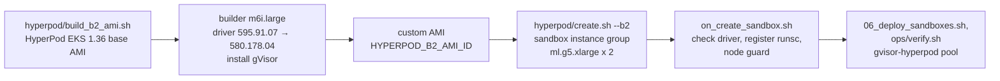
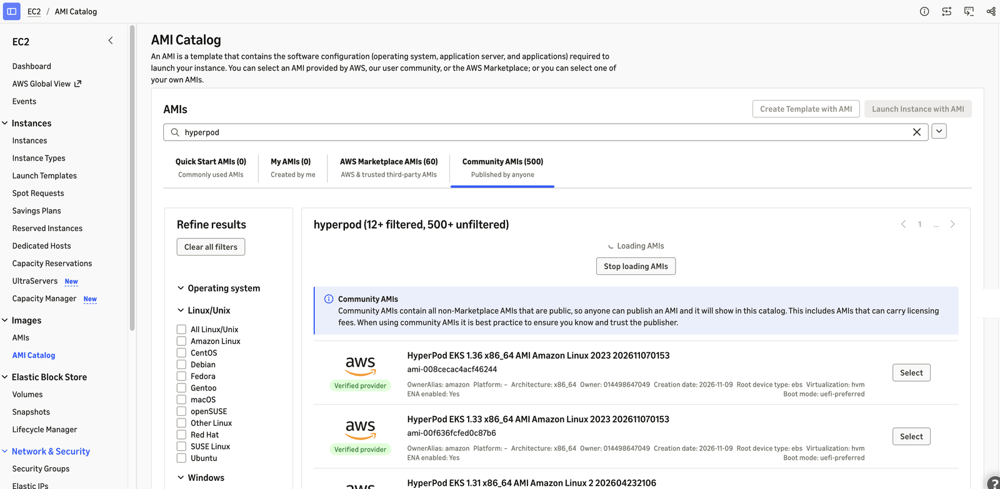

# Custom grading AMI for the earlier HyperPod CDK deployment

<span id="earlier-b2-custom-ami-path"></span>

For all-HyperPod workers, follow the [managed B2 lab](../handson/07_hyperpod_b2.md).

B2 puts both the trainer and the GPU sandboxes on HyperPod instance groups. The sandbox instance group (`sandbox`) boots from a custom AMI that swaps the NVIDIA driver to 580.178.04 and installs gVisor, and runs the same kind of gVisor pool as scenario A (`gvisor-hyperpod`).



*Takeaway: an image built from the default AMI with the driver swapped and gVisor installed backs a separate instance group, which runs a gVisor pool the same way the EC2 nodes do.*

## Why a custom AMI is needed

A driver version missing from gVisor nvproxy's allowlist (unknown) does not run even with the bypass flag, and the default HyperPod EKS AMI's driver is one of them.

| Target | NVIDIA driver | gVisor release-20261109.0 nvproxy |
|---|---|---|
| HyperPod EKS AMI 1.34, 1.35, 1.36 (release of 2026-10-16) | 595.91.07 | not listed (cannot run) |
| HyperPod EKS AMI 1.33 (x86_64) | 580.178.04 | supported |
| EKS AL2023 NVIDIA AMI v20261107 (EC2 gVisor nodes) | 580.178.04 | supported |

The gVisor development branch does not have 595.91.07 either, as of 2026-11-14. So instead of moving the cluster down to 1.33 (extended support), this path uses HyperPod's supported custom AMI feature. The AWS documentation says an image built from a HyperPod public base AMI can go into an instance group's `ImageId`, and names "driver customizations" as a use case.

The replacement driver version, 580.178.04, matches the EC2 gVisor nodes.

- **Verdicts**: so B1 and B2 are expected to give the same verdicts on the same driver version (the earlier custom AMI has not been tested).
- **Kernel module flavor**: it differs, though. The AMI of the EC2 `g5.xlarge` nodes loads the proprietary kernel module (GSP off), while the B2 AMI installs the open kernel module.

| Item | B1 | B2 |
|---|---|---|
| Sandbox nodes | EC2 node group `sandbox-gvisor` (`g5.xlarge` x 2) | HyperPod instance group `sandbox` (`ml.g5.xlarge` x 2) |
| AMI and driver | EKS AL2023 NVIDIA AMI, 580.178.04 | custom AMI from the HyperPod EKS 1.36 base AMI with the driver replaced by 580.178.04 |
| gVisor install | node user data (handler in the NodeConfig) | baked into the AMI; the lifecycle script registers the handler with containerd |
| Device injection | CDI device plugin | the same CDI device plugin (selected by the instance group's label) |
| Node guard | node user data | lifecycle script |
| When a node fails | the EKS managed node group replaces the instance | HyperPod `NodeRecovery` reboots or replaces it |
| Sandbox node cost (per hour) | 1.006 x 2 = about 2.01 USD | 1.408 x 2 = about 2.82 USD |

Costs are On-Demand list prices for us-east-1 and us-west-2. With no EC2 GPU node group in B2, compute is the system nodes, the trainer (`ml.g5.2xlarge`) and the two sandbox nodes, about 4.52 USD per hour (estimate).

## Step 1: Create the cluster

These commands create, in order, the cluster (system nodes only), the images (the trainer with `hyperpodrun`), the CDI device plugin, and the namespaces with the routing table.

```bash
scripts/02_create_cluster.sh --hyperpod-b2
# open cdk/tunnel.sh in a second terminal before the next kubectl or helm step
HYPERPOD=1 scripts/03_build_push_images.sh
# add the three export lines printed above to scripts/config.env before the next command
scripts/04_install_gpu_stack.sh
ACTIVE_RUNTIME=gvisor-hyperpod scripts/05_setup_namespaces_auth.sh
```

**What to look for:**

- The first command ends with the CDK `Outputs` (`EndpointPublicAccess = false`).
- `03_build_push_images.sh` only prints the three `export` lines for `SANDBOX_IMAGE_URI`, `TRAINER_IMAGE_URI` and `CONTROL_IMAGE_URI` at the end; add them to `scripts/config.env` before the next command. Without them, the pool deployment in step 5 stops at the `SANDBOX_IMAGE_URI` check.
- With the tunnel open, `kubectl get nodes` shows only the two `system` nodes.
- There is no GPU node yet, so an empty GPU table from `04_install_gpu_stack.sh` is expected.
- The last output of `05_setup_namespaces_auth.sh` shows `"active": {"runtime": "gvisor-hyperpod", "version": "v1"}`.

## Step 2: Bake the custom AMI (`hyperpod/build_b2_ami.sh`)

Start a builder instance (`m6i.large`) from the HyperPod EKS 1.36 base AMI, replace the driver and create an image. Building a kernel module needs no GPU, so no GPU instance is used; expect 20 to 40 minutes (estimate).

The script first creates a builder-only security group in the cluster VPC and attaches it to the builder. The group allows no inbound traffic and outbound HTTPS (443) only (dnf repositories, the NVIDIA installer, gVisor downloads).

- **After creating the AMI**: it terminates the builder and, once termination finishes, deletes the group.
- **If the script stops before the builder starts**: the group is deleted too.

```bash
scripts/hyperpod/build_b2_ami.sh
```

The base AMI is an image HyperPod publishes. In the EC2 console, open the Community AMIs tab of the AMI Catalog and search for "hyperpod"; it looks like this (AMI IDs and the owner account differ by Region).



*The 1.36 and 1.33 AMIs were published on the same date.*

What the builder does (`infra/hyperpod/ami/customize-b2.sh`):

| Order | What it does |
|---|---|
| 1 | Finds out how the base AMI installed the driver and replaces the driver to match (list below the table) |
| 2 | Checks that the `nvidia` module on disk is 580.178.04 and the open kernel module (`Dual MIT/GPL`) |
| 3 | Installs the pinned gVisor after a sha512 check, and checks that `runsc nvproxy list-supported-drivers` lists 580.178.04 |
| 4 | Resets cloud-init so that nodes launched from the image boot from scratch |
| 5 | Writes one result line to the serial console and powers off. The script reads that line and creates the AMI only on success |

Task 1 depends on how the driver was installed.

- **For dnf packages**: it moves every package of the current driver version to 580.178.04 in one transaction and locks the versions.
- **For the `.run` installer**: it checks the file against two checksums (NVIDIA's and the one in `config.env`) and reinstalls with the open kernel module.

**What to look for:** an ending like this (example). Put the `export` line into `scripts/config.env`.

```text
[hh:mm:ss] base AMI ami-...
[hh:mm:ss] builder security group sg-... (outbound HTTPS only)
[hh:mm:ss] builder instance i-...: swapping the driver and installing gVisor, then it stops (20-40 min)
[hh:mm:ss] GPUSANDBOX-B2-BUILD: OK driver=580.178.04 method=dnf gvisor=20261109.0 kernel=6.12.111-136.204.amzn2023.x86_64
[hh:mm:ss] creating ami-... (hyperpod-eks-1.36-gvisor-nv580.178.04-...)
[hh:mm:ss] terminating builder i-...

Add to scripts/config.env:
export HYPERPOD_B2_AMI_ID="ami-..."
```

`method` shows `dnf` or `runfile` depending on the base AMI. Which one is unconfirmed, so the script handles both and stops on anything else.

**If it fails:**

- `no HyperPod EKS 1.36 AL2023 AMI found`: the script picks the newest public AMI owned by `amazon` and named `HyperPod EKS 1.36 x86_64 AMI Amazon Linux 2023 *`. If the naming changed, search the AMI Catalog's Community AMIs for "HyperPod EKS 1.36" and run `HYPERPOD_BASE_AMI_ID=ami-... scripts/hyperpod/build_b2_ami.sh` with that ID.
- `customization failed`: the builder (stopped) and its security group stay. Read the cause with the printed `get-console-output` command, terminate the builder with `terminate-instances`, and once it is terminated delete the group with the printed `delete-security-group` command.
- `builder i-... did not stop within 60 minutes`: inspect and terminate the builder the same way, then run the printed `delete-security-group` command.
- `could not delete sg-... yet`: the AMI was created but the group was not deleted. Once the builder is terminated, delete it with `aws ec2 delete-security-group --region <region> --group-id sg-...`.
- `driver trees under /opt/nvidia`: the base AMI picks its driver at boot like the EKS AMI. This script does not handle that layout.

## Step 3: Attach the sandbox instance group (`hyperpod/create.sh --b2`)

Create the HyperPod cluster with B1's five steps plus the `sandbox` instance group.

```bash
scripts/hyperpod/create.sh --b2
```

`--b2` adds one instance group from `infra/hyperpod/instance-group-sandbox.json.tpl`. The trainer group keeps the default AMI.

| Setting | Value | Why |
|---|---|---|
| `ImageId` | `${HYPERPOD_B2_AMI_ID}` | the custom AMI from step 2 |
| `InstanceType`, `InstanceCount` | `ml.g5.xlarge`, 2 | two nodes with one A10G each. During a version swap v1 and v2 use one node each |
| `LifeCycleConfig.OnCreate` | `on_create_sandbox.sh` | checks the driver, registers `runsc`, installs the node guard, restarts containerd |
| `ThreadsPerCore` | 2 | SMT on, so each node has 4 vCPUs. The sandbox pod requests 3 CPUs (`gvisor-hyperpod.env`) |
| `KubernetesConfig.Labels` | `gpusandbox/role=sandbox-hyperpod`, `gpusandbox/device-plugin=cdi` | the nodeSelector of RuntimeClass `gvisor-hyperpod` and the CDI device plugin look for these labels |
| `KubernetesConfig.Taints` | `gpusandbox/role=sandbox-hyperpod:NoSchedule` | keeps other pods such as the trainer away |

- **The taint and the device plugins**: the HyperPod chart's device plugin does not tolerate it either, so two plugins never advertise the same GPU.

Per the HyperPod documentation, instance groups with deep health checks cannot have custom taints; this template does not turn the checks on.

The lifecycle script (`on_create_sandbox.sh`) fails instead of skipping when a condition is not met. A failed node creation shows up at once, which is safer than a sandbox node without gVisor joining quietly.

??? note "How the lifecycle script registers `runsc` with containerd"
    1. It takes the containerd config file from the running containerd's `--config` argument (falling back to `/etc/containerd/config.toml`).
    2. It adds the `runsc` handler in the format of the file's `version` (3 or 2).
    3. It checks with `containerd config dump` that containerd can read it.

**What to look for:** the last node table shows two `ml.g5.xlarge` nodes as `Schedulable` and `sandbox-hyperpod` (example).

```text
NAME             STATUS   ...   NODE-HEALTH-STATUS   INSTANCE-TYPE   ROLE
<hyperpod-node>  Ready    ...   Schedulable          ml.g5.2xlarge
<hyperpod-node>  Ready    ...   Schedulable          ml.g5.xlarge    sandbox-hyperpod
<hyperpod-node>  Ready    ...   Schedulable          ml.g5.xlarge    sandbox-hyperpod
```

**If it fails:** if the cluster goes to `Failed`, read the printed `failure` message. The lifecycle script output goes to CloudWatch Logs; the log group naming is unconfirmed, so find the log groups that contain the cluster name.

```bash
aws logs describe-log-groups --region "$AWS_REGION" \
  --query "logGroups[?contains(logGroupName, '${HYPERPOD_CLUSTER_NAME}')].logGroupName" --output text
```

- **`runsc missing` in the log**: the sandbox group did not boot from the custom AMI.
- **`NVIDIA driver ... is not supported`**: the driver actually loaded is not on the supported list of the installed `runsc`.

Check the sandbox group's AMI ID and that AMI's driver and gVisor versions (the `Description` in `aws ec2 describe-images`).

## Step 4: Check the nodes (`hyperpod/check_gvisor.sh`)

The script checks HyperPod workers outside the CPU system group against the driver list for the pinned gVisor release. It removes its temporary namespace and debug pods when it finishes.

```bash
scripts/hyperpod/check_gvisor.sh
```

**What to look for:** this line on both sandbox nodes. The trainer node uses the default AMI and prints `595.91.07: NOT supported`, which is expected because no sandbox runs there.

```text
  driver 580.178.04: SUPPORTED by gVisor 20261109.0
```

Also check that Kubernetes sees the GPUs. Both nodes should show `1`.

```bash
kubectl get nodes -l gpusandbox/role=sandbox-hyperpod \
  -o custom-columns='NODE:.metadata.name,GPU:.status.allocatable.nvidia\.com/gpu'
```

## Step 5: Deploy, verify and train

From here the scripts are the same as in scenario A, with the runtime name `gvisor-hyperpod`.

```bash
scripts/06_deploy_sandboxes.sh gvisor-hyperpod v1
scripts/ops/verify.sh gvisor-hyperpod v1
scripts/hyperpod/run_grpo.sh
```

**What to look for:**

- The pool verification (`ops/verify.sh`) ends with `pool sandbox-gvisor-hyperpod-v1 verified`.
- In check 1 of this verification, the kernel inside the sandbox is the one gVisor reports and must differ from the node kernel (`6.12.111-...`).
- The trainer log shows `"runtime": "gvisor-hyperpod"` in its `reward_batch` lines.

A version swap during training is `scripts/ops/rollout.sh gvisor-hyperpod v1 v2` (default pool replicas 1, change with `GVISOR_HYPERPOD_REPLICAS`).

**If it fails:**

- **If a pod is `Pending`**: check `kubectl -n sandbox describe pod <pod>` for `Insufficient nvidia.com/gpu`.
- **Zero GPUs**: the CDI device plugin is not running on that node; check with `kubectl -n kube-system get pods -o wide | grep nvdp`.
- **Anything else**: see the "gVisor" and "HyperPod" sections of [Troubleshooting](troubleshooting.md).

## Managing the custom AMI

| Situation | What to do |
|---|---|
| HyperPod releases a new base AMI | The custom AMI does not follow it. Switch the sandbox group's AMI with the steps below the table |
| You move gVisor to a new release | Build a new AMI and apply it to the sandbox group with the steps below the table |
| You finish the hands-on | `scripts/08_cleanup.sh` asks whether to delete the AMI in `HYPERPOD_B2_AMI_ID` and its snapshot |

**When HyperPod releases a new base AMI:**

1. Run step 2 again.
2. Set `HYPERPOD_B2_AMI_ID` in `scripts/config.env` to the new AMI ID, and reload it with `source scripts/config.env`.
3. Switch only the sandbox group with `aws sagemaker update-cluster-software --region "$AWS_REGION" --cluster-name "$HYPERPOD_CLUSTER_NAME" --instance-groups InstanceGroupName=sandbox --image-id "$HYPERPOD_B2_AMI_ID"`. Without `--instance-groups`, every instance group moves to this image.

**When you move gVisor to a new release:**

1. Change `GVISOR_RELEASE` and run step 2 again. The build checks that the new release supports the driver.
2. Save the new AMI ID, reload the config and switch only the sandbox group with `update-cluster-software`, as in the steps above. Do not run step 3 (`create.sh --b2`): it calls `create-cluster` again on the existing cluster.
