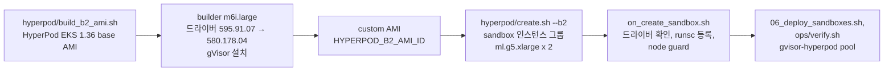
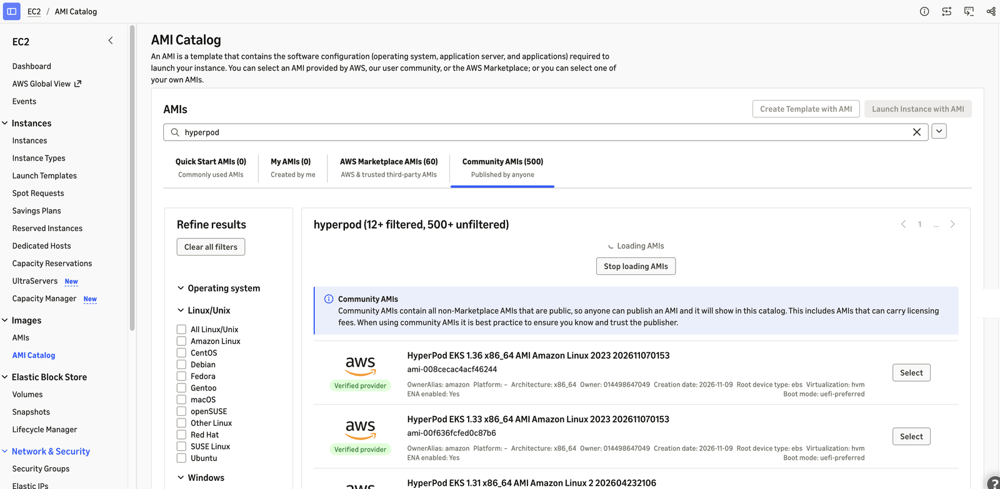

# 기존 CDK 구성에서 HyperPod 채점용 AMI 만들기

<span id="기존-b2-custom-ami-경로"></span>

CPU와 GPU 워커를 모두 HyperPod에서 운영하려면 [관리형 B2 실습](../handson/07_hyperpod_b2.md)을 따르세요.

기존 CDK 구성은 시스템 노드를 EC2에 두고, HyperPod의 `sandbox` 그룹은 드라이버 580.178.04와 gVisor를 설치한 custom AMI로 시작합니다. EC2 빌더로 이미지를 만들고 HyperPod에 지정하는 이 절차는 AWS에서 실행하지 않았습니다. 아래 출력은 예상 예시입니다.



## custom AMI가 필요한 이유

드라이버 버전이 gVisor nvproxy의 허용 목록에 없으면(unknown) 우회 플래그를 써도 GPU 샌드박스가 실행되지 않습니다. HyperPod EKS 기본 AMI의 드라이버가 이 경우에 해당합니다.

| 대상 | NVIDIA 드라이버 | gVisor release-20261109.0 nvproxy |
|---|---|---|
| HyperPod EKS AMI 1.34, 1.35, 1.36 (2026-10-16 릴리스) | 595.91.07 | 목록에 없음 (실행 불가) |
| HyperPod EKS AMI 1.33 (x86_64) | 580.178.04 | 지원 |
| EKS AL2023 NVIDIA AMI v20261107 (EC2 gVisor 노드) | 580.178.04 | 지원 |

gVisor 개발 브랜치에도 2026-11-14 기준 595.91.07은 없습니다. 이 경로는 클러스터를 1.33(extended support)으로 낮추는 대신 HyperPod가 공식 지원하는 custom AMI로 샌드박스 노드를 시작하도록 설계했습니다. AWS 문서에 따르면 HyperPod 공개 base AMI로 만든 이미지를 인스턴스 그룹의 `ImageId`에 지정할 수 있으며, 문서는 사용 예로 "driver customizations"를 명시합니다.

새로 설치하는 드라이버 버전은 EC2 gVisor 노드와 같은 580.178.04입니다.

- **verdict**: 그래서 B1과 B2는 같은 드라이버 버전에서 같은 verdict를 낼 것으로 봅니다(기존 custom AMI 경로 미검증).
- **커널 모듈 종류**: 다만 EC2 `g5.xlarge` 노드의 AMI는 proprietary 커널 모듈(GSP 꺼짐)을 로드하고, B2 AMI는 open 커널 모듈을 설치하므로 모듈 종류는 다릅니다.

| 항목 | B1 | B2 |
|---|---|---|
| 샌드박스 노드 | EC2 노드 그룹 `sandbox-gvisor` (`g5.xlarge` x 2) | HyperPod 인스턴스 그룹 `sandbox` (`ml.g5.xlarge` x 2) |
| AMI와 드라이버 | EKS AL2023 NVIDIA AMI, 580.178.04 | HyperPod EKS 1.36 base AMI에서 드라이버를 580.178.04로 바꾼 custom AMI |
| gVisor 설치 | 노드 user data (NodeConfig에 handler) | AMI에 포함, lifecycle script가 containerd에 handler 등록 |
| 장치 주입 | CDI device plugin | 같은 CDI device plugin (인스턴스 그룹 label로 선택) |
| node guard | 노드 user data | lifecycle script |
| 노드 고장 시 | EKS 관리형 노드 그룹이 인스턴스를 교체 | HyperPod `NodeRecovery`가 재부팅이나 교체 |
| 샌드박스 노드 비용 (시간당) | 1.006 x 2 = 약 2.01 USD | 1.408 x 2 = 약 2.82 USD |

비용은 us-east-1과 us-west-2의 온디맨드 요금입니다. 이 CDK 구성에는 EC2 GPU 노드 그룹이 없으므로, 컴퓨트 비용은 EC2 시스템 노드, trainer(`ml.g5.2xlarge`), 샌드박스 두 대를 더한 약 4.52 USD/시간입니다(추정).

## 1단계: 클러스터 만들기

아래 명령은 차례로 클러스터(system 노드만), 이미지(trainer에 `hyperpodrun` 포함), CDI device plugin, 네임스페이스와 routing 표를 만듭니다.

```bash
scripts/02_create_cluster.sh --hyperpod-b2
# open cdk/tunnel.sh in a second terminal before the next kubectl or helm step
HYPERPOD=1 scripts/03_build_push_images.sh
# add the three export lines printed above to scripts/config.env before the next command
scripts/04_install_gpu_stack.sh
ACTIVE_RUNTIME=gvisor-hyperpod scripts/05_setup_namespaces_auth.sh
```

**확인할 것:**

- 첫 명령은 CDK `Outputs`(`EndpointPublicAccess = false`)를 출력하고 끝납니다.
- `03_build_push_images.sh`는 끝에 `SANDBOX_IMAGE_URI`, `TRAINER_IMAGE_URI`, `CONTROL_IMAGE_URI`의 `export` 세 줄을 출력만 하므로, 이 세 줄을 `scripts/config.env`에 추가한 뒤 다음 명령을 실행하세요. 추가하지 않으면 5단계의 pool 배포가 `SANDBOX_IMAGE_URI` 검사에서 멈춥니다.
- 터널을 연 뒤 `kubectl get nodes`를 실행하면 `system` 노드 두 대만 나옵니다.
- 아직 GPU 노드가 없으므로 `04_install_gpu_stack.sh`의 GPU 표가 비어 있어도 정상입니다.
- `05_setup_namespaces_auth.sh`의 마지막 출력에는 `"active": {"runtime": "gvisor-hyperpod", "version": "v1"}`이 보입니다.

## 2단계: custom AMI 빌드 (`hyperpod/build_b2_ami.sh`)

HyperPod EKS 1.36 base AMI로 builder 인스턴스(`m6i.large`)를 띄워 드라이버를 바꾸고 이미지를 만듭니다. 커널 모듈은 GPU 없이도 빌드할 수 있으므로 GPU 인스턴스는 쓰지 않습니다. 빌드에는 20~40분이 걸릴 것으로 봅니다(추정).

스크립트는 먼저 클러스터 VPC에 builder 전용 보안 그룹을 만들어 builder에 붙입니다. 이 보안 그룹은 인바운드를 모두 막고 아웃바운드는 HTTPS(443)만 허용합니다(dnf 패키지, NVIDIA 설치 파일 및 gVisor 다운로드).

- **AMI를 만든 뒤**: builder를 종료하고, 종료가 끝나면 보안 그룹을 지웁니다.
- **builder를 띄우기 전에 스크립트가 멈춰도**: 보안 그룹은 지워집니다.

```bash
scripts/hyperpod/build_b2_ami.sh
```

base AMI는 HyperPod가 공개한 이미지입니다. EC2 콘솔의 AMI Catalog에서 Community AMIs 탭을 열고 "hyperpod"로 검색하면 아래와 같은 결과가 나옵니다. AMI ID와 소유자 계정은 리전마다 다릅니다.



*1.36과 1.33 AMI가 같은 날짜로 올라와 있습니다.*

builder 인스턴스는 다음 작업을 실행합니다(`infra/hyperpod/ami/customize-b2.sh`).

| 순서 | 하는 일 |
|---|---|
| 1 | base AMI의 드라이버 설치 방식을 확인하고, 그 방식에 맞게 드라이버를 바꿉니다(표 아래 목록) |
| 2 | 디스크의 `nvidia` 모듈이 580.178.04이고 open 커널 모듈(`Dual MIT/GPL`)인지 확인합니다 |
| 3 | 버전을 고정한 gVisor의 sha512를 확인한 뒤 설치하고, `runsc nvproxy list-supported-drivers`에 580.178.04가 있는지 확인합니다 |
| 4 | cloud-init 상태를 지웁니다. 그러면 이 이미지로 시작하는 노드에서 cloud-init이 첫 부팅처럼 처음부터 실행됩니다 |
| 5 | 결과 한 줄을 serial console에 쓰고 전원을 끕니다. 스크립트는 이 줄을 읽어 성공했을 때만 AMI를 만듭니다 |

1번 작업은 드라이버 설치 방식에 따라 다릅니다.

- **dnf 패키지면**: 같은 이름의 패키지를 580.178.04로 한 번에 바꾸고 버전을 고정합니다.
- **`.run` 설치 파일이면**: NVIDIA의 체크섬과 `config.env`의 체크섬 두 가지로 확인한 뒤 open 커널 모듈로 다시 설치합니다.

**확인할 것:** 출력이 아래 형태로 끝나면 성공입니다(예시). `export` 줄을 `scripts/config.env`에 추가하세요.

```text
[hh:mm:ss] base AMI ami-...
[hh:mm:ss] builder security group sg-... (outbound HTTPS only)
[hh:mm:ss] builder instance i-...: swapping the driver and installing gVisor, then it stops (20-40 min)
[hh:mm:ss] GPUSANDBOX-B2-BUILD: OK driver=580.178.04 method=dnf gvisor=20261109.0 kernel=6.12.111-136.204.amzn2023.x86_64
[hh:mm:ss] creating ami-... (hyperpod-eks-1.36-gvisor-nv580.178.04-...)
[hh:mm:ss] terminating builder i-...

Add to scripts/config.env:
export HYPERPOD_B2_AMI_ID="ami-..."
```

`method`는 base AMI에 따라 `dnf`나 `runfile`로 나옵니다. 저자가 base AMI의 설치 방식을 확인하지 못해서 스크립트는 두 방식을 모두 처리합니다. 그 밖의 구성이면 스크립트가 멈춥니다.

**문제가 생기면:**

- `no HyperPod EKS 1.36 AL2023 AMI found`: 스크립트는 소유자 `amazon`, 이름 `HyperPod EKS 1.36 x86_64 AMI Amazon Linux 2023 *`인 공개 AMI 중 가장 최신 AMI를 선택합니다. 이름 규칙이 바뀌었다면 AMI Catalog의 Community AMIs에서 "HyperPod EKS 1.36"으로 검색해 찾은 ID로 `HYPERPOD_BASE_AMI_ID=ami-... scripts/hyperpod/build_b2_ami.sh`를 실행하세요.
- `customization failed`: builder와 보안 그룹이 남습니다(builder는 정지 상태). 출력에 나온 `get-console-output` 명령으로 원인을 확인한 뒤 `terminate-instances` 명령으로 builder를 종료하고, 종료가 끝나면 출력에 나온 `delete-security-group` 명령으로 보안 그룹을 지우세요.
- `builder i-... did not stop within 60 minutes`: 같은 방법으로 builder를 확인해 종료한 뒤, 출력에 나온 `delete-security-group` 명령을 실행합니다.
- `could not delete sg-... yet`: AMI는 만들어졌지만 보안 그룹을 지우지 못한 경우입니다. builder 종료가 끝난 뒤 `aws ec2 delete-security-group --region <리전> --group-id sg-...`로 지우세요.
- `driver trees under /opt/nvidia`: base AMI가 EKS AMI처럼 부팅할 때 드라이버를 선택하는 구조라는 뜻입니다. 이 스크립트는 그 구조를 지원하지 않습니다.

## 3단계: sandbox 인스턴스 그룹 추가 (`hyperpod/create.sh --b2`)

B1과 같은 다섯 단계를 실행하되, `sandbox` 인스턴스 그룹을 추가해 HyperPod 클러스터를 만듭니다.

```bash
scripts/hyperpod/create.sh --b2
```

`infra/hyperpod/instance-group-sandbox.json.tpl`에서 `sandbox` 그룹을 설정합니다. trainer 그룹은 기본 AMI로 시작합니다. add-on 설치 단계만 따로 복구했다면, add-on이 `ACTIVE`가 된 뒤 `kubectl apply -f k8s/runtimes/runtimeclass-gvisor-hyperpod.yaml`로 RuntimeClass도 등록하세요.

| 설정 | 값 | 이유 |
|---|---|---|
| `ImageId` | `${HYPERPOD_B2_AMI_ID}` | 2단계의 custom AMI |
| `InstanceType`, `InstanceCount` | `ml.g5.xlarge`, 2 | A10G GPU가 한 개씩 있는 노드 두 대입니다. 버전을 교체할 때 v1과 v2를 각각 한 대에 배치합니다 |
| `LifeCycleConfig.OnCreate` | `on_create_sandbox.sh` | 드라이버 확인, `runsc` 등록, node guard, containerd 재시작 |
| `ThreadsPerCore` | 2 | SMT를 켜서 vCPU가 4개입니다. 샌드박스 pod는 CPU 3개를 요청합니다(`gvisor-hyperpod.env`) |
| `KubernetesConfig.Labels` | `gpusandbox/role=sandbox-hyperpod`, `gpusandbox/device-plugin=cdi` | RuntimeClass `gvisor-hyperpod`의 nodeSelector와 CDI device plugin이 이 label로 노드를 선택합니다 |
| `KubernetesConfig.Taints` | `gpusandbox/role=sandbox-hyperpod:NoSchedule` | trainer 같은 다른 pod가 이 노드에 스케줄되지 않게 합니다 |

- **taint와 device plugin**: HyperPod chart의 device plugin에도 이 taint의 toleration이 없으므로, 두 plugin이 같은 GPU를 중복으로 등록하지 않습니다.

HyperPod 문서에 따르면 deep health check를 켠 인스턴스 그룹에는 custom taint를 설정할 수 없습니다. 이 템플릿은 deep health check를 켜지 않습니다.

lifecycle script(`on_create_sandbox.sh`)는 조건이 맞지 않으면 건너뛰지 않고 실패합니다. gVisor가 없는 샌드박스 노드가 오류 없이 클러스터에 추가되는 것보다, 노드 생성이 실패해 문제를 바로 알 수 있는 편이 안전하기 때문입니다.

??? note "lifecycle script가 containerd에 `runsc`를 등록하는 순서"
    1. 실행 중인 containerd의 `--config` 인자에서 설정 파일 경로를 찾습니다(인자가 없으면 `/etc/containerd/config.toml`).
    2. 파일의 `version`(3 또는 2)에 맞는 형식으로 `runsc` handler를 추가합니다.
    3. containerd가 이 설정을 읽을 수 있는지 `containerd config dump`로 확인합니다.

**확인할 것:** 마지막 노드 표에 `ml.g5.xlarge` 두 대가 `Schedulable`, `sandbox-hyperpod`로 보이면 됩니다(예시).

```text
NAME             STATUS   ...   NODE-HEALTH-STATUS   INSTANCE-TYPE   ROLE
<hyperpod-node>  Ready    ...   Schedulable          ml.g5.2xlarge
<hyperpod-node>  Ready    ...   Schedulable          ml.g5.xlarge    sandbox-hyperpod
<hyperpod-node>  Ready    ...   Schedulable          ml.g5.xlarge    sandbox-hyperpod
```

**문제가 생기면:** 클러스터가 `Failed`면 출력된 `failure` 메시지를 보세요. lifecycle script의 출력은 CloudWatch Logs에 저장됩니다. 로그 그룹 이름 규칙은 확인하지 못했으므로, 아래 명령으로 클러스터 이름이 들어간 로그 그룹을 찾으세요.

```bash
aws logs describe-log-groups --region "$AWS_REGION" \
  --query "logGroups[?contains(logGroupName, '${HYPERPOD_CLUSTER_NAME}')].logGroupName" --output text
```

- **로그에 `runsc missing`이 나오면**: sandbox 그룹이 custom AMI로 부팅되지 않은 것입니다.
- **`NVIDIA driver ... is not supported`가 나오면**: 실제로 로드된 드라이버가 설치된 `runsc`의 지원 목록에 없다는 뜻입니다.

sandbox 그룹의 AMI ID와, 그 AMI의 드라이버와 gVisor 버전(`aws ec2 describe-images`의 `Description`)을 확인하세요.

## 4단계: 노드 확인 (`hyperpod/check_gvisor.sh`)

CPU 시스템 그룹을 제외한 HyperPod 워커의 드라이버 버전을 gVisor 지원 목록과 대조합니다. 검사용 Pod는 임시 네임스페이스에 생성하고 검사가 끝나면 함께 지웁니다.

```bash
scripts/hyperpod/check_gvisor.sh
```

**확인할 것:** sandbox 노드 두 대에서 아래 줄이 나와야 합니다. trainer 노드는 기본 AMI를 쓰므로 `595.91.07: NOT supported`가 나옵니다. trainer 노드에서는 샌드박스를 실행하지 않으므로 이 결과는 정상입니다.

```text
  driver 580.178.04: SUPPORTED by gVisor 20261109.0
```

Kubernetes가 GPU를 인식하는지도 확인합니다. 두 노드 모두 `1`이면 정상입니다.

```bash
kubectl get nodes -l gpusandbox/role=sandbox-hyperpod \
  -o custom-columns='NODE:.metadata.name,GPU:.status.allocatable.nvidia\.com/gpu'
```

## 5단계: pool 배포, 검증, 학습

<span id="5단계-풀-배포-검증-학습"></span>

여기부터는 시나리오 A와 같은 스크립트를 쓰고, 런타임 이름만 `gvisor-hyperpod`로 지정합니다.

```bash
scripts/06_deploy_sandboxes.sh gvisor-hyperpod v1
scripts/ops/verify.sh gvisor-hyperpod v1
scripts/hyperpod/run_grpo.sh
```

**확인할 것:**

- pool 검증(`ops/verify.sh`)이 `pool sandbox-gvisor-hyperpod-v1 verified`로 끝납니다.
- 이 검증의 1번 검사에서 샌드박스 안의 커널 버전은 gVisor가 제공하는 값이므로 노드 커널(`6.12.111-...`)과 달라야 합니다.
- trainer 로그의 `reward_batch` 줄에는 `"runtime": "gvisor-hyperpod"`가 나옵니다.

학습 중 버전을 교체하려면 `scripts/ops/rollout.sh gvisor-hyperpod v1 v2`를 실행합니다. pool의 replica 기본값은 1입니다. 개수를 바꾸려면 `GVISOR_HYPERPOD_REPLICAS`를 지정하세요.

**문제가 생기면:**

- **pod가 `Pending`이면**: `kubectl -n sandbox describe pod <pod>`의 출력에 `Insufficient nvidia.com/gpu`가 있는지 확인합니다.
- **GPU가 0이면**: CDI device plugin이 그 노드에서 실행되지 않은 것이니 `kubectl -n kube-system get pods -o wide | grep nvdp`로 확인하세요.
- **그 밖의 경우**: [문제 해결](troubleshooting.md)의 "gVisor"와 "HyperPod" 항목을 보세요.

## custom AMI 관리

실제 워커에서 추가로 확인할 항목은 HyperPod의 이미지 검증 통과 여부, 교체한 드라이버와 custom taint에서 health monitoring agent가 동작하는지, containerd 설정 파일의 위치와 형식입니다. `ml.g5.xlarge`에서 `/proc/driver/nvidia/version`으로 커널 모듈 종류를 확인한 뒤 4단계의 드라이버 검사와 5단계의 pool 검증을 실행하세요. 드라이버 580.178.04는 595 이상이 필요한 `ml.g7` 계열을 지원하지 않습니다.

| 상황 | 할 일 |
|---|---|
| HyperPod가 새 base AMI를 공개함 | custom AMI는 자동으로 갱신되지 않습니다. 표 아래 순서로 sandbox 그룹의 AMI를 바꿉니다 |
| gVisor를 새 릴리스로 업그레이드함 | 표 아래 순서로 새 AMI를 만들어 sandbox 그룹에 적용합니다 |
| 실습을 끝냄 | `scripts/08_cleanup.sh`가 `HYPERPOD_B2_AMI_ID`의 AMI와 스냅샷을 지울지 묻습니다 |

**HyperPod가 새 base AMI를 공개했을 때:**

1. 2단계를 다시 실행합니다.
2. `scripts/config.env`의 `HYPERPOD_B2_AMI_ID`를 새 AMI ID로 바꾼 뒤 `source scripts/config.env`로 다시 불러옵니다.
3. `aws sagemaker update-cluster-software --region "$AWS_REGION" --cluster-name "$HYPERPOD_CLUSTER_NAME" --instance-groups InstanceGroupName=sandbox --image-id "$HYPERPOD_B2_AMI_ID"`로 sandbox 그룹만 바꿉니다. `--instance-groups`를 빼면 모든 인스턴스 그룹이 이 이미지로 바뀝니다.

**gVisor를 새 릴리스로 업그레이드할 때:**

1. `GVISOR_RELEASE`를 바꾸고 2단계를 다시 실행합니다. 새 릴리스의 지원 목록에 드라이버가 있는지는 빌드 중에 확인합니다.
2. 위 순서와 같이 새 AMI ID를 설정 파일에 저장하고 다시 불러온 뒤 `update-cluster-software`로 sandbox 그룹만 바꿉니다. 3단계(`create.sh --b2`)는 기존 클러스터에 `create-cluster`를 다시 호출하므로 실행하지 않습니다.
