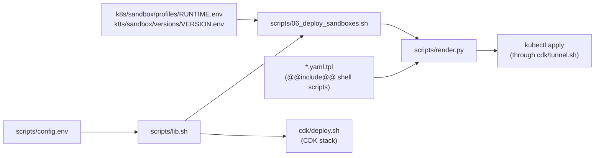
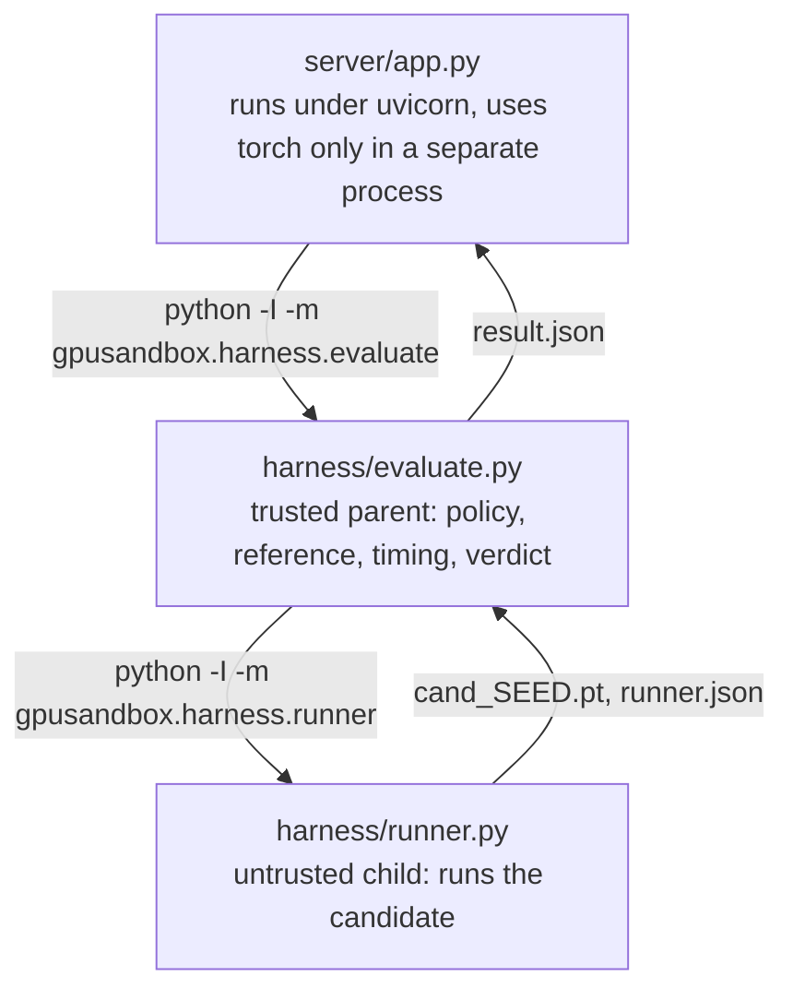

# Repository map

!!! info "TL;DR"
    Use this page to find implementation files. For a command you can run, use the [script reference](scripts.md).

| Code | Location |
|---|---|
| Sandbox server, scorer, client | [`src/gpusandbox`](#srcgpusandbox) |
| Training and rewards | [`rl`](#rl) |
| Exercise commands | [`scripts`](#scripts) |
| Infrastructure and node bootstrap | [`cdk`](#cdk), [`infra`](#infra) |
| Deployment templates | [`k8s`](#k8s) |

See [how values and templates come together](#how-values-and-templates-come-together) for pool configuration.

## Top level

```text
gpu-sandbox-on-aws/
├── src/gpusandbox/        # Python package: sandbox server, harness, client, gateway, rewards, tasks
├── rl/                    # trainers: TRL GRPO (hands-on), veRL (production)
├── scripts/               # main path 01..08, kata/, ops/, extensions/, hyperpod/, shared helpers
├── infra/                 # node user data, gVisor and Kata install, GPU stack values, HyperPod, Karpenter
├── k8s/                   # manifests: namespaces, policies, sandbox pools, jobs, production extras
├── sandbox/Dockerfile     # sandbox image
├── trainer/Dockerfile     # trainer image (TRL + vLLM)
├── gateway/Dockerfile     # control image (gateway + operator tools)
├── demo/                  # replay demo: static site, sample recording, S3 + CloudFront template
├── cdk/                   # Python CDK app: VPC, private EKS, node groups (A, B1, B2, C), SSM tunnel
├── diagrams/              # scenario architecture diagrams: .drawio sources, briefs, arrow-by-arrow guides
├── tests/                 # pytest suite (CPU only, no AWS)
├── docs/ + mkdocs.yml     # this guidebook (Korean default, English .en.md)
├── tools/                 # sync_scripts_md.py: builds SCRIPTS.md from docs/reference/scripts.md
├── .github/workflows/     # CI: tests and docs build
└── pyproject.toml, LICENSE, README.md, TROUBLESHOOTING.md, SCRIPTS.md (and .en.md)
```

!!! note "Local files you should not commit"
    These files only exist locally.

    - `scripts/config.env` (your own settings)
    - `bench-<timestamp>.jsonl` (output of `ops/bench.sh`)
    - `.venv/`, `.pytest_cache/`
    - `site/` (docs build output)
    - `cdk/cdk.out/` (synth output)
    - `cdk/cdk.context.json` (CDK context with your account ID)

    `05_setup_namespaces_auth.sh` and `ops/rollout.sh` create `.routing.json` briefly and delete it right away. `scripts/config.env` in particular holds image URIs with your account ID and IAM ARNs (and your workstation's public IP if you set one), so do not share it.

## How values and templates come together

Every script sources `scripts/lib.sh`, which reads `scripts/config.env`. The script then fills a template with `render <template> KEY=VALUE ...` and hands the result to `kubectl apply`. The infrastructure (VPC, cluster, node groups) is not a template: the CDK app creates it, and `cdk/deploy.sh` exports the same `config.env` values to it.

`render.py` substitutes values by these rules.

- **An undefined variable**: unlike envsubst, it stops with an error.
- **A variable defined as empty, such as `KEY=`**: it becomes an empty string.
- **`$$`**: it becomes a single `$`. That is why `$$(NODE_IP)` in the Deployment template becomes `$(NODE_IP)` after rendering, which Kubernetes expands when it creates the pod.



*Figure: the final manifest of one pool is produced when `render.py` merges the values of `config.env`, a profile and a version file into a template.*

## src/gpusandbox



*Figure: candidate code runs only in the untrusted child process, and the trusted parent process writes the verdict.*

| File | What it does | Called by |
|---|---|---|
| `server/app.py` | Sandbox HTTP server (FastAPI). `POST /v1/evaluate`, `GET /info`, `GET /metrics` (all authenticated), `GET /healthz`, `GET /readyz`. | `gpusandbox-server` in the sandbox image |
| `server/procs.py` | After every evaluation, SIGKILLs every process except the server and its ancestors (tini as PID 1). | `server/app.py` |
| `auth.py` | Verifies audience-bound projected ServiceAccount tokens offline against a JWKS file. If any setting is empty, every protected route is rejected (fail closed). | server, client, tools |
| `harness/evaluate.py` | Trusted parent process. Static policy check, candidate child, reference correctness and timing, verdict JSON. | server |
| `harness/runner.py` | Untrusted child process. Imports the candidate code and writes outputs and timings to the work directory. | `evaluate.py` |
| `harness/policy.py` | AST-based static policy (allowed imports, denied builtins, private and dunder access (only `__init__` and `__name__` allowed), streams, graphs, `torch.compile`, `cpp_extension`). A reward-integrity measure, not the security boundary. Source limit 32 KiB. | `evaluate.py`, `rewards.py`, `rl/verl/reward_fn.py` |
| `harness/timing.py` | The timing procedure shared by reference and candidate: host clock around `torch.cuda.synchronize()`, a distinct input per iteration, output checksums, only exact `torch.Tensor` outputs. | `evaluate.py`, `runner.py` |
| `harness/__init__.py` | `HARNESS_VERSION`. Bumped when the measurement contract (seeds, tolerances, timing method) changes. | server responses, verdicts |
| `tasks/` | 10 kernel tasks (KernelBench style: `Model`, `get_init_inputs()`, `get_inputs(seed, device, size)`, `ATOL`, `RTOL`). Level 0 is `vector_add`, `relu_bias`, `scaled_residual`; level 3 is `matmul_bias_relu`. | harness (reference), `prompts.py` |
| `prompts.py` | System prompt, Triton format example, user prompt, dataset rows. | `rl/trl/train_grpo.py`, `rl/verl/prepare_data.py` |
| `rewards.py` | Three TRL reward functions (format, correctness, speedup) and batch logging (`reward_batch` and `sandbox_version_switch` events). Infrastructure errors (`sandbox_error`) return `None`. | `train_grpo.py`, `rl/verl/reward_fn.py` |
| `client/routing.py` | Reads routing.json into a (runtime, version, address, revision) snapshot. Re-reads at most every 2 seconds and keeps the last good table if a read fails. | client, gateway |
| `client/pool.py` | Resolves the Ready pod IPs of a headless Service through DNS, sends one request per pod at a time, and retries on another pod on 503 or connection errors. | client, gateway, tools |
| `client/__init__.py` | `SandboxClient`. Direct mode (routing file) uses one routing snapshot per `evaluate_batch` call; gateway mode sends batches or a `group_key` to the gateway. | `rewards.py`, `rl/verl/reward_fn.py` |
| `gateway/app.py` | Production gateway. Single scheduler, version pinning per `group_key` (default TTL 900 seconds), TokenReview authentication, recycling of draining pods. | `gpusandbox-gateway` in the control image |
| `golden.py` | Six golden submissions with known verdicts (two correct Triton kernels, a correct torch-only answer, a wrong answer, a benchmark cheat, a host file read). GPU-only entries are skipped on CPU pools. | `tools.py` |
| `tools.py` | Operator tools `probe`, `parity`, `bench`, `simulate` (model-free reward loop), `record` (recording for the demo), `sync-jwks`, `multiturn` (model-free multi-turn episodes). | `k8s/probe/job-probe.yaml.tpl`, `k8s/production/jwks-sync.yaml.tpl`, `k8s/extensions/agent-sandbox/job-multiturn.yaml.tpl` |
| `agent_sandbox.py` | `EpisodeSandbox` of the Agent Sandbox extension. Per episode it borrows one sandbox from a warm pool with a `SandboxClaim`, evaluates through `status.sandbox.serviceFQDN`, and releases it at the end. | `multiturn.py`, `rl/verl/sandbox_tool.py`, per-episode trainer code (direct import), `tests/test_agent_sandbox.py` |
| `multiturn.py` | Multi-turn episode runner. Per episode it claims one sandbox through `EpisodeSandbox`, repeats code submission and verdict feedback (at most 240 characters) up to `max_turns`, and uses `score_verdict` of the final submission as the episode reward. | `tools.py multiturn`, `rl/verl/sandbox_tool.py` (feedback format) |

- **`server/app.py`**: starts a fresh process tree per evaluation and runs one evaluation at a time (others get 503). Readiness passes only when the GPU probe succeeded, egress is verified blocked, and the pod is not draining.
- **`auth.py`**: `read_token` re-reads the token file on every request.
- **`harness/runner.py`**: on GPU evaluations, when the counter can be installed, records how many times the Triton launch function was called up to the end of the correctness check (before timing).
- **`client/__init__.py`**: one TRL reward batch makes no `evaluate_batch` call when it uses only cached results, and up to three calls when results must be scored again, so that it ends with one pool's results (`rewards.py`).
- **`agent_sandbox.py`**: the claim carries a `shutdownTime` as a safety net.
- **`multiturn.py`**: it includes `ScriptedPolicy`, which submits golden submissions in turn without a model. Details: [11 Multi-turn episodes](../handson/11_multi_turn.md), [06 Extending with Agent Sandbox](../concepts/06_agent_sandbox.md)

## rl

| File | What it does |
|---|---|
| `rl/trl/train_grpo.py` | On-policy GRPO with TRL `GRPOTrainer` (LoRA, vLLM colocate). `--dry-run` runs 2 steps on CPU without vLLM. |
| `rl/verl/Dockerfile` | veRL image (production). `scripts/03_build_push_images.sh` does not build it, so build it separately. |
| `rl/verl/prepare_data.py` | Writes the tasks as veRL parquet (train, val). The correctness check runs against the reference inside the sandbox image. |
| `rl/verl/reward_fn.py` | Async `compute_score` for veRL. Uses the gateway's `group_key` pinning; on infrastructure errors it scores only the format and sets a `sandbox_error` flag. |
| `rl/verl/run_grpo_kernels.sh` | Submits the veRL GRPO job to the RayCluster (veRL 0.9.1 key names). |
| `rl/verl/sandbox_tool.py` | Multi-turn tool for veRL 0.9.1. Tested locally only, not run with veRL. |
| `rl/verl/sandbox_tool_config.yaml` | Example veRL tool config for that tool (`class_name`, `warm_pool`, `max_turns`, `max_feedback_chars` and others). Pass it to veRL with `actor_rollout_ref.rollout.multi_turn.tool_config_path`. Details: [06 Extending with Agent Sandbox](../concepts/06_agent_sandbox.md) |

- **`rl/verl/prepare_data.py`**: `ground_truth` carries the `task_id`, and `prompt` carries the PyTorch reference `Model` source that the model rewrites in Triton.
- **`rl/verl/sandbox_tool.py`**: its parts are these. Details: [06 Extending with Agent Sandbox](../concepts/06_agent_sandbox.md)
    - `KernelSandboxTool` evaluates each `submit_kernel` call in the one sandbox claimed for the trajectory and returns the verdict as the tool response.
    - `SandboxToolAgentLoop` deletes the claim when the trajectory ends.
    - `compute_score` uses the score of the final submission as the reward.
    - veRL loads this module through `class_name` in `sandbox_tool_config.yaml`.

## scripts

Usage, behavior on a second run and success signals are in the [Script reference](scripts.md).

### Main path

The scripts you run in numbered order in scenario A.

| File | What it does | Cost and caution |
|---|---|---|
| `01_check_prereqs.sh` | Checks tools (aws, cdk, node, kubectl, helm, docker, python3, jq, session-manager-plugin), AWS identity, the "Running On-Demand G and VT instances" quota, nested virtualization support and per-AZ offerings of the GPU types. Read-only. | none |
| `02_create_cluster.sh [--hyperpod]`, `[--hyperpod-b2]`, `[--cpu-only]` | A thin wrapper that sets `SCENARIO` (A by default; B1, B2 or C by option) and calls `cdk/deploy.sh`. About 20 minutes in the practice account. | EKS, NAT gateway, 2x m6i.large, access instance (t4g.nano), 2x g5.xlarge (A, B1), g5.2xlarge (A) |
| `03_build_push_images.sh` | Builds the sandbox, trainer and control images for linux/amd64 and pushes them to private ECR. Prints three `*_IMAGE_URI` lines at the end. | ECR storage. Tags are IMMUTABLE |
| `04_install_gpu_stack.sh` | Installs the NVIDIA device plugin (CDI mode) on `gpusandbox/device-plugin=cdi` nodes, applies the CDI hook setting to its DaemonSet and waits for the rollout (see below the table), then registers the `gvisor` RuntimeClass and checks the gVisor kernel and GPU access with a smoke pod. | none |
| `05_setup_namespaces_auth.sh` | Namespaces, ServiceAccounts, NetworkPolicies, the JWKS ConfigMap and the routing ConfigMap. It can be re-run, but every run rewrites the active routing table and the NetworkPolicies (see below the table). On a running system, check the active version and the access policies first. | none |
| `06_deploy_sandboxes.sh <runtime> [version] [replicas]` | Deploys one pool (Deployment + headless Service) from a profile and a version file and waits for the rollout. | uses GPU nodes |
| `07_run_grpo.sh [max_steps]` | Submits the scenario A trainer Job and follows its logs. | trainer GPU |
| `08_cleanup.sh [--images]` | After you confirm the cluster name, runs `cdk/destroy.sh --yes`, deletes the IOMMU AMI and the B2 AMI (each after confirmation) and, with `--images`, the ECR repositories. | stops billing |

- **`02_create_cluster.sh`**: the CDK stack creates the VPC, EKS with a private API endpoint, add-ons, the node groups of the scenario and an SSM access instance. When you change `WITH_KATA_CPU` or `WITH_KATA_GPU` and run it again, CDK changes only the node groups that differ.
- **`03_build_push_images.sh`**: `HYPERPOD=1` adds hyperpodrun to the trainer image. `--no-trainer` (scenario C) skips the trainer image.
- **`04_install_gpu_stack.sh`**: sets `CDI_DISABLE_HOOKS=disable-device-node-modification` on the device plugin DaemonSet and waits for the rollout (turns off a CDI hook that fails under runsc; the chart has no value for it).
- **When you re-run `05_setup_namespaces_auth.sh`**: every run rewrites the `rl-trainer` routing table with `ACTIVE_RUNTIME` and `ACTIVE_VERSION` (default `gvisor`, `v1`) and re-applies `k8s/base/networkpolicies.yaml`, which also reverts the `allow-clients-to-sandbox-api` policy that the production gateway replaced to the hands-on rule. On a running system, check the active version and the access policies first.
- **`08_cleanup.sh`**: `cdk/destroy.sh --yes` deletes the pools and Jobs first if the tunnel is up. With or without the tunnel, it then deletes the whole stack and the leftover Lambda log group. The secrets KMS key enters a 7-day deletion window, and the bootstrap stack `CDKToolkit` stays.

### Optional features and operations

Scripts you run depending on the scenario or the task: `kata/` adds Kata nodes, `ops/` holds verification and operations, `extensions/` the Agent Sandbox extension, and `hyperpod/` scenarios B and B2.

| File | What it does | Cost and caution |
|---|---|---|
| `kata/cpu_nodes.sh` | Checks that the `sandbox-kata-cpu` node group exists, then installs kata-deploy and the `gvisor-cpu` RuntimeClass and runs the `gvisor-cpu`, `kata-clh` and `kata-qemu` smoke pods. One run is enough. | 1x c8i.2xlarge (`02_create_cluster.sh` creates the node group) |
| `kata/gpu_nodes.sh` | If `KATA_IOMMU_AMI_ID` is empty, bakes the IOMMU AMI and stops. Then it checks the `sandbox-kata-gpu` node group and installs the GPU Operator (VM passthrough) and kata-deploy. | g4dn.metal about 7.8 USD/hour (`02_create_cluster.sh` creates the node group) |
| `ops/verify.sh <runtime> [version]` | Kernel comparison, egress denial checks, golden verdicts (probe Job), and a check that another namespace cannot connect. | none |
| `ops/simulate.sh [steps] [interval_s]` | The model-free reward loop of scenario C. Runs `tools.py simulate` as a Job, scores the golden submissions batch by batch and prints `reward_batch` and `sandbox_version_switch` events. Not training. | none |
| `ops/rollout.sh <runtime> <from> <to> [--finish]` | Blue/green update: deploy, verify, parity, routing switch. | both pools use GPUs for a while |
| `ops/bench.sh [requests]` | For every deployed v1 pool, measures cold start, evaluation latency p50/p95, throughput and speedup. | none |
| `ops/sync_jwks.sh` | Copies the cluster's ServiceAccount issuer public keys (JWKS) and issuer URL into the `sandbox/sandbox-auth-jwks` ConfigMap. Public keys, not secrets. | |
| `extensions/agent_sandbox.sh install`, `pool <runtime> [n]`, `claim <runtime>`, `episodes <runtime> [episodes] [max_turns]` | Agent Sandbox extension. What each subcommand does is listed below the table. | warm GPU sandboxes hold their GPU while idle |
| `hyperpod/create.sh [--b2]` | HyperPod dependency Helm chart, lifecycle bucket (Block Public Access), execution role, CreateCluster, training operator add-on. `--b2` adds the `sandbox` instance group that boots from the custom AMI, and the `gvisor-hyperpod` RuntimeClass. | ml.g5.2xlarge; B2 adds 2x ml.g5.xlarge |
| `hyperpod/build_b2_ami.sh` | Bakes the scenario B2 custom AMI (`infra/hyperpod/ami/build-b2-ami.sh`): replaces the driver of the HyperPod EKS base AMI with `B2_NVIDIA_DRIVER_VERSION`, adds gVisor, and prints `HYPERPOD_B2_AMI_ID`. | builder m6i.large (during the build), AMI snapshot |
| `hyperpod/run_grpo.sh [max_steps]` | Submits a HyperPodPyTorchJob. | none |
| `hyperpod/check_gvisor.sh` | Scenario B2 node check. Prints whether each HyperPod node's driver is in the pinned gVisor release's nvproxy support list. | none |
| `hyperpod/delete.sh` | Deletes the HyperPod cluster, execution role and lifecycle bucket. Run it before `08_cleanup.sh`. | stops billing |

- **`kata/cpu_nodes.sh`**: if the node group does not exist, it stops and tells you to run `02_create_cluster.sh` again with `WITH_KATA_CPU=1`.
- **`kata/gpu_nodes.sh`**: if it baked the IOMMU AMI and stopped, add `KATA_IOMMU_AMI_ID` and `WITH_KATA_GPU=1`, run `02_create_cluster.sh` again, then run this script again. `02_create_cluster.sh` (`cdk/deploy.sh`) asks you to type `metal`.
- **`--finish` of `ops/rollout.sh`**: it skips all of the steps, scales only the old version to zero replicas and exits, so run the same command again with `--finish` after you confirm the switch.
- **Output of `ops/bench.sh`**: cold start goes to the terminal only; the rest is the `bench` Job's output, which is also appended to `bench-<timestamp>.jsonl`.
- **`extensions/agent_sandbox.sh`**: the subcommands are these. Details: [11 Multi-turn episodes](../handson/11_multi_turn.md)
    - `install` applies the controller and CRDs (pinned to v1.0.11), the claim RBAC and `k8s/base/trainer-rbac.yaml` (ServiceAccount `sandbox-episode`).
    - `pool` creates a SandboxTemplate and a SandboxWarmPool from a runtime profile (the default allowlist includes `sandbox-episode`).
    - `claim` creates one claim, prints its address and deletes it.
    - `episodes` submits a Job (`job-multiturn.yaml.tpl`) that runs multi-turn episodes without a model (2 episodes and up to 3 turns by default; `max_turns` 1 is the single-turn baseline). Before submitting it checks the CRDs, the ServiceAccount and its claim permission, a Ready warm sandbox and the allowlist of the warm sandboxes; afterwards it deletes leftover claims and exits with the Job's result.
- **`hyperpod/create.sh`**: uses a private subnet that CDK tagged with `kubernetes.io/role/internal-elb`, and the helm step needs the tunnel.
- **`hyperpod/check_gvisor.sh`**: creates a debug pod per node and, at the end, deletes every pod in the `default` namespace whose name starts with `node-debugger-`.

### Shared libraries and configuration

Shared files that the scripts source or call.

| File | What it does | Cost and caution |
|---|---|---|
| `lib.sh` | Loads `config.env`; `require_vars`, `require_tools`, `render`, `confirm`, `oidc_issuer`, `wait_for_pods`. `log`, `warn` and `die` use colors only on a terminal, and none with `NO_COLOR` set. | |
| `lib_jobs.sh` | `run_tool_job`: runs `gpusandbox.tools` from the control image as a one-shot Job in `rl-trainer` and streams its logs. | |
| `logview.py` | Shows JSON event lines (`reward_batch`, `sandbox_version_switch`, `parity`, episode events and others) as short colored lines on a terminal. | |
| `render.py` | Renders `${VAR}` templates (undefined variables are errors, empty values become empty strings, `$$` becomes `$`) and inserts `@@include path@@` files. | |
| `config.env.example` | Template for `scripts/config.env`. The values are explained in [Configuration](configuration.md). | |

- **`lib_jobs.sh`**: `run_job_template` does the same for another Job template (`job-multiturn.yaml.tpl`). Logs go through `logview.py`.
- **`logview.py`**: when the output is a pipe or a file, or `GPUSANDBOX_LOG=json` is set, every line passes through unchanged. Standard library only, so it runs with the plain `python3` outside the virtualenv.

## infra

| Path | What it does |
|---|---|
| `eks/node-guard.sh` | On sandbox nodes, drops new connections from pods to the node with iptables (chain `GPUSANDBOX-GUARD`). A systemd unit that runs before kubelet on every boot. |
| `eks/userdata.py` | Standard-library module that builds the MIME user data of the sandbox node groups. The CDK stack puts it into the launch templates, and `tests/test_manifests.py` checks it. |
| `gpu/nvidia-device-plugin-values.yaml` | NVIDIA device plugin values. `deviceListStrategy: cdi-cri`, only `gpusandbox/device-plugin=cdi` nodes. The plugin's `--cdi-disable-hooks` has no value in chart v0.20.1, so `04_install_gpu_stack.sh` sets it as an env var. |
| `gvisor/install-gvisor.sh` | Installs a pinned gVisor release tarball (sha512 check), writes `/etc/containerd/runsc.toml` (nvproxy), warns about unsupported drivers. |
| `kata/kata-deploy-values.yaml` | kata-deploy 4.3.1 values (DaemonSet mode). RuntimeClasses `kata-qemu-nvidia-gpu`, `kata-qemu`, `kata-clh`. |
| `kata/gpu-operator-values.yaml` | GPU Operator v26.7.2 values for VM passthrough (`sandboxWorkloads.mode=kata`, `ccManager.defaultMode=off`, container operands disabled). |
| `kata/build-iommu-ami.sh` | Bakes `intel_iommu=on iommu=pt` into the standard EKS AL2023 AMI with an m6i.large builder. |
| `kata/experimental-clh-gpu/` | Experimental `kata-clh-nvidia-gpu` values (not supported upstream) and a CUDA initialization check. |
| `hyperpod/cluster.json.tpl` | CreateCluster input (one trainer instance group instance, `NodeRecovery: Automatic`). |
| `hyperpod/instance-group-sandbox.json.tpl` | The B2 `sandbox` instance group (`ImageId`, and `KubernetesConfig` with the label and taint). Added to `cluster.json` with `--b2`. |
| `hyperpod/ami/build-b2-ami.sh`, `customize-b2.sh` | The B2 custom AMI builder and the builder instance's user data (driver swap, gVisor install, one result line on the serial console). |
| `hyperpod/execution-role-trust.json`, `execution-role-eks-policy.json` | HyperPod execution role trust and the ENI and ECR inline policy. |
| `hyperpod/lifecycle/on_create.sh`, `on_create_sandbox.sh`, `register_runsc.sh` | Lifecycle scripts. The trainer group installs nothing; the B2 sandbox group checks driver support, registers `runsc` in the schema of containerd's config and installs the node guard (it fails if a condition is not met). |
| `karpenter/nodeclasses.yaml.tpl`, `karpenter/nodepools.yaml` | Four EC2NodeClasses and four NodePools for production (sandbox-gvisor, sandbox-kata-gpu, sandbox-kata-cpu, trainer). |

What `eks/userdata.py` puts in for each node type:

- **gVisor GPU node**: the `runsc` handler in the NodeConfig, the gVisor install with nvproxy, the node guard
- **c8i node**: containerd drop-in `imports` for kata-deploy, gVisor without nvproxy, the node guard
- **Kata GPU node**: a NodeConfig with all cluster fields because of the IOMMU AMI, kubelet `runtimeRequestTimeout: 20m`, the node guard

## cdk

The Python CDK app that creates the infrastructure (VPC, cluster, node groups). The hands-on `scripts/02_create_cluster.sh` and `scripts/08_cleanup.sh` call the scripts in this folder. Details are in [09 Provisioning with CDK](../production/09_cdk.md).

| Path | What it does |
|---|---|
| `deploy.sh [A, B1, B2, C] [--with-kata-cpu]` | Exports `scripts/config.env` and runs `cdk deploy <CLUSTER_NAME>-cdk --require-approval broadening`. If `ADMIN_PRINCIPAL_ARN` is empty it derives your current role ARN, and with `WITH_KATA_GPU=1` it continues only after you type `metal`. |
| `tunnel.sh [local_port]` | Reads the endpoint and the access instance from the stack outputs, opens SSM port forwarding (`127.0.0.1:8443`) and creates the kubectl context `<CLUSTER_NAME>-tunnel`. Needs the Session Manager plugin. |
| `destroy.sh [--yes]` | Deletes the pools and Jobs first if the tunnel is up, runs `cdk destroy`, deletes the leftover `/aws/lambda/<CLUSTER_NAME>-cdk-...` log group and prints any tagged instances left. |
| `app.py`, `cdk.json` | CDK entry point. cdk-nag (AwsSolutions) runs on every synth, and the deploy goes ahead only with no finding acknowledged without a reason. |
| `gpusandbox_cdk/config.py` | Reads and checks the environment variables (`SCENARIO`, the `ADMIN_PRINCIPAL_ARN` format, `EKS_PUBLIC_ACCESS_CIDR` as a /32 only, the `KATA_IOMMU_AMI_ID` format, the CPU topology table for c8i). |
| `gpusandbox_cdk/stack.py` | The stack itself. The EKS cluster, access entries, add-ons, launch templates and node groups are L1 (`Cfn*`); the VPC, security groups, IAM roles, access instance, KMS key and log groups are L2 constructs. |
| `requirements.txt` | Pinned CDK libraries (`aws-cdk-lib`, `constructs`, `cdk-nag`). |
| `tests/test_stack.py` | 18 tests that synthesize offline and check the security defaults, the node groups per scenario and that cdk-nag passes. Run them separately with `cd cdk && python -m pytest -q tests`. |

The resources that `gpusandbox_cdk/stack.py` creates:

- VPC (2 AZs, 1 NAT, private subnets tagged `kubernetes.io/role/internal-elb` and `karpenter.sh/discovery`)
- EKS 1.36 (private endpoint, `API_AND_CONFIG_MAP`, KMS secrets encryption, 5 log types, service CIDR `172.20.0.0/16`)
- 4 add-ons
- the node groups of the scenario (IMDSv2 with hop limit 1 and encrypted gp3 in every launch template)
- the SSM access instance

## k8s

| Path | What it does |
|---|---|
| `base/namespaces.yaml` | `sandbox` (Pod Security `restricted`), `rl-trainer` (`baseline`). |
| `base/networkpolicies.yaml` | Default deny (ingress and egress) in `sandbox`, plus TCP 8000 from `gpusandbox/client: "true"` pods in `rl-trainer` only. |
| `base/trainer-rbac.yaml` | ServiceAccounts `grpo-trainer`, `sandbox-probe`, `sandbox-episode` (`rl-trainer`) and `gpu-sandbox` (`sandbox`), all with API token automount off. |
| `base/routing.json.tpl` | Routing table template (pool addresses plus `ACTIVE_RUNTIME`, `ACTIVE_VERSION`). |
| `runtimes/runtimeclass-gvisor.yaml` | `gvisor` RuntimeClass (handler `runsc`, scheduled onto gVisor nodes only). |
| `runtimes/runtimeclass-gvisor-hyperpod.yaml` | `gvisor-hyperpod` RuntimeClass (handler `runsc`, scheduled onto the B2 sandbox instance group only). |
| `runtimes/runtimeclass-gvisor-cpu.yaml` | `gvisor-cpu` RuntimeClass (same handler `runsc`, without nvproxy, scheduled onto the c8i node only). |
| `sandbox/deployment.yaml.tpl` | One pool = Deployment + headless Service. Security context, probes, egress probe targets and auth env live here. |
| `sandbox/profiles/*.env` | Seven runtime profiles (`gvisor`, `gvisor-hyperpod`, `kata-qemu`, `kata-clh`, `gvisor-cpu`, `kata-clh-cpu`, `kata-qemu-cpu`). |
| `sandbox/versions/*.env` | Harness settings of sandbox versions `v1` and `v2`. |
| `probe/job-probe.yaml.tpl` | One-shot probe, parity, bench and simulate Job (`rl-trainer`, `gpusandbox/client: "true"`). Mounts the routing ConfigMap as a directory (starts without it too). |
| `trainer/job-grpo.yaml.tpl` | Scenario A trainer Job. Mounts the routing ConfigMap as a directory. Runs as the vLLM image's non-root user (`vllm`, uid 2000) to meet Pod Security `restricted`. |
| `trainer/hyperpod-job-grpo.yaml.tpl` | Scenario B HyperPodPyTorchJob (retries, log-based stall detection). |
| `production/gateway.yaml.tpl` | Gateway namespace, RBAC (TokenReview, pod deletion), Deployment (1 replica), Service, NetworkPolicies. Changes the sandbox pools' ingress to admit the gateway only. |
| `production/jwks-sync.yaml.tpl` | JWKS sync CronJob (minute 17 of every hour). |
| `production/pool-hardening.yaml` | Two PriorityClasses, a PodDisruptionBudget and a ResourceQuota (`nvidia.com/gpu` 16, `nvidia.com/pgpu` 8, 64 pods). |
| `production/warm-capacity.yaml` | Low-priority placeholder that holds a spare node of the `sandbox-kata-gpu` NodePool. |
| `production/raycluster-verl.yaml.tpl` | RayCluster for veRL (KubeRay `ray.io/v1`). |
| `extensions/agent-sandbox/template.yaml.tpl` | SandboxTemplate and SandboxWarmPool for Agent Sandbox (`kernel-eval-<runtime>`). Ingress only from `rl-trainer` on port 8000, no egress (`[]`), `dnsPolicy: None`, environment variable injection disallowed. |
| `extensions/agent-sandbox/trainer-claims-rbac.yaml` | Role and RoleBinding that let `rl-trainer/grpo-trainer` and `rl-trainer/sandbox-episode` create and delete `sandboxclaims` in the `sandbox` namespace. |
| `extensions/agent-sandbox/job-multiturn.yaml.tpl` | One-shot multi-turn episode Job (`rl-trainer`, ServiceAccount `sandbox-episode`) that runs `python -m gpusandbox.tools multiturn` from the control image. |

- **`base/trainer-rbac.yaml`**: `sandbox-episode` is the account of the multi-turn episode Job. `05_setup_namespaces_auth.sh` and `extensions/agent_sandbox.sh install` apply this file. Details: [11 Multi-turn episodes](../handson/11_multi_turn.md)
- **`extensions/agent-sandbox/job-multiturn.yaml.tpl`**: unlike the probe Job it mounts a Kubernetes API token, to create and delete SandboxClaims, and it also carries the sandbox-audience token and the `gpusandbox/client: "true"` label. `scripts/extensions/agent_sandbox.sh episodes` renders and runs it. Details: [11 Multi-turn episodes](../handson/11_multi_turn.md)

## demo

| Path | What it does |
|---|---|
| `site/` | Static replay site (`index.html`, `app.js`, `style.css`) and the recording `data/recording.json`. It loads no external scripts and renders the recording as text, never as HTML. |
| `record_local.py` | Starts two loopback sandbox servers (v1, v2) on a laptop CPU, scores real submissions on them and produces the sample recording, without AWS. |
| `infra/site.yaml` | CloudFormation template for a private S3 bucket, a CloudFront distribution with Origin Access Control, and security response headers. |
| `deploy.sh`, `teardown.sh` | Deploy the stack and upload the site; empty the bucket and delete the stack. |

- **When you run `record_local.py` on Linux**: the server kills other processes of the same user after every evaluation, so run it inside a container with its own PID namespace.
- **GPU cluster recording**: a GPU recording from `python -m gpusandbox.tools record` replaces the sample recording.

## Images

| ECR repository | Dockerfile | Base (pinned in the Dockerfile) | Contents | Runs in |
|---|---|---|---|---|
| `<ECR_REPO_PREFIX>/sandbox` | `sandbox/Dockerfile` | `pytorch/pytorch:2.14.1-cuda12.6-cudnn9-runtime` | PyTorch and Triton (base), `gcc` and `libc6-dev` (Triton compiles its launcher), `tini` (PID 1), `gpusandbox[server]` (FastAPI, uvicorn, prometheus-client, PyJWT). UID 10001, port 8000. | every sandbox pod (gVisor and Kata alike) |
| `<ECR_REPO_PREFIX>/trainer` | `trainer/Dockerfile` | `vllm/vllm-openai:v0.33.0` | vLLM, torch, transformers (base, pinned with a constraints file), TRL 1.18.0, PEFT 0.21.3, datasets, `gpusandbox[client]` (httpx), `rl/`. `HYPERPOD=1` adds `hyperpod-elastic-agent`. | trainer Job, HyperPodPyTorchJob |
| `<ECR_REPO_PREFIX>/control` | `gateway/Dockerfile` | `public.ecr.aws/docker/library/python:3.14-slim` | `gpusandbox[gateway]` (FastAPI, uvicorn, httpx, prometheus-client, PyJWT, kubernetes). No torch, no GPU. UID 10001, port 8080. | gateway Deployment, probe/parity/bench Jobs, multi-turn episode Job, jwks-sync CronJob |
| build it yourself | `rl/verl/Dockerfile` | `vllm/vllm-openai:v0.24.0` | veRL 0.9.1 (`verl[vllm]`), `ray[default]`, pandas, pyarrow, `gpusandbox[client]`, `rl/`. | production RayCluster |

!!! warning "What no image contains"
    No image contains the NVIDIA kernel driver. Under gVisor the container uses the host driver through nvproxy; under Kata it uses the driver inside the guest VM that kata-deploy installs. The images carry only the CUDA user-space libraries that come with the PyTorch wheels. Base image tags and package versions are pinned in the Dockerfiles; check them before you build.

> ❓ **Misconception: `gateway/Dockerfile` is an image for the gateway only.**
> The image it builds is `control` in ECR: a "control plane" image with only HTTP and Kubernetes clients and no torch. Besides the gateway (`gpusandbox-gateway`), the probe, parity and bench Jobs started by `ops/verify.sh`, `ops/rollout.sh` and `ops/bench.sh` and the production jwks-sync CronJob all run on it. That is why the hands-on track also needs `CONTROL_IMAGE_URI`.

> ❓ **Misconception: `.tpl` files can be applied directly with `kubectl apply -f`.**
> `.tpl` files contain `${VAR}` placeholders and `@@include@@` lines, so they are not valid YAML as they are. If you apply one without the scripts, render it first: `python3 scripts/render.py <template> KEY=VALUE ... | kubectl apply -f -`. `render.py` stops with an error when a variable is undefined, but an empty value such as `KEY=` is substituted as an empty string, so when you render by hand, make sure values such as the image URI are not empty. The deploy scripts reject empty values with `require_vars`.

## tests

| File | What it checks |
|---|---|
| `tests/test_policy.py` | AST policy: the Triton example and autotune are accepted, an `input` parameter name is allowed, denied imports and builtins, timer monkeypatching through an alias, dunder and private access, `cpp_extension` opt-in, streams, graphs and Tensor subclasses are rejected. |
| `tests/test_harness_cpu.py` | Two-process harness on CPU: correct, wrong, crash and syntax error, benchmark cheat (caught by timed checksums), monkeypatch, timeout, and the references of `vector_add`, `rms_norm`, `layer_norm` and `matmul_bias_relu` submitted as the candidate are correct. |
| `tests/test_server_and_client.py` | Auth fails closed and checks audience and subject, the client over two loopback servers, 503 while busy, readiness requires verified egress denial, probe and parity, gateway group pinning across a routing switch. |
| `tests/test_routing_and_rewards.py` | Routing reload and revision, unknown pool errors, code extraction, speedup score, rewards per verdict with `sandbox_error` excluded, rescoring results cached from another pool after a version switch, policy violations never reach the sandbox. |
| `tests/test_manifests.py` | Rendered output of every profile and version combination (RuntimeClass, token automount off, non-root, read-only root, dropped capabilities, egress probe targets, headless Service), no LoadBalancer or NodePort in static manifests, node user data (the three node kinds of `infra/eks/userdata.py`, including the node guard), the Karpenter EC2NodeClasses and NodePools, rendering of the Agent Sandbox template, the multi-turn Job (`sandbox-episode` account and API token, hardening kept) and the subjects of the claim RoleBinding. It does not render `k8s/production/*.tpl`. |
| `tests/test_agent_sandbox.py` | `EpisodeSandbox` against a fake API: the claim targets the warm pool and has a `shutdownTime`, no address before Ready and `serviceFQDN` preferred, the claim is released at the end, and released even when it never becomes Ready. |
| `tests/test_multiturn.py` | Multi-turn episodes with a fake claim API and the golden verdicts: every turn of an episode is evaluated in its one claimed sandbox, stop conditions (solved, max_turns, sandbox_error), the claim is released when the policy fails, the CLI arguments match the `episodes` subcommand, the veRL tool (checked without veRL) keeps one sandbox per trajectory and releases it, the tool config matches the tool, and episodes run against loopback sandbox servers. Details: [11 Multi-turn episodes](../handson/11_multi_turn.md) |
| `tests/test_logview.py` | `scripts/logview.py`: piped output is the raw input, one summary line per event, `MIXED VERSIONS` for a batch scored by more than one version, trainer metrics (numeric strings too) and pod info, plain text kept as it is, colors off. |
| `tests/test_demo.py` | Demo site: the bucket is private and readable only by its CloudFront distribution, recording schema and reward consistency, nothing external is loaded and no HTML is injected, HTTPS and security headers. |
| `tests/conftest.py` | Loopback server thread, CPU settings, candidate code fixtures, and an autouse fixture that turns off the server's reaper (`reap_strays`) during tests. |

The CDK stack tests live separately in `cdk/tests` (see the cdk section above). How to run them locally, and what to expect, is in [Getting started](../getting_started.md).

## CI and docs

| Path | What it does |
|---|---|
| `.github/workflows/tests.yml` | `pytest` with CPU torch, shellcheck on the shell scripts in `scripts/`, `infra/` and `cdk/`. A separate job installs the CDK libraries and runs `cdk/tests` (offline synth, cdk-nag). |
| `.github/workflows/docs.yml` | Builds the Korean and English site with `mkdocs build --strict` and deploys it to GitHub Pages. |
| `mkdocs.yml`, `docs/` | This guidebook. Korean is the default (`page.md`), English is `page.en.md`. |
| `SCRIPTS.md`, `SCRIPTS.en.md`, `tools/sync_scripts_md.py` | Script descriptions read directly on GitHub. Built from `docs/reference/scripts.md` (and `.en.md`); CI checks with `--check` that they match. After editing the guidebook page, run `python3 tools/sync_scripts_md.py`. |

!!! note "Upstream sources kept for reference"
    `go_create.go` and `go_sandbox.go` at the repository root are copies of upstream Kata Containers Go runtime sources (Apache-2.0 headers). No build, test, script or image references them.

## Naming conventions

| Name | Kind | Meaning and use |
|---|---|---|
| `sandbox` | namespace | Sandbox pods. Pod Security `restricted`, default deny NetworkPolicy. |
| `rl-trainer` | namespace | Trainer, probe Jobs, `sandbox-routing` ConfigMap. |
| `sandbox-gateway` | namespace | Production gateway, jwks-sync. |
| `gpusandbox/role` | node label, taint | `system`, `trainer`, `sandbox-gvisor`, `sandbox-kata`. Dedicated nodes are separated with taints. |
| `gpusandbox/kata-gpu` | node label | `true` (g4dn.metal), `false` (c8i). |
| `gpusandbox/device-plugin=cdi` | node label | Nodes where this repository's device plugin (CDI mode) runs (trainer, gVisor). |
| `nvidia.com/gpu.deploy.operands=false` | node label | Nodes where the GPU Operator places no container operands. |
| `nvidia.com/gpu.workload.config=vm-passthrough` | node label | Node whose GPUs the GPU Operator binds to vfio-pci. |
| `gpusandbox/client: "true"` | pod label | Pods allowed to call the sandbox API (hands-on NetworkPolicy). |
| `gpusandbox/runtime`, `gpusandbox/version` | pod labels | Identify a pool. |
| `sandbox-<runtime>-<version>` | Deployment and Service name | For example `sandbox-gvisor-v1.sandbox.svc.cluster.local:8000`. |
| `sandbox-routing` | ConfigMap | `routing.json` in `rl-trainer` and `sandbox-gateway`. |
| `sandbox-auth-jwks` | ConfigMap | `jwks.json` and `issuer` in `sandbox`. |
| `kernel-eval-<runtime>` | SandboxTemplate and SandboxWarmPool name | Per-runtime template and warm pool of the Agent Sandbox extension. |
| `project=gpu-sandbox-on-aws` | AWS tag | Set on the CDK stack's resources, on instances launched from the node group launch templates, and on the IOMMU AMI builder instance and the AMI. `08_cleanup.sh` and `cdk/destroy.sh` use it to find leftover instances. |
| `<CLUSTER_NAME>-cdk`, `<CLUSTER_NAME>-tunnel` | CloudFormation stack, kubectl context | The CDK stack name and the context that `cdk/tunnel.sh` creates. |
| `kubernetes.io/role/internal-elb`, `karpenter.sh/discovery` | subnet tags | CDK sets them on the private subnets. The HyperPod script and the Karpenter EC2NodeClasses use them to pick subnets. |

## Docs page to code

| Docs page | Main files it explains |
|---|---|
| [Getting started](../getting_started.md) | `pyproject.toml`, `tests/`, `scripts/config.env.example`, `scripts/01_check_prereqs.sh`, `rl/trl/train_grpo.py --dry-run` |
| [01 When the sandbox needs a GPU](../concepts/01_why_gpu_sandbox.md) | `src/gpusandbox/tasks/`, `src/gpusandbox/harness/` |
| [02 Isolation runtimes](../concepts/02_isolation_runtimes.md) | `k8s/runtimes/runtimeclass-gvisor.yaml`, `infra/gvisor/install-gvisor.sh`, `infra/kata/kata-deploy-values.yaml` |
| [03 On-policy RL with sandboxes](../concepts/03_onpolicy_rl_with_sandboxes.md) | `src/gpusandbox/rewards.py`, `src/gpusandbox/client/`, `rl/trl/train_grpo.py` |
| [04 Platforms and instances](../concepts/04_platforms_and_instances.md) | `cdk/gpusandbox_cdk/stack.py` (node groups), `infra/hyperpod/`, `scripts/config.env.example` |
| [05 Decision guide](../concepts/05_decision_guide.md) | `k8s/sandbox/profiles/` |
| [06 Extending with Agent Sandbox](../concepts/06_agent_sandbox.md) | `src/gpusandbox/agent_sandbox.py`, `src/gpusandbox/multiturn.py`, `k8s/extensions/agent-sandbox/`, `scripts/extensions/agent_sandbox.sh`, `rl/verl/sandbox_tool.py` |
| [00 Overview](../handson/00_overview.md) | the order of `scripts/` |
| [01 Cluster and images](../handson/01_cluster_and_images.md) | `scripts/01_check_prereqs.sh`, `02_create_cluster.sh`, `03_build_push_images.sh`, `cdk/`, `sandbox/Dockerfile`, `trainer/Dockerfile`, `gateway/Dockerfile` |
| [02 gVisor GPU sandboxes](../handson/02_gvisor.md) | `scripts/04_install_gpu_stack.sh`, `infra/eks/userdata.py`, `infra/gvisor/install-gvisor.sh`, `infra/gpu/nvidia-device-plugin-values.yaml`, `infra/eks/node-guard.sh` |
| [03 Kata sandboxes (CLH, QEMU)](../handson/03_kata.md) | `scripts/kata/cpu_nodes.sh`, `kata/gpu_nodes.sh`, `infra/kata/`, `infra/eks/userdata.py` |
| [04 Deploy and verify sandbox pools](../handson/04_sandbox_pools.md) | `scripts/05_setup_namespaces_auth.sh`, `06_deploy_sandboxes.sh`, `ops/verify.sh`, `ops/sync_jwks.sh`, `scripts/lib_jobs.sh`, `k8s/base/`, `k8s/sandbox/`, `k8s/probe/`, `src/gpusandbox/server/`, `auth.py`, `tools.py`, `golden.py` |
| [05 On-policy GRPO training](../handson/05_grpo_training.md) | `scripts/07_run_grpo.sh`, `k8s/trainer/job-grpo.yaml.tpl`, `rl/trl/train_grpo.py`, `rewards.py`, `prompts.py` |
| [06 Updating the sandbox during training](../handson/06_sandbox_update.md) | `scripts/ops/rollout.sh`, `k8s/sandbox/versions/`, `k8s/base/routing.json.tpl`, `client/routing.py`, `tools.py` (parity) |
| [07 HyperPod scenario](../handson/07_hyperpod.md) | `scripts/hyperpod/`, `infra/hyperpod/`, `k8s/trainer/hyperpod-job-grpo.yaml.tpl` |
| [08 Runtime benchmark](../handson/08_benchmark.md) | `scripts/ops/bench.sh`, `tools.py` (bench) |
| [09 Demo site (CloudFront)](../handson/09_demo_site.md) | `demo/`, `tools.py` (record) |
| [11 Multi-turn episodes](../handson/11_multi_turn.md) | `scripts/extensions/agent_sandbox.sh` (`episodes`), `src/gpusandbox/multiturn.py`, `tools.py` (multiturn), `k8s/extensions/agent-sandbox/job-multiturn.yaml.tpl`, `k8s/base/trainer-rbac.yaml` (`sandbox-episode`), `tests/test_multiturn.py` |
| [99 Cleanup](../handson/99_cleanup.md) | `scripts/08_cleanup.sh`, `scripts/hyperpod/delete.sh` |
| [Production 00 Architecture](../production/00_architecture.md) | the whole layout |
| [01 Capacity and nodes](../production/01_capacity_and_nodes.md) | `infra/karpenter/`, `k8s/production/warm-capacity.yaml`, `k8s/production/pool-hardening.yaml` |
| [02 Security](../production/02_security.md) | `auth.py`, `k8s/base/networkpolicies.yaml`, `k8s/base/namespaces.yaml`, `infra/eks/node-guard.sh`, `server/procs.py`, `harness/evaluate.py` (child env allowlist) |
| [03 Gateway and pools](../production/03_gateway_and_pools.md) | `gateway/app.py`, `k8s/production/gateway.yaml.tpl`, `k8s/production/jwks-sync.yaml.tpl`, `client/pool.py` |
| [04 Reward integrity](../production/04_reward_integrity.md) | `harness/policy.py`, `harness/runner.py`, `harness/timing.py`, `harness/evaluate.py`, `golden.py`, `rewards.py` |
| [05 Sandbox versioning](../production/05_sandbox_updates.md) | `k8s/sandbox/versions/`, `client/routing.py`, `gateway/app.py` (group pinning), `tools.py` (parity) |
| [06 Scaling with veRL](../production/06_scaling_with_verl.md) | `rl/verl/`, `k8s/production/raycluster-verl.yaml.tpl` |
| [07 Observability and operations](../production/07_observability_and_operations.md) | `/metrics` of server and gateway, `reward_batch` events in `rewards.py`, log monitoring in `k8s/trainer/hyperpod-job-grpo.yaml.tpl` |
| [08 Cost](../production/08_cost.md) | instance types in `scripts/config.env.example`, the command in the header comment of `scripts/kata/gpu_nodes.sh` that scales the node group to zero (running the script itself builds the AMI or installs the GPU Operator and Kata, and does not reduce the node count), `scripts/08_cleanup.sh` |
| [09 Provisioning with CDK](../production/09_cdk.md) | `cdk/`, `infra/eks/userdata.py` |
| [Glossary](glossary.md) | definitions of the terms used across the docs |
| [Configuration](configuration.md) | every environment variable, CLI flag, profile, version file and `routing.json` |
| [Troubleshooting](troubleshooting.md) | error messages of the scripts and diagnostic commands |

??? note "References"
    | Topic | Link |
    |---|---|
    | Amazon EKS Kubernetes versions | [Amazon EKS Kubernetes versions](https://docs.aws.amazon.com/eks/latest/userguide/kubernetes-versions.html) |
    | AWS CDK v2 Developer Guide | [AWS CDK v2 Developer Guide](https://docs.aws.amazon.com/cdk/v2/guide/home.html), [aws/aws-cdk](https://github.com/aws/aws-cdk), [cdklabs/cdk-nag](https://github.com/cdklabs/cdk-nag) |
    | Karpenter documentation | [Karpenter documentation](https://karpenter.sh/docs/), [aws/karpenter-provider-aws](https://github.com/aws/karpenter-provider-aws) |
    | gVisor installation | [gVisor installation](https://gvisor.dev/docs/user_guide/install/), [google/gvisor](https://github.com/google/gvisor) |
    | daekeun-ml/gpu-sandbox-on-aws | [daekeun-ml/gpu-sandbox-on-aws](https://github.com/daekeun-ml/gpu-sandbox-on-aws): [scripts/render.py](https://github.com/daekeun-ml/gpu-sandbox-on-aws/blob/main/scripts/render.py), [scripts/lib.sh](https://github.com/daekeun-ml/gpu-sandbox-on-aws/blob/main/scripts/lib.sh), [k8s/sandbox/deployment.yaml.tpl](https://github.com/daekeun-ml/gpu-sandbox-on-aws/blob/main/k8s/sandbox/deployment.yaml.tpl), [pyproject.toml](https://github.com/daekeun-ml/gpu-sandbox-on-aws/blob/main/pyproject.toml) |

    All sources: [this page in All references](references.md#ref-reference-repository-map)

The full list of sources is in [Verified facts and sources](sources.md).
