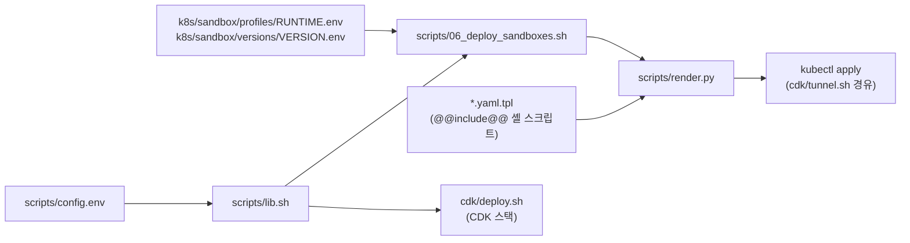
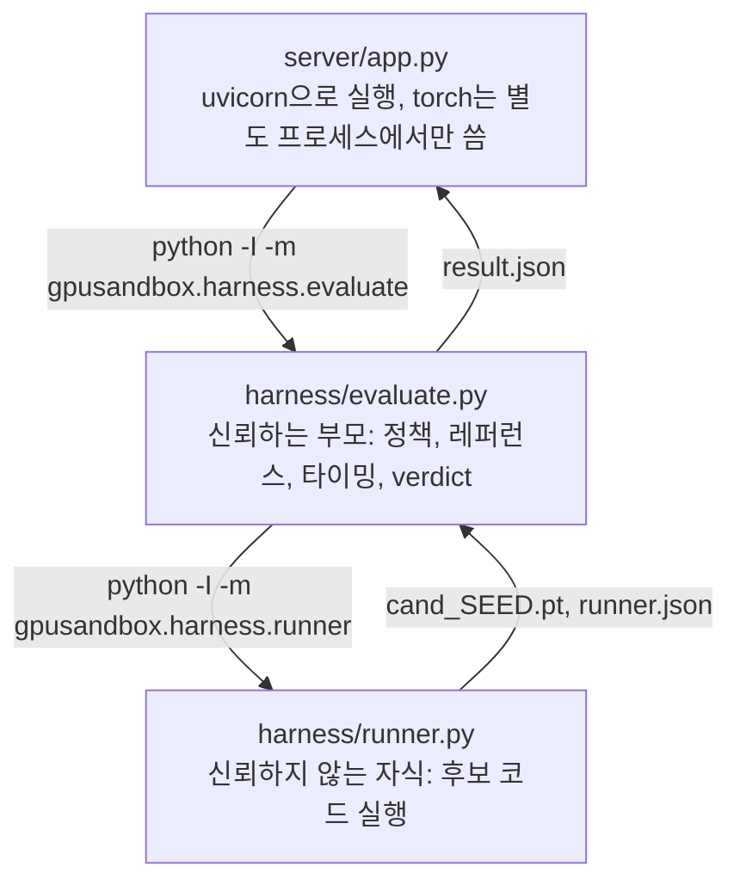

# 저장소 구조

!!! info "TL;DR"
    저장소의 파일마다 하는 일과, 문서 페이지마다 해당하는 코드 파일의 대응표입니다.

## 기존 Pain Point

샌드박스 풀 하나를 배포하면 `scripts/config.env`, 런타임 profile, 버전 파일, Deployment 템플릿의 값이 합쳐지므로, 어떤 값이 어느 파일에서 왔는지 역으로 추적하기 어렵습니다. 템플릿도 그대로 적용할 수 없습니다. `.tpl` 파일은 `scripts/render.py`로 렌더링해야 하고, Karpenter EC2NodeClass 템플릿에는 `@@include@@`로 셸 스크립트가 삽입됩니다. 노드 그룹의 user data는 `infra/eks/userdata.py`가 따로 만듭니다. 이미지 이름도 디렉터리 이름과 다릅니다. `gateway/Dockerfile`이 만드는 이미지는 ECR에서 `control`이고, gateway뿐 아니라 probe, parity, bench, JWKS 동기화도 이 이미지로 실행됩니다.

## Why

- **NVIDIA 커널 드라이버는 어떤 컨테이너 이미지에도 들어 있지 않습니다.** gVisor는 호스트 드라이버를, Kata는 게스트 VM 안의 드라이버를 씁니다.
- **풀 하나의 설정은 `scripts/06_deploy_sandboxes.sh`에서 합쳐집니다.** 이 스크립트가 런타임 profile과 버전 파일을 읽고 Deployment 템플릿을 렌더링합니다.

**사전 지식:** 따로 없습니다. [시작하기](../getting_started.md)로 저장소를 받아 두면 파일을 열어 보며 읽을 수 있습니다.

??? note "용어"
    - **템플릿(`.tpl`), 렌더링**: `${VAR}` 자리표시자가 있는 매니페스트 원본과, 그 자리를 실제 값으로 채워 적용 가능한 YAML을 만드는 일입니다. 이 저장소에서는 `scripts/render.py`가 렌더링합니다.
    - **profile, 버전 파일**: profile(`k8s/sandbox/profiles/*.env`)은 런타임별 값(RuntimeClass, 노드, 가속기)이고, 버전 파일(`k8s/sandbox/versions/*.env`)은 샌드박스 버전별 harness 설정입니다.
    - **harness**: 후보 코드를 실행하고 정답 여부와 속도를 측정해서 verdict를 내는 평가 코드입니다(`src/gpusandbox/harness/`).
    - **control 이미지**: torch 없이 HTTP와 Kubernetes 클라이언트만 포함한 이미지입니다. gateway와 운영 도구가 이 이미지로 실행됩니다.
    - **golden 제출물**: verdict를 미리 아는 후보 코드입니다. 샌드박스가 정상인지 확인하는 기준으로 씁니다.

    더 많은 용어는 [용어 사전](glossary.md)에 있습니다.

## 최상위 구조

```text
gpu-sandbox-on-aws/
├── src/gpusandbox/        # Python package: sandbox server, harness, client, gateway, rewards, tasks
├── rl/                    # trainers: TRL GRPO (hands-on), veRL (production)
├── scripts/               # main path 01..08, kata/, ops/, extensions/, hyperpod/, shared helpers
├── infra/                 # node user data, gVisor and Kata install, GPU stack values, HyperPod, Karpenter
├── k8s/                   # manifests: namespaces, policies, sandbox pools, jobs, production extras
├── sandbox/Dockerfile     # sandbox image
├── trainer/Dockerfile     # trainer image (TRL + vLLM)
├── gateway/Dockerfile     # control image (gateway + operator tools)
├── demo/                  # replay demo: static site, sample recording, S3 + CloudFront template
├── cdk/                   # Python CDK app: VPC, private EKS, node groups (A, B1, B2, C), SSM tunnel
├── diagrams/              # scenario architecture diagrams: .drawio sources, briefs, arrow-by-arrow guides
├── tests/                 # pytest suite (CPU only, no AWS)
├── docs/ + mkdocs.yml     # this guidebook (Korean default, English .en.md)
├── .github/workflows/     # CI: tests and docs build
└── pyproject.toml, LICENSE, README.md
```

!!! note "커밋하지 않아야 하는 로컬 파일"
    `scripts/config.env`(직접 만드는 설정), `bench-<timestamp>.jsonl`(`ops/bench.sh` 결과), `.venv/`, `.pytest_cache/`, `site/`(문서 빌드 결과), `cdk/cdk.out/`(synth 결과), `cdk/cdk.context.json`(계정 ID가 든 CDK context)은 로컬에서만 생기는 파일입니다. `.routing.json`은 `05_setup_namespaces_auth.sh`와 `ops/rollout.sh`가 잠깐 만들었다가 바로 지웁니다. 특히 `scripts/config.env`에는 계정 ID가 포함된 이미지 URI와 IAM ARN(설정했다면 작업 PC의 공인 IP도)이 들어 있으니 공유하지 마세요.

## 값과 템플릿이 합쳐지는 흐름

모든 스크립트는 `scripts/lib.sh`를 source 해서 `scripts/config.env`를 읽습니다. 그다음 `render <템플릿> KEY=VALUE ...`로 템플릿을 채워 `kubectl apply`에 전달합니다. 인프라(VPC, 클러스터, 노드 그룹)는 템플릿이 아니라 CDK 앱이 만들고, `cdk/deploy.sh`가 같은 `config.env` 값을 export해 CDK 앱에 전달합니다. `render.py`는 envsubst와 달리 정의되지 않은 변수를 만나면 오류로 멈추고(`KEY=`처럼 빈 값으로 정의한 변수는 빈 문자열로 치환), `$$`를 `$` 한 글자로 바꿉니다. 그래서 Deployment 템플릿의 `$$(NODE_IP)`는 렌더링 뒤 `$(NODE_IP)`가 되고, 이 값은 Kubernetes가 pod를 만들 때 실제 값으로 치환합니다.



*그림: 풀 하나의 최종 매니페스트는 `config.env`, profile, 버전 파일의 값이 `render.py`에서 템플릿과 합쳐져 만들어집니다.*

## src/gpusandbox



*그림: 후보 코드는 신뢰하지 않는 자식 프로세스에서만 실행되고, verdict는 신뢰하는 부모 프로세스가 씁니다.*

| 파일 | 하는 일 | 호출하는 곳 |
|---|---|---|
| `server/app.py` | 샌드박스 HTTP 서버(FastAPI). `POST /v1/evaluate`, `GET /info`, `GET /metrics`(이상 인증 필요), `GET /healthz`, `GET /readyz`. 평가마다 새 프로세스 트리를 시작하고, 한 번에 하나만 평가합니다(나머지는 503). readiness는 GPU probe 성공, egress 차단 확인, draining 아님이 모두 참일 때만 통과합니다. | sandbox 이미지의 `gpusandbox-server` |
| `server/procs.py` | 평가가 끝날 때마다 서버와 그 조상(PID 1의 tini)을 뺀 모든 프로세스를 SIGKILL 합니다. | `server/app.py` |
| `auth.py` | audience가 지정된 projected ServiceAccount 토큰을 JWKS 파일로 오프라인 검증합니다. 설정이 하나라도 비면 보호된 경로를 모두 거부합니다(fail closed). `read_token`은 요청마다 토큰 파일을 다시 읽습니다. | 서버, 클라이언트, tools |
| `harness/evaluate.py` | 신뢰하는 부모 프로세스. 정적 정책 검사, 후보 자식 실행, 레퍼런스 정확성 비교와 타이밍, verdict JSON 작성. | 서버 |
| `harness/runner.py` | 신뢰하지 않는 자식 프로세스. 후보 코드를 import 하고 출력과 타이밍을 작업 디렉터리에 씁니다. GPU 평가에서 카운터를 설치할 수 있으면, 정확성 검사가 끝날 때까지(타이밍 측정 전) Triton 실행 함수가 호출된 횟수를 기록합니다. | `evaluate.py` |
| `harness/policy.py` | AST 기반 정적 정책(허용 import, 금지 builtin, private와 dunder 접근(`__init__`, `__name__`만 허용), stream, graph, `torch.compile`, `cpp_extension`). 보안 경계가 아니라 reward 무결성을 위한 검사입니다. 소스 최대 32 KiB. | `evaluate.py`, `rewards.py`, `rl/verl/reward_fn.py` |
| `harness/timing.py` | 레퍼런스와 후보를 같은 절차로 측정하는 타이밍 코드. `torch.cuda.synchronize()`를 감싼 호스트 시계, 반복마다 다른 입력, 출력 checksum, 정확히 `torch.Tensor` 타입만 허용. | `evaluate.py`, `runner.py` |
| `harness/__init__.py` | `HARNESS_VERSION`. 측정 계약(seed, 허용 오차, 타이밍 방법)이 바뀌면 올립니다. | 서버 응답, verdict |
| `tasks/` | 커널 과제 10개(KernelBench 형식: `Model`, `get_init_inputs()`, `get_inputs(seed, device, size)`, `ATOL`, `RTOL`). level 0은 `vector_add`, `relu_bias`, `scaled_residual`, level 3은 `matmul_bias_relu`. | harness(레퍼런스), `prompts.py` |
| `prompts.py` | 시스템 프롬프트, Triton 형식 예시, 사용자 프롬프트, 데이터셋 행 생성. | `rl/trl/train_grpo.py`, `rl/verl/prepare_data.py` |
| `rewards.py` | TRL reward 함수 3개(format, correctness, speedup)와 배치 로그(`reward_batch`, `sandbox_version_switch` 이벤트). 인프라 오류(`sandbox_error`)는 `None`. | `train_grpo.py`, `rl/verl/reward_fn.py` |
| `client/routing.py` | routing.json을 읽어 (runtime, version, address, revision) snapshot을 만듭니다. 최소 2초 간격으로 다시 읽고, 읽기에 실패하면 마지막 정상 표를 유지합니다. | 클라이언트, gateway |
| `client/pool.py` | headless Service의 Ready pod IP를 DNS로 찾고, pod마다 한 건씩만 보내며, 503이나 연결 오류면 다른 pod로 재시도합니다. | 클라이언트, gateway, tools |
| `client/__init__.py` | `SandboxClient`. direct 모드(routing 파일)는 `evaluate_batch` 호출 한 번에 routing snapshot 하나를 쓰고, gateway 모드는 gateway에 배치나 `group_key`를 보냅니다. TRL reward batch 하나는 캐시만 쓰면 이 호출이 없고, 다시 채점할 결과가 있으면 최대 세 번 호출해 한 풀의 결과로 맞춥니다(`rewards.py`). | `rewards.py`, `rl/verl/reward_fn.py` |
| `gateway/app.py` | Production gateway. 하나의 스케줄러, `group_key` 단위 버전 고정(기본 TTL 900초), TokenReview 인증, draining pod 재활용. | control 이미지의 `gpusandbox-gateway` |
| `golden.py` | verdict를 미리 아는 golden 제출물 6개(Triton 정답 2개, torch 전용 정답, 오답, 벤치마크 치팅, 호스트 파일 읽기). GPU 전용 항목은 CPU 풀에서 제외됩니다. | `tools.py` |
| `tools.py` | 운영 도구 `probe`, `parity`, `bench`, `simulate`(모델 없는 reward 루프), `record`(데모용 녹화), `sync-jwks`, `multiturn`(모델 없는 multi-turn 에피소드). | `k8s/probe/job-probe.yaml.tpl`, `k8s/production/jwks-sync.yaml.tpl`, `k8s/extensions/agent-sandbox/job-multiturn.yaml.tpl` |
| `agent_sandbox.py` | Agent Sandbox 확장의 `EpisodeSandbox`. 에피소드마다 warm pool에서 `SandboxClaim`으로 샌드박스 하나를 할당받고, `status.sandbox.serviceFQDN`으로 평가 요청을 보낸 뒤 에피소드가 끝나면 반납합니다. claim에는 안전장치로 `shutdownTime`이 설정됩니다. | `multiturn.py`, `rl/verl/sandbox_tool.py`, 에피소드 단위 trainer 코드(직접 import), `tests/test_agent_sandbox.py` |
| `multiturn.py` | multi-turn 에피소드 실행기. 에피소드마다 `EpisodeSandbox`로 샌드박스 하나를 claim하고, 코드 제출과 verdict 피드백(240자 이하)을 `max_turns`까지 반복한 뒤 마지막 제출의 `score_verdict`를 episode reward로 씁니다. 모델 없이 golden 제출물을 차례로 내는 `ScriptedPolicy`가 들어 있습니다. 자세히: [11 multi-turn 에피소드 실습](../handson/11_multi_turn.md), [06 Agent Sandbox로 확장](../concepts/06_agent_sandbox.md) | `tools.py multiturn`, `rl/verl/sandbox_tool.py`(피드백 형식) |

## rl

| 파일 | 하는 일 |
|---|---|
| `rl/trl/train_grpo.py` | TRL `GRPOTrainer`로 on-policy GRPO 학습(LoRA, vLLM colocate). `--dry-run`은 vLLM 없이 CPU에서 2 step만 실행합니다. |
| `rl/verl/Dockerfile` | veRL 이미지(Production). `scripts/03_build_push_images.sh`는 이 이미지를 만들지 않으니 따로 빌드합니다. |
| `rl/verl/prepare_data.py` | 과제를 veRL parquet(train, val)로 씁니다. `ground_truth`에는 `task_id`가 들어가고, `prompt`에는 모델이 Triton으로 다시 작성할 PyTorch 레퍼런스 `Model` 소스가 들어갑니다. 정답 비교는 샌드박스 이미지 안의 레퍼런스로 실행합니다. |
| `rl/verl/reward_fn.py` | veRL용 async `compute_score`. gateway의 `group_key` 고정을 쓰고, 인프라 오류에는 format 점수만 주고 `sandbox_error` 플래그를 기록합니다. |
| `rl/verl/run_grpo_kernels.sh` | RayCluster에 veRL GRPO job을 제출합니다(veRL 0.9.1 키 이름). |
| `rl/verl/sandbox_tool.py` | veRL 0.9.1용 multi-turn 도구. `KernelSandboxTool`은 `submit_kernel` 호출을 trajectory마다 claim한 샌드박스 하나에서 평가하고 verdict를 도구 응답으로 돌려줍니다. `SandboxToolAgentLoop`는 trajectory가 끝나면 claim을 삭제합니다. `compute_score`는 마지막 제출의 점수를 reward로 씁니다. veRL이 `sandbox_tool_config.yaml`의 `class_name`으로 이 모듈을 불러옵니다. 로컬 테스트로만 확인했고 veRL로 실행하지는 않았습니다. 자세히: [06 Agent Sandbox로 확장](../concepts/06_agent_sandbox.md) |
| `rl/verl/sandbox_tool_config.yaml` | 위 도구의 veRL tool config 예시(`class_name`, `warm_pool`, `max_turns`, `max_feedback_chars` 등). `actor_rollout_ref.rollout.multi_turn.tool_config_path`로 veRL에 넘깁니다. 자세히: [06 Agent Sandbox로 확장](../concepts/06_agent_sandbox.md) |

## scripts

### 기본 경로

시나리오 A에서 번호 순서대로 실행하는 스크립트입니다.

| 파일 | 하는 일 | 과금과 주의 |
|---|---|---|
| `01_check_prereqs.sh` | 도구(aws, cdk, node, kubectl, helm, docker, python3, jq, session-manager-plugin), AWS 신원, "Running On-Demand G and VT instances" quota, nested virtualization 지원, GPU 인스턴스의 AZ별 offering 확인. 읽기 전용. | 없음 |
| `02_create_cluster.sh [--hyperpod]`, `[--hyperpod-b2]`, `[--cpu-only]` | `SCENARIO`(기본 A, 옵션에 따라 B1, B2, C)를 정하고 `cdk/deploy.sh`를 호출하는 간단한 wrapper. CDK 스택이 VPC, private API endpoint의 EKS, add-on, 시나리오별 노드 그룹, SSM access instance를 만듭니다. `WITH_KATA_CPU`, `WITH_KATA_GPU`를 바꾸고 다시 실행하면 CDK가 변경된 노드 그룹만 갱신합니다. 실습 계정에서 약 20분. | EKS, NAT gateway, m6i.large 2대, access instance(t4g.nano), g5.xlarge 2대(A, B1), g5.2xlarge(A) |
| `03_build_push_images.sh` | sandbox, trainer, control 이미지를 linux/amd64로 빌드해 private ECR에 push. `HYPERPOD=1`이면 trainer 이미지에 hyperpodrun을 설치합니다. 끝에 `*_IMAGE_URI` 세 줄을 출력합니다. `--no-trainer`(시나리오 C)는 trainer 이미지를 건너뜁니다. | ECR 저장 비용. 태그는 IMMUTABLE |
| `04_install_gpu_stack.sh` | NVIDIA device plugin(CDI 모드)을 `gpusandbox/device-plugin=cdi` 노드에 설치하고, DaemonSet에 `CDI_DISABLE_HOOKS=disable-device-node-modification`을 설정한 뒤 rollout을 기다림(runsc에서 실패하는 CDI hook을 끔, chart에 해당 값이 없음). 이어서 `gvisor` RuntimeClass 등록, smoke pod로 gVisor 커널과 GPU 사용 확인. | 없음 |
| `05_setup_namespaces_auth.sh` | namespace, ServiceAccount, NetworkPolicy, JWKS ConfigMap, routing ConfigMap. 다시 실행할 수 있지만, 실행할 때마다 `rl-trainer`의 routing 표를 `ACTIVE_RUNTIME`, `ACTIVE_VERSION`(기본 `gvisor`, `v1`)으로 새로 쓰고 `k8s/base/networkpolicies.yaml`을 다시 적용합니다. Production gateway가 교체한 `allow-clients-to-sandbox-api`도 핸즈온 규칙으로 돌아갑니다. 운영 중이면 현재 활성 버전과 접근 정책을 먼저 확인하세요. | 없음 |
| `06_deploy_sandboxes.sh <runtime> [version] [replicas]` | profile과 버전 파일로 풀 하나(Deployment + headless Service)를 배포하고 rollout을 기다립니다. | GPU 노드 사용 |
| `07_run_grpo.sh [max_steps]` | 시나리오 A trainer Job을 제출하고 로그를 계속 출력합니다. | trainer GPU |
| `08_cleanup.sh [--images]` | 클러스터 이름을 확인한 뒤 `cdk/destroy.sh --yes`(터널이 열려 있으면 풀과 Job 먼저, 스택 전체, 남은 Lambda 로그 그룹), IOMMU AMI와 B2 AMI(각각 확인 후), `--images`면 ECR 저장소까지 삭제. secrets KMS 키는 7일 삭제 대기에 들어가고 bootstrap 스택 `CDKToolkit`은 남습니다. | 과금 중지 |

### 선택 기능과 운영

시나리오나 목적에 따라 실행하는 스크립트입니다. `kata/`에는 Kata 노드 추가, `ops/`에는 검증과 운영, `extensions/`에는 Agent Sandbox 확장, `hyperpod/`에는 시나리오 B와 B2용 스크립트가 있습니다.

| 파일 | 하는 일 | 과금과 주의 |
|---|---|---|
| `kata/cpu_nodes.sh` | `sandbox-kata-cpu` 노드 그룹이 있는지 확인(없으면 `WITH_KATA_CPU=1`로 `02_create_cluster.sh`를 다시 실행하라는 메시지로 멈춤)한 뒤 kata-deploy 설치, `gvisor-cpu` RuntimeClass, `gvisor-cpu`, `kata-clh`, `kata-qemu` smoke. 한 번만 실행하면 됩니다. | c8i.2xlarge 1대(노드 그룹은 `02_create_cluster.sh`가 만듦) |
| `kata/gpu_nodes.sh` | `KATA_IOMMU_AMI_ID`가 비어 있으면 IOMMU AMI를 빌드하고 멈춥니다(`KATA_IOMMU_AMI_ID`와 `WITH_KATA_GPU=1`을 넣고 `02_create_cluster.sh`를 다시 실행한 뒤 이 스크립트를 다시 실행). 그다음 `sandbox-kata-gpu` 노드 그룹을 확인하고 GPU Operator(VM passthrough)와 kata-deploy를 설치합니다. `metal` 입력은 `02_create_cluster.sh`(`cdk/deploy.sh`)가 받습니다. | g4dn.metal 약 7.8 USD/시간(노드 그룹은 `02_create_cluster.sh`가 만듦) |
| `ops/verify.sh <runtime> [version]` | 커널 비교, egress 차단 점검, golden verdict(probe Job), 다른 namespace에서 접근 차단 확인. | 없음 |
| `ops/simulate.sh [steps] [interval_s]` | 시나리오 C의 모델 없는 reward 루프. `tools.py simulate`를 Job으로 실행해 golden 제출물을 배치마다 채점하고 `reward_batch`, `sandbox_version_switch` 이벤트를 출력합니다. 실제 학습은 하지 않습니다. | 없음 |
| `ops/rollout.sh <runtime> <from> <to> [--finish]` | blue/green 교체: 배포, 검증, parity, routing 전환. `--finish`를 붙이면 앞의 단계 없이 이전 버전만 replica 0으로 줄이고 끝나므로, 전환을 확인한 뒤 같은 명령에 붙여 다시 실행합니다. | 두 풀이 잠시 함께 GPU 사용 |
| `ops/bench.sh [requests]` | 배포된 v1 풀마다 cold start, 평가 지연 p50/p95, throughput, speedup을 측정합니다. cold start는 터미널에만 출력되고, 나머지는 `bench` Job의 출력으로 `bench-<timestamp>.jsonl`에도 저장됩니다. | 없음 |
| `ops/sync_jwks.sh` | 클러스터 ServiceAccount issuer 공개키(JWKS)와 issuer URL을 `sandbox/sandbox-auth-jwks` ConfigMap으로 복사. 공개키이며 비밀이 아닙니다. | |
| `extensions/agent_sandbox.sh install`, `pool <runtime> [n]`, `claim <runtime>`, `episodes <runtime> [episodes] [max_turns]` | Agent Sandbox 확장. `install`은 controller, CRD(v1.0.11 고정), claim RBAC, `k8s/base/trainer-rbac.yaml`(ServiceAccount `sandbox-episode`) 설치. `pool`은 런타임 profile로 SandboxTemplate과 SandboxWarmPool 생성(기본 allowlist에 `sandbox-episode` 포함). `claim`은 claim 하나를 만들어 주소를 출력한 뒤 삭제. `episodes`는 모델 없이 multi-turn 에피소드를 실행하는 Job(`job-multiturn.yaml.tpl`)을 제출합니다(기본 에피소드 2개, 최대 3 turn, `max_turns` 1은 single-turn 기준선). 제출 전에 CRD, ServiceAccount와 claim 권한, Ready 상태의 warm 샌드박스, warm 샌드박스의 allowlist를 확인하고, 끝나면 남은 claim을 지운 뒤 Job의 결과를 종료 코드로 반환합니다. 자세히: [11 multi-turn 에피소드 실습](../handson/11_multi_turn.md) | warm GPU 샌드박스는 요청이 없는 동안에도 GPU를 점유함 |
| `hyperpod/create.sh [--b2]` | HyperPod dependency Helm chart, lifecycle 버킷(Block Public Access), 실행 역할, CreateCluster, training operator add-on. `--b2`는 custom AMI로 부팅하는 `sandbox` 인스턴스 그룹과 `gvisor-hyperpod` RuntimeClass를 추가합니다. CDK가 `kubernetes.io/role/internal-elb` 태그를 붙인 private subnet을 쓰고, helm 단계에는 터널이 필요합니다. | ml.g5.2xlarge, B2는 ml.g5.xlarge 2대 추가 |
| `hyperpod/build_b2_ami.sh` | 시나리오 B2의 custom AMI 빌드(`infra/hyperpod/ami/build-b2-ami.sh`). HyperPod EKS base AMI에서 드라이버를 `B2_NVIDIA_DRIVER_VERSION`으로 바꾸고 gVisor를 설치한 뒤 `HYPERPOD_B2_AMI_ID`를 출력합니다. | builder m6i.large(빌드 중), AMI 스냅샷 |
| `hyperpod/run_grpo.sh [max_steps]` | HyperPodPyTorchJob 제출. | 없음 |
| `hyperpod/check_gvisor.sh` | 시나리오 B2 노드 점검. HyperPod 노드 드라이버가 고정한 gVisor 릴리스의 nvproxy 지원 목록에 있는지 출력합니다. 노드마다 디버그 pod를 만들고, 끝나면 `default` namespace에서 이름이 `node-debugger-`로 시작하는 pod를 모두 삭제합니다. | 없음 |
| `hyperpod/delete.sh` | HyperPod 클러스터, 실행 역할, lifecycle 버킷 삭제. `08_cleanup.sh`보다 먼저 실행합니다. | 과금 중지 |

### 공통 라이브러리와 설정

스크립트가 source 하거나 호출하는 공통 파일입니다.

| 파일 | 하는 일 | 과금과 주의 |
|---|---|---|
| `lib.sh` | `config.env` 로드, `require_vars`, `require_tools`, `render`, `confirm`, `oidc_issuer`, `wait_for_pods`. `log`, `warn`, `die`는 터미널일 때만 색을 쓰고 `NO_COLOR`가 있으면 색을 끕니다. | |
| `lib_jobs.sh` | `run_tool_job`: control 이미지로 `gpusandbox.tools`를 `rl-trainer`의 one-shot Job으로 실행하고 로그를 보여 줍니다. `run_job_template`은 같은 방식으로 다른 Job 템플릿(`job-multiturn.yaml.tpl`)을 실행합니다. 로그는 `logview.py`를 거쳐 보여 줍니다. | |
| `logview.py` | JSON 이벤트 줄(`reward_batch`, `sandbox_version_switch`, `parity`, 에피소드 이벤트 등)을 터미널에서 색을 입힌 한 줄 요약으로 보여 줍니다. 출력이 파이프나 파일이거나 `GPUSANDBOX_LOG=json`이면 원본을 그대로 넘깁니다. 표준 라이브러리만 써서 가상 환경 밖의 `python3`로도 실행됩니다. | |
| `render.py` | `${VAR}` 템플릿 렌더링(정의되지 않은 변수는 오류, 빈 값은 빈 문자열, `$$`는 `$`)과 `@@include path@@` 삽입. | |
| `config.env.example` | `scripts/config.env`의 원본. 값 설명은 [설정 값](configuration.md)에 있습니다. | |

## infra

| 경로 | 하는 일 |
|---|---|
| `eks/node-guard.sh` | 샌드박스 노드에서 pod가 노드로 여는 새 연결을 iptables(`GPUSANDBOX-GUARD` chain)로 차단합니다. 부팅할 때마다 kubelet보다 먼저 실행되는 systemd unit입니다. |
| `eks/userdata.py` | 샌드박스 노드 그룹의 MIME user data를 만드는 모듈(Python 표준 라이브러리만 사용). gVisor GPU 노드(NodeConfig의 `runsc` handler, nvproxy를 켠 gVisor 설치, node guard), c8i 노드(kata-deploy용 containerd drop-in `imports`, nvproxy 없는 gVisor, node guard), Kata GPU 노드(IOMMU AMI라서 클러스터 필드를 모두 담은 NodeConfig, kubelet `runtimeRequestTimeout: 20m`, node guard). CDK 스택이 launch template에 넣고, `tests/test_manifests.py`가 확인합니다. |
| `gpu/nvidia-device-plugin-values.yaml` | NVIDIA device plugin 값. `deviceListStrategy: cdi-cri`, `gpusandbox/device-plugin=cdi` 노드만. plugin의 `--cdi-disable-hooks`는 chart v0.20.1에 값이 없어 `04_install_gpu_stack.sh`가 env로 설정. |
| `gvisor/install-gvisor.sh` | 고정 gVisor 릴리스 tarball 설치(sha512 검사), `/etc/containerd/runsc.toml`(nvproxy), 드라이버 미지원 경고. |
| `kata/kata-deploy-values.yaml` | kata-deploy 4.3.1 값(DaemonSet 모드). `kata-qemu-nvidia-gpu`, `kata-qemu`, `kata-clh` RuntimeClass. |
| `kata/gpu-operator-values.yaml` | GPU Operator v26.7.2 VM passthrough 값(`sandboxWorkloads.mode=kata`, `ccManager.defaultMode=off`, 컨테이너용 operand 끔). |
| `kata/build-iommu-ami.sh` | m6i.large 빌더로 표준 EKS AL2023 AMI를 바탕으로 `intel_iommu=on iommu=pt`가 들어간 AMI를 빌드합니다. |
| `kata/experimental-clh-gpu/` | 실험용 `kata-clh-nvidia-gpu` 값(업스트림 미지원)과 CUDA 초기화 점검 스크립트. |
| `hyperpod/cluster.json.tpl` | CreateCluster 입력(trainer instance group 1대, `NodeRecovery: Automatic`). |
| `hyperpod/instance-group-sandbox.json.tpl` | B2의 `sandbox` 인스턴스 그룹(`ImageId`, label과 taint를 정하는 `KubernetesConfig`). `--b2`일 때 `cluster.json`에 추가됩니다. |
| `hyperpod/ami/build-b2-ami.sh`, `customize-b2.sh` | B2 custom AMI builder와 builder 인스턴스의 user data(드라이버 교체, gVisor 설치, 결과 한 줄을 serial console에 출력). |
| `hyperpod/execution-role-trust.json`, `execution-role-eks-policy.json` | HyperPod 실행 역할 trust와 ENI, ECR inline 정책. |
| `hyperpod/lifecycle/on_create.sh`, `on_create_sandbox.sh`, `register_runsc.sh` | lifecycle 스크립트. trainer 그룹은 아무것도 설치하지 않고, B2의 sandbox 그룹은 드라이버 지원 여부를 확인한 뒤 containerd 설정 schema에 맞춰 `runsc`를 등록하고 node guard를 설치합니다(조건이 맞지 않으면 실패). |
| `karpenter/nodeclasses.yaml.tpl`, `karpenter/nodepools.yaml` | Production용 EC2NodeClass 4개와 NodePool 4개(sandbox-gvisor, sandbox-kata-gpu, sandbox-kata-cpu, trainer). |

## cdk

인프라(VPC, 클러스터, 노드 그룹)를 만드는 Python CDK 앱입니다. 핸즈온의 `scripts/02_create_cluster.sh`와 `scripts/08_cleanup.sh`가 이 폴더의 스크립트를 호출합니다. 자세한 설명은 [09 CDK로 프로비저닝](../production/09_cdk.md)에 있습니다.

| 경로 | 하는 일 |
|---|---|
| `deploy.sh [A, B1, B2, C] [--with-kata-cpu]` | `scripts/config.env`를 export하고 `cdk deploy <CLUSTER_NAME>-cdk --require-approval broadening`을 실행합니다. `ADMIN_PRINCIPAL_ARN`이 비어 있으면 현재 역할 ARN을 만들고, `WITH_KATA_GPU=1`이면 `metal`을 입력해야 진행합니다. |
| `tunnel.sh [local_port]` | 스택 출력에서 endpoint와 access instance를 읽어 SSM 포트 포워딩(`127.0.0.1:8443`)을 열고, kubectl 컨텍스트 `<CLUSTER_NAME>-tunnel`을 만듭니다. Session Manager plugin이 필요합니다. |
| `destroy.sh [--yes]` | 터널이 열려 있으면 풀과 Job을 먼저 지우고 `cdk destroy`, 남은 `/aws/lambda/<CLUSTER_NAME>-cdk-...` 로그 그룹 삭제, 태그가 붙은 남은 인스턴스를 출력합니다. |
| `app.py`, `cdk.json` | CDK 진입점. synth할 때마다 cdk-nag(AwsSolutions)를 실행하고, 이유를 적어 예외 처리하지 않은 지적이 하나라도 있으면 배포하지 않습니다. |
| `gpusandbox_cdk/config.py` | 환경 변수를 읽어 검사합니다(`SCENARIO`, `ADMIN_PRINCIPAL_ARN` 형식, `EKS_PUBLIC_ACCESS_CIDR`는 /32만, `KATA_IOMMU_AMI_ID` 형식, c8i의 CPU 토폴로지 표). |
| `gpusandbox_cdk/stack.py` | 스택 본체. EKS 클러스터, access entry, add-on, launch template, 노드 그룹은 L1(`Cfn*`)으로, VPC, 보안 그룹, IAM 역할, access instance, KMS 키, 로그 그룹은 L2 construct로 정의합니다. VPC(2 AZ, NAT 1개, private subnet에 `kubernetes.io/role/internal-elb`와 `karpenter.sh/discovery` 태그), EKS 1.36(private endpoint, `API_AND_CONFIG_MAP`, KMS secrets 암호화, 로그 5종, service CIDR `172.20.0.0/16`), add-on 4개, 시나리오별 노드 그룹(launch template마다 IMDSv2 hop limit 1, 암호화된 gp3), SSM access instance. |
| `requirements.txt` | 고정한 CDK 라이브러리(`aws-cdk-lib`, `constructs`, `cdk-nag`). |
| `tests/test_stack.py` | 오프라인 synth로 보안 기본값과 시나리오별 노드 그룹, cdk-nag 통과를 확인하는 18개 테스트. `cd cdk && python -m pytest -q tests`로 따로 실행합니다. |

## k8s

| 경로 | 하는 일 |
|---|---|
| `base/namespaces.yaml` | `sandbox`(Pod Security `restricted`), `rl-trainer`(`baseline`). |
| `base/networkpolicies.yaml` | `sandbox` namespace default deny(ingress, egress) + `rl-trainer`의 `gpusandbox/client: "true"` pod만 TCP 8000 허용. |
| `base/trainer-rbac.yaml` | ServiceAccount `grpo-trainer`, `sandbox-probe`, `sandbox-episode`(`rl-trainer`), `gpu-sandbox`(`sandbox`). 모두 API 토큰 자동 마운트를 끕니다. `sandbox-episode`는 multi-turn 에피소드 Job이 쓰는 계정입니다. 이 파일은 `05_setup_namespaces_auth.sh`와 `extensions/agent_sandbox.sh install`이 적용합니다. 자세히: [11 multi-turn 에피소드 실습](../handson/11_multi_turn.md) |
| `base/routing.json.tpl` | routing 표 템플릿(풀 주소 목록 + `ACTIVE_RUNTIME`, `ACTIVE_VERSION`). |
| `runtimes/runtimeclass-gvisor.yaml` | `gvisor` RuntimeClass(handler `runsc`, gVisor 노드로만 스케줄). |
| `runtimes/runtimeclass-gvisor-hyperpod.yaml` | `gvisor-hyperpod` RuntimeClass(handler `runsc`, B2 sandbox 인스턴스 그룹으로만 스케줄). |
| `runtimes/runtimeclass-gvisor-cpu.yaml` | `gvisor-cpu` RuntimeClass(같은 handler `runsc`, nvproxy 없이 c8i 노드로만 스케줄). |
| `sandbox/deployment.yaml.tpl` | 풀 하나 = Deployment + headless Service. 보안 컨텍스트, probe, egress 점검 대상, 인증 env가 여기 있습니다. |
| `sandbox/profiles/*.env` | 런타임별 값 7개(`gvisor`, `gvisor-hyperpod`, `kata-qemu`, `kata-clh`, `gvisor-cpu`, `kata-clh-cpu`, `kata-qemu-cpu`). |
| `sandbox/versions/*.env` | 샌드박스 버전 `v1`, `v2`의 harness 설정. |
| `probe/job-probe.yaml.tpl` | probe, parity, bench, simulate one-shot Job(`rl-trainer`, `gpusandbox/client: "true"`). routing ConfigMap을 디렉터리로 마운트합니다(없어도 시작). |
| `trainer/job-grpo.yaml.tpl` | 시나리오 A trainer Job. routing ConfigMap을 디렉터리로 마운트합니다. vLLM 이미지의 non-root 사용자(`vllm`, uid 2000)로 실행해 Pod Security `restricted`를 충족합니다. |
| `trainer/hyperpod-job-grpo.yaml.tpl` | 시나리오 B HyperPodPyTorchJob(재시도, 로그 기반 정지 감지). |
| `production/gateway.yaml.tpl` | gateway namespace, RBAC(TokenReview, pod 삭제), Deployment(1 replica), Service, NetworkPolicy. 샌드박스 풀의 ingress를 gateway만 허용하도록 바꿉니다. |
| `production/jwks-sync.yaml.tpl` | JWKS 동기화 CronJob(매시 17분). |
| `production/pool-hardening.yaml` | PriorityClass 2개, PodDisruptionBudget, ResourceQuota(`nvidia.com/gpu` 16, `nvidia.com/pgpu` 8, pod 64). |
| `production/warm-capacity.yaml` | `sandbox-kata-gpu` NodePool의 예비 노드를 점유해 두는 낮은 우선순위 placeholder. |
| `production/raycluster-verl.yaml.tpl` | veRL용 RayCluster(KubeRay `ray.io/v1`). |
| `extensions/agent-sandbox/template.yaml.tpl` | Agent Sandbox용 SandboxTemplate과 SandboxWarmPool(`kernel-eval-<runtime>`). ingress는 `rl-trainer`에서 8000번만, egress는 없음(`[]`), `dnsPolicy: None`, 환경 변수 주입 차단. |
| `extensions/agent-sandbox/trainer-claims-rbac.yaml` | `rl-trainer/grpo-trainer`와 `rl-trainer/sandbox-episode`가 `sandbox` namespace의 `sandboxclaims`를 만들고 지울 수 있게 하는 Role과 RoleBinding. |
| `extensions/agent-sandbox/job-multiturn.yaml.tpl` | multi-turn 에피소드 one-shot Job(`rl-trainer`, ServiceAccount `sandbox-episode`). control 이미지로 `python -m gpusandbox.tools multiturn`을 실행합니다. SandboxClaim을 만들고 삭제해야 하므로 probe Job과 달리 Kubernetes API 토큰을 마운트합니다. 샌드박스 audience 토큰과 `gpusandbox/client: "true"` 라벨도 붙어 있습니다. `scripts/extensions/agent_sandbox.sh episodes`가 렌더링해 실행합니다. 자세히: [11 multi-turn 에피소드 실습](../handson/11_multi_turn.md) |

## demo

| 경로 | 하는 일 |
|---|---|
| `site/` | 정적 리플레이 사이트(`index.html`, `app.js`, `style.css`)와 녹화 파일 `data/recording.json`. 외부 스크립트를 불러오지 않고, 녹화 내용을 HTML이 아닌 텍스트로만 표시합니다. |
| `record_local.py` | AWS 없이 노트북 CPU에서 loopback 샌드박스 서버 두 개(v1, v2)를 띄워 실제로 채점하고 예시 녹화를 만듭니다. 서버가 평가마다 같은 사용자의 다른 프로세스를 종료하므로, Linux에서는 별도 PID namespace를 쓰는 컨테이너 안에서 실행합니다. GPU 클러스터의 녹화는 `python -m gpusandbox.tools record`로 만들어 교체합니다. |
| `infra/site.yaml` | CloudFormation 템플릿. 비공개 S3 bucket, Origin Access Control을 쓰는 CloudFront 배포, 보안 응답 헤더를 만듭니다. |
| `deploy.sh`, `teardown.sh` | 스택 배포와 사이트 업로드, bucket 비우기와 스택 삭제. |

## 이미지

| ECR 저장소 | Dockerfile | 베이스(Dockerfile 고정값) | 들어 있는 것 | 실행 위치 |
|---|---|---|---|---|
| `<ECR_REPO_PREFIX>/sandbox` | `sandbox/Dockerfile` | `pytorch/pytorch:2.14.1-cuda12.6-cudnn9-runtime` | PyTorch와 Triton(베이스), `gcc`와 `libc6-dev`(Triton 런처 컴파일), `tini`(PID 1), `gpusandbox[server]`(FastAPI, uvicorn, prometheus-client, PyJWT). UID 10001, 포트 8000. | 모든 샌드박스 pod(gVisor, Kata 공통) |
| `<ECR_REPO_PREFIX>/trainer` | `trainer/Dockerfile` | `vllm/vllm-openai:v0.33.0` | vLLM, torch, transformers(베이스, constraints 파일로 고정), TRL 1.18.0, PEFT 0.21.3, datasets, `gpusandbox[client]`(httpx), `rl/`. `HYPERPOD=1`이면 `hyperpod-elastic-agent`. | trainer Job, HyperPodPyTorchJob |
| `<ECR_REPO_PREFIX>/control` | `gateway/Dockerfile` | `public.ecr.aws/docker/library/python:3.14-slim` | `gpusandbox[gateway]`(FastAPI, uvicorn, httpx, prometheus-client, PyJWT, kubernetes). torch와 GPU 없음. UID 10001, 포트 8080. | gateway Deployment, probe/parity/bench Job, multi-turn 에피소드 Job, jwks-sync CronJob |
| 직접 빌드 | `rl/verl/Dockerfile` | `vllm/vllm-openai:v0.24.0` | veRL 0.9.1(`verl[vllm]`), `ray[default]`, pandas, pyarrow, `gpusandbox[client]`, `rl/`. | Production RayCluster |

!!! warning "어떤 이미지에도 없는 것"
    NVIDIA 커널 드라이버는 어떤 이미지에도 넣지 않습니다. gVisor에서는 컨테이너가 nvproxy를 거쳐 호스트 드라이버를 쓰고, Kata에서는 kata-deploy가 설치한 게스트 VM 안의 드라이버를 씁니다. 이미지에는 PyTorch wheel에 포함된 CUDA user-space 라이브러리만 있습니다. 베이스 이미지 태그와 패키지 버전은 Dockerfile에 고정된 값이니 빌드 전에 확인하세요.

> ❓ **오해: `gateway/Dockerfile`은 gateway 전용 이미지다.**
> 이 Dockerfile이 만드는 이미지는 ECR에서 `control`이고, torch 없이 HTTP와 Kubernetes 클라이언트만 포함한 "제어용" 이미지입니다. gateway(`gpusandbox-gateway`)뿐 아니라 `ops/verify.sh`, `ops/rollout.sh`, `ops/bench.sh`가 실행하는 probe, parity, bench Job과 Production의 jwks-sync CronJob이 모두 이 이미지로 실행됩니다. 그래서 핸즈온 트랙에서도 `CONTROL_IMAGE_URI`가 필요합니다.

> ❓ **오해: `.tpl` 파일은 `kubectl apply -f`로 바로 적용할 수 있다.**
> `.tpl` 파일에는 `${VAR}` 자리표시자와 `@@include@@` 줄이 있어서 그대로는 올바른 YAML이 아닙니다. 스크립트를 쓰지 않고 직접 적용할 때는 `python3 scripts/render.py <템플릿> KEY=VALUE ... | kubectl apply -f -` 형태로 렌더링한 결과를 전달하세요. `render.py`는 정의되지 않은 변수가 있으면 오류를 내고 멈춥니다. 하지만 `KEY=`처럼 빈 값은 빈 문자열로 치환하므로, 직접 렌더링할 때는 이미지 URI 같은 값이 비어 있지 않은지 확인하세요. 배포 스크립트는 `require_vars`로 빈 값을 막습니다.

## tests

| 파일 | 확인하는 것 |
|---|---|
| `tests/test_policy.py` | AST 정책: Triton 예시 허용, autotune 허용, `input` 인자 이름 허용, 금지 import와 builtin, alias를 거친 타이머 monkeypatch, dunder와 private 접근, `cpp_extension` opt-in, stream, graph, Tensor subclass 거부. |
| `tests/test_harness_cpu.py` | CPU에서 2-프로세스 harness: 정답, 오답, 크래시와 문법 오류, 벤치마크 치팅(타이밍 checksum으로 검출), monkeypatch, timeout, `vector_add`, `rms_norm`, `layer_norm`, `matmul_bias_relu`의 레퍼런스를 후보로 냈을 때 정답. |
| `tests/test_server_and_client.py` | 인증 fail closed, audience와 subject 검사, 두 loopback 서버를 쓰는 클라이언트, 평가 중 503, egress 차단을 확인해야 Ready, probe와 parity, routing 전환 중 gateway의 group 고정. |
| `tests/test_routing_and_rewards.py` | routing 다시 읽기와 revision, 없는 풀 오류, 코드 추출, speedup 점수, verdict별 reward와 `sandbox_error` 제외, 버전 전환 뒤 다른 풀로 캐시된 결과의 재채점, 정책 위반은 샌드박스로 보내지 않음. |
| `tests/test_manifests.py` | 모든 profile과 버전 조합의 렌더링 결과(RuntimeClass, 토큰 마운트 끔, non-root, 읽기 전용 루트, capability 제거, egress 점검 대상, headless Service), 정적 매니페스트에 LoadBalancer와 NodePort 없음, 노드 user data(`infra/eks/userdata.py`의 세 노드 종류, node guard 포함), Karpenter EC2NodeClass와 NodePool, Agent Sandbox 템플릿 렌더링, multi-turn Job(`sandbox-episode` 계정과 API 토큰, 보안 설정 유지)과 claim RoleBinding의 subject. `k8s/production/*.tpl` 템플릿은 렌더링하지 않습니다. |
| `tests/test_agent_sandbox.py` | fake API로 `EpisodeSandbox` 확인: claim에 warm pool 참조와 `shutdownTime`이 있음, Ready 전에는 주소가 없고 주소는 `serviceFQDN`을 우선함, 끝나면 claim 반납, Ready가 되지 않아도 claim 반납. |
| `tests/test_multiturn.py` | fake claim API와 golden verdict로 multi-turn 에피소드 확인: 한 에피소드의 모든 turn을 claim한 샌드박스 하나에서 평가함, 중단 조건(solved, max_turns, sandbox_error), policy가 실패해도 claim 반납, CLI 인자와 `episodes` 하위 명령의 일치, veRL 없이 확인한 veRL 도구의 trajectory별 샌드박스와 반납, tool config와 도구의 일치, loopback 샌드박스 서버에서 실행한 에피소드. 자세히: [11 multi-turn 에피소드 실습](../handson/11_multi_turn.md) |
| `tests/test_logview.py` | `scripts/logview.py`: 파이프로 내보낼 때 원본을 그대로 넘김, 이벤트별 요약 줄, 버전이 섞인 batch의 `MIXED VERSIONS` 표시, trainer 지표(숫자 문자열 포함)와 pod 정보 요약, 일반 텍스트는 내용을 바꾸지 않음, 색 끄기. |
| `tests/test_demo.py` | 데모 사이트: bucket이 비공개이고 해당 CloudFront 배포만 읽음, 녹화 스키마와 reward 일관성, 외부 리소스를 불러오지 않고 HTML을 주입하지 않음, HTTPS와 보안 헤더. |
| `tests/conftest.py` | loopback 서버 스레드, CPU 설정, 후보 코드 fixture, 테스트 중 서버의 reaper(`reap_strays`)를 끄는 autouse fixture. |

CDK 스택 테스트는 `cdk/tests`에 따로 있습니다(위 cdk 절). 로컬 실행 방법과 결과는 [시작하기](../getting_started.md)에 있습니다.

## CI와 문서

| 경로 | 하는 일 |
|---|---|
| `.github/workflows/tests.yml` | CPU torch로 `pytest`, `scripts/`, `infra/`, `cdk/`의 셸 스크립트에 shellcheck. 별도 job에서 CDK 라이브러리를 설치하고 `cdk/tests`(오프라인 synth, cdk-nag)를 실행합니다. |
| `.github/workflows/docs.yml` | `mkdocs build --strict`로 한국어와 영어 사이트를 빌드하고 GitHub Pages에 배포합니다. |
| `mkdocs.yml`, `docs/` | 이 가이드북. 한국어가 기본(`page.md`), 영어는 `page.en.md`. |

!!! note "참고용 업스트림 소스"
    저장소 루트의 `go_create.go`, `go_sandbox.go`는 Kata Containers Go 런타임의 업스트림 소스 사본입니다(파일 머리에 Apache-2.0 표기). 빌드, 테스트, 스크립트, 이미지 어디에서도 참조하지 않습니다.

## 이름 규칙

| 이름 | 종류 | 뜻과 쓰는 곳 |
|---|---|---|
| `sandbox` | namespace | 샌드박스 pod. Pod Security `restricted`, default deny NetworkPolicy. |
| `rl-trainer` | namespace | trainer, probe Job, `sandbox-routing` ConfigMap. |
| `sandbox-gateway` | namespace | Production gateway, jwks-sync. |
| `gpusandbox/role` | 노드 라벨, taint | `system`, `trainer`, `sandbox-gvisor`, `sandbox-kata`. 전용 노드를 taint로 분리합니다. |
| `gpusandbox/kata-gpu` | 노드 라벨 | `true`(g4dn.metal), `false`(c8i). |
| `gpusandbox/device-plugin=cdi` | 노드 라벨 | 이 저장소의 device plugin(CDI 모드)이 실행되는 노드(trainer, gVisor). |
| `nvidia.com/gpu.deploy.operands=false` | 노드 라벨 | GPU Operator가 컨테이너용 operand를 배치하지 않는 노드. |
| `nvidia.com/gpu.workload.config=vm-passthrough` | 노드 라벨 | GPU Operator가 GPU를 vfio-pci에 바인딩하는 노드. |
| `gpusandbox/client: "true"` | pod 라벨 | 샌드박스 API 호출이 허용되는 pod(핸즈온 NetworkPolicy). |
| `gpusandbox/runtime`, `gpusandbox/version` | pod 라벨 | 풀 식별. |
| `sandbox-<runtime>-<version>` | Deployment, Service 이름 | 예: `sandbox-gvisor-v1.sandbox.svc.cluster.local:8000`. |
| `sandbox-routing` | ConfigMap | `rl-trainer`와 `sandbox-gateway`의 `routing.json`. |
| `sandbox-auth-jwks` | ConfigMap | `sandbox`의 `jwks.json`과 `issuer`. |
| `kernel-eval-<runtime>` | SandboxTemplate, SandboxWarmPool 이름 | Agent Sandbox 확장의 런타임별 템플릿과 warm pool. |
| `project=gpu-sandbox-on-aws` | AWS 태그 | CDK 스택의 리소스, 노드 그룹 launch template으로 시작한 인스턴스, IOMMU AMI 빌더 인스턴스와 AMI에 붙습니다. `08_cleanup.sh`와 `cdk/destroy.sh`는 이 태그로 남은 인스턴스를 찾습니다. |
| `<CLUSTER_NAME>-cdk`, `<CLUSTER_NAME>-tunnel` | CloudFormation 스택, kubectl 컨텍스트 | CDK 스택 이름과 `cdk/tunnel.sh`가 만드는 컨텍스트. |
| `kubernetes.io/role/internal-elb`, `karpenter.sh/discovery` | subnet 태그 | CDK가 private subnet에 붙입니다. HyperPod 스크립트와 Karpenter EC2NodeClass가 subnet을 고를 때 씁니다. |

## 문서 페이지와 코드 대응표

| 문서 페이지 | 주로 설명하는 파일 |
|---|---|
| [시작하기](../getting_started.md) | `pyproject.toml`, `tests/`, `scripts/config.env.example`, `scripts/01_check_prereqs.sh`, `rl/trl/train_grpo.py --dry-run` |
| [01 GPU 샌드박스가 필요한 경우](../concepts/01_why_gpu_sandbox.md) | `src/gpusandbox/tasks/`, `src/gpusandbox/harness/` |
| [02 격리 런타임 비교](../concepts/02_isolation_runtimes.md) | `k8s/runtimes/runtimeclass-gvisor.yaml`, `infra/gvisor/install-gvisor.sh`, `infra/kata/kata-deploy-values.yaml` |
| [03 On-policy RL과 샌드박스](../concepts/03_onpolicy_rl_with_sandboxes.md) | `src/gpusandbox/rewards.py`, `src/gpusandbox/client/`, `rl/trl/train_grpo.py` |
| [04 플랫폼과 인스턴스 선택](../concepts/04_platforms_and_instances.md) | `cdk/gpusandbox_cdk/stack.py`(노드 그룹), `infra/hyperpod/`, `scripts/config.env.example` |
| [05 상황별 선택 가이드](../concepts/05_decision_guide.md) | `k8s/sandbox/profiles/` |
| [06 Agent Sandbox로 확장](../concepts/06_agent_sandbox.md) | `src/gpusandbox/agent_sandbox.py`, `src/gpusandbox/multiturn.py`, `k8s/extensions/agent-sandbox/`, `scripts/extensions/agent_sandbox.sh`, `rl/verl/sandbox_tool.py` |
| [00 전체 흐름](../handson/00_overview.md) | `scripts/` 전체 순서 |
| [01 클러스터와 이미지](../handson/01_cluster_and_images.md) | `scripts/01_check_prereqs.sh`, `02_create_cluster.sh`, `03_build_push_images.sh`, `cdk/`, `sandbox/Dockerfile`, `trainer/Dockerfile`, `gateway/Dockerfile` |
| [02 gVisor GPU 샌드박스](../handson/02_gvisor.md) | `scripts/04_install_gpu_stack.sh`, `infra/eks/userdata.py`, `infra/gvisor/install-gvisor.sh`, `infra/gpu/nvidia-device-plugin-values.yaml`, `infra/eks/node-guard.sh` |
| [03 Kata 샌드박스 (CLH, QEMU)](../handson/03_kata.md) | `scripts/kata/cpu_nodes.sh`, `kata/gpu_nodes.sh`, `infra/kata/`, `infra/eks/userdata.py` |
| [04 샌드박스 풀 배포와 검증](../handson/04_sandbox_pools.md) | `scripts/05_setup_namespaces_auth.sh`, `06_deploy_sandboxes.sh`, `ops/verify.sh`, `ops/sync_jwks.sh`, `scripts/lib_jobs.sh`, `k8s/base/`, `k8s/sandbox/`, `k8s/probe/`, `src/gpusandbox/server/`, `auth.py`, `tools.py`, `golden.py` |
| [05 On-policy GRPO 학습](../handson/05_grpo_training.md) | `scripts/07_run_grpo.sh`, `k8s/trainer/job-grpo.yaml.tpl`, `rl/trl/train_grpo.py`, `rewards.py`, `prompts.py` |
| [06 학습 중 샌드박스 업데이트](../handson/06_sandbox_update.md) | `scripts/ops/rollout.sh`, `k8s/sandbox/versions/`, `k8s/base/routing.json.tpl`, `client/routing.py`, `tools.py`(parity) |
| [07 HyperPod 시나리오](../handson/07_hyperpod.md) | `scripts/hyperpod/`, `infra/hyperpod/`, `k8s/trainer/hyperpod-job-grpo.yaml.tpl` |
| [08 런타임 벤치마크](../handson/08_benchmark.md) | `scripts/ops/bench.sh`, `tools.py`(bench) |
| [09 데모 사이트 (CloudFront)](../handson/09_demo_site.md) | `demo/`, `tools.py`(record) |
| [11 multi-turn 에피소드 실습](../handson/11_multi_turn.md) | `scripts/extensions/agent_sandbox.sh`(`episodes`), `src/gpusandbox/multiturn.py`, `tools.py`(multiturn), `k8s/extensions/agent-sandbox/job-multiturn.yaml.tpl`, `k8s/base/trainer-rbac.yaml`(`sandbox-episode`), `tests/test_multiturn.py` |
| [99 정리](../handson/99_cleanup.md) | `scripts/08_cleanup.sh`, `scripts/hyperpod/delete.sh` |
| [Production 00 아키텍처](../production/00_architecture.md) | 전체 구성 |
| [01 용량과 노드 관리](../production/01_capacity_and_nodes.md) | `infra/karpenter/`, `k8s/production/warm-capacity.yaml`, `k8s/production/pool-hardening.yaml` |
| [02 보안](../production/02_security.md) | `auth.py`, `k8s/base/networkpolicies.yaml`, `k8s/base/namespaces.yaml`, `infra/eks/node-guard.sh`, `server/procs.py`, `harness/evaluate.py`(자식 env 허용 목록) |
| [03 Gateway와 샌드박스 풀](../production/03_gateway_and_pools.md) | `gateway/app.py`, `k8s/production/gateway.yaml.tpl`, `k8s/production/jwks-sync.yaml.tpl`, `client/pool.py` |
| [04 Reward 무결성](../production/04_reward_integrity.md) | `harness/policy.py`, `harness/runner.py`, `harness/timing.py`, `harness/evaluate.py`, `golden.py`, `rewards.py` |
| [05 샌드박스 버전 관리](../production/05_sandbox_updates.md) | `k8s/sandbox/versions/`, `client/routing.py`, `gateway/app.py`(group 고정), `tools.py`(parity) |
| [06 veRL로 확장](../production/06_scaling_with_verl.md) | `rl/verl/`, `k8s/production/raycluster-verl.yaml.tpl` |
| [07 Observability와 운영](../production/07_observability_and_operations.md) | 서버와 gateway의 `/metrics`, `rewards.py`의 `reward_batch` 이벤트, `k8s/trainer/hyperpod-job-grpo.yaml.tpl`의 로그 모니터링 |
| [08 비용](../production/08_cost.md) | `scripts/config.env.example`의 인스턴스 유형, `scripts/kata/gpu_nodes.sh` 상단 주석의 노드 그룹 0대 축소 명령(스크립트를 실행하면 AMI 빌드나 GPU Operator와 Kata 설치를 하고 노드 수는 줄이지 않음), `scripts/08_cleanup.sh` |
| [09 CDK로 프로비저닝](../production/09_cdk.md) | `cdk/`, `infra/eks/userdata.py` |
| [용어 사전](glossary.md) | 문서 전체의 용어 정의 |
| [설정 값](configuration.md) | 모든 환경 변수, CLI 플래그, profile, 버전 파일, `routing.json` |
| [문제 해결](troubleshooting.md) | 스크립트의 오류 메시지와 진단 명령 |

??? note "참고 자료"
    | 주제 | 링크 |
    |---|---|
    | Amazon EKS Kubernetes versions | [Amazon EKS Kubernetes versions](https://docs.aws.amazon.com/eks/latest/userguide/kubernetes-versions.html) |
    | AWS CDK v2 개발자 가이드 | [AWS CDK v2 개발자 가이드](https://docs.aws.amazon.com/cdk/v2/guide/home.html), [aws/aws-cdk](https://github.com/aws/aws-cdk), [cdklabs/cdk-nag](https://github.com/cdklabs/cdk-nag) |
    | Karpenter 문서 | [Karpenter 문서](https://karpenter.sh/docs/), [aws/karpenter-provider-aws](https://github.com/aws/karpenter-provider-aws) |
    | gVisor 설치 | [gVisor 설치](https://gvisor.dev/docs/user_guide/install/), [google/gvisor](https://github.com/google/gvisor) |
    | daekeun-ml/gpu-sandbox-on-aws | [daekeun-ml/gpu-sandbox-on-aws](https://github.com/daekeun-ml/gpu-sandbox-on-aws): [scripts/render.py](https://github.com/daekeun-ml/gpu-sandbox-on-aws/blob/main/scripts/render.py), [scripts/lib.sh](https://github.com/daekeun-ml/gpu-sandbox-on-aws/blob/main/scripts/lib.sh), [k8s/sandbox/deployment.yaml.tpl](https://github.com/daekeun-ml/gpu-sandbox-on-aws/blob/main/k8s/sandbox/deployment.yaml.tpl), [pyproject.toml](https://github.com/daekeun-ml/gpu-sandbox-on-aws/blob/main/pyproject.toml) |

    전체 출처: [참고 자료 모음의 이 페이지 절](references.md#ref-reference-repository-map)

전체 출처 목록은 [검증된 사실과 출처](sources.md)에 있습니다.
